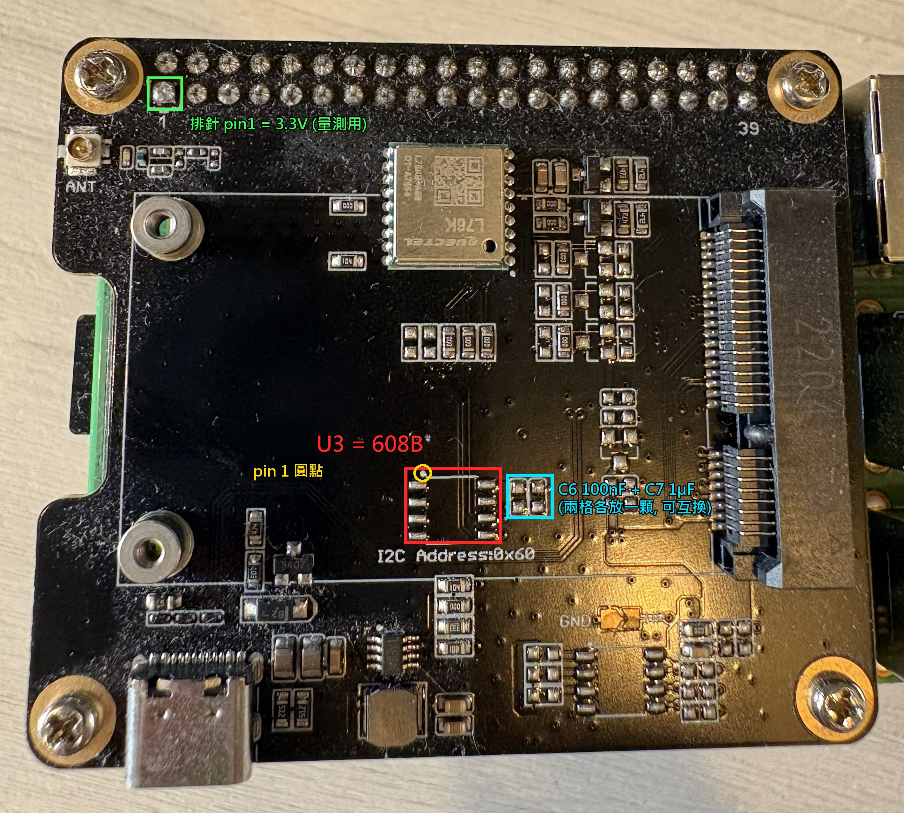
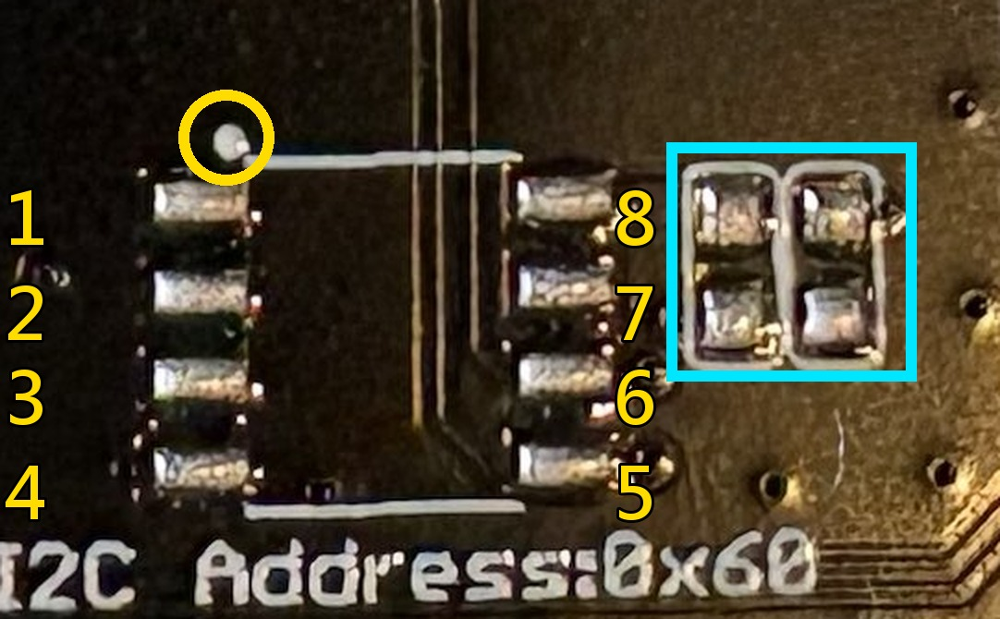

# #255 焊接日與實驗台操作手冊（608B：焊接 → E0a → E1 → E2 → E3）

照表操課用。從拿起烙鐵到實驗 E3 結束，每一步寫明：做什麼、預期看到什麼、看到別的怎麼辦。
設計依據：`docs/design/255-608b-config.md` §8（實驗清單）、`docs/design/255-608b-impl.md` §5、`docs/design/security-architecture.md`。這份手冊不新增任何設計。
審查：`docs/design/255-reviews/review-rig-runbook.md`。第一輪 0 BLOCKER / 6 MAJOR / 11 MINOR，全部已改；複核 APPROVE（0 / 0 / 6），那 6 個小項也已改進本版。

**範圍**
- ✅ 包含：焊 608B 與去耦電容、焊 RTC、實驗台開機、E0a（只讀掃描）、E1（只讀晶片）、E2（鎖定前的寫入與亂數）、E3（寫入設定影像並讀回）。
- ❌ 不包含：**E4（鎖設定區）以後的所有步驟**。鎖定不可逆，要等 E1–E3 的結果回填、PR D2 的工具做好、而且另外取得同意。本手冊用的工具 `se-lab` **沒有任何鎖定指令**（✅ 審查對過原始碼），照這份做不會把晶片鎖死。
- ❌ 不碰 02、04。全程只用實驗台（一台專用的 Pi 加一片備用 WM1302 HAT）。

**E0a–E3 不留下永久改變**：E3 寫進去的設定影像在鎖定前可以重寫。唯一回不去的是焊接本身。

標記：✅ 已對過原始碼、設計或實物照片；⚠️ 推論、憑資料記憶，或還沒在真晶片上驗過。

**通用規則：看到「停」就停。** 不要往下做、不要換參數重試、不要重焊。把當時的輸出帶回來。

---

## 0. 開始前的清單

| 項目 | 說明 |
|---|---|
| 備用 WM1302 HAT | U3 是空焊盤、絲印 `I2C Address:0x60` 的那一版（✅ 實物照片，見 §1）。**不是 02、04 上的那兩片** |
| ATECC608B-SSHDA-B | 1 顆（手上 10 顆）。這顆是「第 1 顆」，之後會被鎖成變體設定，屬於消耗品 |
| 0603 電容 | 100 nF × 1（C6）、1 µF × 1（C7） |
| Adafruit DS3231 模組（#3013）+ CR1220 | RTC，焊在同一台實驗 Pi 上 |
| 實驗台的 Pi | 不是 02、04。型號開機後記錄（§3.2）。**不需要插 HaLow 卡** |
| SD 卡 | 燒 Raspberry Pi OS Lite（64 位元） |
| 工具 | 烙鐵（約 320 °C；鑿形 2.4D 或刀頭）、有鉛 63/37 0.5 mm 焊錫、助焊劑、吸錫線、鑷子、放大鏡、三用電表、防靜電手環、絕緣膠帶 |
| 開發機 | DSKT-MOONLIGHT（Git Bash 與 WSL Ubuntu-24.04），用來編 `se-lab` |

---

## 1. 焊 608B 與去耦電容（HAT 上）

照片（已標註；**照片的擺法是 40 支腳的排針在上方**，以下的「左上」「右邊」都以這個擺法為準）：





### 1.1 位置與方向

- **U3** 在 HAT 中央偏下，絲印 `I2C Address:0x60` 的正上方，位在 mPCIe 插卡的範圍內。**有插卡的話先拔掉**（它蓋住 U3）。
- **Pin 1 = 左上角，旁邊有白色圓點**（近照的黃圈）。晶片本體上的圓點或缺角對齊它。左排由上到下是 1、2、3、4；右排由下到上是 5、6、7、8。
- 晶片腳位（✅ 608B 的 SOIC-8 腳位）：1、2、3、7 不接；4 = GND；5 = SDA；6 = SCL；8 = VCC。
- 板上的走線（⚠️ 來自 Seeed 設計檔，那是絲印 `0x59` 的版本；**本板在 §1.2 用電表確認**）：

| 腳 | 預期接到 |
|---|---|
| 4 | 地 |
| 5（SDA） | 排針第 3 腳；板上有 4.7 kΩ 上拉 |
| 6（SCL） | 排針第 5 腳；板上有 4.7 kΩ 上拉 |
| 8（VCC） | `LORA_3V3`：HAT 自己的 3.3 V 降壓輸出，**不是** Pi 排針第 1 腳的 3.3 V |

- **C6、C7**：U3 右邊並排的兩組 0603 焊盤（照片的藍框）。兩顆都是 VCC 對地的去耦電容，**100 nF 和 1 µF 哪一顆放哪一組都可以**。
  **每顆電容直放**，跨在同一組的上、下兩個焊盤；**不要橫跨兩組**。
- **排針的腳位怎麼數**：照片綠框是第 1 腳。**同一排**（印有 1…39 的那一排）往右第二個焊點是第 3 腳，第三個是第 5 腳。第 2、4 腳在另一排，是 5 V。

### 1.2 焊之前：用電表確認空焊盤（HAT 沒插在 Pi 上、沒通電）

這塊板和設計檔不是同一版，花兩分鐘確認走線。**任何一項不符合就停，不要焊**。

| # | 量哪裡（空焊盤） | 預期 | 記錄 |
|---|---|---|---|
| a | U3 焊盤 4 ↔ HAT 上標 `GND` 的焊盤 | 導通 | |
| b | U3 焊盤 5 ↔ 排針第 3 腳 | 導通 | |
| c | U3 焊盤 6 ↔ 排針第 5 腳 | 導通 | |
| d | U3 焊盤 8 ↔ 藍框兩組焊盤各自的其中一個 | 導通 | **記下是上面還是下面那個**（這是電容的 VCC 焊盤） |
| e | 藍框兩組焊盤各自的另一個 ↔ `GND` | 導通 | |
| f | U3 焊盤 8 ↔ 排針第 2 腳（5 V） | **不導通** | |
| g | U3 焊盤 5 ↔ 焊盤 8、焊盤 6 ↔ 焊盤 8（電阻檔） | 各約 4.7 kΩ | 讀不到就記「沒有上拉」，**可以繼續**（Pi 自己有上拉） |
| h | U3 焊盤 8 ↔ 焊盤 4（電阻檔） | 記下讀值 | §1.4 拿來比 |

### 1.3 焊接步驟

1. 斷電。HAT 從 Pi 上拔下來焊。戴防靜電手環。
2. 在 U3 的**一個角落焊盤**（例如第 4 腳）上先上一點錫。
3. 用鑷子把晶片放上去，**確認 pin 1 的圓點在左上角**，熔那一點錫把晶片固定住。
4. 用放大鏡看八隻腳都對準焊盤。歪了就重熔那一腳調整，**這時候改還來得及**。
5. 上助焊劑，逐腳焊完其餘七腳，最後回頭補第一腳。
6. 焊 C6、C7：先在一邊焊盤上錫 → 鑷子夾電容推上去 → 焊另一邊。
7. 放大鏡檢查：沒有相鄰腳連錫（特別是第 5、6 腳之間）、每隻腳的錫都爬到腳上。

### 1.4 焊完、上電前的電表檢查（HAT 仍然沒插在 Pi 上）

**探棒輕輕點在晶片腳的肩部（腳本身的金屬），不是焊盤，不要用力壓。** 點在焊盤上，就算腳沒焊到也會導通。

| 量哪裡 | 預期 | 不符合時 |
|---|---|---|
| U3 第 4 腳（腳本身）↔ `GND` 焊盤 | 導通 | 第 4 腳沒焊好，補焊 |
| U3 第 5 腳（腳本身）↔ 排針第 3 腳 | 導通 | 第 5 腳沒焊好，補焊 |
| U3 第 6 腳（腳本身）↔ 排針第 5 腳 | 導通 | 第 6 腳沒焊好，補焊 |
| U3 第 8 腳（腳本身）↔ §1.2 d 找到的電容 VCC 焊盤 | 導通 | 第 8 腳沒焊好，補焊 |
| U3 第 5 腳 ↔ 第 6 腳 | **不導通** | 連錫，用吸錫線清掉 |
| U3 第 8 腳 ↔ 第 4 腳（電阻檔） | **不是 0 Ω**，和 §1.2 h 的讀值相近（電容充電時讀值會爬升，屬正常） | 0 Ω = 短路，**不要上電**，檢查電容底下與相鄰腳 |

**上電前最後確認：晶片的 pin 1 圓點在近照黃圈那一角。方向不對不要上電。**（晶片轉了 180° 的話，上面每一項電表檢查都照樣會過。）

---

## 2. 焊 RTC（Pi 上）

RTC 和 608B 在同一條 I2C 匯流排上。裝在同一台實驗 Pi，是為了讓 E0a 確認「喚醒 608B 的脈衝不會干擾 RTC」。

**斷電、拔掉 SD 卡、HAT 不在 Pi 上時才焊。** 背面的線頭用膠帶固定；Pi 不要放在金屬桌面上。

### 2.1 接線（焊在 Pi **背面**的排針焊點）

| DS3231 模組 | Pi 排針 | 注意 |
|---|---|---|
| VIN | **第 1 腳（3.3 V）** | **絕對不要接 5 V**：模組的 I2C 上拉電阻接在 VIN（⚠️ 憑 Adafruit 板子的資料），接 5 V 會把 5 V 灌進 Pi 的 GPIO |
| SDA | 第 3 腳 | |
| SCL | 第 5 腳 | |
| GND | **第 9 腳** | 不用第 6 腳（它緊鄰第 4 腳的 5 V） |
| BAT、32K、SQW、RST | 不接 | |

- 第 1、3、5、7、9 腳在**同一排**（離板邊較遠的那排）；第 7 腳（1 與 9 之間第四個）不接。
- **從背面看，排針是左右相反的。不要用「左邊／右邊」找腳，用 §2.2 的電表結果找。**
- 線長 10–15 cm 以內。CR1220 電池正極朝上（⚠️ 憑 Adafruit 板子的資料；以電池座上的 + 標示為準）。

### 2.2 焊之前：用電表找對焊點（探背面要焊的焊點，對正面的排針）

| 量哪裡 | 預期 | 意思 |
|---|---|---|
| 正面第 2 腳 ↔ 第 4 腳 | 導通 | 這兩支是 5 V，確認數的方向對 |
| 背面「要焊 VIN 的焊點」↔ 正面第 17 腳 | 導通 | 第 1 與第 17 腳都是 3.3 V，板內相連 |
| 背面「要焊 VIN 的焊點」↔ 正面第 2 腳 | **不導通** | 不是 5 V |
| 背面「要焊 GND 的焊點」↔ USB 或 HDMI 插座的金屬外殼 | 導通 | 是地 |
| 背面「要焊 SDA 的焊點」↔ 正面第 3 腳 | 導通 | 位置對 |
| 背面「要焊 SCL 的焊點」↔ 正面第 5 腳 | 導通 | 位置對 |

**任何一項不符合就停，重新找焊點，不要焊。**

### 2.3 焊完的檢查

斷電時：

| 量哪裡 | 預期 |
|---|---|
| 模組 VIN ↔ 模組 GND | 不導通 |
| 模組 VIN ↔ 正面第 2 腳（5 V） | 不導通 |

然後**只接電源開機（不插 SD 卡也可以，HAT 還不要裝）**，量：

| 量哪裡 | 預期 | 不符合時 |
|---|---|---|
| 模組 VIN ↔ GND | 3.2–3.4 V | **超過 3.6 V：立刻斷電，停**。低於 3.2 V（含 0 V）：斷電，停，檢查焊點 |
| 模組 SDA ↔ GND、SCL ↔ GND | 3.2–3.4 V | **超過 3.6 V：立刻斷電，停**。低於 3.2 V（含 0 V）：斷電，停，檢查焊點 |

---

## 3. 實驗台開機

### 3.1 系統

1. SD 卡燒 **Raspberry Pi OS Lite（64 位元）**，開 SSH。
2. **斷電**後把 SD 卡插回去（§2 焊接前拔掉的），再把 HAT 插回 Pi（不插 HaLow 卡）。**40 支腳全部對齊，沒有錯開一排或一格**（錯開會把 5 V 送進 GPIO）。再確認一次晶片 pin 1 的方向。
3. 上電。**10 秒內用手指碰一下 608B：會燙就立刻斷電，停。**
4. **量電容的 VCC 焊盤（§1.2 d）對地 = 3.2–3.4 V。沒有電壓就停**：`LORA_3V3` 沒供電，後面全部不用做。
5. 開 I2C、裝工具（實驗台這一步要能上網）：

```sh
sudo raspi-config nonint do_i2c 0
sudo apt-get update
sudo apt-get install -y i2c-tools
```

### 3.2 記錄環境

以下每一行的輸出都存進 `/dev/shm/e0a.txt`。

```sh
cd /dev/shm
set -o pipefail
tr -d '\0' < /proc/device-tree/model | tee -a e0a.txt; echo | tee -a e0a.txt
ls -l /dev/i2c-1 2>&1 | tee -a e0a.txt
od -An -tx1 /sys/bus/i2c/devices/i2c-1/of_node/clock-frequency 2>&1 | tee -a e0a.txt
ls /sys/bus/i2c/devices/ 2>&1 | tee -a e0a.txt
```

| 輸出 | 預期 | 不符合時 |
|---|---|---|
| model | Pi 的型號 | 只記錄（設計裡標 ⚠️ 的一項） |
| `/dev/i2c-1` | 存在；通常是 `crw-rw---- root i2c` ⚠️ | 不存在：`sudo reboot`，重開後**把 §3.2 整段重做**（重開機會清掉 `/dev/shm`）；還是沒有就**停** |
| clock-frequency | ` 00 01 86 a0`（= 100 kHz） | 不是這個值就**停**（喚醒脈衝要求 ≤ 100 kHz） |
| devices | 只有 `i2c-N` 這種名稱（那是匯流排本身） | 出現 `1-00xx` 這種名稱 = 核心在 1 號匯流排上綁了一個裝置：**停**。其他匯流排上的 `N-00xx`：只記錄 |

> 新開的 SSH 連線都要先下 `cd /dev/shm; set -o pipefail`。`set -o pipefail` 讓後面每一行印出的 `rc=` 是 `se-lab` 自己的結束代碼。
>
> **`/dev/shm` 在重開機或斷電時會清空。** 從這裡到 §8 結束，途中如果實驗台重開機或斷電：**停**，先回報已經做到哪一步（除了上面 `/dev/i2c-1` 不存在的那一次重開）。

---

## 4. E0a：只讀掃描匯流排

**晶片預設在睡眠，掃描時 `60` 通常不會出現，這是正常的。**

```sh
i2cdetect -y -r 1 2>&1 | tee -a e0a.txt
```

`-r` 是用讀取來探測，不送 quick-write（設計的要求）。

| 看到 | 意思 | 怎麼辦 |
|---|---|---|
| 出現 `68`，其他都是 `--` | RTC 在，608B 在睡 | 繼續 |
| 另外也出現 `60` | 608B 被匯流排上的 0x00 位元組叫醒了，正常 | 記下來，繼續 |
| 沒有 `68` | RTC 沒接好 | 回 §2 檢查。608B 的實驗可以繼續，但「不干擾其他裝置」就驗不到，要記下來 |
| 出現 `60`、`68` 以外的位址 | 有不認識的裝置 | **停** |

記下 RTC 現在的狀態，等一下叫醒 608B 之後再比一次：

```sh
i2ctransfer -y 1 w1@0x68 0x00 r7 2>&1 | tee -a e0a.txt
i2ctransfer -y 1 w1@0x68 0x0e r2 2>&1 | tee -a e0a.txt
```

第一行是時間的七個暫存器，第二行是控制與狀態暫存器。

---

## 5. 編 `se-lab` 並放上實驗台

`se-lab` 在分支 `feat/255-se608-core`（PR #380，還沒合併；實驗工具不進任何映像，直接從分支編就可以）。

**先在 Windows 這邊（Git Bash）記下 commit**（這個資料夾是 worktree，在 WSL 裡下 git 指令會失敗）：

```sh
git -C C:/src/Batman-255d log --oneline -1
git -C C:/src/Batman-255d status --short
```

第一行預期 `a62c5a0`（分支有新 commit 時會不同，照實記）；第二行預期沒有輸出。

**然後在 WSL 編**（✅ 審查實跑過這一行，結束代碼 0）：

```sh
cd /mnt/c/src/Batman-255d/feed/batman-prov/src
export PATH=/home/yello/go/pkg/mod/golang.org/toolchain@v0.0.1-go1.26.4.linux-amd64/bin:$PATH
GOFLAGS=-mod=vendor GOTOOLCHAIN=local CGO_ENABLED=0 GOOS=linux GOARCH=arm64 go build -o /tmp/se-lab ./cmd/se-lab
sha256sum /tmp/se-lab
```

把雜湊記下來。複製到實驗台的 **tmpfs**（設計要求不落地）：

```sh
scp /tmp/se-lab <使用者>@<實驗台>:/dev/shm/se-lab
```

實驗台上：

```sh
chmod +x /dev/shm/se-lab
sha256sum /dev/shm/se-lab
```

雜湊要和開發機上的相同。

**`se-lab` 的結束代碼**（✅ `cmd/se-lab/main.go`）：0 完成；1 晶片或匯流排失敗；2 用法錯誤；3 拒絕（版本不對、晶片不在清單、設定區已鎖、位元組 17 不符、匯流排被別的程式佔用）；4 比對不同。

**規則：任何一步出現 `rc=1`（§6 的 `info` 另有處理）、`rc=2`、`rc=3`，都停。** 不要重跑、不要改檔案，把該步的輸出檔帶回來。`rc=1` 出現在 `write-image` 時晶片可能只寫了一部分；這沒有壞處（未鎖、可重寫），但下一步由設計決定。

讀不到 `/dev/i2c-1`（Permission denied）時，在 `./se-lab` 前面加 `sudo`。

---

## 6. E1：只讀晶片（版本、序號、設定區）

```sh
cd /dev/shm
set -o pipefail
./se-lab info 2>&1 | tee e1-info.txt; echo "rc=$?" | tee -a e1-info.txt
```

**⚠️ 這是 `se-lab` 第一次碰到真晶片。** 它的喚醒方式、時序與狀態碼都是照 datasheet 摘要寫的，還沒在真晶片上驗過（程式裡標 `PROVISIONAL`）。
**`info` 印 `rc=1` 時：最多再試兩次（總共三次），都失敗就做 §9 的原始測試，把結果帶回來。不要自己改參數。**
**每次重試之前先把上一次的輸出改名留下來**（錯誤訊息是之後修正時序要用的證據）：第一次失敗後下 `mv e1-info.txt e1-info-fail1.txt`，第二次失敗後下 `mv e1-info.txt e1-info-fail2.txt`，再重跑上面那一行。

`info` 成功（`rc=0`）後：

```sh
./se-lab dump 2>&1 | tee e1-dump.txt; echo "rc=$?" | tee -a e1-dump.txt
```

| 欄位 | 預期 | 不符合時 |
|---|---|---|
| `revision=` | `00006003` | **不是就停**（工具自己也會印 `rc=3`）。這不是我們要的 608B |
| `serial=` | 18 個十六進位字元。開頭 `0123`、結尾 `ee` 是 Microchip 晶片的固定樣式 ⚠️ | 只記錄 |
| `lock_config=` | `55`（未鎖） | 不是 `55` = 這顆已經被鎖過：**停**，換一顆晶片要另外安排 |
| `lock_data=` | `55`（未鎖） | 同上 |
| `config[ 16]=` 那一行的第一個位元組 | `c0`（I2C 位址 0x60） | 只記錄 |
| `byte13=`、`byte17=`、`byte19=` | 兩個十六進位字元 | 只記錄。**`byte17` 後面要用** |

馬上比一次 RTC，並再掃一次匯流排（E0a 的後半：喚醒脈衝不能干擾其他裝置）：

```sh
i2ctransfer -y 1 w1@0x68 0x00 r7 2>&1 | tee -a e0a.txt
i2ctransfer -y 1 w1@0x68 0x0e r2 2>&1 | tee -a e0a.txt
i2cdetect -y -r 1 2>&1 | tee -a e0a.txt
```

| 預期 | 不符合時 |
|---|---|
| 時間比 §4 那次往前走了合理的秒數 | **停** |
| 控制與狀態兩個位元組和 §4 相同 | 只有第二個位元組的 bit 2 不同（例如 `0x88` 對 `0x8c`）：那是 RTC 正在量溫度，再讀一次，仍然只差這一位就算相同。其他不同：**停** |
| 掃描結果和 §4 一樣（`60` 有沒有出現不算差異） | **停** |

再記一項：有沒有裝置回應一般呼叫位址。

```sh
i2ctransfer -y -a 1 w1@0x00 0x00 2>&1 | tee -a e0a.txt; echo "general-call rc=$?" | tee -a e0a.txt
```

印 `Error: Sending messages failed`、`rc` 不是 0 屬正常（沒有裝置回應）。`rc=0` 表示有裝置回應了位址 0x00，只記錄。

---

## 7. E2：設定區鎖定前的行為

### 7.1 犧牲晶片清單（由開發機產生，設計 §8.0 的要求）

在**開發機**上：

```sh
scp '<使用者>@<實驗台>:/dev/shm/e1-info.txt' .
grep '^serial=' e1-info.txt | cut -d= -f2 > allow.txt
cat allow.txt
scp allow.txt <使用者>@<實驗台>:/dev/shm/allow.txt
```

`allow.txt` 是一行、18 個十六進位字元，**用眼睛和 `e1-info.txt` 的 `serial=` 比對一次**。

### 7.2 設定 `byte17`

回到實驗台：

```sh
cd /dev/shm
set -o pipefail
B17=$(grep '^byte17=' e1-dump.txt | cut -d= -f2); echo "byte17=$B17"
```

要印出兩個十六進位字元（例如 `byte17=3b`）。不是就**停**。**新開的 SSH 連線要重新下這三行。**

### 7.3 實驗

```sh
./se-lab -allow allow.txt data-write 6 2>&1 | tee e2-write.txt; echo "rc=$?" | tee -a e2-write.txt
./se-lab -allow allow.txt random 2>&1 | tee e2-random.txt; echo "rc=$?" | tee -a e2-random.txt
```

| 指令 | 預期 | 不符合時 |
|---|---|---|
| `data-write 6` | `data_write_slot6=status_XX`、`rc=0`（**寫入被晶片拒絕**；記下 `XX`）。⚠️ 預期 `0f` | 印出 `data_write_slot6=accepted` = 鎖定前資料區竟然可寫：**停**（要修改設計 §5） |
| `random` | `random=` 後面 64 個十六進位字元、`rc=0`。⚠️ 預期是固定的測試樣式 `ffff0000` 重複 | 是別的值就照實記錄，不算失敗 |

---

## 8. E3：寫入變體設定影像並讀回

先在不碰晶片的情況下印出要寫的影像與雜湊：

```sh
./se-lab -byte17 "$B17" image 2>&1 | tee e3-image.txt; echo "rc=$?" | tee -a e3-image.txt
```

然後寫入（只寫和晶片現況不同的字組；寫完自動讀回比對）：

```sh
./se-lab -allow allow.txt -byte17 "$B17" write-image 2>&1 | tee e3-write.txt; echo "rc=$?" | tee -a e3-write.txt
```

| 輸出 | 預期 | 不符合時 |
|---|---|---|
| `written_words=` | 1 到 23 之間的數字（上限 23 ✅；實際值取決於空白晶片的出廠值 ⚠️） | — |
| `compare=` 與 `rc=` | `compare=EQUAL`、`rc=0` | `compare=DIFFERENT`、`rc=4`：輸出會列出哪些位元組不同。**停，不要自己重寫** |
| `rc=3` 且訊息是 `chip byte 17 = xx, -byte17 = yy` | — | `B17` 設錯：照 §7.2 重設後**重跑一次** |
| `rc=3` 且是其他訊息 | — | **停**。不要改 `allow.txt` |
| `rc=2` 且訊息提到 `needs -byte17` | — | 新開的連線沒有設 `B17`：照 §7.2 重設後**重跑一次**。這是 §5「`rc=2` 就停」的唯一例外 |

再確認穩定：

```sh
./se-lab -byte17 "$B17" compare 2>&1 | tee e3-compare.txt; echo "rc=$?" | tee -a e3-compare.txt
./se-lab -allow allow.txt -byte17 "$B17" write-image 2>&1 | tee e3-rewrite.txt; echo "rc=$?" | tee -a e3-rewrite.txt
./se-lab dump 2>&1 | tee e3-dump.txt; echo "rc=$?" | tee -a e3-dump.txt
```

| 檔案 | 預期 |
|---|---|
| `e3-compare.txt` | `compare=EQUAL`、`rc=0` |
| `e3-rewrite.txt` | `written_words=0`（已經一樣，不再寫）、`compare=EQUAL`、`rc=0` |
| `e3-dump.txt` | `lock_config=55`、`lock_data=55`（仍未上鎖） |

**最後一步：斷電之前，在開發機上把結果複製出來**（tmpfs 關機就消失）：

```sh
scp '<使用者>@<實驗台>:/dev/shm/*.txt' <目的資料夾>/
```

**到這裡停。** 晶片現在是「變體影像、未鎖」。E4 會把它鎖死，不在這份手冊裡。

---

## 9. `info` 失敗時的原始測試（不靠 `se-lab`）

**整行一次貼上再按 Enter**（晶片醒著只有 0.7–1.7 秒，分兩行打一定來不及）：

```sh
i2ctransfer -y -a 1 w1@0x00 0x00; i2ctransfer -y 1 r4@0x60 2>&1 | tee -a raw-wake.txt; echo "rc=$?"
```

前半是喚醒脈衝，它印 `Error: Sending messages failed`（NACK）屬正常。**做三次。**

| 後半的輸出 | 意思 | 怎麼辦 |
|---|---|---|
| `0x04 0x11 0x33 0x43` | 晶片是好的、醒得來。問題在 `se-lab` 的時序或格式 | **不要重焊**。把 `e1-info.txt` 與 `raw-wake.txt` 帶回來 |
| 三次都讀取失敗（I/O error） | 晶片沒回應 | 斷電後依序檢查：電容 VCC 焊盤的電壓（§3.1）、pin 1 方向、§1.4 的導通。找不到原因就**停** |
| 其他四個位元組 | — | 記下來帶回來，**停** |

---

## 10. 要帶回來的東西

`/dev/shm` 裡的檔案（§8 最後一步的 `scp` 會一次帶走）：

`e0a.txt`、`e1-info.txt`、`e1-dump.txt`、`allow.txt`、`e2-write.txt`、`e2-random.txt`、`e3-image.txt`、`e3-write.txt`、`e3-compare.txt`、`e3-rewrite.txt`、`e3-dump.txt`，以及有做 §9 時的 `raw-wake.txt`。

另外手寫記下：

| 項目 | 來源 |
|---|---|
| §1.2 的電表結果（特別是 d：電容的 VCC 焊盤是上面還是下面；g：有沒有上拉；h 的讀值） | §1.2 |
| 上電後電容 VCC 焊盤的電壓 | §3.1 |
| `se-lab` 的 commit 與 sha256 | §5 |
| 任何和「預期」不同的地方，連同當時的完整輸出 | 全部 |

這些結果用來：把 `se608` 裡標 `PROVISIONAL` 的喚醒、時序、狀態碼換成實測值；把晶片設定文件裡的 `byte17` 與影像雜湊定下來；然後做 PR D2（含鎖定指令的工具）。**之後才輪到 E4。**

---

## 11. 規則（每一步都適用）

- **每次要動實驗台之前先取得同意**（設計 §8.0）。這份手冊由使用者本人執行時，本人就是同意者；交給別人或交給助理代跑時，每一節開始前要再問一次。
- 看到任何「停」，就停。
- 不要用這份手冊以外的指令去寫晶片。`se-lab` 會拒絕不在清單上的晶片、版本不對的晶片、已鎖的晶片。
- 不碰 02、04。
