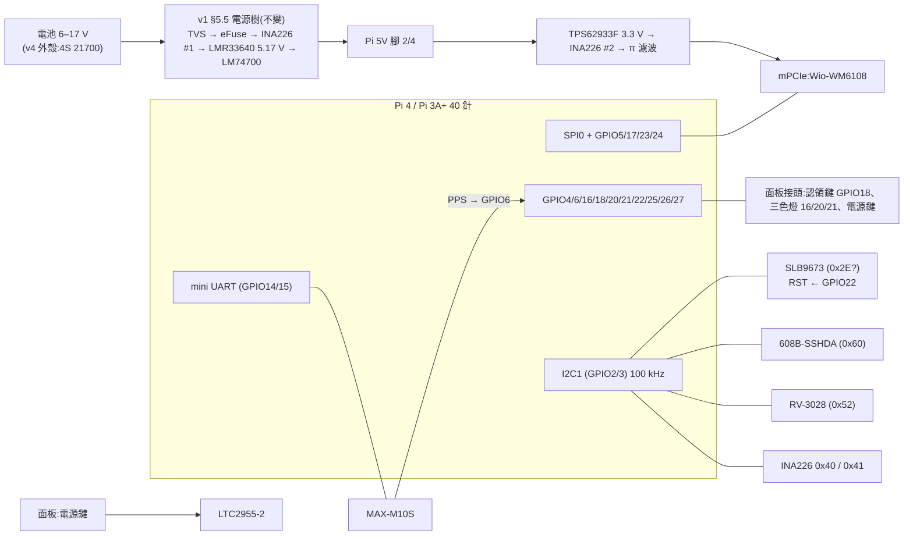

# Batman HAT v2:新 HAT 規格(Pi 4 與 Pi 3A+ 共用)

狀態:**DRAFT v0.4**(2026-10-20;v0.2 依使用者對 O2、O4–O7 的決定修訂;v0.3 QR 改貼本體底面;v0.4 用 3A+ 官方文件補 §5.5、§6.4、§6.5),**尚未經對抗式審查**。審查依 `docs/design/REVIEW.md`,交給獨立 reviewer 審整份。
主單:#227。決策單:#240。需求來源:#219 §8.5(H1–H11)、#256、#300、#302。外殼:#228。軟體配合:#223(#224–#226)、#239。

> 標記慣例(沿用 `hat-v1-spec.md`):**【事實】** = 本專案實測、原始碼、規格書或 repo 檔案可查證;**【推論】** = 由事實推出、尚未實測;**【決策】** = 使用者已拍板(附日期);**【提案】** = 本文提出、待審查或待使用者拍板;**【待量測】** = 要實物量過才能定;**【搜尋結果】** = 只看到搜尋摘要,原文被本環境的網路代理擋住,要人工下載確認。

---

## 0. 一句話

以 `hat-v1-spec.md`(DRAFT v2)為底,**電源電路原封沿用**。改的是三件事:
- 安全與 GPIO:TPM 改 I2C 版 SLB9673、安全晶片改 608B-SSHDA、GNSS 改走 mini UART。
- 讓同一片 HAT **在 Pi 3A+ 也能用**。
- 加上民用供裝要的按鍵與三色燈。

板子為此往 SD 卡端加長,長度由面積需求決定,外殼配合。

## 1. 與 v1 的差異

| # | 項目 | v1(`hat-v1-spec.md`) | v2(本文) | 來源 |
|---|---|---|---|---|
| D1 | TPM | SLB9672,SPI1(GPIO18–21),RST GPIO16,PIRQ GPIO22 | **SLB9673,I2C1**;RST **GPIO22**;PIRQ 不接(輪詢) | 【決策】使用者 2026-10-20 |
| D2 | 安全晶片 | ATECC608C-TFLXTLS(0x36) | **ATECC608B-SSHDA**(未設定版,0x60),所有 SKU 都焊 | 【決策】#107、#240、#219 H1 |
| D3 | RTC | RV-3028-C7 | 不變,保留 | 【決策】使用者 2026-10-20 |
| D4 | GNSS 介面 | UART5(GPIO12/13),Pi 4 限定 | **GPIO14/15(兩塊板都是 mini UART)** | 【決策】走 UART、3A+ 用 mini UART(2026-10-20);接腳為【提案】 |
| D5 | 序列主控台 | Tag-Connect 引出 UART0 | **HAT 上沒有任何序列主控台**;規則:主控台永遠不和周邊共用 UART | #302;【提案】 |
| D6 | 適用主機 | 只有 Pi 4 | **Pi 4(bcm2711)與 Pi 3A+(bcm2710)** | #219 H7 |
| D7 | 按鍵 / 燈 | 只有電源鍵(LTC2955) | 加**認領鍵**(GPIO18)與**三色燈**(GPIO16/20/21),經面板接頭引到外殼 | #219 H2–H5、#128 |
| D8 | QR | 無 | **不在 HAT 上**:貼在通訊本體底面,被電池盒蓋住(§5.8) | 【決策】使用者 2026-10-20 |
| D9 | USB hub | — | **不上 HAT** | 【決策】2026-10-20 |
| D10 | 外形 | 65 × 56.5 mm | **長邊往 SD 卡端加長,上限 10 mm**;寬、Pi 固定孔、40 針位置不變 | 【決策】外形 2026-10-20;加長量依面積定、外殼配合(2026-10-20) |
| D11 | 電源 | HAT 上全套(§5.5) | **不變**,電源留在 HAT;外殼 v4 的 Mini560 / INA226 / DS3231 模組改由 HAT 取代 | 【決策】使用者 2026-10-20 |
| D12 | 安全網路的可選焊位 | 未規定 | **安全相關網路上不留任何 DNP / 跳線 / 0 Ω 可選焊位** | #300 |

## 2. 範圍與需求

### 2.1 放上 HAT 的
- mPCIe 插槽(Wio-WM6108),HaLow 腳位照 v1 §4.1,一支都不動。
- TPM 2.0 **Infineon SLB9673**(I2C)。
- **ATECC608B-SSHDA**(SOIC-8)。
- RTC **RV-3028-C7** + 超級電容。
- GNSS **u-blox MAX-M10S** + 主動天線偏壓。
- 電源:v1 §5.5 全部,包括 eFuse、5 V 與 3.3 V 降壓、兩顆 INA226、LTC2955 軟開關機、BAT_PRESENT。
- 面板接頭:電源鍵、認領鍵、三色燈。

### 2.2 不放上 HAT 的
- PTT 音訊、LoRa:理由見 v1 §8,不變。
- **USB hub**:沿用外殼 #228 的外接 hub 模組【決策】。理由:上游訊號不在 40 針排針上,一定要另接線;hub 晶片加周邊約 150–250 mm²【推論】,會吃掉大部分加長出來的面積。
- HAT ID EEPROM:v1 §5.7 已拿掉,不變。

### 2.3 需求對照(#219 §8.5)

| # | 需求 | v2 怎麼滿足 | 狀態 |
|---|---|---|---|
| H1 | 所有 SKU 焊 608B-SSHDA | §5.2 | 滿足 |
| H2 | 瞬時認領鍵,與電源鍵分開 | GPIO18,經面板接頭(§5.6) | 滿足 |
| H3 | 凹陷、免工具、戴手套可按、有燈號回饋 | 按鍵本體在**外殼**上(#228);燈號回饋由三色燈 | 外殼負責 |
| H4 | 接開機預設下拉的 GPIO,按下拉到 3V3 | GPIO18 開機預設下拉(BCM2711 / BCM2837 相同,#219 引述) | 滿足 |
| H5 | 三色燈 GPIO 16 / 20 / 21 | §4、§5.6 | 滿足 |
| H6 | 608B 所在的 HAT 上留 QR 區 | **不採用**:HAT 封在殼裡看不到;QR 改貼在本體底面、被電池盒蓋住(§5.8) | 改需求,#219 §8.5 已同步 |
| H7 | 3A+ 可用,BT 開著 | GNSS 走 GPIO14/15 mini UART,BT 留在 PL011(§5.4) | 滿足,待驗 V3 |
| H8 | USB hub | 不上 HAT(D9) | 不採用,外殼處理 |
| H9 | 民用不需要 RTC | RTC 保留給 T 系列與 GNSS 冷啟動;民用設計不依賴它 | 相容 |
| H10 | 不擋板載藍牙天線 | 兩塊板各自的天線禁佈區(§6.4) | 3A+ 天線位置【待量測】 |
| H11 | QR 與按鍵不用拆外殼就碰得到 | 按鍵:面板接頭引到外殼;QR:轉開電池盒即可看到,不用工具 | 滿足(外殼負責;空間待 V15) |

## 3. 方塊圖



## 4. GPIO 分配(兩塊板相同)

BCM2711 與 BCM2837 的 40 針 GPIO 編號相同【事實,`docs/hardware.md`「GPIO numbering is unchanged on the 40-pin header」】。開機預設:GPIO0–8 上拉、9–27 下拉【事實,#219 §8.5 H4 引述;兩顆 SoC 相同】。

| GPIO | 用途 | 開機預設 | 為什麼這樣選 |
|---|---|---|---|
| 0 / 1 | 不接 | 上拉 | HAT+ 規格 §2.3:只能接 ID EEPROM【事實,v1】 |
| 2 / 3 | I2C1:SLB9673、608B 0x60、RV-3028 0x52、INA226 0x40 / 0x41 | 上拉 | 維持 100 kHz(608B 喚醒脈衝,v1 §7) |
| 4 | BAT_PRESENT(低 = 有電池) | 上拉 | 不變(v1) |
| 5 | HaLow IRQ | — | 不動 |
| 6 | GNSS PPS | — | 補上 WM1302 拿不到 PPS 的缺口(#300 B-1) |
| 7 | **不可用**(SPI0 CE1) | — | 不變(v1) |
| 8–11 | HaLow SPI0 | — | 不動 |
| 12 | 保留 | 下拉 | 備案:若 SLB9673 需要時脈延展,TPM 改走 GPIO12/13 的軟體 I2C(O3) |
| 13 | 保留 | 下拉 | 同上 |
| **14 / 15** | **GNSS UART**(TXD → GNSS RX、RXD ← GNSS TX) | — | 3A+ 的 BT 佔 PL011 → 14/15 只能用 mini UART;Pi 4 同接法(D4、§5.4) |
| **16** | **燈:紅** | 下拉 | #128;下拉 = 開機時不亮 |
| 17 | HaLow reset | — | 不動 |
| **18** | **認領鍵**(按下 = 3V3) | 下拉 | H4 |
| 19 | 保留(#240 提過「zeroize 開關」,未決) | 下拉 | — |
| **20 / 21** | **燈:綠 / 藍**(顏色對應以 #128 為準) | 下拉 | #128 |
| **22** | **TPM RST#** | 下拉 | 開機預設下拉 + 外加 10 kΩ 下拉 → 每次 SoC 重置都按住 TPM(沿用 v1 GPIO16 的邏輯) |
| 23 / 24 | HaLow wake / busy | — | 不動 |
| 25 | INA226 ALERT | — | 不變(v1) |
| 26 | LTC2955 INT(電源鍵要求關機) | — | 不變(v1) |
| 27 | 軟關機:N-FET → LTC2955 KILL | — | 不變(v1 §5.5.3) |

- **GPIO12、13、19 保留不用**(GPIO19 保留腳位:使用者 2026-10-20)。GPIO12/13 也是 TPM 軟體 I2C 備案的腳。
- **TPM PIRQ 不接**:驅動先用輪詢(v1 已是如此)。省一顆上拉,也少一條要保護的線。
- **燈的驅動**:GPIO 不直接推 LED。每色一顆 N-FET,或用限流電阻接 LED;面板燈的電流與電壓待外殼選料(#128)【提案】。

## 5. 各區塊

### 5.1 TPM 2.0 — Infineon SLB9673

- **為什麼是它**:同系列 SLB9672 的 I2C 版,封裝同為 PG-UQFN-32【事實,#227 留言引 Infineon 規格書】。改 I2C 後:
  - SPI1 四條線、CS 上拉都拿掉;
  - GPIO18–21 空出來,#128 的燈與 H4 的按鍵才有腳可用;
  - 上次 G2 預演失敗原因之一(TPM 的 SPI 腳朝插座、打不下過孔,PLAN §13)消失。
- **認證**【搜尋結果,待人工下載原文確認】:
  - Common Criteria:BSI 證書 **BSI-DSZ-CC-1178-V4-2023**,涵蓋 SLB9673_2.0 v26 韌體,EAL4 加強(AVA_VAN.4、ALC_FLR.1),有效至 2028-07-31([Common Criteria Portal](https://www.commoncriteriaportal.org/files/epfiles/1178V4a_pdf.pdf))。規格書另列 CC-1245。
  - FIPS:**140-2 Level 2**;NIST 有 SLB 9673 FW 27.25 的安全政策。
  - **沒有 FIPS 140-3**:Infineon 論壇回覆「目前產品線沒有 FIPS 140-3 認證的 TPM,140-2 也沒有升級路徑」([Infineon 社群](https://community.infineon.com/t5/OPTIGA-TPM/Looking-for-FIPS-140-3-compliant-TPM/td-p/960207))。
  - ⚠️ FIPS 140-2 證書在美國 CMVP 已陸續轉入「historical」【推論,依 140-2 停發時程】。**若戰術客戶要求 140-3,這顆不符**,見 O2。
- **I2C 位址**:0x2E【搜尋結果,NVIDIA 論壇有人在 0x2E 偵測到;待規格書確認】。不與 0x40 / 0x41 / 0x52 / 0x60 衝突。
- **Linux**:驅動 `tpm_tis_i2c`(`CONFIG_TCG_TIS_I2C`)。DT compatible 依 2022 年的 binding 修補是 `"infineon,slb9673", "tcg,tpm-tis-i2c"`【搜尋結果,LKML;待確認 6.6 核心已合併】。
- **RST#**:接 GPIO22 + 外加 10 kΩ 下拉,由 overlay 的 `gpio-hog` 拉高釋放。沿用 v1 §5.1 的理由:驅動不處理 `reset-gpios`。這一點在 v1 是針對 `tpm_tis_spi` 查證的,**`tpm_tis_i2c` 要重新查**(A5)。
- **時脈延展(clock stretching)風險**:BCM2835/2836/2837 的 I2C 硬體不支援時脈延展,BCM2711 的報告不一致【搜尋結果,raspberrypi/linux #4884 等】。**3A+ 是 BCM2837**:若 SLB9673 會延展 SCL,3A+ 上的 TPM 交易可能讀錯,甚至卡住整條 I2C1(608B、RTC 跟著失效)。
  - 規格書有沒有延展、要多久,**原文未讀到**(A4)。
  - 備案【提案】:TPM 改走 GPIO12/13 的軟體 I2C(`i2c-gpio` overlay,支援延展)。好處是 TPM 和其他晶片分開匯流排。**這要在 bring-up 前用規格書決定,不能等板子回來再改。**
- **資安限制**(沿用 v1 §5.1):PCR 封存擋不住「整片 HAT 移到別台 Pi」。金鑰要綁 Pi OTP,做法是 KDF(TPM 秘密, Pi OTP 私鑰);unseal 一律走 salted session(I2C 共用匯流排可側錄)。
  - **Pi 3A+ 的 OTP 私鑰功能未確認**:Pi 4 的做法依 Raspberry Pi 文件,BCM2837 是否有同等功能要查(A8)。
- **料號**:SLB9673 的戶外溫度版本與料號待規格書(v1 的 SLB9672 有 −40–85 °C 的 XU 版)。

### 5.2 ATECC608B-SSHDA

- 未設定版,I2C **0x60**,SOIC-8;腳位與 608C、TNGLORA 相同【事實,#240、#300】。
- 設定區鎖定不可逆:**槽位配置先在消耗品上實驗**(#219 §8.5、#240)。
- I2C 不接到 mPCIe(本板 mPCIe 第 30、32 腳不接,v1 §4.1)【事實】→ 插卡看不到這條匯流排。
- 出廠初始化由 #219 的燒錄站負責,不在本文範圍。

### 5.3 RTC — RV-3028-C7

不變,見 v1 §5.1 末段與 §5.3:超級電容 CPH3225A,約 2 天;overlay 要帶 `trickle-resistor-ohms`。
- OpenWrt 沒有 `kmod-rtc-rv3028`,要自製,而且兩個 subtarget 都要打包(#240 C8)。

### 5.4 GNSS — MAX-M10S,走 mini UART

- **接腳**:GPIO14(Pi TXD)→ GNSS RXD、GPIO15(Pi RXD)← GNSS TXD。兩塊板都設成 mini UART(`ttyS0`)。
  - 3A+:BT 佔 PL011,mini UART 是唯一還能出到 14/15 的 UART【事實,#219 H7】。
  - Pi 4:接腳相同;BT 也留在 PL011。Pi 4 的 UART2–5 這時都不用。
- **mini UART 的鮑率跟著 core clock 走**:要固定 core clock。
  - 3A+ 的 distroconfig `[pi3]` 已有 `core_freq_min`【事實,`boards-and-builds.md:110`】。HaLow SPI0 的時脈也來自 core_freq(`hardware.md`「One thing to verify」)。
  - **兩者要一起驗**(V3):固定後 GNSS 9600 / 38400 鮑率穩定、HaLow SPI 速率不變。
- **不加 GNSS 電源閘**【決策,使用者 2026-10-20】:新 HAT 一律燒新 image,沒有「舊版系統跑在新 HAT 上」這個選項。#302 的防線是 image 本身:`cmdline.txt` 不開序列主控台、`/etc/inittab` 不在 `ttyS0` 開登入(§8、§12)。
  - 剩下的情況是「有人把舊卡 image 燒到新 HAT」,列為已接受的風險,由燒卡流程擋(§11)。
- 天線:主動式、LNA 前有 SAW 預濾波,加偏壓,不變(v1 §5.4)。
- PPS → GPIO6(`pps-gpio`)。

### 5.5 電源

**電路沿用 v1 §5.5 全部**,包括設計值、模擬、方案 D 電源樹審查。本節只列 v2 的差異:

1. **電源鍵改瞬時型**:LTC2955 的 PB 要瞬時按鍵。v4 外殼現在的開關是自鎖式,直接控制 Mini560 的 EN(`docs/hardware.md`「The switch drives the regulator's EN pin」)。**外殼要換成瞬時按鍵**(#228)。
   - 自鎖式開關改接 LTC2955 的 ON 腳**不可行**:TSOT 版的 SEL 內部接地,ON 下降不會關機(v1 §5.5.2)。
2. **外殼的 Mini560、INA226、DS3231 模組取消**,由 HAT 取代(D11)。保險絲、PTC 留在電池盒,不變(`hardware.md`「All protection lives in the battery pack」)。
3. **3A+ 背饋**(A9 已查,RP-008332-DS-1 簡化電路圖)【事實】:
   - 官方支援經 40 針供 5 V(RP-008331-DS-1 產品簡介「5 V DC via GPIO header」)。
   - micro-USB(J1)→ 自恢復保險絲 F1(Bourns MF-MSMF260,美國)→ `5V` 網路;`5V` 上有 TVS D7(SMBJ5.0A)與 C84 47 µF。**40 針第 2、4 腳直接接 `5V`**,在 F1 之後,中間**沒有防逆流元件**。
   - 推論:
     - HAT 供電時繞過 F1,過流保護全靠 HAT 的 eFuse(v1 已有)。
     - 同時接 micro-USB:HAT 的 5.17 V 會經 F1 倒灌進 USB 電源,和 Pi 4 一樣 → 維持 v1 §5.5.4 的「不建議同時接」。
     - D7 是 5.0 V 工作電壓(standoff)、崩潰電壓最低 6.4 V 的 TVS;HAT 的 5.17 V 高於 5.0 V,TVS 漏電會比規格書標的值大,但遠低於崩潰,不會導通【推論,待量 5V 軌電流 V5】。
4. **3A+ 的 3.3 V 負載**:3V3_PI 供 TPM、608B、RTC、GNSS,估計 < 150 mA(v1 §5.5.5 #15)。
   - 3A+ 的 3.3 V 由電源管理晶片 **XR77004**(MaxLinear,美國)的 VOUT1 降壓供應,經 2.2 µH 電感與 0.3 Ω 電阻(R83)【事實,RP-008332-DS-1】。
   - VOUT1 的額定電流、Pi 自身已用多少,電路圖沒有寫 → 待查 XR77004 規格書,並以 V5 實測。
5. **I2C 上拉**:Pi 在 GPIO2/3 上已有 1.8 kΩ 上拉到 3.3 V(3A+ 為 R23/R24)【事實,RP-008332-DS-1】。HAT **不再加上拉**(v1 `design.py` 也沒有加)。
5. 5 V 預算:3A+ 比 Pi 4 小,v1 的 3.85 A / 4 A 最壞情況只會更寬鬆【推論】。

### 5.6 面板接頭(新)

外殼上的電源鍵、認領鍵、三色燈都經**一個低高度接頭**接到 HAT【提案】:

| 腳 | 訊號 | 備註 |
|---|---|---|
| 1 | GND | |
| 2 | PB(LTC2955) | 電源鍵 |
| 3 | CLAIM(GPIO18) | 經串聯電阻 + ESD 保護;HAT 上預設下拉 |
| 4–6 | LED R / G / B 驅動(開汲極) | 由 HAT 上的 FET 驅動 |
| 7 | 3V3 或 5V(LED 陽極) | 依外殼燈的選料 |

- 接頭建議 JST SH 1.0 mm 側插(日本)【提案】。高度、位置要配合外殼 #228。
- **ESD**:按鍵線拉到外殼面板,是新的外部接觸點 → 每條按鍵線都加 TVS 或 ESD 陣列(C 級料)【提案】。
- **安全**:CLAIM 是 #219 認領窗口的觸發鍵,實體按下才能開啟,這是預期的信任邊界(實體在場)。它不碰任何秘密線路。

### 5.7 除錯

- **HAT 上沒有序列主控台**(D5):GPIO14/15 已給 GNSS;規則是「主控台永遠不和周邊共用 UART」(#302)。
  - 開發期除錯用 SSH、BLE 診斷(#219)、或 USB 轉 UART 接到 Pi 的 USB 埠(#105 的 `ttyUSB0`)。
  - #105「擷取當機時的主控台」要改用別的方式,例如 ramoops / pstore(repo 已有 ramoops 設定)。
- **Tag-Connect TC2050** 只留 HaLow SPI0、IRQ、BUSY、GND、3V3 感測,**不再有 UART**【提案】。
- **I2C 不放測試點**(v1 是放的):I2C 上現在有 TPM 與 608B【提案】。
  - 誠實的限制:Pi 背面的 40 針焊點就能接到 I2C,拿掉測試點只是不方便,不是保護。真正的保護是 salted session 和 608B 的 IO 保護金鑰(§11)。
- 電源測試點、INA226、eFuse 燈:不變(v1 §5.6)。

### 5.8 QR(不在 HAT 上)

- **QR 貼在通訊本體的底面,被電池盒蓋住**【決策,使用者 2026-10-20】。HAT 和電池盒內部都封在殼裡,看不到,所以原本 #219 H6「貼在 HAT 上」與 #256「貼在電池蓋內側」都不可行。
- **為什麼不印在外殼外面**:QR 裡有 `device_id` 與 **256 bit 認領秘密**(#219 §4、§6.1),等於這台機器的權狀。U4(#219 v1.2)的界線是「認領只防不在身邊的人與沒拿到 QR 的旁人」;印在外面,路過拍照的人就拿到了。從未認領的機台每次開機都開放認領窗口,外面的 QR 會讓店面、物流途中的機台被搶先認領【推論】。
- **這個位置同時滿足**:
  - 組裝好時旁人看不到(U4);
  - 轉開電池盒就看得到,不用工具、不用拆殼(H11),換電池時本來就會轉開;
  - 旋轉卡扣有 O-ring 密封,貼紙不受雨水磨損【推論】。
- **空間**【推論,依 Batman-P `enclosure-v4` 模型】:本體底面 63 × 43 mm,中間約 40 × 36 mm 是 pogo 接點與卡扣佔位,兩側各剩約 11 mm 寬。15 × 15 mm 放不下,要用約 10 × 10 mm。
  - 256 bit 秘密加 `device_id` 約為 QR 第 4–5 版,10 mm 時每格約 0.27–0.3 mm,偏小 → **V15 實印試掃**。放不下時,外殼(#228)要在底面讓出空間。
- HAT 上**不留 QR 區**,省下約 225 mm²。
- 交給 #219 / #228 的事(不影響 HAT 電路):
  - QR 和 608B 不在同一塊板上 → 出廠要把本體與 HAT 配對;換 HAT 或換本體要重印。盒內卡仍是備援(P8)。
  - 電池盒的卡扣結構不能讓 QR 在轉動時被刮(貼紙位置避開卡扣行程)。

### 5.9 供應鏈

分級規則照 v1 §5.8,A 級零件不交中國組裝廠(v1 §5.9)。v2 的 A 級清單:

| 零件 | 廠商(所有權) | 備註 |
|---|---|---|
| SLB9673 | Infineon(德國) | 取代 SLB9672 |
| ATECC608B-SSHDA | Microchip(美國) | 取代 608C |
| RV-3028-C7 | Micro Crystal(瑞士) | 不變 |
| MAX-M10S | u-blox(瑞士) | 不變 |

- **新增的 C 級料**:面板接頭、ESD 陣列、燈驅動 FET。
- 已知例外仍是 Wio-WM6108(Seeed / Quectel,**中國**),見 v1 §5.8。
- mPCIe 插座 C7498130 是**中國**連欣科技的 C 級料,見 v1 §6.4。

## 6. 外形與機構

### 6.1 已定

- 寬 56.5 mm、Pi 四個固定孔、40 針排針位置都不變,只加長長邊【決策,2026-10-20】。
- 加長方向:**SD 卡端**(Pi 座標 x < 0)。另一端會撞 Pi 4 的 USB / 網路孔(見 6.2)。
- 不做 compact 版。

### 6.2 v4 外殼現況量測(Batman-P `hardware/enclosure-v4/study/chassis.py` 與 `layout3d.json`,2026-10-20 讀取)

外殼座標:z 向上;Pi 長邊直立,**SD 卡端在下(z 98)**,USB 端朝上。HAT 層在 y 32.9–34.5。

| 方向 | HAT 層遇到什麼 | 可加長 | 可信度 |
|---|---|---|---|
| SD 卡端(往下) | pogo 接收器與卡扣佔位 x 11.5–51.5、z 90–95;中框底面 z 92.5 | **約 3 mm**(到 z 95,留 0.5 mm 間隙約 2.5 mm);x 11.5 以左、51.5 以右兩條可到 5.5 mm | 【事實,模型座標】 |
| SD 卡端,HAT 正面零件 | 後蓋螺絲柱 (31.5, 95.75):y 35–40.5、半徑 3;後窗框平台 y 38–40.5、z 94–97.5 | 零件高 > 0.5 mm 時,螺絲柱附近還要再讓 | 【事實,模型座標】 |
| USB 端(往上) | Pi 4 USB / 網路孔佔 y 21.9–37.9、z 163–185,把 HAT 層整個包住 | **0 mm**(Pi 4);3A+ 可以,但兩板共用外殼 | 【事實,模型座標】 |

另外發現:現行 HAT 角落 (3.5, 98) 附近的後蓋螺絲柱 (4.25, 100) 在 y 35 以上。**HAT 正面角落零件要 ≤ 0.5 mm**,否則碰到螺絲柱【推論,由座標算出;v1 擺件沒有對照過這個外殼】。

**結論**:現行外殼只給約 3 mm。要加長 8–10 mm,本體要加高約 7–8 mm(總高 227 → 約 235 mm),或把 pogo 接收器往下移。依使用者決定(2026-10-20),**HAT 先依面積需求定長度,外殼再配合**。
- 外殼的電池介面本來就還沒定案(README「電池介面三選一」),本體高度這時改,代價最小【推論】。

### 6.3 面積

- 加長量 L 中,上方 20 mm 要和 Pi 4 Wi-Fi 天線禁佈區對齊,可用約 L × 36 mm²:10 mm 約 360、8 mm 約 290【推論,#227】。
- v2 相對 v1 的面積增減【推論,粗估,G1 用 courtyard 實算】:

| 項目 | 增減(mm²) |
|---|---|
| 拿掉 SPI1 走線、CS 上拉 R61、PIRQ 上拉 | −10 |
| SLB9673 取代 SLB9672(同封裝) | 0 |
| 面板接頭 + ESD | +40–60 |
| 燈驅動 FET ×3 | +15 |
| QR 區 | 0(貼在本體底面,§5.8) |
| v1 已知不足(審查 §13 #5) | +300–600 |

- 依 v1 §6.2 的刪減順序處理不夠的部分。

### 6.4 天線禁佈區

- **Pi 4**:天線條 (0,0)–(6.3,20),所有層不鋪銅、不放零件(PLAN §0 決定 1)。
- **Pi 3A+**:機構圖(RP-008330-DS-1)沒有畫無線模組。改從產品簡介(RP-008331-DS-1)的正面照片量:無線模組的屏蔽罩在**第 1 腳那一角**,約 x 6.4–17.0、y 6.1–18.4【推論,照片像素量測,±1 mm】,和 Pi 4 的屏蔽罩(x 6.3–16.8、y 6.4–19.6)幾乎同位置。
  - 天線在屏蔽罩左側的板邊長條【推論,依照片與 Pi 3B+ 同系列的配置;簡化電路圖沒有畫無線部分】。
  - 所以 Pi 4 的天線條禁佈區 (0,0)–(6.3,20) **兩塊板通用**。BLE 是民用版的主要傳輸(H10),這是硬限制;V13 用實機 RSSI 確認。
- 加長的長條區上方 20 mm 是否也要禁佈,取決於天線方向圖【推論】。G1 前用兩塊板的機構圖確認。

### 6.5 工作溫度

- Pi 3A+ 官方工作溫度只有 **0–50 °C**【事實,RP-008331-DS-1】。HAT 上選 −40–85 °C 的零件(例如 LTC2955 的 I 級、SLB9672 的 XU 版)沒有錯,但**整機的溫度下限由 Pi 決定**。戶外低溫、密閉殼內高溫都超出官方範圍,要列入熱測(v1 V6)與低溫開機測試【推論】。

### 6.6 高度

- 卡片下方 ≤ 1.9 mm(綁 5.2H 插座,PLAN §0)、背面限高、固定柱 H5/H6:都沿用 layout-v2 PLAN 的決定。
- 面板接頭若用側插,高度約 3 mm 級【推論】,要放在不碰外殼螺絲柱的地方(6.2)。

## 7. 擁有權

| 資源 | 唯一擁有者(可以改) | 只讀者 |
|---|---|---|
| GPIO22(TPM RST#) | overlay 的 `gpio-hog`(開機時拉高一次) | — |
| I2C1 匯流排 | 核心 `i2c-bcm2835` 驅動 | 各 client 驅動 |
| TPM | 核心 `tpm_tis_i2c` → `/dev/tpmrm0`;使用者空間只有開機解鎖腳本(待設計) | — |
| 608B 設定區與槽位 | 出廠燒錄站(一次性,鎖定後不可改);執行期只有 `batman-provd`(#219) | — |
| RTC 時間 | **只有一個寫入者**:時間來源(chrony / gpsd)校準後寫 RTC【提案,待決定是哪一個】 | 開機時 `hwclock` 讀 |
| GNSS UART(`ttyS0`) | gpsd | — |
| GPIO16 / 20 / 21(三色燈) | **新程式**,到貨後設計(O7);只能有一個寫入者 | — |
| GPIO18(認領鍵) | `gpio-keys` → `batman-provd` | — |
| GPIO26(電源鍵 INT) | `gpio-keys` → `/etc/rc.button/power`(v1 §7.1) | — |
| GPIO27(KILL) | `gpio-poweroff` | — |
| INA226 ×2 | 核心 `ina2xx` hwmon | `batpower` |
| `config.txt` / `distroconfig.txt` / `cmdline.txt` | 燒卡 image(firmware fork 的 `build-board.sh`);**OTA 不帶**(`boards-and-builds.md` §5 #12) | firmware |

**兩個寫入者的風險**:
- RTC:chrony 的 `rtcsync` 和 `hwclock -w` 不能同時開。
- 三色燈:`meshled` 現在驅動的是 Pi 自己的 PWR / ACT 燈,不是 GPIO16/20/21。新燈由新程式控制(使用者 2026-10-20),到貨後設計;設計時要規定其他程式(例如 #219 的認領流程)只送狀態、不直接碰 GPIO。

## 8. 介面契約

| 介面 | 寫 / 讀 | 有效條件與格式 | 缺失或錯誤時 | 誰能碰到 |
|---|---|---|---|---|
| `config.txt` 的 HAT overlay(TPM、RTC、GNSS、pps、gpio-keys、gpio-poweroff) | 燒卡 image 寫;firmware 讀 | 每塊板各自的段落 `[pi4]` / `[pi3]` | 缺 overlay → 該功能不存在;**TPM 缺 = 解鎖失敗,fail-closed**(不解鎖,不是開放) | root、拿到 SD 卡的人 |
| `cmdline.txt` 的 console | 燒卡 image 寫 | **不得含 `console=serial0` / `ttyS0` / `ttyAMA0`**(新 HAT 的 image) | 若含 → GNSS 能對登入程式打字(#302)。**fail-open,由燒卡流程擋**(§11);V9 驗證 | 同上 |
| I2C 位址 | 硬體 | 0x2E(待確認)、0x40、0x41、0x52、0x60 | 位址衝突 = bring-up V2 會抓到 | — |
| GPIO18 認領鍵 | 硬體 → `gpio-keys` 事件 | 按下 = 高 | 斷線 = 永遠低 = 永遠不開認領窗口(fail-closed) | 實體在場的人 |
| 面板接頭 | 外殼線材 | §5.6 腳位表 | 接反 → LED 不亮,按鍵無效;ESD 由 TVS 吸收 | 實體在場的人 |

## 9. 生命週期矩陣

「今天」= 現行 WM1302 HAT 節點;「之後」= v2 HAT + 支援它的 image。

| 情境 | 今天 | 之後 | 驗證 |
|---|---|---|---|
| 首次開機 / firstload | GNSS 在 UART0 + 登入主控台(#302) | 沒有序列主控台;gpsd 讀 `ttyS0`;TPM 由 gpio-hog 放開 RST | V1、V4、V9 |
| 開機 | — | gpio-hog → TPM 啟動;RTC 讀時間;GNSS 開 | V1、V4 |
| 正常關機(`poweroff`) | — | `gpio-poweroff` → KILL → LTC2955 斷電(v1) | V8(沿用 v1 V9) |
| 重開機 | — | GPIO22 回到預設下拉 + 外加下拉 → TPM 被重置;KILL 不動 → 不斷電 | V8、V10 |
| OTA(sysupgrade) | — | OTA 不帶 `config.txt` / `cmdline.txt`;**新 HAT 要燒卡 image**,不能 OTA 上去(#219 §9 已記) | V11 |
| autocommit 回退 | — | 回退到不含 `kmod-tpm-tis-i2c` 等套件的 image:TPM 不在 → 解鎖失敗(fail-closed)。新 HAT 是燒卡上去的,A/B 兩個槽位都來自新卡【推論,待確認建卡腳本兩槽寫同一版】,所以回退的對象也支援 v2。**系統要能開機、可被修復**,不能卡死 | V11 |
| 斷電 | — | RTC 靠超級電容約 2 天;TPM 的 NV 寫入由 TPM 本身處理;608B 執行期不寫設定區 | V6 |
| 元件自身重啟(gpsd / 燈號程式) | — | gpsd 重啟後重新開 `ttyS0`;燈號程式到貨後設計 | V4 |
| 依賴重啟(I2C 卡住) | — | 一顆 I2C 晶片卡住 SDA → TPM、608B、RTC、INA226 同時失效;`i2c-bcm2835` 的匯流排復原行為待查(A6) | V2 |
| 當機 / 當機迴圈 | — | 長按電源鍵 5.3 s 硬體斷電(v1);ramoops 留紀錄 | V8 |
| 降版到不支援 v2 的 image | — | **不支援**(使用者 2026-10-20:新 HAT 只跑新 image)。若有人燒了舊卡 image:主控台可能在 GPIO14/15,GNSS 能對它打字(#302);TPM 的 RST 由預設下拉按住 → TPM 不動。**已接受的風險**,由燒卡流程擋 | V12(燒卡流程檢查) |
| 兩塊板 | 3A+ 的 GNSS 在 PL011,與 BT 衝突(開發期用 `miniuart-bt` 過渡) | 同一片 HAT、同一套接腳;差異只在 `[pi3]` / `[pi4]` 段 | 兩塊板都做 V1–V12 |

## 10. 依賴的假設與證據

| # | 假設 | 證據 | 狀態 |
|---|---|---|---|
| A1 | BCM2711 / BCM2837 開機預設 GPIO 9–27 下拉 | #219 §8.5 H4 引述 | 待補一手來源(BCM2711 / BCM2837 周邊規格書) |
| A2 | 3A+ 的 mini UART 可出到 GPIO14/15,BT 開著時 PL011 被佔 | #219 H7 | 待補 Raspberry Pi「UART configuration」文件原文 |
| A3 | SLB9673 I2C 位址 0x2E | NVIDIA 論壇【搜尋結果】 | **待規格書** |
| A4 | SLB9673 是否延展 SCL、守護時間 | 無 | **待規格書;決定 R3 備案** |
| A5 | `tpm_tis_i2c` 不處理 `reset-gpios` | v1 只查了 `tpm_tis_spi` | **待讀 6.6 核心原始碼** |
| A6 | `i2c-bcm2835` 遇到卡住的匯流排會不會自己復原 | 無 | 待讀原始碼 |
| A7 | 6.6 核心的 `tpm_tis_i2c` 認得 SLB9673 | 2022 LKML 修補【搜尋結果】 | 待讀 firmware fork 的核心原始碼 |
| A8 | Pi 3A+ 有可用於 KDF 的 OTP 裝置私鑰 | 無 | **待查;影響 §5.1 對策 1 在 3A+ 上是否成立** |
| A9 | 3A+ 從 40 針背饋 5 V 的保護與同時接 micro-USB 的後果 | RP-008332-DS-1:40 針 5V 腳在 F1 之後、無防逆流(§5.5 第 3 點) | **已查** |
| A10 | MAX-M10S 關掉 VCC、V_BCKP 常電時可熱啟動 | 無 | 待讀整合手冊 |
| A11 | SLB9673 的 CC / FIPS 證書狀態 | 搜尋摘要(§5.1) | 待人工下載證書原文 |

本環境的網路代理擋住 infineon.com、mouser.com、commoncriteriaportal.org,A3、A4、A11 需要使用者下載規格書放進 repo(同 v1 §10)。

## 11. 安全(威脅模型)

**資產**:TPM 封存的秘密、608B 的身分金鑰與認領秘密、時間(憑證有效期)、位置、節點可用性。

| 行為者 | 攻擊 | v2 的處理 | 剩下的風險 |
|---|---|---|---|
| 遠端(mesh / Wi-Fi) | 沒有新的網路介面 | — | — |
| 本機非 root 程式 | 讀 `/dev/tpmrm0`、`/dev/i2c-1`、`ttyS0`、GPIO | 這些裝置節點只給 root 或專屬群組【提案,權限表待寫】 | 權限表要進審查 |
| 被入侵的租戶容器 | 同上 | 容器不掛這些裝置 | 依 #274 的容器設定 |
| **實體取得節點** | ① 側錄 I2C;② 整片 HAT 移到別台 Pi;③ 按認領鍵;④ 從 Pi 背面焊點接 GPIO14/15 | ① TPM 走 salted session,608B 用 IO 保護金鑰;② 金鑰綁 Pi OTP(§5.1,3A+ 待 A8);③ 認領窗口還要 app 端的流程(#219);④ 沒有主控台在聽 | 608B 的 IO 保護擋不住 Sign / MAC(#240 留言);**3A+ 若沒有 OTP 私鑰,② 在 3A+ 上不成立** |
| **有韌體的周邊**(GNSS、HaLow 卡) | GNSS 對主控台打字(#302);GNSS / 卡片監聽安全晶片 | 主控台不在 UART 上;GNSS 不在 I2C 上;mPCIe 不接 I2C | HaLow 卡在 SPI0,與 I2C 無關 |
| 供應鏈 | A 級零件被換料 | 非中國原產、原廠授權通路、不經中國組裝廠(v1 §5.8–5.9);安全網路不留可選焊位(#300) | WM6108(中國)仍是已知例外 |
| 我們自己的錯 | 舊 image 燒到新 HAT;608B 槽位鎖錯 | TPM RST 預設按住;燒卡站只燒新 image;608B 先在消耗品實驗 | **舊卡 image 燒到新 HAT 會重現 #302**(已接受,使用者 2026-10-20) |

**失效模式**:TPM、608B 讀不到 → 解鎖與認領都 fail-closed。GNSS 讀不到 → 只少定位與 PPS。RTC 失效 → 時間靠 GNSS 或網路;民用不依賴(H9)。

**負向測試**(V9):在新 image 上確認 `cmdline` 沒有序列主控台、`ttyS0` 沒有登入程式,並從 GNSS 端注入 `\r\n` 確認沒有任何程式回應。

## 12. 軟體影響(草案,未驗證)

```ini
# config.txt(兩塊板共通部分;Pi 3A+ 放 [pi3]、Pi 4 放 [pi4] 的差異待列)
dtparam=i2c_arm=on
dtparam=i2c_arm_baudrate=100000
dtoverlay=batman-hat-v2            # 自製:SLB9673 在 I2C1、gpio-hog 放開 GPIO22、gpio-keys GPIO18
dtoverlay=i2c-rtc,rv3028,trickle-resistor-ohms=3000,backup-switchover-mode=3
enable_uart=1                      # mini UART 到 GPIO14/15;BT 留在 PL011(不載 miniuart-bt、不載 disable-bt)
dtoverlay=pps-gpio,gpiopin=6
dtoverlay=gpio-poweroff,gpiopin=27
# cmdline.txt:不得有 console=serial0 / ttyS0 / ttyAMA0
```

- `enable_uart=1` 對兩塊板 core clock 的影響、與 HaLow SPI 的關係:V3。
- 核心模組:`kmod-tpm-tis-i2c`(`CONFIG_TCG_TIS_I2C`)、`kmod-rtc-rv3028`,**兩個 subtarget 都要打包**,並對照 #217 的瘦身清單。
- `/etc/inittab` 拿掉 `ttyS0` / `ttyAMA0` 的 askfirst。
- 上面是**燒卡 image** 的改動,OTA 帶不到(§9)。改到 `cmdline` 的建卡腳本在 CLAUDE.md 的「兩板共用 A/B 檔案」清單內 → 兩塊板都要實機驗證。

## 13. 驗證計畫

| # | 項目 | 方法 | 板子 |
|---|---|---|---|
| V1 | TPM 綁定、reboot 後 `TPM2_Startup` 正常 | `/dev/tpm0`、`tpm2_getcap`;連續 reboot 50 次 | 兩塊 |
| V2 | I2C 位址與匯流排共用 | `i2cdetect -y 1` 應見 0x2E?/0x40/0x41/0x52/0x60;TPM、608B、RTC 交錯存取 1 小時 | 兩塊,**3A+ 為重點**(時脈延展) |
| V3 | mini UART + core clock | GNSS NMEA 長時間無亂碼;HaLow SPI 速率與 iperf 不變 | 兩塊 |
| V4 | GNSS | gpsd 定位、PPS;gpsd 重啟後恢復 | 兩塊 |
| V5 | 3A+ 的 3.3 V 負載 | 量 3V3_PI 電流,與 3A+ 能供的對照 | 3A+ |
| V6 | RTC 斷電保持 | 斷電 24 / 48 小時後讀時間 | 一塊即可(電路相同) |
| V7 | 認領鍵、三色燈、ESD | 按鍵事件;燈號;面板接點 ±8 kV 接觸放電【提案】 | 兩塊 |
| V8 | 軟開關機 | 沿用 v1 V9 | 兩塊 |
| V9 | 沒有序列主控台 | `cat /proc/cmdline`、`/etc/inittab`、`ps` 確認 | 兩塊 |
| V10 | reboot 重置 TPM | reboot 前後讀 TPM 的重置計數 | 兩塊 |
| V11 | OTA 與回退 | 新 HAT 上 OTA、autocommit 回退到舊 image,系統可開機、可修復 | 兩塊 |
| V12 | 燒卡流程 | 燒卡站拒絕燒舊 image 到新 HAT 的流程檢查(做法待定) | — |
| V13 | 板載 BT / Wi-Fi 受 HAT 遮蔽 | 有 / 無 HAT 的 RSSI | 兩塊 |
| V14 | 外殼試裝 | 實物試裝 v4 外殼(加高版) | 兩塊 |
| V15 | QR 實印試掃 | 10 × 10 mm(第 4–5 版)貼紙印在本體底面,iPhone 與 Android 各試掃;轉電池盒 50 次後再掃 | — |

v1 §9 的 V5–V11(電源、熱、雜訊、GNSS 受干擾)照做,兩塊板都要。

## 14. 待決事項

| # | 問題 | 誰決定 | 影響 |
|---|---|---|---|
| O1 | 加長量:依 G1 面積實算,上限 10 mm | 使用者(依數據) | 外殼本體高度 |
| O2 | 目標客戶是否要求 FIPS 140-3?SLB9673 只有 140-2 L2 | 使用者:**不確定**(2026-10-20)→ 先照 SLB9673 走,有客戶指定 140-3 再重開 | 列為風險 |
| O3 | TPM 在 I2C1 共用,或改走 GPIO12/13 軟體 I2C(R3) | 依 A4 規格書 | GPIO 表、佈線 |
| O4 | GNSS 電源閘 | **不採用**(使用者 2026-10-20) | 已結案 |
| O5 | GPIO19 | **保留腳位**(使用者 2026-10-20) | 已結案 |
| O6 | QR 位置 | **本體底面,被電池盒蓋住**(使用者 2026-10-20) | 已結案;空間待 V15,配對轉 #219(§5.8) |
| O7 | 三色燈由誰驅動 | **新程式,到貨後再設計**(使用者 2026-10-20) | 延後 |
| O8 | 面板接頭型號、位置 | 外殼 #228 | 面積、高度 |

## 15. 流程

1. 本文過對抗式審查(`docs/design/REVIEW.md`,審整份),O2–O7 已由使用者處理(2026-10-20)。可以在雲端做。
2. 使用者提供 SLB9673 規格書與 CC 證書(A3、A4、A11)。3A+ 的機構圖、產品簡介、簡化電路圖已提供(2026-10-20),A9 與 §6.4 已用上。
3. 改 `hardware/hat-v1/gen/design.py`,跑 `check.py` 與模擬。要 KiCad 7,在本機做。
4. 擺件、佈線沿用 layout-v2 流程(sketch → G0 → escape → G1 → G2,連續兩次 0 未接),G1 結果決定 O1,通知外殼。在本機做。
5. 打樣,兩塊板都 bring-up,跑 §13。

與舊文件的關係:`hat-v1-spec.md` 仍是電源電路的正本;`hardware/hat-v1/HANDOFF.md` 與 `layout-v2/PLAN.md` §12 的「往左延伸 3 mm」已被本文取代。
