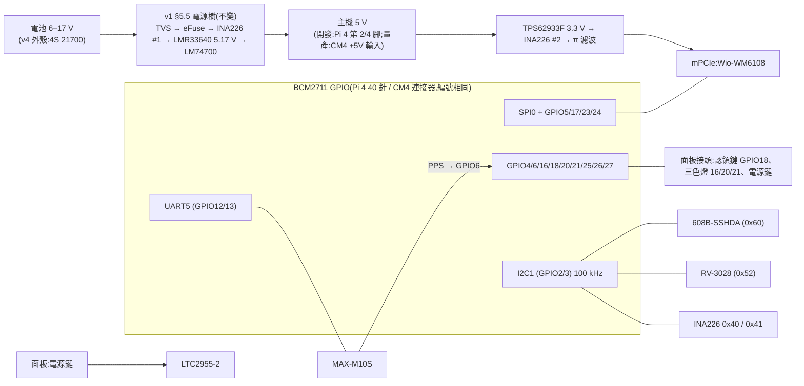

# Batman HAT v2:一塊板、兩種主機——開發插 Pi 4,量產插 CM4

狀態:**DRAFT v0.13**(2026-10-20)。第一輪(v0.10)、第二輪(v0.12)對抗式審查皆 REJECT,處理見 §17、§18;**第三輪待審**。
- **審查分兩段**(使用者 2026-10-20):本文審「開發版(插 Pi 4)」與「量產版必須在擺件前定案的銅箔決定」(§7.4 接腳處置表、§7.5 上電與反灌)。量產版其餘部分(簽章開機、燒錄流程、量產生命週期、熱)另寫 `docs/design/hat-v2-production.md`,量產打件前審完。
- v0.8:拿掉 TPM;量產與民用都用 CM4。
- v0.9:**同一塊板**,開發期用 40 針插在 Pi 4 上,量產期直接插 CM4 當 IO 板(使用者 2026-10-20);外殼不能大改。依 CM4 規格書 RP-008168-DS-4 定孔位、連接器、堆疊高度(§7)。
- 修訂紀錄見 §16。

主單:#227。決策單:#240。需求來源:#219 §8.5(H1–H11)、#256、#300、#302。外殼:#228。軟體配合:#223(#224–#226)、#239。

> 標記慣例(沿用 `hat-v1-spec.md`):**【事實】** = 本專案實測、原始碼、規格書或 repo 檔案可查證;**【推論】** = 由事實推出、尚未實測;**【決策】** = 使用者已拍板(附日期);**【提案】** = 本文提出、待審查或待使用者拍板;**【待量測】** = 要實物量過才能定;**【搜尋結果】** = 只看到搜尋摘要,原文被本環境的網路代理擋住,要人工確認。

---

## 0. 一句話

**一塊板、兩種主機**:
- **開發期**:板子用 40 針排針插在 **Pi 4** 上(當 HAT)。
- **量產期**(軍用、民用都一樣):**同一塊板**直接插 **CM4**(當 IO 板),CM4 掛在板子背面,佔用原本 Pi 4 的空間,裝進同一個外殼。

板上的電源、608B、RTC、GNSS、HaLow 插槽、按鍵與燈號,兩個階段完全相同;差別只在主機接在哪個介面(§7)。

## 1. 已定的方向(使用者 2026-10-20)

| # | 決定 | 影響 |
|---|---|---|
| X1 | **拿掉 TPM**,安全元件只留 ATECC608B | §5.1;TPM 的查證結果留在附錄 A |
| X2 | **開發用 Pi 4、量產用 CM4**;不用 CM3+、不用 Pi 3A+ | §7 |
| X3 | **民用版也改 CM4**;開發也只用 Pi 4 | 不必相容 3A+;#219 的平台假設要跟著改(§2.4) |
| X4 | **同一塊板**:開發插 Pi 4、量產插 CM4(IO 板);**外殼不能大改** | §6、§7 |
| X5 | RTC 保留 RV-3028;GNSS 走 UART,不走 I2C;USB hub 不上開發 HAT | §5 |
| X6 | QR 貼在通訊本體底面、被電池盒蓋住 | §5.8 |
| X7 | 不加 GNSS 電源閘;新 HAT 只跑新 image | §5.4、§11 |
| X8 | GPIO19 保留;三色燈由新程式控制,到貨後設計 | §4、§8 |
| X9 | **VLM(PTT 對講音訊)內建在新板上**;沒有 PTT 的機型不焊這一區 | §5.10 |
| X10 | **審查分兩段**:先審開發版與擺件前要定的銅箔;量產其餘另寫設計 | 狀態列、§16 |
| X11 | CM4 的 Wi-Fi / BLE 天線:**上蓋可加孔**,屆時與外殼一起審 | §7.3 |
| X12 | **買 bench 機**:不部署的 Pi 4 一台、CM4 + 官方 IO Board 一組,專供 v2 驗證 | §14 |
| X13 | **開發版不用裝進外殼**(只用在桌上與測試架);量產版必須裝進 v4 外殼 | §6.2 |
| X14 | **608B 綁主機**:簽章與 ECDH 槽要主機授權才能用,授權秘密只有簽章開機後的 CM4 導得出(第二輪 D1) | §5.2 |
| X15 | HaLow 卡導熱墊改 **1.5 mm**(第二輪 D2) | §7.2 |
| X16 | **全板 1 oz 銅、小過孔**,大電流靠鋪銅加寬(第二輪 D3) | §6.2、§5.5 |
| X17 | **USB 每埠限流依實際裝置壓低**;板上 VLM 不經限流開關(第二輪 D4) | §5.5、§7.4 |
| X18 | **EEPROM_nWP 經量產必焊的 0 Ω 接地**(第二輪 D5) | §7.4 |
| X19 | **Wi-Fi / 藍牙硬體關閉腳接到面板**;上蓋開關要重選或重設計(第二輪 D6) | §5.6、§7.4 |

為什麼不用 CM3+【搜尋結果與 repo 事實,2026-10-20 評估】:
- 沒有無線,民用靠藍牙(#219 P11)會出局。
- BCM2837 不能簽章開機(`productization.md`)。
- 生產保證只到約 2028-01(第三方 endoflife.date;官方原文未找到)。

為什麼不用 CM5:CM5 透過 RP1 晶片出 SPI,HaLow 的 SPI 驅動還沒解決(`productization.md` 指向 `pi5-rp1-bringup.md`)【事實】。

## 2. 範圍

### 2.1 開發 HAT 上有的

| 區塊 | 內容 | 和 v1 比 |
|---|---|---|
| HaLow | mPCIe 插槽(Wio-WM6108),腳位照 v1 §4.1,一支都不動 | 同 |
| 安全元件 | **ATECC608B-SSHDA**(SOIC-8,I2C 0x60) | 608C → 608B;**拿掉 TPM** |
| RTC | RV-3028-C7 + 超級電容 | 同 |
| GNSS | u-blox MAX-M10S + 主動天線偏壓,走 **UART5** | 同 v1 的 UART5 |
| 電源 | v1 §5.5 全部:TVS、eFuse、兩顆降壓、兩顆 INA226、LTC2955 軟開關機、BAT_PRESENT | 同 |
| 面板接頭 | 電源鍵、認領鍵、三色燈 | 新增 |
| **VLM(PTT 對講音訊)** | CM108B USB 音效 + 93C46 EEPROM,相容 OpenVLM;K 頭插孔經線材接到外殼側壁 | 新增(§5.10),v1 §12 原本就規劃放在 CM4 板上 |
| **主機介面** | 40 針排針(開發,接 Pi 4)+ CM4 板對板連接器 ×2(量產) | 新增 CM4 介面(§7) |
| CM4 周邊(量產才用) | USB hub、USB 開機燒錄、EEPROM 寫入保護、GPIO_VREF | 新增(§7.4) |

### 2.2 開發 HAT 上沒有的
- **TPM**(X1):量產板若要認證再評估,見附錄 A。
- LoRa:沿用外接的 RAK 模組,經 USB 接(§7.4)。PTT 音訊改為內建(§5.10)。
- USB hub:開發期用 Pi 4 自己的 USB 埠;**量產插 CM4 時由板上的 USB hub 提供**(§7.4)。
- HAT ID EEPROM:v1 §5.7 已拿掉。
- QR 區:QR 貼在外殼(§5.8)。

### 2.3 #219 §8.5 需求對照

| # | 需求 | 開發(插 Pi 4) | 量產(插 CM4) |
|---|---|---|---|
| H1 | 所有 SKU 焊 608B-SSHDA | §5.2 | 同 |
| H2–H5 | 認領鍵(開機預設下拉的 GPIO)、凹陷按鍵、三色燈 GPIO 16/20/21 | §4、§5.6;按鍵本體在外殼 | 同 |
| H6 | QR 綁 608B 所在的板 | **改需求**:QR 貼本體底面(§5.8) | 同 |
| H7 | 3A+ 可用 | **不再需要**(X3) | — |
| H8 | USB hub | 用 Pi 4 的 USB 埠 | **板上 USB hub**(§7.4) |
| H9 | 民用不依賴 RTC | 相容 | 同 |
| H10 | 不擋藍牙天線 | Pi 4 天線禁佈區(§6.3) | CM4 用 U.FL 外接天線(§7.3) |
| H11 | QR、按鍵不拆殼就碰得到 | 按鍵經面板接頭;QR 轉開電池盒可見 | 同 |

### 2.4 民用改 CM4 對其他文件的影響(本文不改,列出待辦)
- `docs/design/219-field-provisioning.md`:P11(民用 SKU = 3A+)、H7、§9 的 `[pi3]` distroconfig、B12(3A+ 512 MB 記憶體)都以 3A+ 為前提。
- `docs/productization.md`:「Pi 3A+ = civil SKU」與硬體分級表。
- `CLAUDE.md` 與 `docs/boards-and-builds.md`:目前的兩塊板是 `ekh-bcm2711`(Pi 4)與 `ekh-bcm2710`(Pi 3A+)。CM4 和 Pi 4 同為 `bcm2711` 子目標,但 CM4 會是**新的實機驗證對象**(CLAUDE.md:每塊板的 image 都要實燒驗證)。
- 以上由各自的單號處理(#219、#228),不在本 PR 改動。

## 3. 方塊圖



## 4. GPIO 分配

Pi 4 與 CM4 是同一顆 BCM2711;CM4 把 GPIO0–27 全部引到連接器上(例如 GPIO12 = 第 31 腳、GPIO13 = 第 28 腳、GPIO18 = 第 49 腳)【事實,CM4 規格書 RP-008168-DS-4 腳位表】→ 本表兩個階段通用。開機預設 GPIO0–8 上拉、9–27 下拉【事實,CM4 規格書 RP-008168-DS-4 表 1(GPIO 預設狀態)】。

| GPIO | 用途 | 開機預設 | 說明 |
|---|---|---|---|
| 0 / 1 | **不接,連 40 針第 27、28 腳也不連線** | 上拉 | HAT+ 規格 §2.3:只能接 ID EEPROM【事實,v1】。量產版 40 針不焊,若連線就會露出 ID EEPROM 匯流排,讓人外接 EEPROM 注入 overlay(§12) |
| 2 / 3 | I2C1:608B 0x60、RV-3028 0x52、INA226 0x40 / 0x41 | 上拉 | 100 kHz(608B 喚醒脈衝,v1 §7);CM4 模組上已有 1.8 kΩ 上拉【事實,CM4 規格書 §2.5】,Pi 4 待對照(A4)→ 板上不另加 |
| 4 | BAT_PRESENT(低 = 有電池) | 上拉 | 同 v1 |
| 5 | HaLow IRQ | 上拉 | 不動 |
| 6 | GNSS PPS | 上拉 | 補上 WM1302 拿不到 PPS 的缺口(#300 B-1) |
| 7 | **不可用**(SPI0 CE1) | 上拉 | 同 v1 |
| 8–11 | HaLow SPI0 | — | 不動 |
| **12 / 13** | **GNSS:UART5 TXD / RXD** | 下拉 | 同 v1。UART5 是 PL011,鮑率時脈不跟 core clock 走,不會和 HaLow SPI 的 core_freq 互相牽制【推論,依 BCM2711 UART 架構】 |
| **14 / 15** | **開發用序列主控台**,只拉到 Tag-Connect 焊墊 | 下拉 | 【提案,O9】見 §5.7。**今天的 image 在這兩支腳上開 root 主控台**(§5.7);量產前由 #302 的程式修正拿掉 |
| **16** | 燈:紅 | 下拉 | #128;下拉 = 開機時不亮 |
| 17 | HaLow reset | — | 不動 |
| **18** | 認領鍵(按下 = 3V3) | 下拉 | H4 |
| 19 | 保留(使用者 2026-10-20) | 下拉 | — |
| **20 / 21** | 燈:綠 / 藍(顏色對應以 #128 為準) | 下拉 | #128 |
| **22** | **板子識別 strap**:板上 10 kΩ 上拉到主機 3.3 V | 下拉 | 【提案,第二輪軟體 M3】讀到 1 = v2 板;WM1302 等舊板讀到 0(開機預設下拉)。給 OTA 的 `hat=v2` 檢查與健康檢查用(§13) |
| 23 / 24 | HaLow wake / busy | — | 不動 |
| 25 | INA226 ALERT | — | 同 v1 |
| 26 | LTC2955 INT(電源鍵要求關機) | — | 同 v1 |
| 27 | 軟關機:N-FET → LTC2955 KILL | — | 同 v1 §5.5.3 |

- **藍牙**:現行 Pi 4 image 有 `dtoverlay=miniuart-bt`(藍牙搬到 mini UART、GPIO14/15 變成 PL011 = serial0),#254 的 `ble-ok` 閘門也要求它【事實,`254-stage1-impl.md:421`、`254-reviews/review-v1-B.md:138`】。v2 的 GNSS 在 UART5,藍牙可以回到 PL011(拿掉 `miniuart-bt`)【提案】,但要和 #254 的閘門一起改,否則兩份設計的契約衝突(O13)。
- 不論藍牙放哪,**GNSS 都在 UART5,不在 serial0 上**,所以 #302「GNSS 對登入主控台打字」在接線上已經不會發生【推論,依腳位】。
- 燈的驅動:GPIO 不直接推 LED,每色一顆 N-FET;電流、電壓待外殼選料(#128)【提案】。

## 5. 各區塊

### 5.1 TPM:拿掉

- **決定**(X1):開發 HAT 不放 TPM,安全元件只用 608B。
- **為什麼可以拿掉**【推論,依 repo 事實】:
  - 民用設計本來就寫明「沒有 TPM」(#219 §4)。
  - Pi 沒有開機量測(measured boot),TPM 分辨不出開的是不是我們的系統。保護資料加密金鑰要靠**簽章開機 + SoC 的 OTP 私鑰**,這在 Pi 4 / CM4 上做得到,不需要 TPM(`productization.md`)。
  - TPM 在 Pi 上剩下的價值是**認證**(SLB9673 只剩 CC EAL4+ 有效,FIPS 已轉為 Historical)和**硬體防猜 PIN**。這兩項是量產產品的需求,不是開發板的需求。
- **省下的**:
  - 時脈延展問題(SLB9673 需要主控端支援 I2C 時脈延展)、獨立的軟體 I2C、GPIO12/13/22 都不用了。
  - 不必自行打包 OpenWrt 沒有的 tpm2-tss(v1 §7.1)。
  - 少一顆 A 級零件(約 US$4)和它的周邊。
- **之後**:量產版若客戶要求認證,再評估加 TPM。SLB9673 的查證結果(接腳、時脈延展、證書、韌體鎖定)整理在**附錄 A**,不用重查。

### 5.2 ATECC608B(未設定版)

- 未設定版,I2C **0x60**;腳位與 608C、TNGLORA 相同【事實,#240、#300】。設定區鎖定不可逆:**槽位配置先在消耗品上實驗**(#219 §8.5、#240)。
- **包裝與擺位**【提案,第二輪資安 B1】:改用 **UDFN 包裝**(未設定版 ATECC608B-MAHDA,待查是否與 SSHDA 同為 0x60、同設定)放在**背面 CM4 陰影區**,I2C 只走內層。量產時 CM4 蓋在上面,測試夾夾不到。SOIC-8 的 SSHDA 是 #219 H1 指定的,換包裝要回寫 #219。
- I2C 不接到 mPCIe(mPCIe 第 30、32 腳不接,v1 §4.1)【事實】。
- **綁主機**(X14,使用者 2026-10-20):
  - 威脅:偷到量產機的人拔掉 CM4,在同一塊板的 40 針孔焊上排針、插到自己的 Pi 4,就能用正式的出廠身分金鑰(DAC)簽章;簽章開機只保護 CM4 上的系統,灌膠或封條擋不住「整台帶走」【推論,第二輪資安 B1】。
  - 做法【提案】:608B 的 DAC 槽與 ECDH 槽設成**需要授權才能用**(KeyConfig 的 ReqAuth + AuthKey)。授權秘密 = KDF(CM4 OTP 私鑰, 固定標籤),只有簽章開機後的 CM4 讀得到 OTP 私鑰;出廠時由燒錄站在 CM4 上導出並寫入 608B 的授權槽。
  - 結果:CM4 換掉或換成沒有簽章開機的主機,608B 的簽章與 ECDH 都會被拒絕。
  - **時程**:必須在 #219 的 608B 槽位實驗(B1)**鎖槽之前**定案,鎖了就不可逆。608B 的 ReqAuth 細節要用 cryptoauthlib 與消耗品驗證(A14)。
  - 開發版(Pi 4,沒有簽章開機):不綁,用**開發 CA** 與開發授權值(§12)。
  - 遺失機台:另補 DAC 撤銷流程(#219 的 DAC 黑名單),交給 #219。
- 出廠初始化由 #219 的燒錄站負責。
- **TPM 拿掉後,608B 是唯一的安全元件**:沒有硬體防猜 PIN;IO 保護金鑰只保護 ECDH / KDF / Verify 的輸出,不保護 Sign / MAC(#240 留言)。

### 5.3 RTC — RV-3028-C7

不變,見 v1 §5.1 末段與 §5.3:超級電容 CPH3225A,約 2 天;overlay 要帶 `trickle-resistor-ohms`。OpenWrt 沒有 `kmod-rtc-rv3028`,要自製(#240 C8)。

CM4 本身沒有 RTC【事實,v1 §5.3】,量產插 CM4 時同樣用板上這顆。

### 5.4 GNSS — MAX-M10S,走 UART5

- **接腳**:GPIO12(UART5 TXD)→ GNSS RXD、GPIO13(UART5 RXD)← GNSS TXD,同 v1【提案:改回 v1 的接法】。
  - v0.1–v0.7 為了 3A+ 改走 GPIO14/15 的 mini UART;3A+ 不再需要(X3),改回 UART5。
  - UART5 是 PL011,GNSS 的鮑率不受 core clock 影響【推論】。但藍牙與開發用主控台總有一個在 mini UART 上,core clock 仍會被固定(#254 要求 `core_freq_min=500`,`254-stage1-impl.md:421`),所以「不牽動 HaLow SPI 時脈」這個好處不成立【事實,第二輪軟體 m9】。
  - #254 把 `ttyAMA*` 當成實體主控台(`254-stage1-impl.md:218`),而 UART5 也會是 `ttyAMA*` → #254 的判斷要改成看實際 console 設定(O13)。
- **主控台規則**(#302):主控台永遠不和任何周邊共用 UART。GNSS 專用 UART5;主控台若有,只能在 GPIO14/15(§5.7)。
- **不加 GNSS 電源閘**(X7)。#302 的防線是**接線**:GNSS 在 UART5,主控台在 serial0(GPIO14/15),兩者不同 UART。
  - 這條防線**不靠 cmdline**。`batman-slot` 把 `console=serial0 console=ttyUSB0,115200 console=tty1` 寫死,且每次 OTA 的 `apply` 都會重寫目標槽的 cmdline【事實,`batman-slot:36`、`:674`;建卡腳本 `build-gpt-ab-card.sh:151`、`build-ab-image.sh:170` 同樣寫法】。所以「量產 image 不開主控台」**不能靠燒卡設定**,要由 #302 的程式修正處理(§13)。
  - UART5 的 tty 名稱要在 `config.txt` 開 overlay 後實測確認(A5),並寫進 gpsd 設定;禁止任何 console 參數指向它。
- 天線:主動式、LNA 前有 SAW 預濾波,加偏壓,同 v1 §5.4。
- PPS → GPIO6(`pps-gpio`)。

### 5.5 電源

**電路沿用 v1 §5.5 全部**(設計值、模擬、方案 D 電源樹審查)。v2 的差異:

1. **電源鍵改瞬時型**:LTC2955 的 PB 要瞬時按鍵。v4 外殼現在是自鎖開關、直接控制 Mini560 的 EN(`hardware.md`)→ 外殼換成瞬時按鍵(#228)。自鎖開關改接 LTC2955 的 ON 腳不可行:TSOT 版的 SEL 內部接地,ON 下降不會關機(v1 §5.5.2)。
2. **外殼的 Mini560、INA226、DS3231 模組取消**,由 HAT 取代。保險絲、PTC 留在電池盒(`hardware.md`)。
3. **主機 5 V**(網路 `5V_HOST`):開發期接 Pi 4 第 2/4 腳;量產期接 CM4 的 +5 V 輸入(第 77、79、81、83、85、87 腳)。
   - CM4 的 +5 V 輸入建議範圍 **4.75–5.25 V**,絕對最大 6.0 V;上電要單調上升,運作中全程 ≥ 4.75 V【事實,CM4 規格書腳位表、表 3、第 25 頁】。
   - 板上 5 V 設定 5.17 V(v1,100 k / 24 k 回授,`design.py:186-187` 用 **0.5%** 電阻)【事實】。電阻約 ±0.8%,再加 LMR33640 的 VFB 公差(待查,A12)與負載瞬變過衝,上限會貼到或超過 5.25 V【推論,審查 M1】。超過是違反建議範圍,不會燒毀。
   - **量產版 BOM 改設 5.05–5.10 V,回授用 0.1% 電阻**;開發版維持 5.17 V(Pi 4 端要補排針壓降)。O12 本來就分兩份 BOM。
   - V18 依 CM4 規格書第 26 頁的方法:2 A 負載下 5V_HOST > 4.9 V、量瞬變上限。
4. **3V3_SEC**(608B、RTC、GNSS,< 150 mA,v1 §5.5.5 #15):開發期取自 Pi 4 的 3.3 V;量產期取自 CM4 的 `CM4_3.3V` 輸出,可供 **600 mA**(每腳 300 mA)【事實,CM4 規格書】,足夠。
5. **I2C 上拉**:CM4 模組上 GPIO2/3 已有 1.8 kΩ 上拉【事實】;Pi 4 待對照(A4)。板上不另加。
6. **GPIO 負載**:CM4 的 28 支 GPIO 合計負載要低於 50 mA【事實】。三色燈用 FET 驅動,不從 GPIO 直接取電(§4)。
7. **5 V 電流預算**【推論,第二輪電源 M5】:
   - `boards.py` 的數字是 RAK19003 0.2 W + RAK4631 0.4 W + VLM 0.3 W = 0.9 W,而且是**平均發熱估計**,不是峰值(v0.12 寫 0.5 W 是誤引)【事實】。
   - 最壞情況粗估:CM4 約 2 A(規格書只給典型 1.4 A,最大值待查)+ HaLow 換算到 5 V 0.85 A + hub 本身 0.1 A + CM4_3.3V 外部負載約 0.2 A + USB 下游。若 USB 埠照標準 0.5 A 算,合計約 4.2 A,超過 LMR33640 的 4 A。
   - **處置(X17)**:hub 下游每埠的限流開關設在實際裝置需要的值(RAK 約 0.2 A,待量);板上 VLM 直接由板上電源供電,不經 USB VBUS 限流。這樣最壞約 3.6 A【推論】,擺件前依實測定案(V18)。
8. **銅厚**(X16):全板改 **1 oz**(原 PLAN §7 為外層 2 oz)。v1 與 PLAN 的大電流路徑寬度、壓降預算(PLAN §1 A1–A8)都是用 2 oz 的 0.246 mΩ/□ 算的,1 oz 約加倍 → **G0 前重算**,不夠就用內層鋪銅並聯或加寬【推論】。

### 5.6 面板接頭(新)

外殼上的電源鍵、認領鍵、三色燈,經一個低高度接頭接到 HAT【提案】:

| 腳 | 訊號 | 備註 |
|---|---|---|
| 1 | GND | |
| 2 | PB(LTC2955) | 電源鍵 |
| 3 | CLAIM(GPIO18) | 串聯電阻 + ESD;HAT 上預設下拉 |
| 4–6 | LED R / G / B 驅動(開汲極) | HAT 上的 FET 驅動 |
| 7 | LED 陽極電源(3V3 或 5V) | 依外殼燈的選料 |

- 接頭建議 JST SH 1.0 mm 側插(日本)【提案】,高度、位置配合外殼 #228。兩個階段是同一塊板,接頭與腳位自然相同,外殼線材不必改。
- **ESD**:按鍵線拉到外殼面板,是新的外部接觸點 → 每條線加 TVS 或 ESD 陣列。
- **安全**:CLAIM 是 #219 認領窗口的觸發鍵,實體在場才能按,這是預期的信任邊界;它不碰任何秘密線路。CLAIM 事件怎麼送到 `batman-provd` 見 §9。
- **無線靜默開關**(X19):量產版的 CM4 有 WL_nDisable(第 89 腳)、BT_nDisable 硬體關閉腳【事實,CM4 規格書】,接到面板接頭,由**上蓋的自鎖式開關**拉低。
  - 開發版(Pi 4)沒有對應的腳,這兩條只在量產版有作用。
  - 面板接頭多 2 腳(共 9 腳);**上蓋開關要重選或重設計**:電源鍵改瞬時型(§5.5 第 1 點),另加一個無線靜默的自鎖開關 → 交給外殼 #228。
  - 開關斷線 = 腳懸空 = 內部上拉 = 無線開著:這是 fail-open,軍用機型若要求「斷線就靜默」要反過來設計(O17)。

### 5.7 除錯

- **GNSS 不和主控台共用 UART**(#302):GNSS 在 UART5。
- **GPIO14/15 的現況**【事實,審查 B1、B2】:
  - 現行 image 開了 `miniuart-bt`,GPIO14/15 = PL011 = serial0;cmdline 寫死 `console=serial0`(`batman-slot:36`)→ **這兩支腳上就是 root 主控台**。
  - 這兩支腳本來就在 Pi 4 的 40 針上,開發版多一組 Tag-Connect 焊墊並沒有增加暴露【推論】。
- **開發用主控台**【提案,O9】:GPIO14/15 拉到 **Tag-Connect TC2050 焊墊**,不裝接頭,供 #105 擷取當機輸出。
- **量產版**:主控台要由 #302 的程式修正拿掉(§13);修好之前,量產版不放行。另外 bootloader 的 `BOOT_UART` 設 0(§7.4)。
- Tag-Connect 另帶 HaLow SPI0、IRQ、BUSY、GND、3V3 感測(同 v1)。
- **I2C 不放測試點**:I2C 上有 608B。限制:40 針焊點本來就碰得到 I2C(§12 寫明實體攻擊者能做什麼)。
- 電源測試點、INA226、eFuse 燈:同 v1 §5.6。

### 5.8 QR(不在 HAT 上)

- **QR 貼在通訊本體的底面,被電池盒蓋住**(X6)。HAT 和電池盒內部都封在殼裡看不到,所以 #219 H6「貼在 HAT 上」與 #256「貼在電池蓋內側」都不可行。
- **為什麼不印在外殼外面**:QR 裡有 `device_id` 與 **256 bit 認領秘密**(#219 §4、§6.1),等於這台機器的權狀。U4 的界線是「認領只防不在身邊的人與沒拿到 QR 的旁人」。印在外面,路過拍照的人就拿到了;而從未認領的機台每次開機都開放認領窗口【推論】。
- 這個位置同時滿足:組裝好時旁人看不到(U4);轉開電池盒就看到、不用工具(H11);旋轉卡扣有 O-ring 密封【推論】。
- **空間**【推論,依 Batman-P `enclosure-v4` 模型】:本體底面 63 × 43 mm,中間約 40 × 36 mm 是 pogo 與卡扣,兩側各剩約 11 mm 寬 → QR 約 10 × 10 mm,偏小,**V15 實印試掃**。
- **保護範圍要說清楚**【審查 M5】:這個位置只擋「沒碰過機器、也沒碰過包裝的人」。換電池的隊友、修理行看得到;盒內卡跟著包裹走;若電池依運輸規定與本體分開寄,物流途中 QR 是露出的;標籤印表機的列印佇列也會經手秘密。
  - 對策(交給 #219):出貨時電池盒先裝上,或 QR 貼紙加封條;**軍用機型是否貼 QR、是否開認領窗口**另行決定(O14,建議都不要)。
- 交給 #219 / #228:出廠要配對本體與板子;換任一個要重印;盒內卡仍是備援(P8)。

### 5.9 供應鏈

分級規則照 v1 §5.8,A 級零件不交中國組裝廠(v1 §5.9)。A 級清單:

| 零件 | 廠商(所有權) | 備註 |
|---|---|---|
| ATECC608B-SSHDA | Microchip(美國) | 取代 608C |
| RV-3028-C7 | Micro Crystal(瑞士) | 同 |
| MAX-M10S | u-blox(瑞士) | 同 |
| CM4(量產) | Raspberry Pi Ltd(英國) | 有韌體、存 OTP 金鑰 → A 級;產地待查 COO |

- 新增的 C 級料:面板接頭、ESD 陣列、燈驅動 FET。
- 已知例外:Wio-WM6108(Seeed / Quectel,**中國**,v1 §5.8);mPCIe 插座 C7498130(連欣科技,**中國**,C 級,v1 §6.4)。

### 5.10 VLM(PTT 對講音訊)— 內建,相容 OpenVLM

- **決定**(X9,使用者 2026-10-20):VLM 做在新板上。v1 §12 原本就寫「PTT 是 CM4 底板才新增的區塊」;v0.10 以前漏了這一點。
- **只有有 PTT 的機型焊這一區**:C1、C3、T1、T2(#219 §3.2 能力表)【事實】。其他機型不打件,外殼不裝 K 頭插孔。
- **電路**:照 OpenVLM VLM-KW 的做法【事實,github.com/OpenMANET/OpenVLM `README.md`、`docs/cli-reference.md`】:
  - **C-Media CM108B**(**台灣**)USB 音效晶片,USB 識別碼固定 0x0D8C:0x0012;
  - **93C46** SPI EEPROM(128 bytes),出廠用 `openvlm provision` 寫入;
  - CM108B 的 **GPIO1 接高**:openmanetd 用它分辨「OpenVLM」與一般 CM108 裝置;
  - K 頭 PTT 鍵接 CM108B 的 GPIO3,走 USB-HID 回報;openmanetd 設定 `controlSource=openvlm`(`expansion-gps-ptt.md`)。
- **K 頭插孔**:3.5 mm(PJ-392)與 2.5 mm,中心距 11.5 mm,仍裝在外殼右側壁(Batman-P `boards.py`)【事實】;用 JST SH 5 腳線接到板上(現行 VLM 板的 J3 就是這樣接)。
- **USB 怎麼接到主機**:
  - 量產(插 CM4):CM4 USB → 板上 USB hub → CM108B;hub 另一埠給 RAK(§7.4)。
  - 開發(插 Pi 4):Pi 4 的 USB 不在 40 針上 → 板上留一個 USB 上游接頭,用短線接 Pi 4 的 USB-A → 同一顆 hub → CM108B【提案】。所以**有 PTT 的機型,開發版也要焊 hub**。
  - hub 的上游來源(CM4 或接頭)依打件版本選一個,不是安全網路,不受 D12 限制。
- **授權**:OpenVLM 是 **CERN-OHL-W v2(弱互惠)**【事實,OpenVLM `LICENSE`】。照抄它的電路,出貨時這一塊(含我們的修改)要以 CERN-OHL-W 公開;板子其他部分不受影響【推論,非法律意見,商品化前請專業確認】。另一條路是依 C-Media 規格書自己設計,只沿用 GPIO1 / EEPROM 的識別慣例。
- **面積與雜訊**【推論】:CM108B 為 LQFP-48;OpenVLM 板上另有 27 顆電容、13 顆電阻,加 LDO、FET、EEPROM(`VLMKW0100_top_cpl.csv`)【事實】→ 估約 **250–400 mm²**(v0.12 的 150–250 偏樂觀,第二輪電源 m8)。遠離兩顆開關降壓與 HaLow 卡;類比地與音訊走線和開關節點隔開。
- **ESD**:K 頭插孔是外部接觸點,MIC、SPK、PTT 三條線都加 ESD 保護(第二輪電源 m9),V7 一起測。
- **供電**:VLM 由板上電源直接供電,不經 hub 下游的限流開關(X17)。
- **耗電**:約 0.3 W(Batman-P `boards.py` 的估計)【推論】。
- **外殼**:原本放在前層的 VLM 板(53 × 26.5 mm)拿掉,空間省下;RAK 的 USB 改接板上。
- **供應鏈**:CM108B(台灣,B 級,有邏輯、無可改寫韌體【推論,待查 CM108B 是否有可寫的內部韌體】);93C46 選非中國廠(例如 Microchip,美國)。

### 5.11 裝置節點權限

**前提**【事實】:
- 核心沒有 `CONFIG_CGROUP_DEVICE`(`security-profiles.md:35`,#109),容器的裝置白名單沒有強制力。
- `/dev` 是 devtmpfs,每次開機重建;uci-defaults 只跑一次 → 權限要用 **procd 的 hotplug 規則**在每次開機與每次裝置出現時套用(第二輪軟體 M5)【推論,實作時確認 procd `hotplug.json` 的擁有權】。
- gpsd 目前以 `nobody` 執行,系統沒有 `gpsd` 群組(`254-reviews/254-stage1-impl-v1.md:29`)→ 要新增專屬的系統使用者與群組【提案】。
- 已上線的租戶設定都帶 `--cap-drop=ALL`(`deploy/*/*.hardening.env`),但 `payload-lib.sh` 的檢查**只允許、沒有強制**這個參數(`payload-lib.sh:9、41、64`)【事實】→ 新租戶漏掉就會帶著 `CAP_MKNOD` 跑。

| 裝置 | 權限 | 誰能用 | 說明 |
|---|---|---|---|
| `/dev/i2c-1` | root:root 0600 | 只有 608B helper(root) | 能開它就能叫 608B 簽章、改 RTC |
| 其他 `/dev/i2c-*`、`/dev/spidev*` | root:root 0600 | root | — |
| `/dev/gpiomem`、`/dev/mem` | root:root 0600(或核心不提供) | root | 能開 gpiomem 就能把 GPIO2/3 改成輸出,自己模擬 I2C 操作 608B(第二輪資安 M3) |
| `/dev/vcio`(VideoCore mailbox) | root:root 0600 | 只有 root helper | 能讀 OTP 私鑰(#219 §9 的 helper 用到) |
| `/dev/gpiochip*`、`/sys/class/gpio` | root:root 0600 | root | 能拉 GPIO27(KILL)斷電、GPIO17 重置 HaLow |
| `/dev/mmcblk0*` | root:disk 0660 | root | eMMC / SD 全部內容 |
| GNSS 的 tty(UART5) | root:gpsd 0660 | gpsd(新增的系統使用者) | 名稱待實測(A5) |
| `/dev/pps0` | root:gpsd 0660 | gpsd / 時間程式 | — |
| `/dev/rtc0` | root:root 0600 | 只有時間程式(root) | 寫入者見 §8 |
| RAK 的 tty | root:dialout 0660 | Meshtastic 工具 | — |
| VLM 的 hidraw / ALSA | root:audio 0660 | openmanetd | — |

**608B helper 的契約**【提案,第二輪資安 M1;要同步改 #219】:
- #219 現在寫的是 `batman-provd` 直接用 cryptoauthlib 存取 608B(`219-field-provisioning.md:200、529`),與本表衝突。改為:**只有 root helper 開 `/dev/i2c-1`**;provd(非 root、經藍牙對外)透過 helper 存取。
- socket:root:provd 0660,只接受 provd 的 uid(以 `SO_PEERCRED` 檢查)。
- 操作清單只有:讀 DAC 憑證、讀 `device_id`、認領挑戰比對(CheckMac)、ECDH(換密碼用)、讀「曾被認領」計數器。
- **helper 自己組要簽的結構**:帶用途標籤、混入 helper 產生的 nonce;不接受「替任意摘要簽章」。
- 限速:每秒操作次數上限,超過就拒絕並記錄。

**容器**:payload 管理程式的檢查要**強制** `--cap-drop=ALL`,guardian 也要檢查 CapDrop(§13 第 6 項)。

**負向測試**(V20),每條都配正向對照:
- 非 root `open("/dev/i2c-1")` → EACCES;主機 root → 成功(對照)。
- 沒有 `--cap-drop=ALL` 的 manifest → payload 管理程式拒絕;有的 → 通過(對照)。
- 刻意給 `CAP_MKNOD` 的測試容器內 `mknod c 89 1` 讀 0x60 → 能讀(對照,證明測試有效);正式租戶 → 失敗。
- provd 以外的 uid 連 helper socket → 拒絕;provd 送任意摘要要求簽章 → 拒絕。

## 6. 外形與機構

### 6.1 v4 外殼的可用空間(Batman-P `enclosure-v4/study/chassis.py`、`layout3d.json`,2026-10-20 讀取)

外殼座標:x 寬、y 深(前 → 背)、z 高。Pi 長邊直立,SD 卡端在下(z 98),USB 端朝上。

| 項目 | 數值 | 可信度 |
|---|---|---|
| 本體內寬 | x 2.5–60.5 = **58 mm** | 【事實,模型參數】 |
| Pi 疊層可用深度 | 中隔板背面 y 17.5 → 後蓋內面 y 40.5 = **23 mm** | 【事實】 |
| 可用高度 | 中框底面 z 92.5(pogo 佔位頂 z 95)→ 後窗框上緣 z 187 | 【事實】 |
| 今天的疊層 | Pi 4 PCB y 20.5–21.9;Pi 4 USB / 網路孔到 y 37.9、z 163–185;HAT y 32.9–34.5;WM6108 到 y 39.5;導熱墊到 y 40.5(壓後蓋鋁板) | 【事實】 |

### 6.2 板子外形

- 寬 56.5 mm、Pi 四個固定孔、40 針排針位置不變【決策,2026-10-20】。量產時同一塊板裝進外殼,所以**外形受外殼限制**(X4)。**開發版不用裝進外殼**(X13)。
- 加長方向只能往 SD 卡端,**上限約 3 mm**:再往下是 pogo 接收器與卡扣(z 95),兩側長條可到 5.5 mm【事實,模型座標】。USB 端開發期會撞 Pi 4 的 USB / 網路孔【事實】。
- **後蓋螺絲柱共 8 個**【事實,`chassis.py:39-40、131-133`;審查 M6】:(4.25, 100 / 128 / 156)、(58.75, 100 / 128 / 156)、(31.5, 95.75)、(31.5, 188.75)。柱底在外殼 y 35.0;量產版板面改在 y 32.5 起算的正面(板厚 1.6 mm,正面約 y 34.1),淨空約 **0.9 mm** → 這些柱的投影範圍內,正面零件 ≤ 0.9 mm,G0 畫成禁高區。
  - x 58.75 那一排落在板座標 y 約 0–3.75,就是 40 針排針那一邊;開發版的排針焊腳會撞柱,但開發版不裝外殼(X13);量產版不焊排針,所以沒有問題【推論】。
- **面積**【推論,粗估;G1 用 courtyard 實算】:

  | 項目 | 增減(mm²) |
  |---|---|
  | 拿掉 TPM 與周邊、SPI1 走線 | 約 −60(省下) |
  | 面板接頭 + ESD + 燈驅動 FET | +55–75 |
  | CM4 周邊:USB hub 與晶振、USB 開機電路、接頭(§7.4) | +200–300 |
  | 加長 3 mm(扣掉天線條對齊) | 約 +100(多出) |
  | v1 已知不足(審查 §13 #5) | +300–600 |
  | DF40 ×2 的扇出過孔(0.4 mm 間距,貫穿正面)、CM4 固定柱 4 處(每處禁放約 Ø6) | 正面與背面都要扣【審查 M3】;**1 oz 小過孔**(X16)規格與板廠確認 |
  | USB 上游切換、VBUS 限流開關、USB ESD、RAK 接頭(§7.4) | +40–80 |
  | VLM(§5.10) | +250–400 |
  | §7.5 雙向隔離緩衝器、放電 FET、3V3_SEC 負載開關、hub 專用 LDO | +40–70 |

  → **正面放不下**。背面 CM4 陰影區(3.0 mm 堆疊,CM4 底下淨空 1.5 mm)扣掉連接器、扇出、固定柱,再乘 60–70% 擺件密度,**約 1200 mm² 可用**,不是 v0.10 寫的 2000【推論,審查 M3】。陰影區零件 ≤ **1.2 mm**(留 0.3 mm 餘量)。
  - **Pi 4 天線條 (0,0)–(6.3,20)**:所有層不鋪銅、不放零件,**兩種打件版本都一樣**(銅箔不分版本)。CM4 外框在 x 5–6.3、y 8–20 和它重疊;**CM4 固定孔 (8.5, 11.5) 的接地焊墊(禁放約 Ø6)會侵入天線條**(第二輪電源 m7)→ 該孔改用不鍍銅孔、不接地,或 G0 微調 CM4 位置【提案】。
  - **Pi 4 PoE 排針投影**(x 59–63、y 7–12):只是高度問題,背面這一區只放**量產版才焊**的零件(開發版不焊,不會撞 Pi 4)【推論,G0 驗證】。
  - **G0 用 courtyard 實算後才確定放不放得下**;放不下依 v1 §6.2 刪減。

### 6.3 天線禁佈區

- **Pi 4**:天線條 (0,0)–(6.3,20),所有層不鋪銅、不放零件(PLAN §0 決定 1)。
- 量產插 CM4 時見 §7.3。

### 6.4 高度與溫度

- 卡片下方 ≤ 1.9 mm(綁 5.2H 插座)、背面限高、固定柱 H5/H6:沿用 layout-v2 PLAN。
- **工作溫度**:開發期由 Pi 4 本身限制;量產 CM4 為 **−20 至 +85 °C**(無線最佳 −20 至 +75 °C)【事實,CM4 規格書 §3.2】。戶外低溫低於 −20 °C 的場合要另評估(O10)。

## 7. 兩種主機介面

### 7.1 CM4 的機構數字【事實,CM4 規格書 RP-008168-DS-4 §3.1、圖 4;使用者 2026-10-20 提供,另有 STEP 檔 RP-008170 / RP-008171】

| 項目 | 數值 |
|---|---|
| 外框 | 55 × 40 mm;模組厚 4.7 mm;PCB 1.2 mm |
| 固定孔 | 4 × M2.5,離邊 3.5 mm → CM4 自身座標 (3.5,3.5)、(51.5,3.5)、(3.5,36.5)、(51.5,36.5) |
| 板對板連接器 | 2 × 100 腳 Hirose DF40,中心線離上、下緣各 3 mm,中心 x = 25.0;第 1 腳在上排右端 |
| 堆疊高度 | **1.5 mm**(DF40C-100DS-0.4V,CM4 底下淨空 0)或 **3.0 mm**(DF40HC(3.0)-100DS-0.4V,CM4 底下淨空 1.5 mm);插上後總高 5.078 / 6.578 mm |
| 天線 | 板上 PCB 天線或 U.FL(CM4 座標 2.567, 9);`config.txt` 的 `dtparam=ant1 / ant2` 選擇;建議用外接 |
| 電源 | 單一 +5 V(4.75–5.25 V);對外 3.3 V、1.8 V 各 600 mA |
| 溫度 | −20 至 +85 °C(無線最佳 −20 至 +75 °C) |

### 7.2 擺位【推論,依上表與 §6.1 的外殼座標計算;G0 用 `sketch.py` 加入 CM4 外框驗證】

板座標 = Pi / HAT 座標(原點在 40 針排針那一邊的角,x 沿 Pi 長邊,y 0–56.5)。

- **CM4 在板子背面**(朝 Pi 的那一面),外框 x 5–60、y 8–48。
  - CM4 固定孔落在板座標 (8.5, 11.5)、(56.5, 11.5)、(8.5, 44.5)、(56.5, 44.5)。
  - 兩排連接器中心在 y 11 與 y 45,x 中心 30。**這只在其中一種面朝下的方向成立**:規格書圖 4 的連接器中心在 CM4 自身 x = 25,另一個方向會是 x = 35【推論,審查 m2】。方向定了,U.FL 與 SoC 位置也跟著定 → G0 依 STEP 檔定方向後寫回本節。
  - 離 Pi 四個固定孔的銅柱(外徑約 5 mm)最少 1.7 mm;離 40 針排針與它的手焊淨空(y ≤ 6.1)有 1.9 mm 以上。
  - CM4 是面朝下裝在板子背面,連接器腳位相對 CM4 正視圖要鏡像,畫封裝時照 STEP 檔核對。
- **開發期(插 Pi 4)**:開發版**不焊 CM4 插座**(O12),背面只有陰影區的矮零件(≤ 1.2 mm),離 Pi 4 最高的零件(約 6.0 mm)還有約 3.8 mm【推論】。若 Pi 4 SoC 加散熱片,依 v1 §6.1 另畫背面禁放區。
- **量產期(插 CM4,裝進外殼)**:
  - 板子沿用 **Pi 4 的四個固定孔**,用 **12 mm 標準銅柱**鎖在外殼現有的 Pi 固定柱上(柱頂 y 20.5),板面落在 y 32.5(今天 HAT 在 y 32.9)。
  - **HaLow 卡導熱墊改 1.5 mm**(X15):原 1 mm 導熱墊剛好貼平(y 39.5–40.5,壓縮量 0,`layout3d.json`)【事實】;板子低 0.4 mm 後改 1.5 mm,壓縮約 0.1 mm【推論】。導熱墊的可壓縮範圍要依選料確認(V16)。
  - 後蓋螺絲柱的淨空因此從 0.5 mm 變成 **0.9 mm**(§6.2 的禁高區跟著改)。
  - CM4 從板子背面往中隔板方向凸出:3.0 mm 堆疊時底面在 y 25.9(板面 y 32.5 − 6.578),離固定柱頂還有 5.4 mm【推論】。
  - HaLow 卡照舊朝後蓋,導熱墊壓後蓋鋁板,散熱不變。
  - CM4 SoC 朝中隔板,散熱改用銅片導到側壁(今天是 Pi 4 SoC 銅片,`layout3d.json`)。
  - 外殼要拿掉 Pi 4 的 USB 彎頭插頭預留區;RAK / VLM 改接板上的 USB(§7.4)。
- **用 3.0 mm 堆疊**【決策,使用者 2026-10-20,O11】:CM4 底下多 1.5 mm,陰影區可以放 ≤ 1.2 mm 的零件(§6.2)。量產期 CM4 底面離固定柱頂仍有 5.8 mm。
- **H5 / H6(HaLow 卡固定柱)的螺絲**不能鑽穿到背面陰影區,螺絲長度要限制【審查 m1】。

### 7.3 天線

- 開發期:Pi 4 的天線條禁佈區 (0,0)–(6.3,20),所有層不鋪銅、不放零件(§6.3)。CM4 的連接器與孔位都在禁佈區外【推論,依 §7.2 座標】。
- 量產期:CM4 選**有天線的版本、用 U.FL 外接天線**(規格書建議)。板上 PCB 天線需要至少 6.5 × 11 mm 不鋪銅、四周 10 mm 淨空,在這個疊層裡做不到【推論】。
- **天線出口**(X11,使用者 2026-10-20):**上蓋可以加一個孔**,和外殼(#228)一起審。今天上蓋只有 HaLow N 座、LoRa N 座、GPS SMA(`layout3d.json`)【事實】。
- **認證**:只有 Raspberry Pi 官方天線套件和 CM4 一起做過認證;換別的天線要另做認證【事實,CM4 規格書 §2.1】→ 建議用官方套件,詳細放進量產設計。

### 7.4 CM4 接腳處置表(擺件前必須定案)

量產版的銅箔和開發版是同一塊板,所以下列每支 CM4 腳**現在就要決定接到哪裡**。依據:CM4 規格書 RP-008168-DS-4 腳位表與 §2【事實】;處置為【提案】,第二輪審查重點。

| CM4 腳 / 功能 | 規格書要求 | 處置 | 理由 |
|---|---|---|---|
| +5V(77、79、81、83、85、87) | 4.75–5.25 V,單調上升 | 接 `5V_HOST` | §5.5 |
| GPIO_VREF(78) | 必須接 CM4_3.3V(84、86) | 直接接 CM4_3.3V | 不能空接或接地 |
| CM4_3.3V(84、86) | 合計 600 mA | 供 3V3_SEC、KILL / INT 上拉 | §5.5 第 4 點 |
| CM4_1.8V(88、90) | — | 不接 | 不需要 |
| GPIO0–27 | — | 依 §4 | 兩階段同一張表 |
| **ID_SD / ID_SC(GPIO0/1)** | HAT EEPROM 用 | **不接**,40 針第 27、28 腳也不連線 | 防止外接 EEPROM 注入 overlay(§12) |
| **EEPROM_nWP(20)** | 上電前就要是低電位;還要軟體設定 `eeprom_write_protect=1` 才生效(規格書 §2.18) | **經量產版必焊的 0 Ω 接地**(X18),0 Ω 放在背面 CM4 陰影區 | 真正的鎖是簽章開機燒進 CM4 的熔絲;0 Ω 保留日後修補 bootloader 的路(拆殼、拆 CM4 才碰得到)【推論】 |
| **nRPIBOOT(93)** | 拉低 → USB 開機燒錄;要在 +5 V 上升後 2 ms 內就是低 | 只拉到**燒錄治具用的測試焊墊**,放在**背面 CM4 陰影區**(CM4 裝上後碰不到) | 治具燒錄;簽章開機啟用後 rpiboot 能做什麼,寫進量產設計(A10) |
| **USB 2.0(D+/D−)** | 預設關閉,要 `otg_mode=1` | 經 **USB 2.0 類比切換器**:平時接板上 hub;治具拉 nRPIBOOT 時,同一條治具線把切換器切到燒錄焊墊(焊墊在陰影區)。切換器的選擇腳由治具焊墊驅動、板上預設下拉 = 接 hub;電源取 CM4_3.3V | 一組 USB 兼兩種用途 |
| USB_OTG_ID | 固定當主機或固定當裝置都接地(規格書第 6 頁) | **直接接地** | 燒錄時不必切換(第二輪電源 m2) |
| hub 下游 VBUS | — | RAK 埠一顆限流開關,限流值依實際裝置(X17);VLM 不經 VBUS | Pi 4 本來就有,CM4 沒有 |
| **hub 本身的電源** | 主機 +5 V 之前任何腳不得加電(第 25 頁) | **hub 專用 LDO**,致能由主機 3.3 V 控制;hub 的 D+ 上拉因此不會早於主機上電(第二輪電源 M6) | — |
| **RUN_PG(92)** | 拉低可重置 CPU | **不引出**,不放焊墊 | 減少實體攻擊面(§12) |
| **GLOBAL_EN(99)** | 拉低 = 最低功耗;內部 100 kΩ 上拉到 +5 V | 只拉到**陰影區的測試焊墊**(V18 負向對照用);電源由 LTC2955 切 5 V 主電源(v1) | 一個電源擁有者(§8);CM4 裝上後碰不到 |
| LED_nPWR | 要加緩衝才能推 LED | 不接 | 狀態燈由新的三色燈程式負責(§8) |
| **Pi_nLED_Activity(21)** | 可承受 5 V、可吸 20 mA | **和三色燈的紅色線或(開汲極並接)**【提案,第二輪電源 m4】 | 密封的量產機也看得到開機錯誤碼(閃燈) |
| **WL_nDisable(89)/ BT_nDisable** | 拉低 = 關閉無線 | **接到面板接頭的無線靜默開關**(X19) | §5.6 |
| Ethernet、HDMI、CSI / DSI、PCIe、SD、SDA0 / SCL0(80、82)、Camera_GPIO(97)、AnalogIP0/1(94、96)、nEXTRST(100)、PCIe_CLK_nREQ(102)、Ethernet_SYNC、SD_VDD_OVERRIDE | — | 不接 | 外殼沒有對應開孔;CM4 有 eMMC |
| **Reserved(76、104)** | 規格書要求不可接任何東西 | 不接 | — |

- **40 針排針在量產版不焊**,它的焊墊會露出 I2C、SPI0、GPIO27(KILL)、GPIO14/15 等【事實,接線】,而且是貫穿孔,蓋不住。**D12 的例外**:這是「主機介面」的打件版本,不是可選的安全元件。對「換主機」的攻擊,真正的防線是 608B 綁主機(X14、§5.2);灌膠或封條只是事後看得出被拆【推論,第二輪資安 B1】。
- 打件版本見 §7.9。

### 7.5 上電、斷電與反灌(審查 BLOCKER)

- **規格書要求**【事實,CM4 規格書第 25 頁】:CM4 斷電時,任何腳都不能被外部加電壓,否則之後可能開不了機;CM4_3.3V 對外供電時,斷電過程中不可以低於 CM4_1.8V;+5 V 單調上升、運作中全程 ≥ 4.75 V。
- **風險**【推論】:LTC2955 長按斷電或拔電池時,HaLow 3.3 V 軌上約 0.3 mF 電容(`design.py` C60–C62)會撐住數 ms;這段時間 HaLow 卡的 IRQ / BUSY / MISO 可能仍為高,經 GPIO 反灌進已斷電的 CM4。Pi 4 也有同樣的限制,v1 §5.5.5 #8 只分析了穩態。
- **處置**【提案,第二輪電源 M1、M2;軟體 M7】:
  1. **兩個方向都加有 Ioff(斷電隔離)功能的緩衝器**(例如 TI SN74LVC 系列,非中國廠):
     - 卡往主機(MISO、IRQ):緩衝器電源取**主機 3.3 V**,主機沒電 → 輸出高阻抗。BUSY 在卡上沒接通(R17 = DNP,v1 §4.1)【事實】,不緩衝。
     - 主機往卡(SCK、MOSI、CS、RESET_N / GPIO17、WAKE / GPIO23):緩衝器電源取 **3V3_MPCIE**,卡沒電 → 輸出高阻抗,主機的訊號不會灌進還沒上電的卡。
     - HaLow 的**腳位對應不變**(§4),只在路徑中加緩衝器;MISO 多約 3–5 ns 延遲,SPI 時脈 25–32 MHz(v1 §5.1)時要做時序預算(A15)【推論】。
     - HaLow 卡不在或沒電時,緩衝器輸入要有上下拉,避免浮接造成假中斷。
  2. **3V3_MPCIE 放電**:P-MOSFET,源極接 3V3_MPCIE、閘極接主機 3.3 V(主機沒電 → 導通放電),串電阻限流。
  3. **3V3_SEC 經負載開關**(例如 TI TPS22917),致能取 5V_HOST 的電壓偵測(5 V 先掉 → 先切斷 3.3 V 外部負載),確保「CM4_3.3V 不低於 CM4_1.8V」(規格書第 22 頁要求的額外電路)。開發版同一電路,沒有壞處。
  4. 608B、RTC、GNSS 都在 3V3_SEC 後面,和主機一起上下電。
  5. 面板、VLM、USB 的上拉都接主機那一側的電源;hub 用專用 LDO(§7.4)。
  6. **Tag-Connect 序列線**:板子沒電時接上序列線,線的 TX 會灌進 GPIO15 → 焊墊加串聯電阻,並在使用說明寫明先上電再接線。
- **驗證**(V18):示波器同時量 5V_HOST、CM4_3.3V、CM4_1.8V、3V3_MPCIE、GPIO5、GPIO17;做長按斷電、拔電池、正常關機、快速關再開;並用陰影區的 GLOBAL_EN 測試焊墊依規格書第 26 頁的方法確認 3.3 V < 200 mV(負向對照)。CM4 的 MxL7704 要先把各路輸出放到 < 200 mV 才會啟動【事實,MxL7704 規格書 Sequencing】,所以反灌就是「開不了機」的實際機制。
- **KILL 時序**:KILL 與 INT 的上拉在量產版接 CM4_3.3V(`design.py:268-271` 目前接 3V3_PI)。CM4_3.3V 要等 GLOBAL_EN 的 RC 延遲後才起來,必須在 LTC2955 的遮蔽時間(最短 304 ms)內變高,否則按電源鍵後又會斷電 → V18 量測【審查 m4】。

### 7.6 軟體

- CM4 與 Pi 4 同為 `bcm2711` 子目標;A/B 開機(tryboot)在 CM4 上可用【推論:文件把 Pi 4 與 CM4 寫在一起(`productization.md:124`),CM4 未實測】。
- CM4 專用設定放 **`[cm4]` 段**,不要放 `[pi4]`(`[pi4]` 的篩選可能也套用到 CM4,待查原文):
  - **`otg_mode=1`**:CM4 的 USB 預設關閉,不加的話 hub、RAK、VLM 全部不能用【事實,CM4 規格書 §2.4】;
  - `dtparam=ant2`(外接天線);
  - bootloader 設定 `BOOT_UART=0`。
- `config.txt` 不隨 OTA 更新(`batman-slot:663`),eMMC 封在殼裡 → 出廠就要對,之後只能拆殼用 rpiboot 重燒【事實 + 推論】。
- `DISK=/dev/mmcblk0` 寫死在 `batman-slot:28`、`95-batman-storage:30`;CM4 eMMC 的裝置名要實測(V17)【事實】。
- EEPROM bootloader 要 ≥ 2025-08-20 才有「FAT 分割有 config.txt 但沒有韌體」的退回保護(`boards-and-builds.md` §1)→ 工廠設好;EEPROM_nWP 經 0 Ω 拉低並設 `eeprom_write_protect=1` 後,現場不能升級;要修只能拆殼拆 CM4、移除 0 Ω(X18)。量產 config 另加 `force_eeprom_read=0`(不讀 HAT ID EEPROM,§4)。
- 簽章開機要用 `boot.img` / `boot.sig`【推論,待查】,和 `batman-slot` 在節點上寫散檔與 cmdline 的做法不相容 → 量產設計處理。
- 要加 CM4 的 DTB(`bcm2711-rpi-cm4.dtb` 是否收進 image 待查 firmware fork),並在 CM4 實機上驗證(CLAUDE.md)。
- 生產保證:CM4 到 2034-01【搜尋結果,Raspberry Pi 官方產品頁】。

### 7.7 CM4 選型(O10)【推論,依 repo 的實測數據;成本越低越好】

**一律選無線版**(民用靠 BLE 認領,#219 P11)。**一律選有 eMMC 的版本**,不選 Lite:Lite 要另加 SD 卡座(佔面積)和 SD 卡(現場可被抽換、磨耗);eMMC 焊死在模組上。

| 用途 | 實測數據 | 建議 |
|---|---|---|
| **民用 / 中繼**(無 OTS) | 完整 mesh 堆疊只用 **109 MB** RAM(manet01,`hardware.md` §Resource budget);原本民用規劃的 3A+ 只有 512 MB 也能跑 docker canary(`ab-autocommit.md`) | **1 GB RAM**;eMMC **8 GB** |
| **戰術 + OTS** | OTS 只在 8 GB 的 Pi 4 上驗證過(04:MemTotal 7.6 GiB、MemAvailable 6.6 GiB);容器上限 opentakserver 512m + eud 1280m + eud_ssl 1536m,另有其他 OTS 容器;manifest 有 MemTotal 下限(`289-eud-gateway.md`、`264-ots-eud-patch.md`) | **8 GB RAM**(目前唯一驗證過的);4 GB 要先重做 OTS 容量測試才能用 |

**eMMC 容量怎麼算**:
- 固定分割區:boot A/B 各 64 MB、rootfs A/B 各 1.5 GB、p5 512 MB、救援保留 300 MB,合計約 **3.9 GB**(`storage-architecture.md`)。
- 剩下的給 p6(docker、OTS 資料庫、log)。8 GB eMMC 約剩 3–3.5 GB,16 GB 約剩 11 GB,32 GB 約剩 26 GB【推論,未扣 eMMC 實際可用容量差】。
- 民用沒有 OTS,p6 只放 log 與小型資料,8 GB 夠。
- 戰術:OTS 的 docker 映像約 1.2 GB(`159-flash-and-go-ots.md`),加上資料庫與 log。**p6 實際用量沒有紀錄** → 要在 04 上量(見下),量完再在 16 GB 與 32 GB 之間選。

**還缺的實測數據**(在 manet04 上跑,唯讀):
```sh
df -h /opt/batdata          # p6 用量
docker system df            # 映像、容器、volume 各佔多少
free -m                     # 平常與 16 支手機連線時的記憶體
```

**價格參考**【搜尋結果,2020 上市牌價與零售價,要向授權經銷商詢價】:無線 1 GB 版約 US$35(8 GB eMMC)起;零售 CM4102008(2 GB / 8 GB)約 US$87.5、CM4104032(4 GB / 32 GB)約 US$79 起。實際價差以經銷商報價為準。

### 7.8 開發期也可以先插 CM4

官方 **CM4 IO Board 有 40 針 HAT 排針**【搜尋結果】→ 開發期可把這塊板當 HAT 插在「CM4 + 官方 IO Board」上,提早在 CM4 上驗證軟體(V17)。板子自己的 CM4 介面要等量產版 BOM 才會用到。

### 7.9 打件版本(第二輪電源 M6)

同一塊 PCB,四種打件:

| | 開發 · 無 PTT | 開發 · 有 PTT | 量產 · 無 PTT | 量產 · 有 PTT |
|---|---|---|---|---|
| 40 針排針 | ✅ | ✅ | — | — |
| CM4 插座 ×2、USB 切換器、nWP 0 Ω、jig 焊墊附近的上下拉 | — | — | ✅ | ✅ |
| USB hub + hub LDO | — | ✅(上游接 Pi 4 USB-A 的接頭) | ✅ | ✅ |
| RAK 埠限流開關 | — | ✅ | ✅ | ✅ |
| VLM 區(§5.10)與 K 頭線材接頭 | — | ✅ | — | ✅ |
| §7.5 隔離緩衝器、放電 FET、3V3_SEC 負載開關 | ✅ | ✅ | ✅ | ✅ |
| 開發用 Tag-Connect 主控台焊墊 | 有銅箔 | 有銅箔 | 有銅箔(主控台由 #302 程式修正拿掉) | 同左 |

- 軟體分得出哪一種:主機種類看 device tree 的 model(Pi 4 / CM4);v2 看 GPIO22 strap(§4);有沒有 PTT 看 USB 上有沒有 0D8C:0012【提案】。
- 「兩種主機介面都焊上」是打件錯誤:CM4 插座焊上而又插 Pi 4 不會有電氣衝突(插座空著),但量產機若誤焊 40 針排針,會多出完整的裸露介面 → 出廠 AOI 檢查(§10)。

## 8. 擁有權

| 資源 | 唯一擁有者(可以改) | 只讀者 / 說明 |
|---|---|---|
| I2C1 匯流排 | 核心 `i2c-bcm2835` 驅動 | 608B helper、RTC、INA226 驅動 |
| 608B 設定區與槽位 | 出廠燒錄站(一次性);執行期只有 root helper(§5.11),`batman-provd` 經它存取 | — |
| **系統時間** | 目前有多個寫入者:sysfixtime(關機存、開機還原)、`batman-faketime`(只往前推,上限 2035)、busybox ntpd【事實,`explicit-reboot.md:31`、`batman-reboot:41`、`batman-faketime`】 | **v2 要訂出唯一來源順序**【提案】:GNSS(PPS)> ntpd > RTC > faketime。busybox ntpd 不吃 PPS → 要換時間程式(例如 chrony,英國 / 開源,非中國)或另寫,見 O18 |
| **RTC 硬體時間** | **只有一個寫入者**【提案】:由時間來源程式在 GNSS 或 ntpd 校準後寫入 | 開機時讀;讀之前先檢查 RV-3028 的 PORF(斷電旗標),失電就不採用,避免 faketime 下限被推到錯誤的未來【審查 M5】 |
| GNSS UART(UART5) | gpsd(專屬系統使用者,§5.11) | — |
| PPS(GPIO6) | 核心 `pps-gpio` | gpsd / ntpd 讀 |
| BAT_PRESENT(GPIO4) | 硬體 | `batpower` **目前沒讀**;且 `batpower` 取第一顆 `ina2*`、預設 2 串電池(`usr/bin/batpower:50-56`、`init.d/batpower:12`)→ v2 有兩顆 INA226,要指定電池那顆並改串數(§13 第 7 項,第二輪軟體 M4) |
| INA226 ALERT(GPIO25) | 硬體 | **目前沒有任何程式讀**(v1 §7.2);接手者待定 |
| GPIO14/15 主控台 | `batman-slot` 寫的 cmdline(`console=serial0`) | #302 修正前,量產不放行 |
| GPIO16 / 20 / 21(三色燈) | **新程式**,到貨後設計(X8);只能有一個寫入者 | 其他程式只送狀態 |
| **狀態顯示整體** | 開發期:meshled 管 Pi 的 PWR / ACT 燈,新程式管三色燈;量產期 CM4 沒有拉出 PWR / ACT → meshled 的狀態要併入新程式【提案】 | 兩者不能同時寫同一顆燈 |
| GPIO18(認領鍵) | `gpio-keys` → `/etc/rc.button/claim` → 寫入 provd 的事件 socket(§9) | provd 只信這條路徑 |
| GPIO22(板子識別) | 硬體 strap | `check_image`、健康檢查讀(§13) |
| WL_nDisable / BT_nDisable | 面板開關(硬體,X19) | 軟體只讀狀態,不寫 |
| GPIO26(電源鍵 INT) | `gpio-keys` → `/etc/rc.button/power`(v1 §7.1) | — |
| GPIO27(KILL) | `gpio-poweroff` | — |
| **主機電源** | LTC2955(切 5 V 主電源);GLOBAL_EN 只到陰影區測試焊墊、RUN_PG 不接(§7.4) | 單一擁有者 |
| 3V3_SEC 負載開關、3V3_MPCIE 放電 | 硬體(§7.5) | — |
| INA226 ×2 | 核心 `ina2xx` hwmon | `batpower` |
| USB hub、VBUS 開關 | 硬體;hub 下游裝置由各自的程式使用(openmanetd 用 VLM,Meshtastic 工具用 RAK) | **USB 授權**:`authorized_default=0`,只放行白名單(hub、VLM 0D8C:0012、RAK)【提案,第二輪資安 M4】 |
| `config.txt` / `distroconfig.txt` | 燒卡 image;**OTA 不帶**(`boards-and-builds.md` §5 #12) | firmware |
| `cmdline.txt` | **`batman-slot`**(每次 OTA 的 `apply` 重寫,`:674`);建卡腳本(`build-gpt-ab-card.sh:151`、`build-ab-image.sh:170`)寫初值 | 三處要收斂成單一來源(#302) |
| CM4 bootloader EEPROM 內容與設定 | 工廠(量產設計);`95-batman-storage:418` 會讀它 | nWP 0 Ω(X18)+ `eeprom_write_protect=1` |
| 608B 授權秘密(X14) | 出廠燒錄站寫入 608B;執行期只由 root helper 在簽章開機的 CM4 上從 OTP 導出 | 不落地、不進 log |
| nRPIBOOT、EEPROM_nWP 狀態 | 硬體處置(§7.4) | — |

## 9. 介面契約

| 介面 | 寫 / 讀 | 有效條件與格式 | 缺失或錯誤時 | 誰能碰到 |
|---|---|---|---|---|
| `config.txt` 的 HAT overlay(RTC、UART5、pps、gpio-keys、gpio-poweroff) | 燒卡 image 寫;firmware 讀 | `[pi4]`(開發)/ CM4 段落(量產) | 缺 overlay → 該功能不存在;608B 讀不到 → 認領 fail-closed | root、拿到儲存媒體的人 |
| `cmdline.txt` 的 console | 燒卡 image 寫 | **不得把主控台放在 UART5**;量產 image 不開任何序列主控台 | 若放錯 → GNSS 能對登入程式打字(#302)。**fail-open,由燒卡流程擋**;V9 驗證 | 同上 |
| I2C1 位址 | 硬體 | 0x40、0x41、0x52、0x60 | 衝突 = bring-up V2 抓到 | — |
| GPIO18 認領鍵 | 硬體 → `gpio-keys` | 按下 = 高 | 斷線 = 永遠低 = 永遠不開認領窗口(fail-closed) | 實體在場的人 |
| 面板接頭 | 外殼線材 | §5.6 腳位表;兩個階段同一塊板 | 接反 → LED 不亮、按鍵無效;ESD 由 TVS 吸收 | 實體在場的人 |
| 認領鍵 → provd | `rc.button/claim`(root)寫;provd 讀 | provd 的事件 socket 只接受 root 的 uid(`SO_PEERCRED`);事件只帶「按下」與時間 | provd 沒在跑 → 事件丟掉,不開窗口(fail-closed)【提案,第二輪軟體 M6】 | root |
| 608B helper socket | provd 呼叫;root helper 執行 | §5.11 的操作清單 | helper 不在 → 認領與換密碼失敗(fail-closed) | provd(uid 檢查) |
| GPIO22 板子識別 | 硬體 | 1 = v2 | 讀到 0 → `check_image` 視為非 v2 板,不裝 `hat=v2` image | — |
| 無線靜默開關 | 面板 → WL/BT_nDisable | 拉低 = 關 | 斷線 = 無線開著(fail-open,O17) | 實體在場的人 |

## 10. 生命週期矩陣

本表只涵蓋**開發版(插 Pi 4)**(X10)。量產版(插 CM4)的矩陣寫在 `hat-v2-production.md`,至少要有這些列:rpiboot 燒 eMMC、工廠首次開機、p6 長滿 eMMC、bootloader EEPROM 版本與寫入保護、簽章開機下的 A/B、密封外殼內無法重燒、5 V 低於 4.75 V、USB 熱插拔與重新列舉、降版到沒有 `otg_mode` / `ant2` 的 image、打件版本錯誤(兩種主機介面都焊上)、開發 image 流到量產機。

「今天」= 現行 WM1302 HAT 節點;「之後」= v2 板插 Pi 4。

| 情境 | 今天 | 之後 | 驗證 |
|---|---|---|---|
| 首次開機 / firstload | GNSS 在 UART0,和登入主控台同一條(#302) | GNSS 在 UART5,和主控台(serial0)分開;主控台仍在(開發版接受) | V4、V9 |
| 開機 | — | RTC 先檢查 PORF 再讀;GNSS、608B、VLM 可用 | V2、V4、V6、V19 |
| 正常關機(`poweroff`) | — | `gpio-poweroff` → KILL → LTC2955 斷電(v1);斷電過程不反灌(§7.5) | V8、V18 |
| 重開機 | — | KILL 不動 → 不斷電(v1) | V8 |
| OTA stage 1(sysupgrade 前半,舊系統還在跑) | — | 只寫非使用中的槽;**cmdline 由舊 image 的 `batman-slot` 寫**(`platform-ab.sh:37` 呼叫的是正在跑的那份;`batman-slot:674`)→ #302 的修正**要分兩個版本發**:第一版改 `batman-slot` 本身,第二版之後的 OTA 才會寫出新 cmdline【事實 + 推論,第二輪軟體 M1】 | V11 |
| OTA stage 2(重開進新槽) | — | 新槽的 `config.txt` 沿用燒卡時的(OTA 不帶);**payload 沒有宣告硬體版本,舊 image 也能裝**(審查 M4)→ 要加 `hat=v2` 宣告與 `check_image` 比對【提案,§13】 | V11 |
| autocommit **提交** | — | mesh 加入閘門通過即提交;**閘門不看 HAT 功能**(RTC、GNSS、VLM 壞了也會提交)→ 健康檢查加 HAT 項目【提案】 | V11 |
| autocommit **回退** | — | 回到上一槽;回退**不碰 cmdline**(`batman-slot:731-741`),上一槽保留它當初寫的值【事實,第二輪軟體 M1】 | V11 |
| 斷電(拔電池、長按 5.3 s) | — | RTC 靠超級電容約 2 天;斷電過程依 §7.5 不反灌 | V6、V18 |
| 元件自身重啟(gpsd、三色燈程式) | — | gpsd 重啟後重新開 UART5;燈號程式到貨後設計 | V4 |
| 依賴重啟:network / procd / hotplug 重送事件 | — | gpsd、gpio-keys 重新綁定;hub 下游重新列舉後 openmanetd 要能重新抓到 VLM【推論,待測】 | V19 |
| 依賴重啟:I2C 卡住 | — | 一顆晶片卡住 SDA → 608B、RTC、INA226 同時失效;`i2c-bcm2835` 的復原行為待查(A6) | V2 |
| 當機 / 當機迴圈 | — | 長按電源鍵 5.3 s 硬體斷電(v1);ramoops 留紀錄 | V8 |
| 只用 Pi 4 的 USB-C 供電、沒接電池 | — | 5V_HOST 由 Pi 4 經 40 針倒送回板上 → 3V3_SEC 負載開關照常導通,608B、RTC、GNSS 可用;HaLow 卡的 3V3_MPCIE 有沒有被倒灌要依 v1 電源樹(LM74700 理想二極體的位置)確認;HAT 電池與 USB-C 不可同時供電(v1 規定)【推論,待確認】 | V18 |
| 電池欠壓 / 電壓緩降 | — | eFuse 與 LMR33640 欠壓鎖定(v1);RTC 保持 | V8 |
| 快速關再開(< 1 s) | — | MxL7704 要求各路 < 200 mV 才啟動 → 放電路徑要在時間內放完(§7.5)| V18 |
| 板上沒插 HaLow 卡 | — | 緩衝器輸入有上下拉,不產生假中斷(§7.5) | V2 |
| Tag-Connect 序列線在板子沒電時接上 | — | 串聯電阻限流(§7.5 第 6 點) | V18 |
| 重新開機後 USB 重新列舉 | — | 權限由 hotplug 規則重套(§5.11);USB 授權白名單重新判定 | V20 |
| 降版到不支援 v2 的 image | — | 經燒卡:不支援(X7)。經 OTA:目前擋不住(見 OTA stage 2)。GNSS 在 UART5,舊 image 不會在那裡開登入,所以不會重現 #302【推論】 | V11、V12 |
| Pi 4 | 現行 | 開發版唯一主機 | 全部 |
| CM4 + 官方 IO Board | — | 開發期選配(§7.8);只能用一個電源:HAT 的 5.17 V 不可和 IO Board 自己的 5 V 並聯【審查 m5】 | V17 |
| bcm2710(Pi 3A+) | 03 仍在機隊 | **不適用**:v2 不支援 3A+(X2、X3);03 繼續用 WM1302 HAT | — |

## 11. 依賴的假設與證據

| # | 假設 | 證據 | 狀態 |
|---|---|---|---|
| A1 | BCM2711 開機預設 GPIO0–8 上拉、9–27 下拉 | CM4 規格書表 1 | **已查** |
| A2 | CM4 的 GPIO0–27 全部引出 | CM4 規格書腳位表 | **已查** |
| A3 | CM4:3.3 V 輸出 600 mA、GPIO2/3 有 1.8 kΩ 上拉、1 個 USB 2.0、堆疊 1.5 / 3.0 mm、+5 V 4.75–5.25 V | CM4 規格書 RP-008168-DS-4 | **已查** |
| A9 | DF40 插座本體在板上的高度與封裝(兩種堆疊) | 無 | 待讀 Hirose DF40 規格書;STEP 檔核對 |
| A10 | 簽章開機啟用後,rpiboot 能否讀寫 eMMC(是否需要客戶金鑰簽章的 msd) | 無 | 待讀 raspberrypi/usbboot 的 secure-boot 文件(量產設計) |
| A11 | `[pi4]` 段落的篩選是否也套用到 CM4 | 審查者記憶 | 待讀 Raspberry Pi config.txt 條件篩選原文 |
| A12 | LMR33640 的 VFB 公差 | 無 | 待讀 TI 規格書 SNVSB99C |
| A13 | CM108B 有無可改寫的內部韌體 | 無 | 待讀 C-Media 規格書 |
| A14 | 608B 的 KeyConfig ReqAuth / AuthKey 能讓 Sign 與 ECDH 在沒授權時被拒;授權狀態在睡眠 / 重置後失效 | 審查者記憶;Microchip 文件需 NDA | 讀 cryptoauthlib 原始碼(`atcacert`、`calib_checkmac`)+ 消耗品實驗;**#219 鎖槽前完成** |
| A15 | 加了 Ioff 緩衝器後 HaLow SPI 25–32 MHz 時序仍夠 | 無 | 依選定緩衝器的 tpd 算;V3 跑 iperf |
| A16 | ATECC608B 的 UDFN 版本(MAHDA)與 SSHDA 同位址、同設定、可在原廠通路買到 | 無 | 查 Microchip 料號表 |
| A17 | CM4 最大電流(非典型) | 規格書只給典型 | 實測(V18) |
| A4 | Pi 4 在 GPIO2/3 有 1.8 kΩ 上拉 | 3A+ 電路圖同設計(RP-008332-DS-1) | 待對照 Pi 4 簡化電路圖 |
| A5 | UART5 在 GPIO12/13(ALT4)、`dtoverlay=uart5` 後的 tty 名稱 | ALT4 已由審查者對照 CM4 規格書替代功能表;現行 image 開了 `miniuart-bt`(§4) | ALT4 **已查**;tty 名稱待實測 |
| A6 | `i2c-bcm2835` 遇到卡住的匯流排會不會自己復原 | 無 | 待讀原始碼 |
| A7 | MAX-M10S 的 UART5 鮑率在 Pi 4 上穩定(不受 core clock 影響) | PL011 有獨立時脈【推論】 | V3 實測 |
| A8 | CM4 生產保證 2034-01;溫度 −20 至 +85 °C | 規格書(溫度)【事實】;產品頁(保證)【搜尋結果】 | 保證年限待讀原文 |

## 12. 安全(威脅模型)

**資產**:
- 608B 的出廠身分金鑰(DAC)與認領秘密、608B 的「曾被認領」計數器、IO 保護金鑰與它放在哪裡;
- eMMC / SD 上的明文內容(民用的 SAE 網路密碼在 p5);
- 時間(憑證效期)、位置;
- 供電控制(GPIO27 KILL)、HaLow 重置(GPIO17);
- 量產另有:簽章開機金鑰、OTP 內容、bootloader EEPROM 設定、產線 CA 私鑰(量產設計)。

| 行為者 | 攻擊 | v2 的處理 | 剩下的風險 |
|---|---|---|---|
| **遠端**(mesh / Wi-Fi / 藍牙) | ① **GNSS 訊號欺騙**:騙時間(影響憑證效期、RTC)與位置;② 藍牙晶片(Pi 4 / CM4 的 CYW43455)韌體漏洞 | ① 時間來源順序與合理性檢查(§8),RTC 只由一個寫入者在多來源一致時寫;② 依上游安全更新 | v0.10 寫「沒有新的網路介面」是錯的(審查 M6) |
| 本機非 root 程式 | 開 `/dev/i2c-1` 叫 608B 簽章、改 RTC;開 gpiochip / gpiomem 斷電或自己模擬 I2C;開 vcio 讀 OTP | §5.11 權限表(含 gpiomem、mem、vcio、mmcblk、其他 i2c / spidev);608B 只經 root helper,helper 自己組要簽的結構 | 權限表落實前不放行 |
| 被入侵的租戶容器 | 同上,加上 `mknod` 自建裝置節點 | 核心沒有 `CONFIG_CGROUP_DEVICE` → payload 管理程式**強制** `--cap-drop=ALL`(今天只允許、不強制,§5.11)、不跑 privileged | 依 #274 / #98 |
| **USB 周邊**(RAK、VLM、插到 hub 的任何東西) | 有韌體的 USB 裝置假裝成鍵盤,對 tty1 打字;或假裝成網卡 | `authorized_default=0` + 白名單(§8);量產 image 不在 tty1、ttyUSB0 開登入;VLM 在板上、韌體固定【推論,A13】 | 白名單用 VID:PID,可被偽造 → 只擋「隨手插一個」,不擋專門偽造;`productization.md:109` 要求執行期關 USB 和 RAK / VLM 衝突 → 量產設計決定 |
| **實體取得節點**(開發版) | 換卡開機後使用 608B;接 40 針或 GPIO14/15 拿 root 主控台 | 開發版不設防:Pi 4 沒啟用簽章開機 | 開發板的 608B 用**開發 CA**;**正式的 App、provd 驗證端、TAK 端都要拒絕開發 CA 簽的身分**(V23,第二輪資安 M5) |
| **實體取得節點**(量產版) | ① 40 針裸焊墊夾上自己的 I2C 主控,直接叫 608B 簽章;② **換主機**:拔掉 CM4、焊上排針插自己的 Pi 4,用正式 DAC 簽章(第二輪 B1);③ 短接 nRPIBOOT 從 USB 讀寫 eMMC;④ 外接 ID EEPROM 注入 overlay | ① ② **608B 綁主機**(X14,§5.2):沒有授權就拒絕簽章與 ECDH,授權只有簽章開機的 CM4 導得出;608B 改 UDFN 放陰影區;③ nRPIBOOT 焊墊在陰影區 + 簽章開機與 A10;④ GPIO0/1 不連線(§4) | X14 依賴 A14;**整台被偷**時攻擊者仍可用原 CM4 開機 → 靠 #219 的 DAC 撤銷;拆 608B 做物理攻擊不在範圍 |
| **有韌體的周邊**(GNSS、HaLow 卡) | GNSS 對主控台打字(#302);監聽安全晶片 | GNSS 在 UART5,和主控台分開;GNSS 不在 I2C;mPCIe 不接 I2C | 主控台本身要由 #302 的程式修正拿掉 |
| **CM4 本身**(bootloader EEPROM) | 改 bootloader 設定 | nWP 經必焊 0 Ω 接地(X18)+ `eeprom_write_protect=1`;簽章開機熔絲才是真正的鎖 | 拆 0 Ω 要拆殼與 CM4 |
| 無線靜默開關 | 有人在場把無線關掉 | 預期行為(實體在場 = 信任);狀態要回報 | 斷線即開(fail-open,O17) |
| 供應鏈 | A 級零件被換料 | 非中國原產、原廠通路、不經中國組裝廠(v1 §5.8–5.9) | WM6108(中國)仍是例外 |
| 工廠與物流 | 燒錄站、標籤印表機看到所有認領秘密;換電池的隊友、修理行、物流看到 QR | 工廠不保存秘密(#219 P8);QR 範圍見 §5.8 | O14 |
| 我們自己的錯 | 開發 image 流到量產機;舊 image 經 OTA 裝上;608B 槽位鎖錯 | 開發與量產用**不同的簽章金鑰與 CA**【提案】;`build-board.sh` 產量產 variant 時發現 console 就失敗【提案】;payload 宣告 `hat=v2`(§10);608B 先在消耗品實驗 | 量產設計 |

**拿掉 TPM 的理由**(§5.1)依賴量產的簽章開機設計,所以本節對量產版的結論都是【推論,待量產設計驗證】(審查 BLOCKER)。開發版不受影響。

**失效模式**:608B 讀不到 → 認領 fail-closed。GNSS 讀不到 → 只少定位與 PPS。RTC 失效(PORF)→ 不採用,改用 GNSS / ntpd;民用不依賴(H9)。

**負向測試**:
- V9:從 GNSS 端(UART5)注入 `\r\n`,沒有任何程式回應;OTA 後與回退後各跑一次,並加進 `daily-validation.sh`。
- V20:§5.11 的權限負向測試。
- V21:GNSS 時間欺騙,含跳 1 年、慢慢漂移、重開機後、離線且 RTC PORF 時、`.faketime` 被推到未來。
- V23:正式 App 拒絕開發 CA 簽的 DAC。
- V24:換主機:608B 在沒有授權時拒絕 Sign 與 ECDH(對照:授權後成功)。

## 13. 軟體影響(草案,未驗證)

```ini
# config.txt [pi4](開發 HAT)
dtparam=i2c_arm=on
dtparam=i2c_arm_baudrate=100000
dtoverlay=uart5                      # GNSS:GPIO12/13
dtoverlay=pps-gpio,gpiopin=6
dtoverlay=i2c-rtc,rv3028,trickle-resistor-ohms=3000,backup-switchover-mode=3
dtoverlay=gpio-poweroff,gpiopin=27
dtoverlay=batman-hat-v2              # 自製:gpio-keys GPIO18(認領)、GPIO26(電源鍵 INT)
# 開發 image 才加:enable_uart=1 + cmdline console=serial0(GPIO14/15);量產 image 兩者都不加
```

- 核心模組:`kmod-rtc-rv3028`(自製),`pps-gpio` 已有;**不再需要** `kmod-tpm-tis-i2c`、`kmod-i2c-gpio`、tpm2-tss。gpsd 與 pps 相關套件有沒有進 image,repo 裡找不到證據 → 實作時確認(審查 M5)。
- **要另開 PR 的程式修正**(不在本規格 PR;屬兩板共用 A/B 檔案,依 CLAUDE.md 做雙板實測):
  1. **主控台設定收斂成單一來源**(#302):`batman-slot:36`、`build-gpt-ab-card.sh:151`、`build-ab-image.sh:170` 三處;量產 variant 不開序列主控台,也不開 `console=ttyUSB0`(否則核心訊息會打進 hub 下游的 RAK / VLM)。
  2. **payload 宣告硬體版本**(`hat=v2`),由 `check_image` 比對;**autocommit 健康檢查加 HAT 項目**。
  3. `apply` 只用 `cp -f` 加 overlay、從不刪除(`batman-slot:648`)→ 會留下不同版本混用的 dtbo,要處理。
  4. 時間來源順序與 RTC 單一寫入者(§8)。
  5. 和 #254 協調 `miniuart-bt` 與 `ble-ok` 閘門(O13);#254 把 `ttyAMA*` 當實體主控台的判斷要改(§5.4)。
  6. **payload 管理程式強制 `--cap-drop=ALL`**,guardian 也檢查(§5.11)。
  7. **batpower**:指定電池那顆 INA226(依 I2C 位址)、依機型設串數、讀 BAT_PRESENT(§8)。
  8. **權限與 USB 授權**:procd hotplug 規則、gpsd 專屬使用者、`authorized_default=0` 白名單(§5.11、§8)。
  9. **608B helper**:root helper 與 provd 的 socket 契約(§5.11);同步改 #219。
  10. **#302 修正分兩個版本發**(§10):第一版改 `batman-slot` 自己,第二版之後的 OTA 才寫出新 cmdline。
- `/etc/inittab`:量產 image 不在任何序列埠開登入。
- 以上是**燒卡 image** 的改動,OTA 帶不到(§10)。改到 `cmdline` 的建卡腳本在 CLAUDE.md 的「兩板共用 A/B 檔案」清單內 → 要依該規則實機驗證。

## 14. 驗證計畫

| # | 項目 | 方法 |
|---|---|---|
| V2 | I2C1 位址與共用 | `i2cdetect -y 1` 應見 0x40 / 0x41 / 0x52 / 0x60;608B、RTC、INA226 交錯存取 1 小時無錯 |
| V3 | UART5 GNSS | NMEA 長時間無亂碼;HaLow SPI 速率與 iperf 不受影響 |
| V4 | GNSS | gpsd 定位、PPS;gpsd 重啟後恢復 |
| V6 | RTC 斷電保持 | 斷電 24 / 48 小時後讀時間 |
| V7 | 認領鍵、三色燈、ESD | 按鍵事件;燈號;面板接點 ±8 kV 接觸放電【提案】 |
| V8 | 軟開關機 | 沿用 v1 V9 |
| V9 | GNSS 不接主控台 | GNSS 端(UART5)注入 `\r\n` 無回應;**正向對照**:同樣注入到開發主控台(GPIO14/15)有 login 提示,證明注入有效;OTA 後與回退後各跑一次;加進 `daily-validation.sh`。量產另驗 `cat /proc/cmdline` 沒有序列主控台(#302 修正後) |
| V11 | OTA 與回退 | 新 HAT 上 OTA、autocommit 回退,系統可開機、可修復 |
| V12 | 燒卡流程 | 燒卡站拒絕燒舊 image 的流程檢查(做法待定) |
| V13 | Pi 4 Wi-Fi / BT 受 HAT 遮蔽 | 有 / 無 HAT 的 RSSI |
| V15 | QR 實印試掃 | 10 × 10 mm 貼紙印在本體底面,iPhone 與 Android 各試掃;轉電池盒 50 次後再掃 |
| V16 | 量產版放進外殼 | 外殼(#228)用 `layout3d.py` 加入 CM4(STEP)與板子做干涉檢查,含 12 mm 銅柱與 SoC 散熱銅片 |
| V17 | 開發期在 CM4 + 官方 IO Board 上 | 同 V2–V9;CM4 eMMC 裝置名;只用一個電源 |
| V18 | 量產版插 CM4 | 5V_HOST 在 2 A 負載下 > 4.9 V 且瞬變不超過上限;最壞電流(A17)與 5 V 預算(§5.5 第 7 點);§7.5 的上電 / 斷電 / 反灌 / 快速關再開示波器量測,用 GLOBAL_EN 測試焊墊做負向對照;KILL 時序;USB hub 接 RAK + VLM;rpiboot 經陰影區焊墊燒 eMMC;外接天線 RSSI;同 V2–V9 |
| V19 | 內建 VLM | `openvlm identify` 認得;K 頭 PTT 鍵觸發;錄放音迴路;HaLow 發射時的音訊雜訊 |
| V20 | 裝置權限負向測試 | §5.11 的四條,每條都有正向對照;USB 白名單外的裝置插上不被授權 |
| V21 | GNSS 時間欺騙 | 跳 1 年、慢慢漂移、重開機後、離線且 RTC PORF、`.faketime` 在未來:RTC 與系統時間不得被錯誤寫入 |
| V23 | 開發 CA 被拒 | 正式 App、provd 驗證端、TAK 端拒絕開發 CA 簽的 DAC;正式 CA 的通過(對照) |
| V24 | 換主機 | 608B 沒授權時 Sign、ECDH 被拒;授權後成功(對照);在消耗品上做(A14) |
| V22 | 熱(量產) | 量產版在最高環境溫度、外殼密閉、OTS 滿載下量 CM4 SoC 溫度與降頻、無線晶片 < 75 °C(CM4 典型約 7 W,今天外殼模型只算 Pi 4 4 W,審查 M5);細節放量產設計 |

v1 §9 的 V5–V11(電源、熱、雜訊、GNSS 受干擾)照做。

**驗證機台**(X12,使用者 2026-10-20):買一台**不部署**的 Pi 4,和一組 CM4 + 官方 IO Board,專供 v2。理由:02、04 是部署角色,只能 sysupgrade 不能重燒卡;bench 機 03 是 3A+,v2 不支援(審查 M6)。CLAUDE.md、`boards-and-builds.md` §1、CI 的 `ab-shared-change` 要加 CM4 段落,另開 PR 處理。v0.7 的 V1、V5、V10(TPM、3A+ 3.3 V)隨 X1、X3 取消。

## 15. 待決事項

| # | 問題 | 建議 | 影響 |
|---|---|---|---|
| O1 | 面積:陰影區實際約 1200 mm²(§6.2) | G0 courtyard 實算;不夠依 v1 §6.2 刪減 | 外形、BOM |
| O2 | 量產板要不要 TPM?(客戶要不要認證) | 到量產板設計時決定;資料在附錄 A | 量產板 |
| O8 | 面板接頭型號、位置 | 外殼 #228 定 | 兩代共用 |
| O9 | GPIO14/15 開發用主控台焊墊(§5.7) | 保留焊墊、不裝接頭;量產 image 不開 | 除錯方式 |
| O10 | CM4 選型 | **無線版**(使用者 2026-10-20);RAM / eMMC 依實測數據、成本越低越好 → 見 §7.7 | 量產成本 |
| O11 | CM4 堆疊高度 | **3.0 mm**(使用者 2026-10-20):新板子背面焊 DF40HC(3.0)-100DS-0.4V ×2 | 已結案 |
| O13 | 藍牙放 PL011(拿掉 `miniuart-bt`)還是維持現狀 | 拿掉;和 #254 的 `ble-ok` 閘門一起改 | #254 |
| O14 | 軍用機型是否貼 QR、是否開認領窗口 | 都不要(審查 M5) | #219 |
| O15 | EEPROM_nWP | **(b)經量產必焊的 0 Ω 接地**(使用者 2026-10-20,X18) | 已結案 |
| O17 | 無線靜默開關斷線時要開還是關 | 民用:斷線 = 開(現設計);軍用若要求斷線即靜默,改成常閉開關 + 反向邏輯 | #228、軍用規格 |
| O18 | 時間程式:busybox ntpd 不吃 PPS | 換 chrony(開源,非中國)或用 gpsd 的 SHM 加自寫的校時;另開 PR 前決定 | §8、§13 |
| O19 | 608B 包裝:SOIC-8(#219 H1)或 UDFN(陰影區) | UDFN(§5.2),待 A16 | #219 |
| O16 | VLM 照抄 OpenVLM(CERN-OHL-W)或自己設計 | 畫電路圖前決定 | 授權 |
| O12 | 打件 | **分兩種**(使用者 2026-10-20):開發版焊 40 針、不焊 CM4 插座;量產版相反。另加**有 / 無 PTT**:無 PTT 的機型不焊 VLM 區(X9) | 已結案 |

O3–O7 已結案(TPM 匯流排隨 TPM 拿掉而取消;GNSS 電源閘不採用;GPIO19 保留;QR 位置;三色燈延後),見 §1。

## 16. 流程與修訂紀錄

**流程**:
1. 第三輪對抗式審查(`docs/design/REVIEW.md`,審整份):開發版 + §7.4、§7.5、§7.9 的銅箔決定(X10)。可以在雲端做。
2. 改 `hardware/hat-v1/gen/design.py`:拿掉 TPM、608C → 608B、GNSS 維持 UART5、加面板接頭;依 §7.2 整理分頁。跑 `check.py` 與模擬。要 KiCad 7,在本機做。
3. 擺件、佈線沿用 layout-v2 流程(sketch → G0 → escape → G1 → G2,連續兩次 0 未接)。在本機做。
4. 打樣,在 Pi 4(與選配的 CM4 + 官方 IO Board)上 bring-up,跑 §14。
5. 量產版另寫 `docs/design/hat-v2-production.md`:簽章開機、燒錄、量產生命週期、熱、天線與上蓋開孔(X11);量產打件前審完。
6. §13 列出的程式修正另開 PR(#302 等),依 CLAUDE.md 做雙板實測。

**修訂紀錄**:

| 版本 | 內容 |
|---|---|
| v0.1 | 初稿:SLB9673(I2C)、608B、GNSS mini UART、Pi 4 與 3A+ 共用 |
| v0.2 | 使用者對 O2、O4–O7 的決定 |
| v0.3 | QR 改貼本體底面 |
| v0.4 | 用 3A+ 官方文件補背饋、3.3 V、天線、溫度 |
| v0.5 | 依 SLB9673 規格書:TPM 走獨立軟體 I2C、接腳表、證書更正 |
| v0.6 | 依 MxL7704 規格書補 3A+ 的 3.3 V 額定 |
| v0.7 | 證書頁確認:CC 有效、FIPS 為 Historical |
| v0.8 | **範圍改變**(使用者 2026-10-20):拿掉 TPM;量產與民用都改 CM4;HAT 日後轉 CM4 載板、外殼不大改。GNSS 改回 UART5;刪除 3A+ 相容內容(v0.4、v0.6 的 3A+ 分析保留在 git 歷史與 Batman-P 的文件);新增 §7 CM4 載板 |
| v0.9 | **同一塊板兩種主機**(使用者 2026-10-20:開發插 Pi 4、量產插 CM4);依 CM4 規格書定孔位、連接器、堆疊高度與擺位(§7);5 V 設定點貼近 CM4 上限(§5.5);面積改用背面 CM4 陰影區(§6.2) |
| v0.10 | O10–O12 使用者決定:無線版、3.0 mm 堆疊、兩種打件;新增 §7.7 CM4 選型(依實測數據) |
| v0.11 | VLM 內建(X9,使用者 2026-10-20):新增 §5.10;無 PTT 機型不打件;OpenVLM 授權為 CERN-OHL-W |
| v0.12 | 第一輪審查(三位皆 REJECT)處理,見 §17;使用者決定 X10–X13(審查分兩段、上蓋可加孔、買 bench 機、開發版不裝外殼);新增 §5.11 權限、§7.4 CM4 接腳處置表、§7.5 上電與反灌 |
| v0.13 | 第二輪審查(三位皆 REJECT)處理,見 §18;使用者決定 X14–X19(608B 綁主機、1.5 mm 導熱墊、1 oz 銅、USB 限流、nWP 經 0 Ω、無線靜默開關);新增 §7.9 打件版本、GPIO22 板子識別 |

與舊文件的關係:`hat-v1-spec.md` 仍是電源電路的正本;`hardware/hat-v1/HANDOFF.md` 與 `layout-v2/PLAN.md` §12 的「往左延伸 3 mm」已被本文取代。

---

## 17. 第一輪審查(v0.10)的處理

三位獨立 reviewer(電源與機構、腳位軟體與生命週期、資安)皆 **REJECT**,一致意見是:開發版的硬體大方向可行,問題集中在量產 CM4 那一側與「量產不開主控台」的主張。使用者決定分兩段審(X10)。

| 來源 | 嚴重度 | 問題 | 處理 |
|---|---|---|---|
| 電源 B1 | BLOCKER | CM4 電源契約與斷電反灌沒分析 | §7.5(緩衝器 Ioff、放電路徑、V18 示波器量測) |
| 軟體 B1 | BLOCKER | `batman-slot` 寫死 `console=serial0`,OTA 每次重寫 | §5.4、§5.7、§8、§10、§13:#302 防線改為「接線分開」;主控台修正另開 PR,量產前完成 |
| 軟體 B2 | BLOCKER | 機隊有 `miniuart-bt`,GPIO14/15 是 root 主控台 | §4、§5.7;O13 與 #254 協調 |
| 資安 1 | BLOCKER | 拿掉 TPM 的理由依賴未寫的簽章開機;量產接腳要先定 | §7.4 接腳處置表(nWP、nRPIBOOT、ID_SD/SC、RUN_PG、GLOBAL_EN);§12 對量產的結論標【推論】;簽章開機進量產設計 |
| 資安 2 | BLOCKER | 權限表沒寫;沒有 `CONFIG_CGROUP_DEVICE` | §5.11、V20 |
| 電源 M1 | MAJOR | 5.17 V 超過 CM4 建議上限 | §5.5:量產 BOM 改 5.05–5.10 V、0.1% 電阻 |
| 電源 M2 | MAJOR | USB 主機 / 裝置兩用、`otg_mode`、VBUS、預算 | §7.4(類比切換器、OTG_ID、限流開關)、§7.6、§5.5 第 7 點 |
| 電源 M3 | MAJOR | 面積高估、PLAN 3 mm / 10 mm 矛盾 | §6.2(約 1200 mm²、G0 實算);PLAN §12 已註明被本文取代 |
| 電源 M4 | MAJOR | CM4 天線沒地方出、認證 | §7.3(X11 上蓋可加孔,官方天線套件) |
| 電源 M5 | MAJOR | 量產熱沒預算 | V22;量產設計 |
| 電源 M6 | MAJOR | 後蓋螺絲柱只列 2 個 | §6.2 列全 8 個;開發版不裝外殼(X13) |
| 電源 M7、軟體 M7、資安 3 | MAJOR | rpiboot、裸焊墊、RUN_PG 的實體攻擊面 | §7.4、§12 |
| 軟體 M3 | MAJOR | CM4 必要設定與出廠後改不了 | §7.6 |
| 軟體 M4 | MAJOR | 舊 image 經 OTA 擋不住 | §10、§13(`hat=v2` 宣告、健康檢查) |
| 軟體 M5 | MAJOR | RTC 寫入者寫錯 | §8(sysfixtime、faketime、ntpd;PORF 檢查) |
| 軟體 M6 | MAJOR | 沒有合法的驗證機台 | X12 買 bench 機;§14 |
| 資安 4 | MAJOR | 開發 / 量產 image 只靠流程區分 | §12(不同簽章金鑰與 CA、build 檢查) |
| 資安 5 | MAJOR | QR 保護被高估 | §5.8、O14 |
| 資安 6 | MAJOR | 遠端輸入漏列 | §12(GNSS 欺騙、藍牙韌體、USB 周邊)、V21 |
| 各 MINOR | MINOR | GPIO 預設、陰影區 1.2 mm、連接器方向、12 mm 銅柱、KILL 時序、IO Board 單一電源、`[cm4]` 段、tryboot 標記、編號 | §4、§6.2、§7.2、§7.5、§7.6、§10 |

生命週期與擁有權的漏項:已補 OTA stage 1 / 2、autocommit 提交、依賴重啟、Pi 4 / CM4 / bcm2710 分列(§10);擁有權補系統時間、PPS、BAT_PRESENT、ALERT、狀態顯示、主機電源、cmdline、bootloader EEPROM(§8)。量產矩陣依 X10 放進量產設計,並在 §10 開頭列出必須涵蓋的列。

---

## 18. 第二輪審查(v0.12)的處理

三位 reviewer 再次皆 **REJECT**。使用者對六個需要拍板的問題做了決定(D1–D6 → X14–X19),其餘直接修。

| 來源 | 嚴重度 | 問題 | 處理 |
|---|---|---|---|
| 資安 B1 | BLOCKER | 換主機:拔 CM4、焊排針插 Pi 4,用正式 DAC 簽章 | X14 608B 綁主機(§5.2);V24;A14 要在 #219 鎖槽前驗 |
| 資安 M1 | MAJOR | root helper 與 #219 的 provd 直接用 cryptoauthlib 衝突 | §5.11 helper 契約;§13 第 9 項同步改 #219 |
| 資安 M2 | MAJOR | 容器仍可 mknod,payload-lib 沒強制 cap-drop | §5.11、§13 第 6 項;V20 改測「管理程式拒絕」 |
| 資安 M3 | MAJOR | 權限表漏 gpiomem、mem、vcio、其他 i2c、spidev、mmcblk、sysfs gpio、RAK tty | §5.11 表 |
| 資安 M4 | MAJOR | USB 裝置偽裝鍵盤對 tty1 打字 | §8 USB 授權白名單;§12;§13 第 8 項 |
| 資安 M5 | MAJOR | 驗證端要拒開發 CA | §12;V23 |
| 資安 M6 | MAJOR | 銅箔層級缺:608B 包裝與擺位、nRPIBOOT / USB 焊墊位置、未列的 CM4 腳 | §5.2(UDFN、陰影區,O19)、§7.4(焊墊在陰影區、補齊腳位) |
| 軟體 M1 | MAJOR | cmdline 生命週期寫錯(舊 image 寫) | §10;§13 第 10 項分兩版發 |
| 軟體 M2 | MAJOR | RTC / 時間寫入者 | §8(busybox ntpd 不吃 PPS,O18);V21 擴充 |
| 軟體 M3 | MAJOR | 沒有硬體識別「這是 v2」 | §4 GPIO22 strap;§9 |
| 軟體 M4 | MAJOR | batpower 取錯 INA226、假設 2 串 | §8;§13 第 7 項 |
| 軟體 M5 | MAJOR | 權限要 hotplug;沒有 gpsd 群組 | §5.11;§13 第 8 項 |
| 軟體 M6 | MAJOR | 認領鍵到 provd 的通道沒定義 | §8、§9 |
| 軟體 M7 | MAJOR | Ioff 緩衝器影響 SPI 時序;反方向沒分析 | §7.5 第 1 點(雙向)、A15 |
| 電源 M1 | MAJOR | 反灌只做一半:BUSY 沒接、主機往卡方向、放電電路 | §7.5 第 1、2 點 |
| 電源 M2 | MAJOR | CM4_3.3V 不可低於 1.8V | §7.5 第 3 點負載開關 |
| 電源 M3 | MAJOR | 12 mm 銅柱使導熱墊多 0.4 mm 空隙 | X15 1.5 mm 導熱墊(§7.2) |
| 電源 M4 | MAJOR | DF40 0.4 mm 間距與 2 oz / 0.8 mm 過孔規則衝突 | X16 全板 1 oz;§5.5 第 8 點重算 |
| 電源 M5 | MAJOR | 最壞 5 V 約 4.2 A 超過 4 A | X17 每埠限流、VLM 不經 VBUS;§5.5 第 7 點 |
| 電源 M6 | MAJOR | 打件版本矛盾;hub 要自己的 LDO | §7.9 四種打件;§7.4 hub LDO |
| 電源 M7 | MAJOR | O15 未決 | X18 |
| 電源 m1 | MINOR | GLOBAL_EN 測試焊墊 | §7.4、V18 |
| 電源 m2 | MINOR | USB_OTG_ID 兩種模式都接地 | §7.4 |
| 電源 m3 | MINOR | 漏列 CM4 腳 | §7.4 |
| 電源 m4、m5 | MINOR | `force_eeprom_read=0`;Pi_nLED_Activity | §7.4;`force_eeprom_read` 進量產設計的 config |
| 電源 m6 | MINOR | design.py 是 0.5% 不是 1% | §5.5 |
| 電源 m7 | MINOR | CM4 孔焊墊侵入天線條 | §6.2 |
| 電源 m8、m9 | MINOR | VLM 面積;K 頭 ESD | §5.10 |
| 軟體 m(多項) | MINOR | KILL 依賴 CM4_3.3V、AUTO-ON 復原、開發版生命週期漏列(只插 USB-C、欠壓、快速關再開、沒插卡、Tag-Connect) | §10 補列;KILL 與 AUTO-ON 留給量產設計的生命週期矩陣 |
| 軟體 m9 | MINOR | UART5 不牽動 core clock 的好處不成立 | §5.4 |
| 資安 D6 | — | WL/BT_nDisable | X19;§5.6;O17 |

---

## 附錄 A:SLB9673 查證紀錄(TPM 已拿掉,留給量產板評估)

來源:SLB9673 TPM 2.0 FW26.xx 規格書 Rev 1.4(2024-11-13,存於 Batman-P `hardware/datasheets/`);BSI、NIST 證書頁(使用者 2026-10-20 截圖)。

- **介面**:I2C,位址 0x2E,最高 1 MHz;**使用時脈延展,主控端必須支援**【事實,規格書 §1.3、§3.2.8】。BCM2711 硬體 I2C 對時脈延展的支援報告不一致【搜尋結果】→ 量產板若加 TPM,要先驗證 CM4 的硬體 I2C,或用 `i2c-gpio` 軟體 I2C。
- **接腳和 SLB9672 不同**【事實,規格書表 13–15】:
  - 29 / 30 = SDA / SCL;
  - 20 = TEST#,必須接高電位;
  - 6、19、21、24 必須空接;
  - 17 = RST#(內建弱上拉);18 = PIRQ#(開汲極)。
  - 去耦:3 × 100 nF + 1 µF。
- **認證**【事實,證書頁截圖】:
  - CC **BSI-DSZ-CC-1245-2024**:EAL4+、ALC_FLR.1、AVA_VAN.4,**有效至 2029-10-08,只涵蓋韌體 v26.24.19041.00**。
  - FIPS 140-2 **#4467**:**Historical**(sunset),新的聯邦採購不應納入;沒有 FIPS 140-3。
- **韌體鎖定**:要維持 CC 範圍,訂購 FW26.24,不升級 TPM 韌體。
- **料號**【事實,規格書表 1】:SLB 9673XU2.0 FW26.24,訂購碼 SP006026288,−40–85 °C;AU 版(SP006026290)−40–105 °C。
- **Linux**:`tpm_tis_i2c`(`CONFIG_TCG_TIS_I2C`),compatible `"infineon,slb9673", "tcg,tpm-tis-i2c"`【搜尋結果,LKML;待確認核心版本】;OpenWrt 要自行打包 tpm2-tss(v1 §7.1)。
- 廠商:Infineon(德國)。
