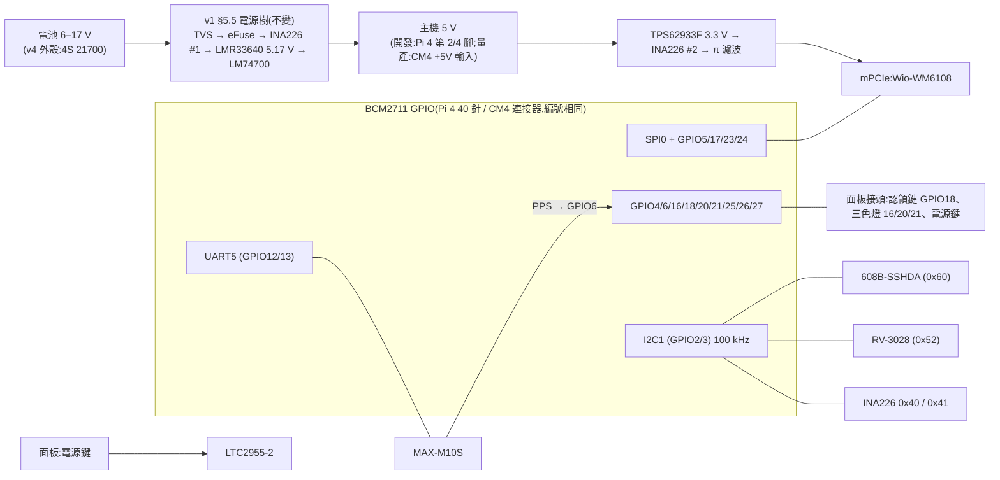

# Batman HAT v2:一塊板、兩種主機——開發插 Pi 4,量產插 CM4

狀態:**DRAFT v0.20**(2026-10-20)。第一、二輪審查皆 REJECT;第三至五輪資安 REJECT;第六至九輪三位皆 APPROVE-WITH-CHANGES、0 BLOCKER;**第九輪電源與資安已只剩 MINOR**,軟體 2 個 MAJOR 已在本版處理。處理見 §17–§25;**第十輪待審**。
- **審查分兩段**(使用者 2026-10-20):本文審「開發版(插 Pi 4)」與「量產版必須在擺件前定案的銅箔決定」(§7.4 接腳處置表、§7.5 上電與反灌)。量產版其餘部分(簽章開機、燒錄流程、量產生命週期、熱)另寫 `docs/design/hat-v2-production.md`,量產打件前審完。
- v0.8:拿掉 TPM;量產與民用都用 CM4。
- v0.9:**同一塊板**,開發期用 40 針插在 Pi 4 上,量產期直接插 CM4 當 IO 板(使用者 2026-10-20);外殼不能大改。依 CM4 規格書 RP-008168-DS-4 定孔位、連接器、堆疊高度(§7)。
- 修訂紀錄見 §16。

主單:#227。決策單:#240。需求來源:#219 §8.5(H1–H11)、#256、#300、#302。外殼:#228。軟體配合:#223(#224–#226)、#239。

> 標記慣例(沿用 `hat-v1-spec.md`):**【事實】** = 本專案實測、原始碼、規格書或 repo 檔案可查證;**【推論】** = 由事實推出、尚未實測;**【決策】** = 使用者已拍板(附日期);**【提案】** = 本文提出、待審查或待使用者拍板;**【待量測】** = 要實物量過才能定;**【搜尋結果】** = 只看到搜尋摘要,原文被本環境的網路代理擋住,要人工確認。

---

## 0. 一句話

**一塊板、兩種主機**:
- **開發期**:板子用 40 針排針插在 **Pi 4** 上(當 HAT)。
- **量產期**(軍用、民用都一樣):**同一塊板**直接插 **CM4**(當 IO 板),CM4 掛在板子背面,佔用原本 Pi 4 的空間,裝進同一個外殼。

板上的電源、608B、RTC、GNSS、HaLow 插槽、按鍵與燈號,兩個階段完全相同;差別只在主機接在哪個介面(§7)。

## 1. 已定的方向(使用者 2026-10-20)

| # | 決定 | 影響 |
|---|---|---|
| X1 | **拿掉 TPM**,安全元件只留 ATECC608B | §5.1;TPM 的查證結果留在附錄 A |
| X2 | **開發用 Pi 4、量產用 CM4**;不用 CM3+、不用 Pi 3A+ | §7 |
| X3 | **民用版也改 CM4**;開發也只用 Pi 4 | 不必相容 3A+;#219 的平台假設要跟著改(§2.4) |
| X4 | **同一塊板**:開發插 Pi 4、量產插 CM4(IO 板);**外殼不能大改** | §6、§7 |
| X5 | RTC 保留 RV-3028;GNSS 走 UART,不走 I2C;USB hub 不上開發 HAT | §5 |
| X6 | QR 貼在通訊本體底面、被電池盒蓋住 | §5.8 |
| X7 | 不加 GNSS 電源閘;新 HAT 只跑新 image | §5.4、§11 |
| X8 | GPIO19 保留;三色燈由新程式控制,到貨後設計 | §4、§8 |
| X9 | **VLM(PTT 對講音訊)內建在新板上**;沒有 PTT 的機型不焊這一區 | §5.10 |
| X10 | **審查分兩段**:先審開發版與擺件前要定的銅箔;量產其餘另寫設計 | 狀態列、§16 |
| X11 | CM4 的 Wi-Fi / BLE 天線:**上蓋可加孔**,屆時與外殼一起審 | §7.3 |
| X12 | **買 bench 機**:不部署的 Pi 4 一台、CM4 + 官方 IO Board 一組,專供 v2 驗證 | §14 |
| X13 | **開發版不用裝進外殼**(只用在桌上與測試架);量產版必須裝進 v4 外殼 | §6.2 |
| X14 | **608B 綁主機**:簽章與 ECDH 槽要主機授權才能用,授權秘密只有簽章開機後的 CM4 導得出(第二輪 D1) | §5.2 |
| X15 | HaLow 卡導熱墊改 **1.5 mm**(第二輪 D2) | §7.2 |
| X16 | **全板 1 oz 銅、小過孔**,大電流靠鋪銅加寬(第二輪 D3) | §6.2、§5.5 |
| X17 | **USB 每埠限流依實際裝置壓低**;板上 VLM 不經限流開關(第二輪 D4) | §5.5、§7.4 |
| X18 | **EEPROM_nWP 經量產必焊的 0 Ω 接地**(第二輪 D5) | §7.4 |
| X19 | ~~Wi-Fi / 藍牙硬體關閉腳接到面板~~ → 由 X20 取代;上蓋開關仍要重選或重設計(第二輪 D6) | §5.6 |
| X20 | **發射管制(EMCON)**:面板開關只當輸入;板上保留切斷 HaLow、RAK、Wi-Fi、藍牙的硬體能力,由軟體依分級控制;分級與通訊窗口另開單和 #181 一起設計(第三輪 D7) | §5.6、§5.12 |
| X21 | 量產版 40 針焊墊**不加**隔離 0 Ω,風險寫進威脅模型(第三輪 D8 b) | §12 |
| X22 | **CM4 OTP 私鑰在 CM4 上產生、不出機**;執行期鎖住讀取;工廠不保存(第三輪 D9 a) | §5.2 |
| X23 | **608B 由 #254 的 `batman-provhelper` 存取**(它的 `se` 後端),交握在 helper 內完成,不對外提供 ECDH(第三輪 D10 a) | §5.11 |
| X24 | 3V3_SEC **預設不加負載開關**(0 Ω 二選一),V18 實測 CM4_3.3V 是否會低於 1.8 V 再決定(第三輪 D11 b) | §7.5 |
| X25 | payload 宣告**支援的 HAT 清單**(`hats=wm1302,v2`),清楚可查(第三輪 D12) | §13 |
| X26 | **Noise 交握維持 #254 的設計**(provd 是 Noise 終點);HAT 規格只寫明界線,「要不要搬進 helper」交給 #254(第四輪 D13 b) | §5.11、§12 |
| X27 | **發射管制擴充 IC 每次開機都回到「一般」**(RESET 接主機重置);要不要重新套用靜默由軟體決定;autocommit 要知道發射管制狀態(第四輪 D14 a) | §5.12、§10 |
| X28 | payload **沒有 `hats=` 欄位 = `wm1302`**;GPIO22 讀不到 = 非 v2(第四輪 D15) | §9 |
| X29 | **VLM 做在主板上,位置不預設**:新板重新設計,依 §5.10 的限制在擺件時決定;子板不是預設方案(第四輪 D16) | §5.10、§6.2 |
| X31 | **簽章規則**【決策,使用者 2026-10-20】:量產簽章金鑰只簽同時具備 `lock_device_private_key=1`、無序列主控台、USB 授權的 image;bench / 開發用 CM4 用**開發簽章金鑰**(第五輪資安 M4) | §5.2、§12 |
| X30 | **LoRa 先外接 RAK**(RAKwireless,**中國**);新板擺件完成後若有空間餘裕再評估上板(v1 §12 原列為 CM4 板新增區塊)(使用者 2026-10-20) | §2、§5.12 |

為什麼不用 CM3+【搜尋結果與 repo 事實,2026-10-20 評估】:
- 沒有無線,民用靠藍牙(#219 P11)會出局。
- BCM2837 不能簽章開機(`productization.md`)。
- 生產保證只到約 2028-01(第三方 endoflife.date;官方原文未找到)。

為什麼不用 CM5:CM5 透過 RP1 晶片出 SPI,HaLow 的 SPI 驅動還沒解決(`productization.md` 指向 `pi5-rp1-bringup.md`)【事實】。

## 2. 範圍

### 2.1 開發 HAT 上有的

| 區塊 | 內容 | 和 v1 比 |
|---|---|---|
| HaLow | mPCIe 插槽(Wio-WM6108),腳位照 v1 §4.1,一支都不動 | 同 |
| 安全元件 | **ATECC608B-SSHDA**(SOIC-8,I2C 0x60) | 608C → 608B;**拿掉 TPM** |
| RTC | RV-3028-C7 + 超級電容 | 同 |
| GNSS | u-blox MAX-M10S + 主動天線偏壓,走 **UART5** | 同 v1 的 UART5 |
| 電源 | v1 §5.5 全部:TVS、eFuse、兩顆降壓、兩顆 INA226、LTC2955 軟開關機、BAT_PRESENT | 同 |
| 面板接頭 | 電源鍵、認領鍵、三色燈 | 新增 |
| **VLM(PTT 對講音訊)** | CM108B USB 音效 + 93C46 EEPROM,相容 OpenVLM;K 頭插孔經線材接到外殼側壁 | 新增(§5.10),v1 §12 原本就規劃放在 CM4 板上 |
| **主機介面** | 40 針排針(開發,接 Pi 4)+ CM4 板對板連接器 ×2(量產) | 新增 CM4 介面(§7) |
| CM4 周邊(量產才用) | USB hub、USB 開機燒錄、EEPROM 寫入保護、GPIO_VREF | 新增(§7.4) |

### 2.2 開發 HAT 上沒有的
- **TPM**(X1):量產板若要認證再評估,見附錄 A。
- LoRa:沿用外接的 RAK 模組,經 USB 接(§7.4)。PTT 音訊改為內建(§5.10)。
- USB hub:開發期用 Pi 4 自己的 USB 埠;**量產插 CM4 時由板上的 USB hub 提供**(§7.4)。
- HAT ID EEPROM:v1 §5.7 已拿掉。
- QR 區:QR 貼在外殼(§5.8)。

### 2.3 #219 §8.5 需求對照

| # | 需求 | 開發(插 Pi 4) | 量產(插 CM4) |
|---|---|---|---|
| H1 | 所有 SKU 焊 608B-SSHDA | §5.2 | 同 |
| H2–H5 | 認領鍵(開機預設下拉的 GPIO)、凹陷按鍵、三色燈 GPIO 16/20/21 | §4、§5.6;按鍵本體在外殼 | 同 |
| H6 | QR 綁 608B 所在的板 | **改需求**:QR 貼本體底面(§5.8) | 同 |
| H7 | 3A+ 可用 | **不再需要**(X3) | — |
| H8 | USB hub | 用 Pi 4 的 USB 埠 | **板上 USB hub**(§7.4) |
| H9 | 民用不依賴 RTC | 相容 | 同 |
| H10 | 不擋藍牙天線 | Pi 4 天線禁佈區(§6.3) | CM4 用 U.FL 外接天線(§7.3) |
| H11 | QR、按鍵不拆殼就碰得到 | 按鍵經面板接頭;QR 轉開電池盒可見 | 同 |

### 2.4 民用改 CM4 對其他文件的影響(本文不改,列出待辦)
- `docs/design/219-field-provisioning.md`:P11(民用 SKU = 3A+)、H7、§9 的 `[pi3]` distroconfig、B12(3A+ 512 MB 記憶體)都以 3A+ 為前提。
- `docs/productization.md`:「Pi 3A+ = civil SKU」與硬體分級表。
- `CLAUDE.md` 與 `docs/boards-and-builds.md`:目前的兩塊板是 `ekh-bcm2711`(Pi 4)與 `ekh-bcm2710`(Pi 3A+)。CM4 和 Pi 4 同為 `bcm2711` 子目標,但 CM4 會是**新的實機驗證對象**(CLAUDE.md:每塊板的 image 都要實燒驗證)。
- 以上由各自的單號處理(#219、#228),不在本 PR 改動。

## 3. 方塊圖



## 4. GPIO 分配

Pi 4 與 CM4 是同一顆 BCM2711;CM4 把 GPIO0–27 全部引到連接器上(例如 GPIO12 = 第 31 腳、GPIO13 = 第 28 腳、GPIO18 = 第 49 腳)【事實,CM4 規格書 RP-008168-DS-4 腳位表】→ 本表兩個階段通用。開機預設 GPIO0–8 上拉、9–27 下拉【事實,CM4 規格書 RP-008168-DS-4 表 1(GPIO 預設狀態)】。

| GPIO | 用途 | 開機預設 | 說明 |
|---|---|---|---|
| 0 / 1 | **不接,連 40 針第 27、28 腳也不連線** | 上拉 | HAT+ 規格 §2.3:只能接 ID EEPROM【事實,v1】。量產版 40 針不焊,若連線就會露出 ID EEPROM 匯流排,讓人外接 EEPROM 注入 overlay(§12) |
| 2 / 3 | I2C1:608B 0x60、RV-3028 0x52、INA226 0x40 / 0x41 | 上拉 | 100 kHz(608B 喚醒脈衝,v1 §7);CM4 模組上已有 1.8 kΩ 上拉【事實,CM4 規格書 §2.5】,Pi 4 待對照(A4)→ 板上不另加 |
| 4 | BAT_PRESENT(低 = 有電池) | 上拉 | 同 v1 |
| 5 | HaLow IRQ | 上拉 | 不動 |
| 6 | GNSS PPS | 上拉 | 補上 WM1302 拿不到 PPS 的缺口(#300 B-1) |
| 7 | **不可用**(SPI0 CE1) | 上拉 | 同 v1 |
| 8–11 | HaLow SPI0 | — | 不動 |
| **12 / 13** | **GNSS:UART5 TXD / RXD** | 下拉 | 同 v1。UART5 是 PL011,鮑率時脈不跟 core clock 走,不會和 HaLow SPI 的 core_freq 互相牽制【推論,依 BCM2711 UART 架構】 |
| **14 / 15** | **開發用序列主控台**,只拉到 Tag-Connect 焊墊 | 下拉 | 【提案,O9】見 §5.7。**今天的 image 在這兩支腳上開 root 主控台**(§5.7);量產前由 #302 的程式修正拿掉 |
| **16** | 燈:紅 | 下拉 | #128;下拉 = 開機時不亮 |
| 17 | HaLow reset | — | 不動 |
| **18** | 認領鍵(按下 = 3V3) | 下拉 | H4 |
| 19 | 保留(使用者 2026-10-20) | 下拉 | — |
| **20 / 21** | 燈:綠 / 藍(顏色對應以 #128 為準) | 下拉 | #128 |
| **22** | **板子識別 strap**:板上 10 kΩ 上拉到**主機 3.3 V**(不接 3V3_SEC) | 下拉 | 【提案】讀到 1 = v2 板。「WM1302 讀到 0」**沒有證據**:repo 沒有 WM1302 的 GPIO22 接線資料;v1 `design.py:370` 在 GPIO22 有 10 kΩ 上拉(R62,改 v2 時移除)→ A18 在 02、04、空的 Pi 4、CM4 IO Board 上唯讀實測後才能定 |
| 23 / 24 | HaLow wake / busy | — | 不動 |
| 25 | INA226 ALERT | — | 同 v1 |
| 26 | LTC2955 INT(電源鍵要求關機) | — | 同 v1 |
| 27 | 軟關機:N-FET → LTC2955 KILL | — | 同 v1 §5.5.3 |

- **藍牙**:現行 Pi 4 image 有 `dtoverlay=miniuart-bt`(藍牙搬到 mini UART、GPIO14/15 變成 PL011 = serial0),#254 的 `ble-ok` 閘門也要求它【事實,`254-stage1-impl.md:421`、`254-reviews/review-v1-B.md:138`】。v2 的 GNSS 在 UART5,藍牙可以回到 PL011(拿掉 `miniuart-bt`)【提案】,但要和 #254 的閘門一起改,否則兩份設計的契約衝突(O13)。
- 不論藍牙放哪,**GNSS 都在 UART5,不在 serial0 上**,所以 #302「GNSS 對登入主控台打字」在接線上已經不會發生【推論,依腳位】。
- 燈的驅動:GPIO 不直接推 LED,每色一顆 N-FET;電流、電壓待外殼選料(#128)【提案】。

## 5. 各區塊

### 5.1 TPM:拿掉

- **決定**(X1):開發 HAT 不放 TPM,安全元件只用 608B。
- **為什麼可以拿掉**【推論,依 repo 事實】:
  - 民用設計本來就寫明「沒有 TPM」(#219 §4)。
  - Pi 沒有開機量測(measured boot),TPM 分辨不出開的是不是我們的系統。保護資料加密金鑰要靠**簽章開機 + SoC 的 OTP 私鑰**,這在 Pi 4 / CM4 上做得到,不需要 TPM(`productization.md`)。
  - TPM 在 Pi 上剩下的價值是**認證**(SLB9673 只剩 CC EAL4+ 有效,FIPS 已轉為 Historical)和**硬體防猜 PIN**。這兩項是量產產品的需求,不是開發板的需求。
- **省下的**:
  - 時脈延展問題(SLB9673 需要主控端支援 I2C 時脈延展)、獨立的軟體 I2C、GPIO12/13/22 都不用了。
  - 不必自行打包 OpenWrt 沒有的 tpm2-tss(v1 §7.1)。
  - 少一顆 A 級零件(約 US$4)和它的周邊。
- **之後**:量產版若客戶要求認證,再評估加 TPM。SLB9673 的查證結果(接腳、時脈延展、證書、韌體鎖定)整理在**附錄 A**,不用重查。

### 5.2 ATECC608B(未設定版)

- 未設定版,I2C **0x60**;腳位與 608C、TNGLORA 相同【事實,#240、#300】。設定區鎖定不可逆:**槽位配置先在消耗品上實驗**(#219 §8.5、#240)。
- **包裝與擺位**【提案,第二輪資安 B1】:改用 **UDFN 包裝**(未設定版 ATECC608B-MAHDA,待查是否與 SSHDA 同為 0x60、同設定)放在**背面 CM4 陰影區**,I2C 只走內層。量產時 CM4 蓋在上面,測試夾夾不到。SOIC-8 的 SSHDA 是 #219 H1 指定的,換包裝要回寫 #219。
- I2C 不接到 mPCIe(mPCIe 第 30、32 腳不接,v1 §4.1)【事實】。
- **綁主機**(X14、X22,使用者 2026-10-20):
  - 威脅:偷到量產機的人拔掉 CM4,在同一塊板的 40 針孔焊上排針、插到自己的 Pi 4,就能用正式的出廠身分金鑰(DAC)簽章【推論,第二輪資安 B1】。
  - 做法【提案】:608B 的 DAC 槽與 ECDH 槽設成**需要授權才能用**(KeyConfig 的 ReqAuth + AuthKey)。授權值 = CM4 韌體以 OTP 私鑰算出的 HMAC(固定標籤)。
  - **不可逆參數**(第三輪資安 BLOCKER,#219 鎖槽前定案):
    - 授權槽:`IsSecret=1`、不可讀、**WriteConfig = Never**;在鎖資料區前寫入。否則小偷可以把授權槽改成自己知道的值。
    - 設定區必須先鎖。
    - 產線 CA 在簽 DAC 前,**讀回 608B 設定區**確認 ReqAuth 位元與鎖定狀態,不符就不簽。
  - **OTP 私鑰的產生**(X22):在 CM4 上產生,不離開機器;授權值也由 CM4 自己經 I2C 寫進 608B,燒錄站只下指令、看不到值,日誌不得記錄。Raspberry Pi 官方範例是在機外用 openssl 產生並建議另存備份【事實,`raspberrypi/rpi-eeprom` `tools/rpi-otp-private-key` 使用說明】,我們**不照做**,否則違反 #219 P8「工廠不保存秘密」(`219-field-provisioning.md:28`)。CM4 韌體能不能在機上產生並寫入 OTP 待實測(A19)。
  - **執行期鎖讀取**:量產 config 加 `lock_device_private_key=1`(新版韌體才有,CM4 支援度待實測,A19)【事實:選項存在於 `rpi-otp-private-key` 說明】;授權值改由韌體的 HMAC 服務(`rpifwcrypto`,`/dev/vcio_crypto`)算,私鑰不進 userspace。
  - **界線**(第三輪資安 M2、第四輪資安 m1)【推論】:綁定只擋「**從沒在原 CM4 上拿到 root 的人**」。拿到過一次 root,就能叫韌體算出授權值,之後換主機照樣用 → 只能靠 #219 的 DAC 撤銷。而且 CM4 的簽章開機**沒有防降版**:偷到機台的人可以用 rpiboot 載入任何一版「舊的、有 root 漏洞、但有我們簽章」的 image → 「拿到 root」的入口是**所有歷史簽章 image 的漏洞**。防降版交給量產設計。
  - **舊簽章 image 可以直接讀出私鑰**(第五輪資安 M4)【推論】:`lock_device_private_key` 寫在 config.txt;任何一版**沒有這行**的舊簽章 image,root 能直接讀出 OTP 私鑰本身(`vcmailbox 0x00030081`),不只是叫韌體算授權值 → 私鑰永久外流,依賴 OTP 的資料加密金鑰一起失守。#302 修正前的 image 在 GPIO14/15 上就是 root 登入,門檻可能只是 rpiboot 載入舊 image 加一條序列線。對策見 X31。
  - `rpifwcrypto` 說明寫明 `lock_device_private_key` **不防 root**【事實,`raspberrypi/utils` rpifwcrypto README】。這把 OTP 金鑰若也給其他用途(例如 Pi Connect),HMAC 標籤要分開(domain separation)。A19 若在 CM4 上不成立,退路是:私鑰在機上產生後只存 OTP、授權值由 provhelper 在開機早期算一次後清除【推論,量產設計再審】。
  - helper 每次「授權 + 操作」後**立刻讓 608B 睡眠**,把授權的有效時間縮到最短(第三輪資安 M3)。睡眠指令可能被干擾而沒送到,授權有效時間的**硬上限是 ChipMode 的 watchdog**(1.3 s 或 10 s)→ 選 **1.3 s**【推論,依 cryptoauthlib `ATCA_CHIPMODE_*` 定義,V24 驗證】。
  - **完整的不可逆設定表**(第四輪資安 M1)要在 #219 鎖槽前列出並經審查,至少包含:
    - 每個槽的 SlotConfig / KeyConfig(DAC、ECDH、授權、IO 保護金鑰、認領秘密);
    - **ChipMode**:`UserExtraAdd` **不允許**(否則能碰匯流排的人可用 UpdateExtra 永久改掉 608B 位址,provhelper 找不到晶片、`backend=se` 拒絕啟動 = 永久拒絕服務,`254-stage1-impl.md:215`);watchdog 1.3 s;
    - DAC / ECDH 槽**不允許執行期 GenKey**;
    - IO 保護:ECDHPROT、KDFPROT 開啟;**主機端那一份 IO 保護金鑰存在哪裡**(建議同樣由韌體 HMAC 導出,不落地);
  - **產線 CA 比對設定區的 golden digest**,不是只看 ReqAuth 位元。每顆不同或會變的位元組要**遮罩後另外驗**:SN(byte 0–3、8–12)、RevNum、Counter(52–67,另驗等於出廠初值)、UserExtra(84,另驗是否為 0x00)【推論,依公開的 608A 設定區配置】;其餘全部比對。
  - 設定值補充(第五輪資安 m2):ECDHPROT / KDFPROT 的值定為「只允許加密輸出,或只輸出到槽 / TempKey」;**認領秘密槽設 SlotConfig.NoMac**(否則能碰匯流排的人可用 MAC 指令當回應 oracle);「計數器遞增要授權」公開資料看不到這個機制 → **改為不要求**:誤遞增只會多要求一次按鍵,是 fail-safe。
  - **授權只用晶片 RNG 產生的 nonce**,不用主機給的(pass-through),避免在 40 針焊墊上錄下一次授權交換後重放(X21)。
  - **時程**:#219 的 608B 槽位實驗(B1)**鎖槽之前**定案。cryptoauthlib 的 ReqAuth 授權流程整段在 `#if 0` 裡(`lib/pkcs11/pkcs11_session.c:615–724`,commit d49c7d5)【事實,第三輪資安】→ 讀原始碼答不了,**只能靠消耗品實驗**(A14、V24)。
  - 開發版(Pi 4,沒有簽章開機):**608B 設定區和量產相同**(V24 才驗得到量產設定),授權值改由開發用的固定 KDF 輸入產生、只在開發機上。**開發晶片鎖區後立刻用 UpdateExtra 把 UserExtra(byte 84)寫成開發值**(不可逆;開發工具把「鎖區 → UpdateExtra → 讀回確認」做成同一步驟,任一步失敗就報錯,第六輪資安 F5。兩道晶片指令之間斷電會留下「已鎖、UserExtra = 0x00」的開發晶片 → **開發工具每次啟動先偵測這個狀態,補寫並讀回確認,完成前不做其他事**,第七輪資安 m2);產線 CA 只接受 UserExtra = 0x00 的晶片,簽完再寫入量產值 → 開發時鎖好的晶片不會拿到正式 DAC(第五輪資安 M3)【推論:UpdateExtra 只在原值為 0 時寫得進去,V24 驗證】;身分由**開發 CA** 簽,開發 CA 私鑰**不進 repo**(#254 拒絕過內建開發 CA,理由是「公開 repo 的 CA 私鑰 = 假信任根」,`254-stage1-impl.md:79`);開發機用 `batman-prov-dev/1` prologue(`219-protocol.md:52`)【事實:引用;提案:做法】。
  - **維修代價**:CM4 壞了,608B 綁著那顆 CM4 → 換 CM4 也不能沿用身分,整台要重新出廠或換板【推論】。
  - 遺失機台:DAC 撤銷流程交給 #219。
- 出廠初始化由 #219 的燒錄站負責。
- **TPM 拿掉後,608B 是唯一的安全元件**:沒有硬體防猜 PIN;IO 保護金鑰只保護 ECDH / KDF / Verify 的輸出,不保護 Sign / MAC(#240 留言)。

### 5.3 RTC — RV-3028-C7

不變,見 v1 §5.1 末段與 §5.3:超級電容 CPH3225A,約 2 天;overlay 要帶 `trickle-resistor-ohms`。OpenWrt 沒有 `kmod-rtc-rv3028`,要自製(#240 C8)。

CM4 本身沒有 RTC【事實,v1 §5.3】,量產插 CM4 時同樣用板上這顆。

### 5.4 GNSS — MAX-M10S,走 UART5

- **接腳**:GPIO12(UART5 TXD)→ GNSS RXD、GPIO13(UART5 RXD)← GNSS TXD,同 v1【提案:改回 v1 的接法】。
  - v0.1–v0.7 為了 3A+ 改走 GPIO14/15 的 mini UART;3A+ 不再需要(X3),改回 UART5。
  - UART5 是 PL011,GNSS 的鮑率不受 core clock 影響【推論】。但藍牙與開發用主控台總有一個在 mini UART 上,core clock 仍會被固定(#254 要求 `core_freq_min=500`,`254-stage1-impl.md:421`),所以「不牽動 HaLow SPI 時脈」這個好處不成立【事實,第二輪軟體 m9】。
  - #254 把 `ttyAMA*` 當成實體主控台(`254-stage1-impl.md:218`),而 UART5 也會是 `ttyAMA*` → #254 的判斷要改成看實際 console 設定(O13)。
- **主控台規則**(#302):主控台永遠不和任何周邊共用 UART。GNSS 專用 UART5;主控台若有,只能在 GPIO14/15(§5.7)。
- **不加 GNSS 電源閘**(X7)。#302 的防線是**接線**:GNSS 在 UART5,主控台在 serial0(GPIO14/15),兩者不同 UART。
  - 這條防線**不靠 cmdline**。`batman-slot` 把 `console=serial0 console=ttyUSB0,115200 console=tty1` 寫死,且每次 OTA 的 `apply` 都會重寫目標槽的 cmdline【事實,`batman-slot:36`、`:674`;建卡腳本 `build-gpt-ab-card.sh:151`、`build-ab-image.sh:170` 同樣寫法】。所以「量產 image 不開主控台」**不能靠燒卡設定**,要由 #302 的程式修正處理(§13)。
  - UART5 的 tty 名稱要在 `config.txt` 開 overlay 後實測確認(A5),並寫進 gpsd 設定;禁止任何 console 參數指向它。
- 天線:主動式、LNA 前有 SAW 預濾波,加偏壓,同 v1 §5.4。
- PPS → GPIO6(`pps-gpio`)。

### 5.5 電源

**電路沿用 v1 §5.5 全部**(設計值、模擬、方案 D 電源樹審查)。v2 的差異:

1. **電源鍵改瞬時型**:LTC2955 的 PB 要瞬時按鍵。v4 外殼現在是自鎖開關、直接控制 Mini560 的 EN(`hardware.md`)→ 外殼換成瞬時按鍵(#228)。自鎖開關改接 LTC2955 的 ON 腳不可行:TSOT 版的 SEL 內部接地,ON 下降不會關機(v1 §5.5.2)。
2. **外殼的 Mini560、INA226、DS3231 模組取消**,由 HAT 取代。保險絲、PTC 留在電池盒(`hardware.md`)。
3. **主機 5 V**(網路 `5V_HOST`):開發期接 Pi 4 第 2/4 腳;量產期接 CM4 的 +5 V 輸入(第 77、79、81、83、85、87 腳)。
   - CM4 的 +5 V 輸入建議範圍 **4.75–5.25 V**,絕對最大 6.0 V;上電要單調上升,運作中全程 ≥ 4.75 V【事實,CM4 規格書腳位表、表 3、第 25 頁】。
   - 板上 5 V 設定 5.17 V(v1,100 k / 24 k 回授,`design.py:186-187` 用 **0.5%** 電阻)【事實】。電阻約 ±0.8%,再加 LMR33640 的 VFB 公差(待查,A12)與負載瞬變過衝,上限會貼到或超過 5.25 V【推論,審查 M1】。超過是違反建議範圍,不會燒毀。
   - **量產版 BOM 改設 5.05–5.10 V,回授用 0.1% 電阻**;開發版維持 5.17 V(Pi 4 端要補排針壓降)。O12 本來就分兩份 BOM。
   - **下限也要分析**(第三輪電源 M2):量產設定點壓低後,到 CM4 端只剩約 0.15 V 餘裕(規格書理想 > 4.9 V,含雜訊【事實】),要吸收設定點公差、LM74700 FET 壓降、1 oz 銅壓降、DF40 接點電阻、HaLow 發射突波(TPS62933F 吃同一條 5 V 軌,v1 `hat-v1-spec.md:262`)。處置【提案】:
     - LMR33640 的 FB 改 **Kelvin 取樣,取樣點在 DF40 的 +5V 腳**(LM74700 之後)。**取樣線斷掉會讓 FB 被拉到 0、輸出衝向 VSYS(最壞 19.6 V,`design.py:502` 的 eFuse OVP 最壞值),燒掉 CM4 或 Pi 4**(第四輪電源 M1)【推論】→ 分壓電阻留在 IC 旁;10–50 Ω 的**本地備援電阻**從 5V_BUCK 接到**分壓器頂端節點**(0 Ω 選擇之後,兩顆 0 Ω 都漏焊時仍安全);取樣點用 0 Ω 二選一(開發版取本地、量產版取 DF40);**crowbar 放在 5V_BUCK**(降壓 IC 輸出、LM74700 / 旁路**之前**;第八輪電源 M1、m2)(比較器 + SCR,例如 TI 比較器、Littelfuse SCR,皆美國廠;部分 SCR 在中國廠生產,選料查 COO):放在 5V_BUCK 才能涵蓋**旁路跳線開路**的情況(跳線開路時回授隔著備援電阻去穩 CM4 端,5V_BUCK 會升到約 9 V 至 VSYS,而 5V_HOST 一直低於觸發點)【推論】;開發版的 LM74700 擋住 Pi 4 USB-C,只插 USB-C 時 crowbar 不會短路 Pi 的 5 V。**比較器的電源與參考取同一個 VSYS 來源,參考不在 = 不觸發;SCR 閘極加下拉**。**觸發點取視窗中點約 5.56 V**(第九輪電源 m2;5.5 V ±1.5% 的下限 5.4175 V 低於 5.42 V,自相矛盾),**含公差的上限 V_trip,max ≤ 5.7 V**(5.8 V 時 (6.0 − 5.8) / 0.1 = 2 µs、餘量為零);**下限 V_trip,min ≥ V_out,max + 卸載過衝**,開發與量產各列一次:開發 5.17 V 加 0.5% 電阻與 VFB ±1% 約 5.27 V,加過衝 0.1–0.15 V → V_trip,min ≥ 約 5.42 V;量產 = 設定點 5.05–5.10 V **加 5V_BUCK 到 DF40 的 IR 壓降(旁路、L1 → DF40 的 1 oz 銅箔,約 20–40 mV)**加過衝【推論】→ 中點 5.56 V 可容許約 ±2.5% 的總公差。**A12(VFB 公差)要在選比較器與參考 IC 之前查清**:若 VFB 是 ±1.5%,開發版視窗不夠(第九輪電源 m3)。參考 IC 與電阻精度等級寫進 BOM(第八輪電源 m3);**反應時間 t_react ≤ (6.0 − V_trip,max − 餘量) / (dV/dt)max**。5 V 軌電容 6 × 22 µF 0805(`design.py:183-185、202、214-215`)【事實】,扣直流偏壓後約 60 µF、高側限流約 6 A 級【推論,A12】→ dV/dt 約 0.07–0.1 V/µs,**目標 ≤ 1–2 µs**(20 µs 會過衝到約 6.5–7 V,第六輪電源 M1),拆成「比較器 tpd + SCR 的 t_gt」兩段;**比較器的參考電壓不取自故障中的 5 V 軌**(取 VSYS 經 LDO,和比較器電源同一來源;**參考要在 EN_5V 之前穩定**;比較器選**供電低於最低值時輸出為低**的型號,VSYS 上升期間不誤觸發;參考 IC 單獨開路 = 誤觸發(安全方向),參考卡高 = 永遠不觸發(潛伏故障)→ 量產加 crowbar 功能測試點,第九輪電源 m4)。以上 dV/dt 只涵蓋 FB 斷線;上管短路時電流由 eFuse 的暫態反應決定,G1 前補分析【推論,第七輪電源 m3】。觸發後 LMR33640 進 hiccup 限流;**上管短路時 eFuse 是 5.0 A auto-retry、不是斷開**(`design.py:136、142`)→ **SCR 的 I_T(RMS) 與 I_TSM 依 eFuse 5 A auto-retry 的熱循環選定,長期不開路**;另加**電容放電**條件:觸發瞬間約 60 µF(加主機端電容)從 5.7 V 倒進 SCR,峰值可達數十 A,選型要列 di/dt、I²t,必要時加 mΩ 級串聯限流(第八輪電源 m4)【推論】;**C14–C16(10 V X5R,`design.py:183-185`)的耐壓與備援電阻的功率,依「旁路開路」情境重選**(理由:避免電容在 5 A auto-retry 下過壓、短路發熱;**crowbar 是單點保護,沒有第二道**,SCR 燒成開路時 19.6 V 經備援電阻打到主機,電容耐壓救不了主機,第九輪電源 m5);旁路元件也要列**脈衝額定**(SCR 觸發時主機端電容的數十 A 經旁路倒灌)。v0.17 的「串一顆由 crowbar 燒斷的保險絲」**撤回**:保險絲必須長期通過約 3.6 A 正常負載,額定 ≥ 4 A 的保險絲在 5 A 脈衝下不會斷(第七輪電源 M1)【推論】。另一條路是把 eFuse 改 latch 模式,會重開 v1 的決定,不採用。**不用 TVS**:5 V 級 TVS 的崩潰電壓下限約 6.4 V,壓不住 CM4 的 6.0 V 絕對最大值,而且會被 4 A 級電流燒毀(第五輪電源 F1)【推論】;
     - LM74700 是為了擋 Pi USB-C 倒灌才加的(`hat-v1-spec.md:168`),量產接 CM4 沒有 USB-C → **量產版用 ≥ 4 A 跳線焊位旁路**(§7.9);
     - 評估 HaLow 的 TPS62933F 改從 LM74700 之前取電,突波不直接打在 CM4 輸入;
     - 列出上下限完整視窗表(公差 ± 壓降 ± 瞬變),必須落在 4.9–5.25 V,G0 前完成。VFB 公差以 ±1% 估(A12),4.9–5.25 V 只剩約 ±110 mV 給瞬變【推論】。
   - V18 依 CM4 規格書第 26 頁的方法:2 A 負載下 5V_HOST > 4.9 V、量瞬變上限。
4. **3V3_SEC**(608B、RTC、GNSS,< 150 mA,v1 §5.5.5 #15):開發期取自 Pi 4 的 3.3 V;量產期取自 CM4 的 `CM4_3.3V` 輸出,可供 **600 mA**(每腳 300 mA)【事實,CM4 規格書】,足夠。
5. **I2C 上拉**:CM4 模組上 GPIO2/3 已有 1.8 kΩ 上拉【事實】;Pi 4 待對照(A4)。板上不另加。
6. **GPIO 負載**:CM4 的 28 支 GPIO 合計負載要低於 50 mA【事實】。三色燈用 FET 驅動,不從 GPIO 直接取電(§4)。
7. **5 V 電流預算**【推論,第二輪電源 M5】:
   - `boards.py` 的數字是 RAK19003 0.2 W + RAK4631 0.4 W(RAKwireless,**中國**深圳;外接模組,X30) + VLM 0.3 W = 0.9 W,而且是**平均發熱估計**,不是峰值(v0.12 寫 0.5 W 是誤引)【事實】。
   - 最壞情況粗估:CM4 約 2 A(規格書只給典型 1.4 A,最大值待查)+ HaLow 換算到 5 V 0.85 A + hub 本身 0.1 A + CM4_3.3V 外部負載約 0.2 A + USB 下游。若 USB 埠照標準 0.5 A 算,合計約 4.2 A,超過 LMR33640 的 4 A。
   - **處置(X17)**:hub 下游每埠的限流開關設在實際裝置需要的值(RAK 約 0.2 A,待量);板上 VLM 直接由板上電源供電,不經 USB VBUS 限流。這樣最壞約 3.6 A【推論】,擺件前依實測定案(V18)。
   - **DF40 每腳額定電流**沒查(A23)。審查者憑記憶約 0.3 A / 腳,6 支 +5V 腳約 1.8 A,可能低於 CM4 的 2 A【推論,未查證】→ 讀 Hirose 規格書並加溫度降額;CM4_3.3V 的外部負載也是經這 6 支腳進來的,一起算。
8. **銅厚**(X16):全板改 **1 oz**(原 PLAN §7 為外層 2 oz)。
   - PLAN 的預算以外層 2 oz 0.246 mΩ/□ 算【事實,`PLAN.md:53`】;1 oz 約加倍【推論】→ **A3 約 3.6 mΩ 超過上限 3 mΩ、A5 約 1.6 mΩ 超過上限 1 mΩ**(`PLAN.md:61、63`)。
   - v1 的熱處置靠「外層 2 oz + 散熱過孔」(`hat-v1-spec.md:226、593`)→ 這等於**重新打開 v1 審查 #19(熱)**。
   - G0 前:重做 A1–A8,新增「L1 → DF40 77–87」一列;熱改用內層 GND / 5V 鋪銅加熱過孔陣列,重估 LMR33640 與 TPS62933F 在 3.6 A 時的溫升;寫明小過孔尺寸與每顆電流,A8 的過孔數依此重算(`PLAN.md:68`)。

### 5.6 面板接頭(新)

外殼上的電源鍵、認領鍵、三色燈,經一個低高度接頭接到 HAT【提案】:

| 腳 | 訊號 | 備註 |
|---|---|---|
| 1 | GND | |
| 2 | PB(LTC2955) | 電源鍵 |
| 3 | CLAIM(GPIO18) | 串聯電阻 + ESD;HAT 上預設下拉 |
| 4–6 | LED R / G / B 驅動(開汲極) | HAT 上的 FET 驅動 |
| 7 | LED 陽極電源(3V3 或 5V) | 依外殼燈的選料 |
| 8 | EMCON(發射管制開關) | 接 §5.12 擴充 IC P0;串聯電阻 + ESD;HAT 上預設上拉 = 一般 |

- 接頭建議 JST SH 1.0 mm 側插(日本)【提案】,高度、位置配合外殼 #228。兩個階段是同一塊板,接頭與腳位自然相同,外殼線材不必改。
- **ESD**:按鍵線拉到外殼面板,是新的外部接觸點 → 每條線加 TVS 或 ESD 陣列。
- **安全**:CLAIM 是 #219 認領窗口的觸發鍵,實體在場才能按,這是預期的信任邊界;它不碰任何秘密線路。CLAIM 事件送到 `batman-provhelper`,見 §8、§9。
- **發射管制開關**(X20):上蓋一個自鎖開關,接到 §5.12 的 I/O 擴充 IC 當**輸入**,軟體依分級決定關什麼。
  - 面板接頭多 1 腳(共 8 腳);**上蓋開關要重選或重設計**:電源鍵改瞬時型(§5.5 第 1 點),另加一個發射管制的自鎖開關 → 交給外殼 #228。
  - 開關線拉到上蓋,是新的外部接觸點 → 加 ESD 保護(第三輪電源 m8)。
  - 開關斷線 = 讀到「一般」= 無線照常:fail-open(O17)。

### 5.7 除錯

- **GNSS 不和主控台共用 UART**(#302):GNSS 在 UART5。
- **GPIO14/15 的現況**【事實,審查 B1、B2】:
  - 現行 image 開了 `miniuart-bt`,GPIO14/15 = PL011 = serial0;cmdline 寫死 `console=serial0`(`batman-slot:36`)→ **這兩支腳上就是 root 主控台**。
  - 這兩支腳本來就在 Pi 4 的 40 針上,開發版多一組 Tag-Connect 焊墊並沒有增加暴露【推論】。
- **開發用主控台**【提案,O9】:GPIO14/15 拉到 **Tag-Connect TC2050 焊墊**,不裝接頭,供 #105 擷取當機輸出。
- **量產版**:主控台要由 #302 的程式修正拿掉(§13);修好之前,量產版不放行。另外 bootloader 的 `BOOT_UART` 設 0(§7.4)。
- Tag-Connect 另帶 HaLow SPI0、IRQ、BUSY、GND、3V3 感測(同 v1)。
- **I2C 不放測試點**:I2C 上有 608B。限制:40 針焊點本來就碰得到 I2C(§12 寫明實體攻擊者能做什麼)。
- 電源測試點、INA226、eFuse 燈:同 v1 §5.6。

### 5.8 QR(不在 HAT 上)

- **QR 貼在通訊本體的底面,被電池盒蓋住**(X6)。HAT 和電池盒內部都封在殼裡看不到,所以 #219 H6「貼在 HAT 上」與 #256「貼在電池蓋內側」都不可行。
- **為什麼不印在外殼外面**:QR 裡有 `device_id` 與 **256 bit 認領秘密**(#219 §4、§6.1),等於這台機器的權狀。U4 的界線是「認領只防不在身邊的人與沒拿到 QR 的旁人」。印在外面,路過拍照的人就拿到了;而從未認領的機台每次開機都開放認領窗口【推論】。
- 這個位置同時滿足:組裝好時旁人看不到(U4);轉開電池盒就看到、不用工具(H11);旋轉卡扣有 O-ring 密封【推論】。
- **空間**【推論,依 Batman-P `enclosure-v4` 模型】:本體底面 63 × 43 mm,中間約 40 × 36 mm 是 pogo 與卡扣,兩側各剩約 11 mm 寬 → QR 約 10 × 10 mm,偏小,**V15 實印試掃**。
- **保護範圍要說清楚**【審查 M5】:這個位置只擋「沒碰過機器、也沒碰過包裝的人」。換電池的隊友、修理行看得到;盒內卡跟著包裹走;若電池依運輸規定與本體分開寄,物流途中 QR 是露出的;標籤印表機的列印佇列也會經手秘密。
  - 對策(交給 #219):出貨時電池盒先裝上,或 QR 貼紙加封條;**軍用機型是否貼 QR、是否開認領窗口**另行決定(O14,建議都不要)。
- 交給 #219 / #228:出廠要配對本體與板子;換任一個要重印;盒內卡仍是備援(P8)。

### 5.9 供應鏈

分級規則照 v1 §5.8,A 級零件不交中國組裝廠(v1 §5.9)。A 級清單:

| 零件 | 廠商(所有權) | 備註 |
|---|---|---|
| ATECC608B-SSHDA | Microchip(美國) | 取代 608C |
| RV-3028-C7 | Micro Crystal(瑞士) | 同 |
| MAX-M10S | u-blox(瑞士) | 同 |
| CM4(量產) | Raspberry Pi Ltd(英國) | 有韌體、存 OTP 金鑰 → A 級;產地待查 COO |

- 新增的 C 級料:面板接頭、ESD 陣列、燈驅動 FET。
- 已知例外:Wio-WM6108(Seeed / Quectel,**中國**,v1 §5.8);mPCIe 插座 C7498130(連欣科技,**中國**,C 級,v1 §6.4)。

### 5.10 VLM(PTT 對講音訊)— 內建,相容 OpenVLM

- **決定**(X9,使用者 2026-10-20):VLM 做在新板上。v1 §12 原本就寫「PTT 是 CM4 底板才新增的區塊」;v0.10 以前漏了這一點。
- **只有有 PTT 的機型焊這一區**:C1、C3、T1、T2(#219 §3.2 能力表)【事實】。其他機型不打件,外殼不裝 K 頭插孔。
- **電路**:照 OpenVLM VLM-KW 的做法【事實,github.com/OpenMANET/OpenVLM `README.md`、`docs/cli-reference.md`】:
  - **C-Media CM108B**(**台灣**)USB 音效晶片,USB 識別碼固定 0x0D8C:0x0012;
  - **93C46** SPI EEPROM(128 bytes),出廠用 `openvlm provision` 寫入;
  - CM108B 的 **GPIO1 接高**:openmanetd 用它分辨「OpenVLM」與一般 CM108 裝置;
  - K 頭 PTT 鍵接 CM108B 的 GPIO3,走 USB-HID 回報;openmanetd 設定 `controlSource=openvlm`(`expansion-gps-ptt.md`)。
- **K 頭插孔**:3.5 mm(PJ-392)與 2.5 mm,中心距 11.5 mm,仍裝在外殼右側壁(Batman-P `boards.py`)【事實】;用 JST SH 5 腳線接到板上(現行 VLM 板的 J3 就是這樣接)。
- **USB 怎麼接到主機**:
  - 量產(插 CM4):CM4 USB → 板上 USB hub → CM108B;hub 另一埠給 RAK(§7.4)。
  - 開發(插 Pi 4):Pi 4 的 USB 不在 40 針上 → 板上留一個 USB 上游接頭,用短線接 Pi 4 的 USB-A → 同一顆 hub → CM108B【提案】。所以**有 PTT 的機型,開發版也要焊 hub**。
  - hub 的上游來源(CM4 或接頭)依打件版本選一個,不是安全網路,不受 D12 限制。
- **授權**:OpenVLM 是 **CERN-OHL-W v2(弱互惠)**【事實,OpenVLM `LICENSE`】。照抄它的電路,出貨時這一塊(含我們的修改)要以 CERN-OHL-W 公開;板子其他部分不受影響【推論,非法律意見,商品化前請專業確認】。另一條路是依 C-Media 規格書自己設計,只沿用 GPIO1 / EEPROM 的識別慣例。
- **面積與雜訊**【推論】:CM108B 為 LQFP-48;OpenVLM 板上另有 27 顆電容、13 顆電阻,加 LDO、FET、EEPROM(`VLMKW0100_top_cpl.csv`)【事實】→ 估約 **250–400 mm²**(v0.12 的 150–250 偏樂觀,第二輪電源 m8)。
- **位置不預設**(X29):新板重新設計,擺件時依下列限制決定,VLM 必須在主板上:
  - **CM108B 不能放 CM4 陰影區**:本體 7 × 7 × 1.4 mm【事實,LCSC 上的 C-Media 規格書摘要】,含腳的離板高度約 1.5–1.6 mm【推論,JEDEC LQFP】,超過陰影區 ≤ 1.2 mm 的限高(第四輪電源 M4)。沒有找到 QFN 版或同功能的較矮料;CM119B 也是 LQFP-48【搜尋結果】。
  - 可能的區域【推論】:HaLow 卡下方(卡底面離板約 3.0–3.3 mm,`PLAN.md:35`、`design.py:348`;卡下零件 ≤ 1.9 mm,`PLAN.md:33`)、正面其他區域、板邊延伸區(≤ 3.9 mm;後蓋螺絲柱 (31.5, 95.75) 投影範圍內 ≤ 0.9 mm,§6.2)。小零件(≤ 1.2 mm)可分散到陰影區。
  - 類比音訊遠離兩顆開關降壓與 HaLow 卡的天線端;類比地與開關節點隔開;放 HaLow 卡下方時,V19 的「HaLow 發射時音訊雜訊」是判定條件。
  - K 頭線材接頭靠近外殼右側的插孔。
- **ESD**:K 頭插孔是外部接觸點,MIC、SPK、PTT 三條線都加 ESD 保護(第二輪電源 m9),V7 一起測。
- **供電**:VLM 由板上電源直接供電,不經 hub 下游的限流開關(X17)。
- **耗電**:約 0.3 W(Batman-P `boards.py` 的估計)【推論】。
- **外殼**:原本放在前層的 VLM 板(53 × 26.5 mm)拿掉,空間省下;RAK 的 USB 改接板上。
- **供應鏈**:CM108B(台灣,B 級,有邏輯、無可改寫韌體【推論,待查 CM108B 是否有可寫的內部韌體】);93C46 選非中國廠(例如 Microchip,美國)。

### 5.11 裝置節點權限

**前提**【事實】:
- 核心沒有 `CONFIG_CGROUP_DEVICE`(`security-profiles.md:35`,#109),容器的裝置白名單沒有強制力。
- `/dev` 是 devtmpfs,每次開機重建;uci-defaults 只跑一次 → 權限要用 **procd 的 hotplug 規則**在每次開機與每次裝置出現時套用(第二輪軟體 M5)【推論,實作時確認 procd `hotplug.json` 的擁有權】。
- gpsd 目前以 `nobody` 執行,系統沒有 `gpsd` 群組(`254-reviews/254-stage1-impl-v1.md:29`)→ 要新增專屬的系統使用者與群組【提案】。
- 已上線的租戶設定都帶 `--cap-drop=ALL`(`deploy/*/*.hardening.env`),但 `payload-lib.sh` 的檢查**只允許、沒有強制**這個參數:`:41、43` 收任何 `--cap-drop` 值都放行,`:64` 的 guardian `docker inspect` 不看 CapDrop【事實】→ 新租戶漏掉就會帶著 `CAP_MKNOD` 跑。
- **前提可能有誤**(第三輪資安 m7)【推論】:docker 在 cgroup v2 是用 eBPF(`CONFIG_CGROUP_BPF`)管裝置,不是 `CONFIG_CGROUP_DEVICE`;節點用 cgroup v2(`payload-host-packages.txt:47`)【事實】。要先在節點上唯讀查 `zcat /proc/config.gz | grep CGROUP_BPF`(A20)。若有,V20 的「刻意給 CAP_MKNOD 能讀 0x60」正向對照會失敗,那代表前提錯,不是測試壞。

| 裝置 | 權限 | 誰能用 | 說明 |
|---|---|---|---|
| `/dev/i2c-1` | root:root 0600 | provhelper;**例外**:`batpower` 的 i2cget 來源(`batpower:45`)也是 root → 改成只用 hwmon,或寫明例外 | 能開它就能叫 608B 簽章、改 RTC、控制發射管制 IC |
| 其他 `/dev/i2c-*`、`/dev/spidev*` | root:root 0600 | root | — |
| `/dev/gpiomem`、`/dev/mem` | root:root 0600(或核心不提供) | root | 能開 gpiomem 就能把 GPIO2/3 改成輸出,自己模擬 I2C 操作 608B(第二輪資安 M3) |
| `/dev/vcio`(VideoCore mailbox)、`/dev/vchiq`、韌體 HMAC 的裝置節點(名稱待 A26 實測,可能就是 vcio) | root:root 0600 | **所有 root 程式**:provhelper、`batman-slot`、`platform-ab.sh`、autocommit、meshled、`bootfacts.sh`、`95-batman-storage` 都用 vcmailbox / vcgencmd(第四輪軟體 #8) | vcio 能讀 OTP 私鑰(`vcmailbox 0x00030081`,未鎖時)【事實,`rpi-otp-private-key`】、能叫韌體算授權值 → 權限擋不住其他 root 程式,這是 X22 界線的一部分 |
| `/dev/gpiochip*`、`/sys/class/gpio` | root:root 0600 | root | 能拉 GPIO27(KILL)斷電、GPIO17 重置 HaLow |
| `/dev/mmcblk0*` | root:disk 0660 | root | eMMC / SD 全部內容 |
| GNSS 的 tty(UART5) | root:gpsd 0660 | gpsd(新增的系統使用者) | 名稱待實測(A5) |
| `/dev/pps0` | root:gpsd 0660 | gpsd / 時間程式 | — |
| `/dev/rtc0` | root:root 0600 | 時間程式(root,唯一寫入者);**例外**:開機 restore(S12)用一支**另寫的小工具**以 `RTC_VL_READ` 讀 PORF 與時間,只讀(`batman-faketime` 是 busybox sh,`:1`,下不了 ioctl;工具列進套件,第七輪軟體 #7) | 寫入者見 §8 |
| RAK 的 tty | root:dialout 0660 | Meshtastic 工具 | — |
| VLM 的 hidraw / ALSA | root:audio 0660 | openmanetd | — |

**608B 的存取者 = #254 的 `batman-provhelper`**(X23、X26):
- #254 已經審過一支 root 的 `batman-provhelper`:SEQPACKET socket 加 `SO_PEERCRED`(只接受 provd 的 uid,`254-stage1-impl.md:156`),keystore 有 `file|se` 兩個後端,`se` 就是留給 608B 的(`:12、103-106`)【事實】。
- **`se` 後端只替換 keystore 實作**(#255),對外介面沿用 #254 §4.1 的動詞表。沒有 `keystore.ecdh`(解密 oracle,`:176`),ECDH 只在 helper 內部做(`:188`);`sign.peer` 的被簽內容由 helper 自己組(`:164`)【事實】。
- **協定以 v0.7 為準**(Noise `NX` / `NXpsk0`):節點每次開機產生 `s_node`,DAC 每次開機簽 `batman-node-static-v1 ‖ s_node_pub ‖ boot_id`(`219-protocol.md:52-60、76`);`s_node` 放在 provd 記憶體(`254-stage1-impl.md:149`),**Noise 終點在 provd**(`:178`)【事實】。v0.14 引用的舊 SIGMA 標籤(`batman-hs-v1`)與「helper 產生臨時金鑰、輸出 session key」撤回(第四輪軟體 #1、資安 M2)。
- **界線**(X26)【推論】:provd(非 root、藍牙可達)被攻陷 = **這次開機期間**可被遠端冒充(它能把 `s_node` 與 `node_cert` 外送);helper 只守長期金鑰、ECDH 與改網。「把 Noise 搬進 helper」交給 #254 另議。
- 「曾被認領」計數器的遞增是 helper 的操作(`219-field-provisioning.md:334`);限速;helper socket 沿用 #254 的 `/tmp/run/batman-prov/helper.sock` 0660(`254-stage1-impl.md:103、128`,provd 要連得上);helper 自己的狀態檔(用過的來源)放 `/tmp/run/batman/`(root 0700,§8)。
- #219 文件(`:200、529`)要改成經 provhelper。
- **認領鍵與認領窗口**(第五輪軟體 #1、資安 M1、M2):
  - **窗口只由 provhelper 擁有**(開啟來源、時長、計數):v2 的兩個來源(未認領的機台每次開機、按鍵,`219-field-provisioning.md:346`)都由 helper 合併;SD 標記延後到 #255(下文)。provd 讀到的判決只拿來顯示 UI 與藍燈。
  - **需要實體在場的動詞由 helper 自己檢查窗口**:`claim.verify`(今天只驗 CheckMac 加 legacy 防呆門,`254-stage1-impl.md:166、385-397`)與 #255 的換擁有者。被攻陷的 provd 直接送 → `E_FORBIDDEN`。否則「provd 被攻陷 ≠ 能換擁有者」(`:12`)不成立。
  - **按鍵來源**:provhelper **直接讀 GPIO18**(gpiochip 的 line event),**不經 button-hotplug**。理由:button-hotplug 會比對所有送 EV_KEY 的輸入裝置,不只 gpio-keys【推論,依 OpenWrt `button-hotplug.c`,行號待附】→ 偽造的 USB HID(改韌體的 RAK、冒充 0D8C:0012)送同一個按鍵碼就能開窗口。**電源鍵**(第六輪資安 F2、軟體 m5):`rc.button` 收到的環境變數只有 HOME、PATH、SUBSYSTEM、ACTION、BUTTON、SEEN、SEQNUM,沒有來源裝置,腳本**無從核對來源**【事實,上游 `button-hotplug.c:131-156`、`gpio-button-hotplug.c:141-172`】;`kmod-button-hotplug` 會比對**所有**帶 EV_KEY 的輸入裝置(`button-hotplug.c:298-302`)【事實】 →
    - **只用 `gpio-button-hotplug`**(只認 DT 的 gpio-keys 節點,不建立 input 裝置;v1 也是選它,`hat-v1-spec.md:505`);
    - image **禁止帶 `kmod-button-hotplug`**,`build-board.sh` 檢查到就讓 build 失敗;
    - 這樣 USB HID 送 KEY_POWER、KEY_RESTART、WPS 等按鍵碼都不會觸發 `rc.button/power`、`reset`、`wps`、`dpp`(`254-stage1-impl.md:145、148`);
    - 其他輸入裝置 `inhibited=1`、`/dev/uinput` root 0600 或不帶 kmod-uinput,只當**縱深防禦**(註冊到寫入 `inhibited` 之間有空檔)。
    - **Magic SysRq 與 Ctrl+Alt+Del**(第七輪資安 M1):核心的 SysRq 輸入處理器只要開了 `CONFIG_MAGIC_SYSRQ` 就會掛上,不需要 VT【推論,`drivers/tty/sysrq.c`】→ 偽造的 USB 鍵盤送 Alt+SysRq+B / O / E / C 就能重開、斷電、殺行程、crash,和電源鍵效果相同,而且重開機會讓發射管制期間發射(§12)。repo 內**有**依賴 SysRq 的地方:`scripts/daily-validation.sh:2148` 寫 `kernel.sysrq=1` 再 `echo c > /proc/sysrq-trigger` 觸發 panic 測 pstore,`docs/crash-debug.md:89、97` 也依賴同一機制【事實,第八輪資安 m3 更正 v0.18 的「grep 無結果」】→ 量產關 SysRq 後,這個測試**在量產 variant 改用其他 panic 觸發方式,或依核心設定判斷**(不能標 `na`:CLAUDE.md 規定 `na` 只用在 SoC 本來就不適用的 suite,量產 / 開發是 build 的差別,第九輪資安 #6);OpenWrt 的 `KERNEL_MAGIC_SYSRQ` 預設開啟【推論,依記憶】。處置:**實際防線是核心設定**:量產關 `CONFIG_MAGIC_SYSRQ`,開發設 `CONFIG_MAGIC_SYSRQ_DEFAULT_ENABLE=0`;cmdline 加 `sysctl.kernel.sysrq=0` **只是縱深防禦**:cmdline 每次 OTA 由**正在跑的舊版** `batman-slot` 的 `CMDLINE_COMMON` 重寫(`batman-slot:36`),第一次 OTA 進來的新 image 還不會有這個參數(和 §13 第 10 項的 console 同一種情況);`CMDLINE_COMMON` 兩板共用,依 CLAUDE.md 雙板實測(第九輪資安 #5);**量產核心關 `CONFIG_MAGIC_SYSRQ`**,`build-board.sh` 檢查到就讓 build 失敗;開發版 tty1 的 Ctrl+Alt+Del 列為開發版接受的風險。節點上唯讀探測 `/proc/sys/kernel/sysrq`(A29)。
    - build 檢查也確認核心沒有 `CONFIG_KEYBOARD_GPIO`,否則它會和 gpio-button-hotplug 搶 gpio-keys 節點【推論,第七輪軟體 #8】。
  - **GPIO18 只有 provhelper 一個擁有者**(第六輪資安 F1、軟體 M1):overlay 的 gpio-keys 節點**只放 GPIO26**;GPIO18 不寫進任何 DT 按鍵節點(只設 pull-down)。否則 `gpio-button-hotplug` 先申請這條 line(`gpio-button-hotplug.c:420、501、525`)【事實】,helper 再申請會 EBUSY,認領鍵永久失效。helper 用 **chip label(pinctrl-bcm2711)加 offset** 找這支腳,不用 gpiochip 編號;申請失敗 → 告警並 fail-closed(不開窗口)。
  - **root 可偽造認領鍵**(gpio-sim / configfs 做假 chip,或先把 GPIO18 申請走):屬 root 已失守的範圍(X22 界線,root 也能 setuid 成 provd);量產核心關 `CONFIG_GPIO_SIM`,加上 chip label 核對(第六輪資安 F4)。
  - 按鍵時間由 helper 收到時用 **CLOCK_MONOTONIC** 自己打戳,不受 faketime / GNSS 時間跳動影響。
  - **開機期間的按鍵**(第六輪軟體 M2):`219-field-provisioning.md:514` 的「開機長按 = 恢復出廠」**已被 #254 的 U8 取代**,helper 沒有恢復出廠動詞(`254-stage1-impl.md:24、176、298`)【事實】→ 開機時按著鍵**只當「開啟認領窗口」的來源**,恢復出廠交給 #255。helper 在 S89 才起來,量不出按了多久,所以不做長按判定。**判定方式**(第七輪軟體 #2):helper 啟動時讀到高 → 啟動後 **T 秒(建議 10 s)內看到放開(下降緣)**,就算一次開機按鍵(每個 `boot_id` 一次);
  - **按鍵卡死在高**(面板線短路到 3V3):啟動後超過 T 秒仍為高才判定卡死;卡死時告警、不開窗口,之後要先看到一次放開、再按下才算數。
  - **每個窗口來源每次開機只算一次**(綁 `boot_id`):未認領機台的開機窗口、按鍵;helper 重啟**不重開**已用過的來源,否則能讓 helper 當掉的 provd 可以一直延長窗口(第六輪資安 F8)。
  - **SD 標記**:`219-field-provisioning.md:494` 的 SD 標記是「恢復出廠」標記(清除、刪標記、**重開**),而 U8 已把恢復出廠移出階段 1(`254-stage1-impl.md:71`)【事實】→ **SD 標記這個窗口來源整條延後到 #255**,v2 不實作(第七輪軟體 #3)。
  - **用過的來源存哪裡**(第八輪資安 MAJOR-2 更正):root-only run dir(tmpfs,每次開機為空)的檔案,帶 `boot_id`:
    - **不存在** = 本次開機第一次啟動:helper 先寫暫存檔、再 `link()` 成正式檔(不用 O_EXCL 加之後再寫,避免當掉時留下空檔被判成損毀);
    - **寫入順序:先記下「這個來源已用」,再開窗口**;否則開窗口後、記錄前當掉,重啟會再開一次(第九輪資安 #2);
    - 存在且 `boot_id` 相同 = helper 重啟,讀出已用過的來源;
    - `boot_id` 不同 = 舊檔,視同第一次,用 `rename` 覆蓋;
    - **損毀** = 全部已用過(fail-closed);
    - 只有 root 能刪這個檔(X22 界線內)。v0.18 的「缺檔 = 全部已用過」會讓每次開機都打不開窗口,撤回。
  - 開機時按下、在 helper 起來(S89)之前就放開的按鍵**會遺失**,使用者要再按一次(第八輪軟體 #7)。
  - 這些是**對 #254 的修改**(窗口從 provd 移到 helper、`claim.verify` 加窗口檢查),要經 #254 審查,列入 §13 第 9 項。

**容器**:payload 管理程式的檢查要**強制** `--cap-drop=ALL` 與非 root `--user`,guardian 也要檢查 CapDrop(§13 第 6 項)。

**USB 授權與序列登入**(第三輪資安 M6):
- 現況【事實】:ttyUSB0 / ttyAMA0 跑 askfirst → `login -f root`(`137-bootstrap-credential.md:9`),cmdline 也有 `console=ttyUSB0 console=tty1`(`batman-slot:36`)→ 任何 USB 轉序列晶片(例如 WCH CH340,**中國**)插上就成為 ttyUSB0 並拿到 root shell。
- 改為【提案】:
  - cmdline 加 `usbcore.authorized_default=0`(開機就生效,不是開機後才寫 sysfs);
  - 以**介面**為單位放行(`interface_authorized_default=0`):只放 CDC-ACM、Audio、VLM 的 HID;VLM 的 HID 不得成為按鍵來源(上一段:電源鍵只認 gpio-keys(GPIO26),認領鍵由 helper 直接讀 GPIO18);
  - 授權程式把 USB 描述元當成不可信資料;
  - **量產核心必須關 `CONFIG_VT`**(不是「或」):Ctrl+Alt+Del 由 VT 鍵盤處理器處理,掛在所有帶 EV_KEY 的輸入裝置上,和 tty1 有沒有開登入無關;`kernel.ctrl-alt-del=0` 時改送 SIGINT 給 init,procd 收到會 reboot【推論,procd `signal.c` 待查】→ 只關 tty1 擋不住偽造鍵盤重開機。`build-board.sh` 檢查;inittab 移除 ttyUSB0(第八輪資安 m1)。
- **擁有者與失效模式**(第四輪資安 m4):
  - 授權程式 = 一支 hotplug 規則觸發的 root 腳本(擁有者 §8);`interface_authorized_default` 是各 root hub 的 sysfs 屬性,不是 cmdline 參數 → 由同一支腳本在 hub 列舉時、下游裝置列舉前設好;
  - 授權程式不在或出錯 → RAK / VLM 不能用(**fail-closed**),健康檢查告警;
  - **開發版接受的風險**:開發版仍開 tty1,允許的 VLM HID 介面一樣能註冊為鍵盤輸入。
- 白名單用 VID:PID,可被偽造(例如 RAK 的 nRF52840 經 DFU 改韌體多報一個 HID)→ 只擋「隨手插一個」,不擋專門偽造。
- 更正:「插上就拿到 root」只在 `ttylogin` 未設時成立;認領上鎖後要密碼(`137-bootstrap-credential.md` §4)【事實】。

**負向測試**(V20),每條都配正向對照:
- 非 root `open("/dev/i2c-1")` → EACCES;主機 root → 成功(對照)。
- 沒有 `--cap-drop=ALL` 的 manifest → payload 管理程式拒絕;有的 → 通過(對照)。
- 刻意給 `CAP_MKNOD` 的測試容器內 `mknod c 89 1` 讀 0x60 → 能讀(對照,證明測試有效);正式租戶 → 失敗。
- provd 以外的 uid 連 helper socket → 拒絕;provd 送任意摘要要求簽章 → 拒絕。

### 5.12 發射管制的硬體能力(X20,第三輪 D7)

**為什麼**【推論,依公開資料】:戰場上有測向設備加無人機找發射源再攻擊的做法;軍方的發射管制是**分級**的,常見最高級是「只收不發」,次一級只在約定時間或特定頻率通訊(通訊窗口)。全部關掉等於沒帶機台,所以本板只提供**能力**,行為由軟體分級。

各無線電的風險不同【事實:HaLow 閒置也每 500 ms 發 ELP,`181-survival-strategy.md:99`;推論:其餘】:HaLow 公里級且持續發 → 最高;LoRa 只在送東西時發 → 中;Wi-Fi → 低到中;藍牙 → 低。手機用 Meshtastic 走的是 **RAK 自己的藍牙**(nRF52840,Nordic,挪威),和 CM4 的藍牙分開。

**硬體**【提案】:I2C1 上加一顆 **I/O 擴充 IC**(例如 TI TCA6408A,美國;位址 0x20,不和 0x40 / 0x41 / 0x52 / 0x60 衝突)。理由:GPIO 已用完(19 保留、22 給板子識別)。

| 擴充 IC 腳 | 方向 | 接到 | 擴充 IC 重置時(輸入 = 高阻抗)的結果 |
|---|---|---|---|
| P0 | 輸入 | 面板發射管制開關(低電位有效:閉合 = 拉到 GND) | 上拉 = 一般 |
| P1 | 輸出 | HALOW_OFF:經串聯電阻驅動 N-FET,把 TPS62933F 的 EN 拉低(HaLow 卡斷電),同時觸發 3V3_MPCIE 放電(§7.5 第 2 點) | 下拉 = 不切 → HaLow 照常 |
| P2 | 輸出 | RAK_OFF:**和 HALOW_OFF 相同結構**,N-FET 把 RAK 埠限流開關的 EN 拉低(EN 平時由主機 3.3 V 經電阻致能,§7.5 第 5 點) | 下拉 = 不切 |
| P3 / P4 | 輸出,**以 gpiolib 的 open-drain 旗標模擬開汲極**(TCA6408A 本身是推挽,A25) | WL_nDisable(89)/ BT_nDisable(91),經 0 Ω;**只在量產版作用**。CM4 內部已有 1.8 kΩ 上拉到 CM4_3.3V【事實,CM4 規格書 RP-008168-DS-4 接腳說明與 §2.1】,板上**不另加上拉** | 不拉 = 開 |
| P5–P7 | — | 保留 | — |

- **重置**(X27,第四輪軟體 #2、電源 M3):擴充 IC 的暫存器只有上電重置與 RESET 腳會清除【推論,TCA6408A 規格書不在 repo,A25】→ 暖開機、程式當掉都會保留上次的值。所以:
  - VCC 接 3V3_SEC;
  - **量產版 RESET 經 0 Ω 接 CM4 的 nEXTRST(第 100 腳,重置期間為低)**【事實,CM4 規格書 RP-008168-DS-4 接腳表第 100 腳說明】;
  - **開發版 RESET 用 RC 接主機 3.3 V**(上電重置);
  - **兩個版本都由開機早期的 init 腳本主動寫回「一般」**(第五輪電源 F3):CM4 規格書只寫 nEXTRST「重置期間為低」與冷開機時序,`reboot` / watchdog 重置時會不會拉低沒有證據(A27)→ nEXTRST 只當第二道;init 腳本先把輸出暫存器寫 0、再設方向,避免 P1 / P2 短暫輸出高誤切(上電時輸出暫存器預設 0xFF);**寫回「一般」必須在 mm6108 驅動載入之前**(第八輪軟體 MAJOR-2):mm6108 由 `/etc/modules.d/mm6108` 自動載入(`scripts/node/halow-fi-263.sh:33`)【事實】,kmodloader 比 init.d 早【推論】;暖開機時開發版擴充 IC 仍是切斷,卡沒電 → probe 失敗且不重試 → 這次開機沒有 HaLow。做法【提案,A30】:`kmod-gpio-pca953x` 放 `modules-boot.d`、由 **preinit hook** 寫回「一般」,之後才載 mm6108;退路:init 寫完後對 mm6108 的 SPI 裝置 unbind / bind 重新 probe;init 的動作條件 = **0x20 的 pca953x 已綁定**(這個 DT 節點只在 `[gpio22=1]` overlay 裡,本身就隱含 v2);**不在 preinit 讀 GPIO22**:OpenWrt 在 `/etc/init.d/boot` 才掛 debugfs,preinit 時很可能讀不到【推論,第九輪軟體 M2;A30】;節點不存在 → 不動作;節點存在但驅動沒綁 → 告警,並走 unbind / bind 退路;它和發射管制程式**同一個套件**,init 寫完才把 line 交給程式(第五輪軟體 m6);
  - 每次開機都回到「一般」;要不要重新套用靜默由發射管制程式依保存的設定決定(另開單)。
- **一般運作不依賴這顆 IC**:它沒焊、壞掉或沒被軟體設定時,所有無線照常(全部 fail-open 到「一般」)。
- **和 OTA 的關係**(第五輪軟體 #2、資安 M5):
  - **tryboot 試用期間,發射管制狀態一律不得放寬 mesh 閘門**:狀態是受測的新 image 自己寫的,不能替自己作保;
  - 發射管制程式在 `batman-slot is-trial` 回報已提交之前**不依保存的設定重新套用靜默**;但**實體面板開關照常生效**(第六輪軟體 M3):「受測 image 不能替自己作保」只針對放寬 mesh 閘門,開關撥到靜默時照常切斷,代價只是這次試用失敗、退回(fail-safe)。`is-trial` 回 2(未知)時發射管制**視為已提交**:這是**刻意和 autocommit 不同**(autocommit 回 2 時不提交;只有 DT 的 tryboot 旗標為 1 時才回退,非 tryboot 開機不提交也不回退,`batman-autocommit:70-75、323-327、410`)【事實】,理由是對發射管制來說「當成已提交」= 允許重新套用靜默,是比較安全的一側;
  - **靜默中時拒絕 OTA**:檢查放在 `node_checks`(`batman-slot:802`,即 `precheck-node`),stage 2 的 apply 也會再跑(`:564`)→ `-F` 繞不過;**靜默中 `batman-slot rollback` 也拒絕**:開發版的擴充 IC 只在上電時重置,回退到沒有發射管制 init 的舊 image 會停在靜默、節點失聯(第六輪軟體 m2);**判斷依據是擴充 IC 的實際輸出**,讀到 HALOW_OFF 或 RAK_OFF 有切斷就拒絕。讀法(第八輪軟體 MAJOR-1、資安 MAJOR-1):**禁止以「輸入」申請 P1 / P2**(TCA6408A 輸出會變高阻抗、被下拉,檢查本身就解除靜默【推論】);**程式活著時**(常態)line 被持有、申請會 EBUSY → **讀 gpiolib debugfs `/sys/kernel/debug/gpio`**(只列已申請的 line,含 out hi / lo,唯讀不改設定【推論,上游 `gpiolib_dbg_show`】)拿實際輸出,再和狀態檔交叉比對,**兩者任一顯示切斷就拒絕**(第九輪資安 #1、軟體 M1);**line 沒人持有**(程式 crash)→ 以 GPIO v2 uAPI **as-is 申請**(不帶方向旗標)讀值【推論:pca953x 的 get 讀的是 input port,也就是腳的實際電位;釋放時可能清掉 desc 旗標 → A31,V25 的「檢查前後 HALOW_OFF 不變」驗證】;**只有「0x20 不存在」才放行**,正面判準 = `/sys/bus/i2c/devices/1-0020` 沒有 DT 節點(非 v2 板);**v2 板上有節點但驅動沒綁、ramfs 缺 `/dev/gpiochip*` 等其他讀取錯誤一律拒絕**(第九輪軟體 m3);讀取由 `batman-hwprobe`(§13 第 15 項,列進 `RAMFS_COPY_BIN`,A28)做。v0.17 的「狀態讀不到 = 沒有東西會被卡住」不成立:程式 crash loop 時擴充 IC 仍保留上次的值(§10)(第七輪資安 m1);擴充 IC 本身讀不到(沒焊、壞掉)才放行;
  - **自動回退不經過 `rollback`**(第七輪軟體 #1、資安 m5):autocommit 回退走 `batman-slot reboot committed`(`batman-autocommit:196、245`),試用中 panic=10 也回到已提交槽【事實】→ 上面的 rollback 拒絕擋不到。對策是**發版順序規則**:宣告 `v2 ∈ hats` 的 payload **必須帶擴充 IC 的 init**,`build-board.sh` 檢查;發射管制 init(§13 第 11 項)**不得晚於** `hats=`(§13 第 2 項)上線。這樣 v2 板上任何可被退回的槽都有 init;
  - **靜默可以擋住安全更新**(第七輪資安 m3):誰能下靜默,誰就能讓機器停在有漏洞的版本 → O20 規定**靜默指令需要認證**(若可遠端下達);OTA 因靜默被拒時**告警**;解除程序 = 實體開關撥回一般、清除保存的設定;
  - 發射管制狀態的檔案契約見 §9。
- **硬體保證版本**(將來軍用;第四輪電源 M2、資安 M3):P0 開關是低電位有效,HALOW_OFF / RAK_OFF 是高電位有效,**極性相反,不能用 0 Ω 直連** →
  - 銅箔現在就留:開關 → **反相 FET** → 經二極體與擴充 IC 輸出**線或**到 HALOW_OFF / RAK_OFF;
  - WL / BT_nDisable 那兩條(第六輪電源 M2):**開關側不吸電流**。v0.16 的「開關經蕭特基直接拉低」不成立:電流經面板線上的串聯電阻(§5.6),root 推高 P3 / P4 時兩條線合計約 30 mA,100 Ω 就壓降 3 V【推論】 → 改由**反相 FET 的輸出(開關閉合 = 高)驅動兩顆 N-FET**,開汲極拉低 WL / BT_nDisable,Rds 在 Ω 級時低電位 < 0.1 V。擴充 IC 以 open-drain 旗標使用,P3 / P4 串 **220–330 Ω**(和 CM4 內部 1.8 kΩ 上拉分壓,加 TCA 的 VOL,低電位約 0.45–0.6 V;第 89、91 腳的 VIL 未公開,V25 實量)【推論】;**P0 上拉接主機 3.3 V**;
  - HALOW_OFF / RAK_OFF:擴充 IC 的串聯電阻 R_s 要**遠大於**反相 FET 的上拉 R_pu(≥ 10 倍),閘極下拉 R_pd 又要 **≥ 10 × R_s**(例如 R_pu 10 kΩ、R_s 100 kΩ、R_pd 1 MΩ),否則軟體切斷時閘極只剩約 1.65 V(第六輪電源 m2);**反相 FET 的上拉接主機 3.3 V**,不接 VSYS(否則主機沒電時經 TCA 的 ESD 二極體反灌 CM4_3.3V,第五輪電源 F5);
  - O17 若改常閉開關,反相 FET 的位置可改打成直通(兩種極性都做得到);
  - 硬體保證是**軍用機型的打件選項**,和有無 PTT 無關(§7.9)。
- **存取路徑**(第四輪資安 m3):用核心的 `gpio-pca953x` 驅動,發射管制程式走 gpiochip,**不開 `/dev/i2c-1`**(否則多一個能直接對 608B 下指令的 root 程式)。驅動綁定後 i2c-dev 對 0x20 會回 EBUSY,這是預期行為。
- **BOM 注意**:不得改用有內建上拉的替代料(例如 TCA9554 有 100 kΩ 內建上拉【推論】),否則重置時會誤觸 HALOW_OFF。
- Pi 4 沒有 WL / BT_nDisable 腳,開發版的 Wi-Fi / 藍牙只能用軟體 `rfkill`。CM4 規格書寫 WL_nDisable「prevents the wireless module from powering up」;執行中拉低能不能立刻停止發射是【推論】,V25 用頻譜儀驗證。
- **軟體行為**(誰能切、分級內容、通訊窗口時間表、SOS 怎麼打破、狀態顯示)**另開單,和 #181 一起設計**(O20)。#181 已規劃 V6 測 Meshtastic `tx_enabled` 不重開 RAK 能否切換【事實,`181-survival-strategy.md:201`】;RAK 韌體執行期改設定可能卡死(F11)。
- 面積約 +40 mm²(擴充 IC、反相 FET、二極體、電阻)。

## 6. 外形與機構

### 6.1 v4 外殼的可用空間(Batman-P `enclosure-v4/study/chassis.py`、`layout3d.json`,2026-10-20 讀取)

外殼座標:x 寬、y 深(前 → 背)、z 高。Pi 長邊直立,SD 卡端在下(z 98),USB 端朝上。

| 項目 | 數值 | 可信度 |
|---|---|---|
| 本體內寬 | x 2.5–60.5 = **58 mm** | 【事實,模型參數】 |
| Pi 疊層可用深度 | 中隔板背面 y 17.5 → 後蓋內面 y 40.5 = **23 mm** | 【事實】 |
| 可用高度 | 中框底面 z 92.5(pogo 佔位頂 z 95)→ 後窗框上緣 z 187 | 【事實】 |
| 今天的疊層 | Pi 4 PCB y 20.5–21.9;Pi 4 USB / 網路孔到 y 37.9、z 163–185;HAT y 32.9–34.5;WM6108 到 y 39.5;導熱墊到 y 40.5(壓後蓋鋁板) | 【事實】 |

### 6.2 板子外形

- 寬 56.5 mm、Pi 四個固定孔、40 針排針位置不變【決策,2026-10-20】。量產時同一塊板裝進外殼,所以**外形受外殼限制**(X4)。**開發版不用裝進外殼**(X13)。
- 加長方向只能往 SD 卡端,**上限約 3 mm**:再往下是 pogo 接收器與卡扣(z 95),兩側長條可到 5.5 mm【事實,模型座標】。USB 端開發期會撞 Pi 4 的 USB / 網路孔【事實】。
- **周邊限高**(第四輪電源 m11):後窗框平台在 y 38.0(`chassis.py:30`),範圍是窗口 x 6–57、z 97.5–187 以外(`chassis.py:28`)→ 板子周邊條帶的正面零件 ≤ 3.9 mm;SD 端加長區在窗口之外,同樣受平台限制 ≤ 3.9 mm(`chassis.py:28、87`);後蓋螺絲柱 (31.5, 95.75) 投影範圍內 ≤ 0.9 mm(第五輪電源 F9 更正 v0.15 無出處的 2.5 mm)。
- **後蓋螺絲柱共 8 個**【事實,`chassis.py:39-40、122-124`;審查 M6】:(4.25, 100 / 128 / 156)、(58.75, 100 / 128 / 156)、(31.5, 95.75)、(31.5, 188.75)。柱底在外殼 y 35.0;量產版板面改在 y 32.5 起算的正面(板厚 1.6 mm,正面約 y 34.1),淨空約 **0.9 mm** → 這些柱的投影範圍內,正面零件 ≤ 0.9 mm,G0 畫成禁高區。
  - x 58.75 那一排落在板座標 y 約 0–3.75,就是 40 針排針那一邊;開發版的排針焊腳會撞柱,但開發版不裝外殼(X13);量產版不焊排針,所以沒有問題【推論】。
- **面積**【推論,粗估;G1 用 courtyard 實算】:

  | 項目 | 增減(mm²) |
  |---|---|
  | 拿掉 TPM 與周邊、SPI1 走線 | 約 −60(省下) |
  | 面板接頭 + ESD + 燈驅動 FET | +55–75 |
  | CM4 周邊:USB hub 與晶振、USB 開機電路、接頭(§7.4) | +200–300 |
  | 加長 3 mm(扣掉天線條對齊) | 約 +100(多出) |
  | v1 已知不足(審查 §13 #5) | +300–600 |
  | DF40 ×2 的扇出過孔(0.4 mm 間距,貫穿正面)、CM4 固定柱 4 處(每處禁放約 Ø6) | 正面與背面都要扣【審查 M3】;**1 oz 小過孔**(X16)規格與板廠確認 |
  | USB 上游切換、VBUS 限流開關、USB ESD、RAK 接頭(§7.4) | +40–80 |
  | VLM(§5.10) | +250–400 |
  | §7.5 雙向隔離緩衝器、放電、3V3_SEC 負載開關焊位、hub 專用 LDO | +40–70 |
  | §5.12 發射管制 I/O 擴充 IC 與 FET | +30 |

  增量合計約 +865–1505 mm²,對上陰影區約 1200 mm²,**很緊**(第三輪電源 m10)。而且**要按高度分級**(第四輪電源 M4):
  - 陰影區只放 ≤ 1.2 mm 的零件;CM108B(約 1.6 mm)、hub 的 SSOP 包裝、C62(7343-20,1.9 mm,`design.py:339-341`)、電感(約 3.1 mm,`design.py:182`)都不能放;hub 選 QFN(例如 Microchip USB2514B,美國);
  - 預算表 G0 前改成三欄:≤ 1.2 mm(陰影區可放)、≤ 1.9 mm(HaLow 卡下方可放,和 §6.4、`PLAN.md:33、288` 一致;第五輪電源 F2)、更高(只能放正面開放區);
  - 面積比較要先扣掉 DF40 扇出與 CM4 固定柱在**正面**的禁放區。
  - 放不下時的刪減順序【提案】:① 開發用 Tag-Connect 焊墊移到正面;② 依 v1 §6.2;③ 板邊延伸;VLM 依 X29 留在主板,不列為刪減項。陰影區兩種版本都有零件 → **兩面迴焊**,成本列入。

  → **正面放不下**。背面 CM4 陰影區(3.0 mm 堆疊,CM4 底下淨空 1.5 mm)扣掉連接器、扇出、固定柱,再乘 60–70% 擺件密度,**約 1200 mm² 可用**,不是 v0.10 寫的 2000【推論,審查 M3】。陰影區零件 ≤ **1.2 mm**(留 0.3 mm 餘量)。
  - **Pi 4 天線條 (0,0)–(6.3,20)**:所有層不鋪銅、不放零件,**兩種打件版本都一樣**(銅箔不分版本)。CM4 外框在 x 5–6.3、y 8–20 和它重疊;**CM4 固定孔 (8.5, 11.5) 的接地焊墊(禁放約 Ø6)會侵入天線條**(第二輪電源 m7)→ **該孔改用不鍍銅孔、不接地**【提案,第三輪電源 m5 要求現在定】。CM4 固定柱:M2.5、3.0 mm 高(配合 3.0 mm 堆疊)。
  - **Pi 4 PoE 排針投影**(x 59–63、y 7–12):只是高度問題,背面這一區只放**量產版才焊**的零件(開發版不焊,不會撞 Pi 4)【推論,G0 驗證】。
  - **G0 用 courtyard 實算後才確定放不放得下**;放不下依 v1 §6.2 刪減。

### 6.3 天線禁佈區

- **Pi 4**:天線條 (0,0)–(6.3,20),所有層不鋪銅、不放零件(PLAN §0 決定 1)。
- 量產插 CM4 時見 §7.3。

### 6.4 高度與溫度

- 卡片下方 ≤ 1.9 mm(綁 5.2H 插座)、背面限高、固定柱 H5/H6:沿用 layout-v2 PLAN。
- **工作溫度**:開發期由 Pi 4 本身限制;量產 CM4 為 **−20 至 +85 °C**(無線最佳 −20 至 +75 °C)【事實,CM4 規格書 §3.2】。戶外低溫低於 −20 °C 的場合要另評估(O10)。

## 7. 兩種主機介面

### 7.1 CM4 的機構數字【事實,CM4 規格書 RP-008168-DS-4 §3.1、圖 4;使用者 2026-10-20 提供,另有 STEP 檔 RP-008170 / RP-008171】

| 項目 | 數值 |
|---|---|
| 外框 | 55 × 40 mm;模組厚 4.7 mm;PCB 1.2 mm |
| 固定孔 | 4 × M2.5,離邊 3.5 mm → CM4 自身座標 (3.5,3.5)、(51.5,3.5)、(3.5,36.5)、(51.5,36.5) |
| 板對板連接器 | 2 × 100 腳 Hirose DF40,中心線離上、下緣各 3 mm,中心 x = 25.0;第 1 腳在上排右端 |
| 堆疊高度 | **1.5 mm**(DF40C-100DS-0.4V,CM4 底下淨空 0)或 **3.0 mm**(DF40HC(3.0)-100DS-0.4V,CM4 底下淨空 1.5 mm);插上後總高 5.078 / 6.578 mm |
| 天線 | 板上 PCB 天線或 U.FL(CM4 座標 2.567, 9);`config.txt` 的 `dtparam=ant1 / ant2` 選擇;建議用外接 |
| 電源 | 單一 +5 V(4.75–5.25 V);對外 3.3 V、1.8 V 各 600 mA |
| 溫度 | −20 至 +85 °C(無線最佳 −20 至 +75 °C) |

### 7.2 擺位【推論,依上表與 §6.1 的外殼座標計算;G0 用 `sketch.py` 加入 CM4 外框驗證】

板座標 = Pi / HAT 座標(原點在 40 針排針那一邊的角,x 沿 Pi 長邊,y 0–56.5)。

- **CM4 在板子背面**(朝 Pi 的那一面),外框 x 5–60、y 8–48。
  - CM4 固定孔落在板座標 (8.5, 11.5)、(56.5, 11.5)、(8.5, 44.5)、(56.5, 44.5)。
  - 兩排連接器中心在 y 11 與 y 45,x 中心 30。**這只在其中一種面朝下的方向成立**:規格書圖 4 的連接器中心在 CM4 自身 x = 25,另一個方向會是 x = 35【推論,審查 m2】。方向定了,U.FL 與 SoC 位置也跟著定 → G0 依 STEP 檔定方向後寫回本節。
  - 離 Pi 四個固定孔的銅柱(外徑約 5 mm)最少 1.7 mm;離 40 針排針與它的手焊淨空(y ≤ 6.1)有 1.9 mm 以上。
  - CM4 是面朝下裝在板子背面,連接器腳位相對 CM4 正視圖要鏡像,畫封裝時照 STEP 檔核對。
- **開發期(插 Pi 4)**:開發版**不焊 CM4 插座**(O12),背面只有陰影區的矮零件(≤ 1.2 mm),離 Pi 4 最高的零件(約 6.0 mm)還有約 3.8 mm【推論】。若 Pi 4 SoC 加散熱片,依 v1 §6.1 另畫背面禁放區。
- **量產期(插 CM4,裝進外殼)**:
  - 板子沿用 **Pi 4 的四個固定孔**,用 **12 mm 標準銅柱**鎖在外殼現有的 Pi 固定柱上(柱頂 y 20.5),板面落在 y 32.5(今天 HAT 在 y 32.9)。
  - **HaLow 卡導熱墊改約 1.5 mm**(X15),但**厚度還不能定**(第三輪電源 M4):
    - v0.13 的「壓縮約 0.1 mm」是用外殼模型裡 WM6108 那個 5.0 mm 高的佔位方塊算的,那個方塊原本代表 WM1302 HAT【事實,`layout3d.py:42`、`layout3d.json`】。v2 用 5.2H 插座,卡片底面離板約 3.0–3.3 mm(`PLAN.md:35`;`design.py:348` 實拍約 3.15 mm),加卡片與卡上零件的高度,實際總高未知。
    - 0.1 mm 只有約 7% 壓縮,小於銅柱、PCB、列印外殼的公差總和【推論】。
    - 做法:用插座規格書加 WM6108 實測厚度重算;依選料取 **15–30% 壓縮**的厚度;外殼模型改用 v2 真實尺寸(V16);導熱墊選非中國廠。
  - 後蓋螺絲柱的淨空因此從 0.5 mm 變成 **0.9 mm**(§6.2 的禁高區跟著改)。
  - CM4 從板子背面往中隔板方向凸出:3.0 mm 堆疊時底面在 y 25.9(板面 y 32.5 − 6.578),離固定柱頂還有 5.4 mm【推論】。
  - HaLow 卡照舊朝後蓋,導熱墊壓後蓋鋁板,散熱不變。
  - CM4 SoC 朝中隔板,散熱改用銅片導到側壁(今天是 Pi 4 SoC 銅片,`layout3d.json`)。
  - 外殼要拿掉 Pi 4 的 USB 彎頭插頭預留區;RAK / VLM 改接板上的 USB(§7.4)。
- **用 3.0 mm 堆疊**【決策,使用者 2026-10-20,O11】:CM4 底下多 1.5 mm,陰影區可以放 ≤ 1.2 mm 的零件(§6.2)。量產期 CM4 底面離固定柱頂仍有 5.4 mm(§7.2 上一段)。
- **H5 / H6(HaLow 卡固定柱)的螺絲**不能鑽穿到背面陰影區,螺絲長度要限制【審查 m1】。

### 7.3 天線

- 開發期:Pi 4 的天線條禁佈區 (0,0)–(6.3,20),所有層不鋪銅、不放零件(§6.3)。CM4 的連接器與孔位都在禁佈區外【推論,依 §7.2 座標】。
- 量產期:CM4 選**有天線的版本、用 U.FL 外接天線**(規格書建議)。板上 PCB 天線需要至少 6.5 × 11 mm 不鋪銅、四周 10 mm 淨空,在這個疊層裡做不到【推論】。
- **天線出口**(X11,使用者 2026-10-20):**上蓋可以加一個孔**,和外殼(#228)一起審。今天上蓋只有 HaLow N 座、LoRa N 座、GPS SMA(`layout3d.json`)【事實】。
- **認證**:只有 Raspberry Pi 官方天線套件和 CM4 一起做過認證;換別的天線要另做認證【事實,CM4 規格書 §2.1】→ 建議用官方套件,詳細放進量產設計。

### 7.4 CM4 接腳處置表(擺件前必須定案)

量產版的銅箔和開發版是同一塊板,所以下列每支 CM4 腳**現在就要決定接到哪裡**。依據:CM4 規格書 RP-008168-DS-4 腳位表與 §2【事實】;處置為【提案】,第二輪審查重點。

| CM4 腳 / 功能 | 規格書要求 | 處置 | 理由 |
|---|---|---|---|
| +5V(77、79、81、83、85、87) | 4.75–5.25 V,單調上升 | 接 `5V_HOST` | §5.5 |
| GPIO_VREF(78) | 必須接 CM4_3.3V(84、86) | 直接接 CM4_3.3V | 不能空接或接地 |
| CM4_3.3V(84、86) | 合計 600 mA | 供 3V3_SEC、KILL / INT 上拉 | §5.5 第 4 點 |
| CM4_1.8V(88、90) | — | 不接 | 不需要 |
| GPIO0–27 | — | 依 §4 | 兩階段同一張表 |
| **ID_SD / ID_SC(GPIO0/1)** | HAT EEPROM 用 | **不接**,40 針第 27、28 腳也不連線 | 防止外接 EEPROM 注入 overlay(§12) |
| **EEPROM_nWP(20)** | 上電前就要是低電位;還要軟體設定 `eeprom_write_protect=1` 才生效(規格書 §2.18) | **經量產版必焊的 0 Ω 接地**(X18),0 Ω 放在背面 CM4 陰影區 | 真正的鎖是簽章開機燒進 CM4 的熔絲;0 Ω 保留日後修補 bootloader 的路(拆殼、拆 CM4 才碰得到)【推論】 |
| **nRPIBOOT(93)** | 拉低 → USB 開機燒錄;要在 +5 V 上升後 2 ms 內就是低 | 只拉到**燒錄治具用的測試焊墊**,放在**背面 CM4 陰影區**(CM4 裝上後碰不到) | 治具燒錄;簽章開機啟用後 rpiboot 能做什麼,寫進量產設計(A10) |
| **USB 2.0(D+/D−)** | 預設關閉,要 `otg_mode=1` | 經 **USB 2.0 類比切換器**:平時接板上 hub;治具拉 nRPIBOOT 時,同一條治具線把切換器切到燒錄焊墊(焊墊在陰影區)。切換器的選擇腳由治具焊墊驅動、板上預設下拉 = 接 hub;電源取 CM4_3.3V | 一組 USB 兼兩種用途 |
| USB_OTG_ID | 固定當主機或固定當裝置都接地(規格書第 6 頁) | **直接接地** | 燒錄時不必切換(第二輪電源 m2) |
| hub 下游 VBUS | — | RAK 埠一顆限流開關,限流值依實際裝置(X17);VLM 不經 VBUS | Pi 4 本來就有,CM4 沒有 |
| **hub 本身的電源** | 主機 +5 V 之前任何腳不得加電(CM4 規格書第 25 頁 §5.1) | **hub 專用 LDO**,致能由主機 3.3 V 控制;hub 的 D+ 上拉因此不會早於主機上電(第二輪電源 M6) | — |
| **RUN_PG(92)** | 拉低可重置 CPU | **不引出**,不放焊墊 | 減少實體攻擊面(§12) |
| **GLOBAL_EN(99)** | 拉低 = 最低功耗;內部 100 kΩ 上拉到 +5 V | 只拉到**陰影區的測試焊墊**(V18 負向對照用);電源由 LTC2955 切 5 V 主電源(v1) | 一個電源擁有者(§8);CM4 裝上後碰不到 |
| LED_nPWR | 要加緩衝才能推 LED | 不接 | 狀態燈由新的三色燈程式負責(§8) |
| **Pi_nLED_Activity(21)** | 可承受 5 V、可吸 20 mA;每次存取 eMMC 都會閃 | **和三色燈的紅色線或(開汲極並接)**;開機後設 `act_led_trigger=none`,韌體只在開機錯誤時閃 | 密封的量產機也看得到開機錯誤碼;紅燈的寫入者規則見 §8 |
| **WL_nDisable(89)/ BT_nDisable(91)** | 拉低 = 關閉無線;內部 1.8 kΩ 上拉 | 經 220–330 Ω + 0 Ω 接 §5.12 的 I/O 擴充 IC(open-drain 旗標);**硬體保證版由反相器輸出驅動 N-FET 開汲極拉低,N-FET 汲極直接接在 CM4 第 89、91 腳的網路上**(串聯電阻與 0 Ω 之外,0 Ω 漏焊或被拆也不影響),低電位才會 < 0.1 V(X20,第七輪電源 m2) | §5.12 |
| **nEXTRST(100)** | 重置期間為低 | 經 0 Ω 接發射管制擴充 IC 的 RESET(X27) | §5.12 |
| Ethernet、HDMI、CSI / DSI、PCIe、SD、SDA0 / SCL0(80、82)、Camera_GPIO(97)、AnalogIP0/1(94、96)、PCIe_CLK_nREQ(102)、Ethernet_SYNC、SD_VDD_OVERRIDE | — | 不接 | 外殼沒有對應開孔;CM4 有 eMMC |
| **Reserved(76、104、106)** | 規格書要求不可接任何東西 | 不接 | 第三輪電源 m1 補 106 |

- **40 針排針在量產版不焊**,它的焊墊會露出 I2C、SPI0、GPIO27(KILL)、GPIO14/15 等【事實,接線】,而且是貫穿孔,蓋不住。**D12 的例外**:這是「主機介面」的打件版本,不是可選的安全元件。對「換主機」的攻擊,真正的防線是 608B 綁主機(X14、§5.2);灌膠或封條只是事後看得出被拆【推論,第二輪資安 B1】。
- 打件版本見 §7.9。

### 7.5 上電、斷電與反灌(審查 BLOCKER)

- **規格書要求**【事實,CM4 規格書第 22 頁,腳位表後的說明】:CM4 斷電時,任何腳都不能被外部加電壓,否則之後可能開不了機;CM4_3.3V 對外供電時,斷電過程中不可以低於 CM4_1.8V;+5 V 單調上升、運作中全程 ≥ 4.75 V。
- **風險**【推論】:LTC2955 長按斷電或拔電池時,HaLow 3.3 V 軌上約 0.3 mF 電容(`design.py` C60–C62)會撐住數 ms;這段時間 HaLow 卡的 IRQ / BUSY / MISO 可能仍為高,經 GPIO 反灌進已斷電的 CM4。Pi 4 也有同樣的限制,v1 §5.5.5 #8 只分析了穩態。
- **處置**【提案,第二輪電源 M1、M2;軟體 M7】:
  1. **兩個方向都加有 Ioff(斷電隔離)功能的緩衝器**(例如 TI SN74LVC 系列,非中國廠):
     - 卡往主機(MISO、IRQ):緩衝器電源取**主機 3.3 V**,主機沒電 → 輸出高阻抗。BUSY 在卡上沒接通(R17 = DNP,v1 §4.1)【事實】,不緩衝。
     - 主機往卡(SCK、MOSI、CS、RESET_N / GPIO17、WAKE / GPIO23):緩衝器電源取 **3V3_MPCIE**,卡沒電 → 輸出高阻抗,主機的訊號不會灌進還沒上電的卡。
     - HaLow 的**腳位對應不變**(§4),只在路徑中加緩衝器;MISO 多約 3–5 ns 延遲,SPI 時脈 25–32 MHz(v1 §5.1)時要做時序預算(A15)【推論】。
     - HaLow 卡不在或沒電時,緩衝器輸入要有上下拉,避免浮接造成假中斷。
  2. **3V3_MPCIE 放電**:P-MOSFET 只能放到 |Vgs(th)|(約 0.5–1 V)就停,會留殘壓(第三輪電源 m6)→ 改用 **N-FET,由電池側 VSYS 供電的反相器驅動**(主機 3.3 V 消失或 HALOW_OFF 拉起 → N-FET 導通),放電電阻 100 Ω 級、對 ≥ 200 µF 的時間常數約 20 ms【推論,G1 前依實際電容算】。VSYS 最壞 19.6 V(`design.py:502`)→ **閘極加稽納箝位**,稽納與 Vgs 依 19.6 V 選(v1 的 R30 是 1 MΩ 分壓、閘極 = 0.53 × VSYS,`design.py:261`,不是稽納;第五輪電源 F7)。**放電反相器的輸入改取 EN_3V3**(主機 3.3 V 經 R23 上拉,`design.py:247`):「主機沒電或 HALOW_OFF」自然合成一個訊號(第五輪電源 F6)。反相 FET 的 Vgs(th) 和 TPS62933F 的 EN 門檻之間有重疊帶,降壓 IC 會短暫推約 33 mA 進放電電阻:**短暫重疊、無害,不是互斥**;1 MΩ 偏壓下低壓稽納在 µA 級膝點很軟,稽納依規格書的 Iz 選、閘極電壓依此重算(第六輪電源 m3);反相器上拉 **≥ 1 MΩ**,和 R10 / R11 的 9 µA 一起列入待機預算;拔電池時 VSYS 也在掉,放電不保證,寫入 V18(第四輪電源 m6)。
  3. **3V3_SEC 預設直接接主機 3.3 V**(X24,第三輪 D11 b):
     - v0.13 的負載開關會在「5 V 先掉、CM4 還在跑」時切斷 3V3_SEC,結果 CM4 的 UART5 TX(閒置為高)與 GPIO2/3 的 1.8 kΩ 上拉反灌進已經沒電的 GNSS、608B、RTC【事實:v1 `design.py:355-356、394` 早寫過這兩條路徑;CM4 規格書 1.8 kΩ】——同類問題換到另一側。
     - CM4 規格書說 3.3 V 低於 1.8 V 的情況通常不會發生;本板 3V3_SEC 外部負載 < 150 mA,遠低於 600 mA【事實:規格書;推論:套用到本板】。
     - **銅箔保留**:負載開關(例如 TI TPS22917,美國)與 0 Ω 二選一;若要上負載開關,同時要上 GNSS RXD 的 Ioff 緩衝器(TI SN74LVC1G125,美國)與 I2C 的 Ioff 緩衝器(TI TCA9517,美國),5 V 偵測用專用監控 IC(TI TPS3839,美國),不用分壓。
     - V18 實測斷電時 CM4_3.3V 與 CM4_1.8V 的先後,不符規格書才改打負載開關那一組。
  4. 608B、RTC、GNSS 在 3V3_SEC 後面,和主機 3.3 V 同時上下電。
  5. 面板、VLM、USB 的上拉都接主機那一側的電源;hub 用專用 LDO(§7.4);**VLM 的電源與 RAK 埠限流開關的 EN 也由主機 3.3 V 致能**,主機沒電時不會經 D+ 灌進 hub(第三輪電源 m7)。
  6. **Tag-Connect 序列線**:板子沒電時接上序列線,線的 TX 會灌進 GPIO15 → 焊墊加串聯電阻,並在使用說明寫明先上電再接線。
- **驗證**(V18):示波器同時量 5V_HOST、CM4_3.3V、CM4_1.8V、3V3_MPCIE、GPIO5、GPIO17;做長按斷電、拔電池、正常關機、快速關再開;並用陰影區的 GLOBAL_EN 測試焊墊依規格書第 26 頁的方法確認 3.3 V < 200 mV(負向對照)。CM4 的 MxL7704 的 **group 0** 要先放到 < 200 mV 才會啟動,後面的 group 不等【事實,MxL7704 規格書 Sequencing 章】;CM4 哪一路屬於 group 0 沒有公開,所以「反灌到 group 0 = 開不了機」是【推論】。V18 的 3.3 V **與 1.8 V** 都要 < 200 mV(CM4 規格書 §6.1 Hardware checklist 第 3、4 項)。
- **KILL 時序**:KILL 與 INT 的上拉在量產版接 CM4_3.3V(`design.py:268-271` 目前接 3V3_PI)。CM4_3.3V 要等 GLOBAL_EN 的 RC 延遲後才起來,必須在 LTC2955 的遮蔽時間(最短 304 ms)內變高,否則按電源鍵後又會斷電 → V18 量測【審查 m4】。

### 7.6 軟體

- CM4 與 Pi 4 同為 `bcm2711` 子目標;A/B 開機(tryboot)在 CM4 上可用【推論:文件把 Pi 4 與 CM4 寫在一起(`productization.md:124`),CM4 未實測】。
- CM4 專用設定放 **`[cm4]` 段**,不要放 `[pi4]`(`[pi4]` 的篩選可能也套用到 CM4,待查原文):
  - **`otg_mode=1`**:CM4 的 USB 預設關閉,不加的話 hub、RAK、VLM 全部不能用【事實,CM4 規格書 §2.4】;
  - `dtparam=ant2`(外接天線);
  - bootloader 設定 `BOOT_UART=0`。
- `config.txt` 不隨 OTA 更新(`batman-slot:663`),eMMC 封在殼裡 → 出廠就要對,之後只能拆殼用 rpiboot 重燒【事實 + 推論】。
- `DISK=/dev/mmcblk0` 寫死在 `batman-slot:28`、`95-batman-storage:30`;CM4 eMMC 的裝置名要實測(V17)【事實】。
- EEPROM bootloader 要 ≥ 2025-08-20 才有「FAT 分割有 config.txt 但沒有韌體」的退回保護(`boards-and-builds.md` §1)→ 工廠設好;EEPROM_nWP 經 0 Ω 拉低並設 `eeprom_write_protect=1` 後,現場不能升級;要修只能拆殼拆 CM4、移除 0 Ω(X18)。量產 config 另加 `force_eeprom_read=0`(不讀 HAT ID EEPROM,§4)。
- 簽章開機要用 `boot.img` / `boot.sig`【推論,待查】,和 `batman-slot` 在節點上寫散檔與 cmdline 的做法不相容 → 量產設計處理。
- 要加 CM4 的 DTB(`bcm2711-rpi-cm4.dtb` 是否收進 image 待查 firmware fork),並在 CM4 實機上驗證(CLAUDE.md)。
- 生產保證:CM4 到 2034-01【搜尋結果,Raspberry Pi 官方產品頁】。

### 7.7 CM4 選型(O10)【推論,依 repo 的實測數據;成本越低越好】

**一律選無線版**(民用靠 BLE 認領,#219 P11)。**一律選有 eMMC 的版本**,不選 Lite:Lite 要另加 SD 卡座(佔面積)和 SD 卡(現場可被抽換、磨耗);eMMC 焊死在模組上。

| 用途 | 實測數據 | 建議 |
|---|---|---|
| **民用 / 中繼**(無 OTS) | 完整 mesh 堆疊只用 **109 MB** RAM(manet01,`hardware.md` §Resource budget);原本民用規劃的 3A+ 只有 512 MB 也能跑 docker canary(`ab-autocommit.md`) | **1 GB RAM**;eMMC **8 GB** |
| **戰術 + OTS** | OTS 只在 8 GB 的 Pi 4 上驗證過(04:MemTotal 7.6 GiB、MemAvailable 6.6 GiB);容器上限 opentakserver 512m + eud 1280m + eud_ssl 1536m,另有其他 OTS 容器;manifest 有 MemTotal 下限(`289-eud-gateway.md`、`264-ots-eud-patch.md`) | **8 GB RAM**(目前唯一驗證過的);4 GB 要先重做 OTS 容量測試才能用 |

**eMMC 容量怎麼算**:
- 固定分割區:boot A/B 各 64 MB、rootfs A/B 各 1.5 GB、p5 512 MB、救援保留 300 MB,合計約 **3.9 GB**(`storage-architecture.md`)。
- 剩下的給 p6(docker、OTS 資料庫、log)。8 GB eMMC 約剩 3–3.5 GB,16 GB 約剩 11 GB,32 GB 約剩 26 GB【推論,未扣 eMMC 實際可用容量差】。
- 民用沒有 OTS,p6 只放 log 與小型資料,8 GB 夠。
- 戰術:OTS 的 docker 映像約 1.2 GB(`159-flash-and-go-ots.md`),加上資料庫與 log。**p6 實際用量沒有紀錄** → 要在 04 上量(見下),量完再在 16 GB 與 32 GB 之間選。

**還缺的實測數據**(在 manet04 上跑,唯讀):
```sh
df -h /opt/batdata          # p6 用量
docker system df            # 映像、容器、volume 各佔多少
free -m                     # 平常與 16 支手機連線時的記憶體
```

**價格參考**【搜尋結果,2020 上市牌價與零售價,要向授權經銷商詢價】:無線 1 GB 版約 US$35(8 GB eMMC)起;零售 CM4102008(2 GB / 8 GB)約 US$87.5、CM4104032(4 GB / 32 GB)約 US$79 起。實際價差以經銷商報價為準。

### 7.8 開發期也可以先插 CM4

官方 **CM4 IO Board 有 40 針 HAT 排針**【搜尋結果】→ 開發期可把這塊板當 HAT 插在「CM4 + 官方 IO Board」上,提早在 CM4 上驗證軟體(V17)。板子自己的 CM4 介面要等量產版 BOM 才會用到。

### 7.9 打件版本(第二輪電源 M6)

同一塊 PCB,四種打件:

| | 開發 · 無 PTT | 開發 · 有 PTT | 量產 · 無 PTT | 量產 · 有 PTT |
|---|---|---|---|---|
| 40 針排針 | ✅ | ✅ | — | — |
| CM4 插座 ×2、USB 切換器、nWP 0 Ω、jig 焊墊附近的上下拉 | — | — | ✅ | ✅ |
| USB hub + hub LDO | — | ✅(上游接 Pi 4 USB-A 的接頭;該線 VBUS **不接 5V_HOST**,只經分壓接 hub 的 VBUS_DET) | ✅ | ✅ |
| RAK 埠限流開關 | —(V25 的 RAK 項 N/A) | ✅ | ✅ | ✅ |
| VLM 區(§5.10)與 K 頭線材接頭 | — | ✅ | — | ✅ |
| §7.5 HaLow 隔離緩衝器、3V3_MPCIE 放電 | ✅ | ✅ | ✅ | ✅ |
| §7.5 第 3 點:3V3_SEC 0 Ω(預設)/ 負載開關組(備用) | 0 Ω | 0 Ω | 0 Ω(V18 後定) | 同左 |
| 5 V 回授電阻 | 5.17 V、0.5% | 同左 | 5.05–5.10 V、0.1% | 同左 |
| LM74700 / 旁路(§5.5 第 3 點) | LM74700 | LM74700 | **機器打件的 0 Ω 或跳線元件(≥ 4 A),列入 AOI 檢查**;U4、C18、Q3 皆不焊(BOM 考量;`design.py:195-201`);v0.18 的「熔斷也是安全方向」**撤回**:開路時 5V_BUCK 會被推高(§5.5,crowbar 已移到 5V_BUCK 涵蓋);V18 後定 | 同左 |
| §5.12 發射管制 I/O 擴充 IC | ✅ | ✅ | ✅ | ✅ |
| §5.12 硬體保證(反相 FET + 二極體線或 + WL / BT 的兩顆 N-FET) | — | — | 軍用機型焊 | 軍用機型焊 |
| §5.12 擴充 IC RESET 來源 | RC(主機 3.3 V) | 同左 | 0 Ω 接 nEXTRST | 同左 |
| §5.5 Kelvin 取樣點 0 Ω | 本地 | 本地 | DF40 | DF40 |
| §5.5 本地備援電阻、**5V_BUCK** crowbar、crowbar 功能測試點(量產) | ✅ | ✅ | ✅ | ✅ |
| §5.12 P3 / P4 → WL / BT_nDisable 的 0 Ω | — | — | ✅ | ✅ |
| hub 上游 D+ / D−(成對 0 Ω 選擇) | — | 板上 USB 接頭(USB 切換器不焊) | USB 切換器 | 同左 |
| 開發用 Tag-Connect 主控台焊墊 | 有銅箔 | 有銅箔 | 有銅箔(主控台由 #302 程式修正拿掉) | 同左 |

- hub 晶片未選料;候選:Microchip USB2514B(美國)、Genesys GL850G(**台灣**)。
- 軟體分得出哪一種:主機種類看 device tree 的 model(Pi 4 / CM4);v2 看 GPIO22 strap(§4);有沒有 PTT 看 USB 上有沒有 0D8C:0012【提案】。
- 「兩種主機介面都焊上」是打件錯誤:CM4 插座焊上而又插 Pi 4 不會有電氣衝突(插座空著),但量產機若誤焊 40 針排針,會多出完整的裸露介面 → 出廠 AOI 檢查(§10)。

## 8. 擁有權

| 資源 | 唯一擁有者(可以改) | 只讀者 / 說明 |
|---|---|---|
| I2C1 匯流排 | 核心 `i2c-bcm2835` 驅動 | provhelper(608B)、RTC、INA226 驅動、發射管制程式(0x20) |
| 608B 設定區與槽位 | 出廠時由 CM4 自己寫入、燒錄站只下指令(一次性,X22);執行期只有 `batman-provhelper`(X23) | — |
| **系統時間** | 目前有多個寫入者:sysfixtime(關機存、開機還原)、`batman-faketime`(只往前推,上限 2035)、busybox ntpd【事實,`explicit-reboot.md:31`、`feed/batman-provision/files/etc/init.d/batman-reboot:41`、`batman-faketime`】 | **v2 要訂出唯一來源順序**【提案】:GNSS(PPS)> ntpd > RTC > faketime。busybox ntpd 不吃 PPS → 要換時間程式(例如 chrony,開源專案,現任維護者在 Red Hat,非中國)或另寫,見 O18 |
| **RTC 硬體時間** | **只有一個寫入者**【提案】(上游 sysfixtime 開機時也會 `hwclock` 讀 RTC,並可能回寫【推論,上游 base-files 不在 repo,A21】):由時間來源程式在 GNSS 與另一來源一致時寫入 | 開機時讀;讀之前先檢查 RV-3028 的 PORF,失電就不採用。**目前不成立**(第三輪軟體 #4):`sysfixtime stop` 在有 RTC 時會 `hwclock -w`【推論,依上游 OpenWrt `base-files`】,`feed/batman-provision/files/etc/init.d/batman-reboot:41` 明確呼叫它、procd 關機也會【事實】;核心若開 `CONFIG_RTC_SYSTOHC`,同步後也會定期寫 RTC → 停用 sysfixtime 的 RTC 寫入(含改 `feed/batman-provision/files/etc/init.d/batman-reboot:41`)、關 SYSTOHC。**讀**的一側:核心的 `CONFIG_RTC_HCTOSYS` 會在 userspace 的 PORF 檢查之前就讀 RTC,rtc-rv3028 在 PORF 時讀時間可能回錯誤【推論】→ 一起查證(A21、§13 第 4 項) |
| **時間合理性** | 時間程式 | **只有 GNSS 一個來源時**:不寫 RTC、不把時間跳動超過門檻(faketime 只能往前,被推到 2035 就退不回來)。門檻【提案,第五輪資安 m5 修正】:
- 有可信參考(RTC 未 PORF 或上次已知時間)時:單次跳動上限 = ±(5 分鐘 + 100 ppm × 距參考的時間);累計漂移上限 **100 ppm**(約 9 s / 天;一般晶振 ±20–50 ppm,2 s / 天會誤判誠實的 GNSS);
- **沒有可信參考**(PORF 又離線):接受 GNSS 時間,但標為「單一來源」,不寫 RTC、不寫 `.faketime`,等第二來源出現才確認;
- 超過就不採用並告警 |
| `.faketime` | `batman-faketime`(每 30 分鐘往前寫,`batman-faketime` 的 INTERVAL / save)【事實】 | 和時間程式的介面見 §9:faketime 讀時間程式的「目前時間可信」判決,不可信時不寫 |
| GNSS UART(UART5) | gpsd(專屬系統使用者,§5.11) | — |
| PPS(GPIO6) | 核心 `pps-gpio` | gpsd / ntpd 讀 |
| BAT_PRESENT(GPIO4) | 硬體 | `batpower` **目前沒讀**;且 `batpower` 取第一顆 `ina2*`、預設 2 串電池(`usr/bin/batpower:50-56`、`init.d/batpower:12`)→ v2 有兩顆 INA226,要指定電池那顆並改串數(§13 第 7 項,第二輪軟體 M4) |
| INA226 ALERT(GPIO25) | 硬體 | **目前沒有任何程式讀**(v1 §7.2);接手者待定 |
| GPIO14/15 主控台 | `batman-slot` 寫的 cmdline(`console=serial0`) | #302 修正前,量產不放行 |
| GPIO16 / 20 / 21(三色燈) | **新程式**,到貨後設計(X8);只能有一個寫入者 | 其他程式只送狀態。例外:量產版紅燈另和 Pi_nLED_Activity 線或,開機後 `act_led_trigger=none`,韌體只在開機錯誤時寫(§7.4) |
| **狀態顯示整體** | 開發期:meshled 管 Pi 的 PWR / ACT 燈,新程式管三色燈;量產期 CM4 沒有拉出 PWR / ACT → meshled 的狀態要併入新程式【提案】 | 兩者不能同時寫同一顆燈 |
| GPIO18(認領鍵) | **provhelper 直接讀**(gpiochip line event),不經 button-hotplug(§5.11) | **認領窗口只由 provhelper 擁有**;provd 只讀判決做顯示;`claim.verify` 與換擁有者由 helper 自己檢查窗口 |
| GPIO22(板子識別) | 硬體 strap | `check_image`、`do_upgrade`、`batman-slot status`、健康檢查、`batman-hwprobe` 讀(§13);preinit **不讀**(§5.12) |
| **發射管制狀態檔** | 發射管制程式;`/tmp/run/batman/emcon.state`(#280 的 root-only run dir,root 0700,`280-tmp-trust.md:65-70`);**原子 rename** 寫入 | 內容 `boot_id` + monotonic 心跳 `ts` + 狀態;**寫入順序:先寫「切斷」再驅動輸出;確認輸出回到一般後才寫「一般」**;過期 = `boot_id` 不符或心跳超過 60 s(照 #254 health 檔,`254-stage1-impl.md:129`);格式錯 = 視為最壞(切斷)。**不得放 `/tmp/run/batman-prov/`**(provd 的 ujail 有掛,`254-stage1-impl.md:322`)(第九輪資安 #3、軟體 M1) |
| **認領窗口用過的來源檔** | provhelper;`/tmp/run/batman/claim-sources`(root 0700) | 寫法見 §5.11:**先記下來源已用、再開窗口**;建檔用「寫暫存檔 → `link()`」,舊檔(`boot_id` 不同)用 `rename` 覆蓋(第九輪資安 #2) |
| **HAT 前次紀錄**(「舊 image 正常」) | **`batman-autocommit` 在已提交的開機**寫(`is-trial` 回 1);受測的新 image 不寫 | 格式見 §9;autocommit 讀。**今天的缺口**【事實,第八輪軟體 #3】:autocommit 在已提交的開機直接 `exit 0`(`batman-autocommit:324`),寫入者還不存在;`batman-slot apply` 不記來源版本,payload `metadata` 的 `version=` 是 build 時間戳(`build-ab-payload.sh:69`)→ 在 §13 第 14 項實作前,這道回歸閘門**不會觸發**(缺 = 不擋) |
| 保存的靜默設定(提交後重新套用用) | 發射管制程式;放 p6 root-only | 損毀 → 視為「一般」並告警(軍用:損毀 = 一直發射,另由硬體保證打件涵蓋);細節 O20(第六輪資安 F7) |
| 發射管制 I/O 擴充 IC(0x20) | preinit hook(寫回「一般」)→ 交給**發射管制程式**(另開單,§5.12),兩者同一套件、依序交接,經 `gpio-pca953x` / gpiochip;`batman-hwprobe` 的 as-is 申請會短暫佔住 line → 程式啟動時遇 EBUSY 要重試 | 開關狀態只讀;沒程式時所有無線照常;`batman-slot` 的 `node_checks` 與 `rollback` 唯讀讀輸出(§9);**autocommit 不讀**(X27 的「autocommit 要知道」已由 §9 取代) |
| USB 授權 | hotplug 觸發的 root 授權腳本(§5.11) | 不在 → RAK / VLM 不能用(fail-closed) |
| GPIO26(電源鍵 INT) | `gpio-keys` → `/etc/rc.button/power`(v1 §7.1) | — |
| GPIO27(KILL) | `gpio-poweroff` | — |
| **主機電源** | LTC2955(切 5 V 主電源);GLOBAL_EN 只到陰影區測試焊墊、RUN_PG 不接(§7.4) | 單一擁有者 |
| 3V3_SEC、3V3_MPCIE 放電 | 硬體(§7.5);3V3_SEC 預設直通(X24) | — |
| INA226 ×2 | 核心 `ina2xx` hwmon | `batpower` |
| USB hub、VBUS 開關 | 硬體;hub 下游裝置由各自的程式使用(openmanetd 用 VLM,Meshtastic 工具用 RAK) | **USB 授權**:`authorized_default=0`,只放行白名單(hub、VLM 0D8C:0012、RAK)【提案,第二輪資安 M4】 |
| `config.txt` / `distroconfig.txt` | 燒卡 image;**OTA 不帶**(`boards-and-builds.md` §5 #12) | firmware |
| `cmdline.txt` | **`batman-slot`**(每次 OTA 的 `apply` 重寫,`:674`;`invalidate_slot` `:382` 也用同一變數);建卡腳本(`build-gpt-ab-card.sh:151`、`build-ab-image.sh:170`)寫初值 | 收斂成單一來源(#302);**console 內容改由 payload 帶**(§13 第 1 項) |
| CM4 bootloader EEPROM 內容與設定 | 工廠(量產設計);`95-batman-storage:418` 會讀它 | nWP 0 Ω(X18)+ `eeprom_write_protect=1` |
| 608B 授權值(X14) | 韌體 HMAC(OTP 私鑰);出廠與執行期都只由 provhelper 經 `/dev/vcio_crypto` 取得 | 不落地、不進 log;私鑰執行期鎖住讀取(X22) |
| nRPIBOOT、EEPROM_nWP 狀態 | 硬體處置(§7.4) | — |

## 9. 介面契約

| 介面 | 寫 / 讀 | 有效條件與格式 | 缺失或錯誤時 | 誰能碰到 |
|---|---|---|---|---|
| `config.txt` 的 HAT overlay(RTC、UART5、pps、gpio-keys(只 GPIO26)、gpio-poweroff、`gpio-pca953x` 0x20) | 燒卡 image 寫;firmware 讀 | `[gpio22=1]` 條件段落(A24);v2 overlay `batman-hat-v2.dtbo` 隨 OTA 更新 | 缺 overlay → 該功能不存在;608B 讀不到 → 認領 fail-closed | root、拿到儲存媒體的人 |
| `cmdline.txt` 的 console | **`batman-slot` 寫**(燒卡時由建卡腳本寫初值),與 §8 一致;#302 修正後內容取自 payload 的 `boot/cmdline.console` | **不得把主控台放在 UART5**;量產 payload 不帶序列主控台;`batman-slot` 依白名單驗證後才寫 | 白名單外 → `apply` 失敗、不切槽(fail-closed);V9 檢查**兩槽**的 `cmdline.txt` | root、拿到儲存媒體的人 |
| I2C1 位址 | 硬體 | 0x20、0x40、0x41、0x52、0x60 | 衝突 = bring-up V2 抓到 | — |
| GPIO18 認領鍵 | 硬體 → **provhelper**(line event,不經 gpio-keys) | 按下 = 高 | 斷線 = 永遠低 = 永遠不開(fail-closed);卡死在高 = 不開並告警;line 被別人申請 = 不開並告警 | 實體在場的人 |
| 面板接頭 | 外殼線材 | §5.6 腳位表;兩個階段同一塊板 | 接反 → LED 不亮、按鍵無效;ESD 由 TVS 吸收 | 實體在場的人 |
| 認領鍵 → provhelper | GPIO18 → provhelper 直接讀(line event) | helper 自己打 CLOCK_MONOTONIC 時戳;窗口(來源、時長、計數)只在 helper | provhelper 沒在跑 → 不開窗口(fail-closed);USB HID 送的按鍵碼不算 | 實體在場的人 |
| 發射管制狀態 | **程式在跑時(常態):gpiolib debugfs 的實際輸出 + 狀態檔交叉比對,任一切斷即切斷;程式不在時:as-is 申請讀實際輸出**(§5.12;禁止以輸入申請)。狀態檔契約見 §8。讀者:`batman-slot` 的 `node_checks`(precheck-node 與 stage 2 apply)、`rollback`;autocommit 不用 | P1 / P2 有切斷 → 拒絕 OTA 與 rollback,並告警 | **只有 `/sys/bus/i2c/devices/1-0020` 沒有 DT 節點 → 放行**;節點在但驅動沒綁、狀態檔缺失或過期、其他讀取錯誤 → 拒絕 | root |
| HAT 前次紀錄 | `batman-autocommit` 在已提交的開機寫(p6 root-only);試用中的 autocommit 讀 | 每項:裝置在不在、驅動有沒有綁上,帶寫入時的 image 版本與 `boot_id` | 比對對象是 **apply 時記下的「來源版本」**(不是試用中的新版本,否則永遠不符、閘門永遠不觸發,第七輪軟體 #6);缺檔或來源版本不符 → 視同不擋 | root |
| provhelper socket | provd 呼叫;provhelper 執行 | #254 §4.1 動詞表 + §5.11 的交握操作;無 ECDH 匯出 | provhelper 不在 → 認領與換密碼失敗(fail-closed) | provd(`SO_PEERCRED`) |
| GPIO22 板子識別 → `hats=` | 硬體;`check_image` **與 `do_upgrade`** 都讀(`-F` 會略過 stage1,比照 SoC 閘門 `platform-ab.sh:309-319`) | 本機標籤:GPIO22 = 1 → `v2`;= 0 → `non-v2`(**不等於 WM1302**,Pi 3、空板也讀到 0)。payload 的 `hats=` 寫在 `metadata`,**`metadata` 要納入 SHA256SUMS**(現在沒有,`platform-ab.sh:12`、`build-ab-payload.sh:69、73`)。讀取機制:repo 裡沒有 libgpiod / `gpioget` → 讀 `/sys/kernel/debug/gpio` 或 pinctrl debugfs(先確認核心有、有掛),工具加進 `RAMFS_COPY_BIN`(`:37`) | **缺 `hats=` = `wm1302`**(X28):v2 板拒絕、WM1302 與 Pi 3 照常;**格式錯誤** → 拒絕;**SoC 是 bcm2710 → 直接判 `non-v2`,不讀腳位**(`soc_running`,`platform-ab.sh:201`);**bcm2711 上 GPIO22 讀不到** → 視為 `non-v2` 並寫告警與 OTA 飛行記錄。**已知風險**:v2 板讀不到時會接受舊 payload(降版成功,違反 X7),只靠告警發現(第五輪軟體 #3)。讀取改讀 **pinctrl-bcm2835 debugfs 的 `pins`**(`/sys/kernel/debug/gpio` 很可能只列已被申請的 line【推論】);stage 2 的 ramfs 裡讀不讀得到 debugfs 待查(A28)。**`hats=` 只是防呆,不是資安防線**:payload 沒有簽章(`platform-ab.sh:12、295` 只有 SHA256SUMS),能寫 payload 的人可以改 `metadata` 再重算(第五輪資安 m4)。比對:`v2` 板要 `v2 ∈ hats`;`non-v2` 要 `wm1302 ∈ hats`。`batman-slot status` 顯示本機標籤與 payload 清單 | — |
| `.faketime` ↔ 時間程式 | 時間程式寫「時間可信」判決到 root-only run dir(綁 `boot_id` + monotonic 時間,不用牆上時間,不落 p6);`batman-faketime` 讀 | 判決過期 = 不可信 | **時間程式套件沒裝** → faketime 照現行行為;**有裝但判決缺失或過期**(含時間程式重啟期間)→ **不 save**。開機 `restore`(S12,只往前推)時:RTC 未 PORF 且比 `.faketime` 早 → **以 RTC 為準**,不讓被推到未來的 `.faketime` 蓋過(第五輪軟體 #4)【提案】 | root |
| 發射管制開關 | 面板 → I/O 擴充 IC P0 | 依軟體分級(另開單) | 斷線 / IC 不在 = 一般(fail-open,O17) | 實體在場的人 |

## 10. 生命週期矩陣

本表只涵蓋**開發版(插 Pi 4)**(X10)。量產版(插 CM4)的矩陣寫在 `hat-v2-production.md`,至少要有這些列:rpiboot 燒 eMMC、工廠首次開機、p6 長滿 eMMC、bootloader EEPROM 版本與寫入保護、簽章開機下的 A/B、密封外殼內無法重燒、5 V 低於 4.75 V、USB 熱插拔與重新列舉、降版到沒有 `otg_mode` / `ant2` 的 image、打件版本錯誤(兩種主機介面都焊上)、開發 image 流到量產機。

「今天」= 現行 WM1302 HAT 節點;「之後」= v2 板插 Pi 4。

| 情境 | 今天 | 之後 | 驗證 |
|---|---|---|---|
| 首次開機 / firstload | GNSS 在 UART0,和登入主控台同一條(#302) | GNSS 在 UART5,和主控台(serial0)分開;主控台仍在(開發版接受) | V4、V9 |
| 開機 | — | RTC 先檢查 PORF 再讀;GNSS、608B、VLM 可用 | V2、V4、V6、V19 |
| 正常關機(`poweroff`) | — | `gpio-poweroff` → KILL → LTC2955 斷電(v1);斷電過程不反灌(§7.5) | V8、V18 |
| 重開機 | — | KILL 不動 → 不斷電(v1) | V8 |
| OTA stage 1(`check_image`,舊系統還在跑) | — | 檢查 SoC 與 **`hats=` 清單**(X25) | V11 |
| OTA stage 2 apply(`platform_do_upgrade` → `batman-slot apply`,`platform-ab.sh:343`) | — | 再檢查一次 `hats=`;寫非使用中的槽。**cmdline 由正在跑的那份 `batman-slot` 寫**(`:37` 把它帶進 ramfs)【事實,第三輪軟體核對】→ #302 修正後 console 內容改取自 payload 的 `boot/cmdline.console`,不再由正在跑的 image 決定(第三輪軟體 #3b) | V11 |
| stage 2 apply 途中斷電 | — | `batman-slot` 先作廢目標槽、解除 tryboot,寫完才切換(`batman-slot:381-385`;`boards-and-builds.md` §6 寫入順序)【事實】→ 開回原槽。作廢的槽**一律不帶 console**(作廢的槽沒有 rootfs,不會有登入 shell,剩下的是序列 SysRq 這類核心主控台功能【推論,第五輪軟體 m10 更正理由】) | V11 |
| tryboot 試用(重開進新槽) | — | 新槽的 `config.txt` 沿用燒卡時的(OTA 不帶);v2 的 overlay 放在 `[gpio22=1]` 條件段落,同一燒卡 image 可服務 WM1302 與 v2【推論,A11】 | V11 |
| autocommit **提交** | — | mesh 加入閘門通過即提交。HAT 項目(RTC、GNSS、VLM、608B)**只告警、不擋**:硬體缺件和新軟體無關,擋了會讓每次 OTA 都被回退(同「缺 `/etc/batman-build` 永遠無法 commit」那一類事故,`boards-and-builds.md` §2);只有「舊 image 正常、新 image 失敗」的回歸才擋(**這道閘門在 §13 第 14 項實作前不會觸發**,§8);WM1302 與 Pi 3 用 `na`(第四輪軟體 #4)。HAT 項目只看「裝置在不在、驅動有沒有綁上」,不看 GNSS 有沒有定位(室內 600 s 內定不到)。「舊 image 正常」的前次紀錄**只由已提交的開機寫**(受測的新 image 不寫,否則會把紀錄蓋成自己的結果,§8),缺檔 = 視同不擋。**tryboot 試用期間不採用發射管制狀態**,mesh 閘門照常;靜默中拒絕 OTA(§5.12、§9)。`batman-autocommit` 是兩板共用 A/B 檔案,依 CLAUDE.md 雙板實測 | V11、V25 |
| autocommit **回退** | — | 回到上一槽;回退**不碰 cmdline**(`batman-slot:731-741`),上一槽保留它當初寫的值【事實】→ 第一次修正後的 OTA 只改目標槽,回退會回到**仍開著主控台**的槽;**放行條件 = 兩槽的 cmdline 都已由修正版寫過**(第三輪軟體 #3a) | V9、V11 |
| 斷電(拔電池、長按 5.3 s) | — | RTC 靠超級電容約 2 天;斷電過程依 §7.5 不反灌 | V6、V18 |
| 元件自身重啟(gpsd、三色燈程式) | — | gpsd 重啟後重新開 UART5;燈號程式到貨後設計 | V4 |
| 依賴重啟:network / procd / hotplug 重送事件 | — | gpsd、gpio-keys 重新綁定;hub 下游重新列舉後 openmanetd 要能重新抓到 VLM【推論,待測】 | V19 |
| 依賴重啟:I2C 卡住 | — | 一顆晶片卡住 SDA → 608B、RTC、INA226 同時失效;`i2c-bcm2835` 的復原行為待查(A6) | V2 |
| 當機 / 當機迴圈 | — | 長按電源鍵 5.3 s 硬體斷電(v1);ramoops 留紀錄 | V8 |
| 只用 Pi 4 的 USB-C 供電、沒接電池 | — | 5V_HOST 由 Pi 4 經 40 針倒送回板上;crowbar 在 5V_BUCK 側、被 LM74700 隔開,VSYS 不在時參考不在 = 不觸發(§5.5);3V3_SEC 直接接主機 3.3 V(X24),608B、RTC、GNSS 可用;HaLow 卡的 3V3_MPCIE 有沒有被倒灌要依 v1 電源樹(LM74700 理想二極體的位置)確認;HAT 電池與 USB-C 不可同時供電(v1 規定)【推論,待確認】 | V18 |
| 電池欠壓 / 電壓緩降 | — | eFuse 與 LMR33640 欠壓鎖定(v1);RTC 保持 | V8 |
| 快速關再開(< 1 s) | — | MxL7704 要求各路 < 200 mV 才啟動 → 放電路徑要在時間內放完(§7.5)| V18 |
| 板上沒插 HaLow 卡 | — | 緩衝器輸入有上下拉,不產生假中斷(§7.5) | V2 |
| Tag-Connect 序列線在板子沒電時接上 | — | 串聯電阻限流(§7.5 第 6 點) | V18 |
| 重新開機後 USB 重新列舉 | — | 權限由 hotplug 規則重套(§5.11);USB 授權白名單重新判定 | V20 |
| provd / provhelper 重啟 | — | 認領窗口只在 provhelper;provhelper 重啟 → 窗口關閉(fail-closed);provd 重啟不影響窗口 | V26 |
| 時間程式重啟 | — | 重啟期間不寫 RTC;判決過期 → `batman-faketime` 不 save;重新取得來源後才寫 | V21 |
| 回退到沒有發射管制 init 的舊 image(發射管制中) | — | 手動 `rollback`:靜默中被拒(§5.12)。**自動回退**(autocommit 的 `reboot committed`、試用中 panic):不經 rollback → 靠發版順序規則保證 v2 板上的已提交槽都有 init(§5.12);規則生效前的槽、以及 **bcm2711 讀不到 GPIO22 時接受的舊 payload**(§9 已知風險)可能沒有 init:開發版拔電恢復 | V25 |
| 試用中撥開關靜默 → mesh 閘門失敗 → 自動回退 | — | 回到的已提交槽有 init(發版順序規則)→ 寫回「一般」;依保存的設定再決定是否靜默 | V25 |
| 旁路跳線開路(量產) | — | 5V_BUCK 被推高 → 5V_BUCK 側 crowbar 觸發;AOI 檢查旁路元件(§7.9) | V18 |
| 靜默中暖開機 | — | preinit 寫回「一般」後才載 mm6108;開機後看得到 mm6108 綁定(A30) | V25 |
| crowbar 觸發 / 上管持續短路 | — | LTC2955 只控制降壓 IC 的 EN(Q7,`design.py:193`),停不了 eFuse 的 auto-retry → 密封外殼內持續熱循環、耗電池,直到拔電池。G1 前訂出 auto-retry 週期下的平均功耗上限,並列入熱預算(第七輪電源 m4) | V18 |
| 認領鍵卡死在高 | — | helper 不開窗口、告警(§5.11) | V26 |
| 試用期間撥動發射管制開關 | — | 開關照常切斷;試用失敗退回(fail-safe) | V25 |
| dockerd 重啟 | — | guardian 對每個容器重查 CapDrop | V20 |
| 發射管制程式重啟 | — | 擴充 IC **保留**上次的值(程式重啟不會重置 IC);程式起來後依保存的設定重新判定 | V25 |
| 重開機 / OTA 試開機(發射管制中) | — | init 腳本寫回「一般」(兩版本),量產另有 nEXTRST →HaLow 照常,試開機的 mesh 閘門可通過;之後程式依設定決定是否重新靜默(X27) | V25 |
| 擴充 IC 失效 / 沒焊 | — | 所有無線照常;軍用硬體保證版本不受影響 | V25 |
| 降版到不支援 v2 的 image | — | 經燒卡:不支援(X7),燒卡站檢查 `hats=`(V12)。經 OTA:`hats=` 閘門擋下(舊 payload 沒有 `hats=` = `wm1302`,X28)。GNSS 在 UART5,舊 image 不會在那裡開登入,所以不會重現 #302【推論】 | V11、V12 |
| Pi 4 | 現行 | 開發版唯一主機 | 全部 |
| CM4 + 官方 IO Board | — | 開發期選配(§7.8);只能用一個電源:HAT 的 5.17 V 不可和 IO Board 自己的 5 V 並聯【審查 m5】 | V17 |
| bcm2710(Pi 3A+) | 03 仍在機隊 | v2 板不支援 3A+(X2、X3);但 §13 第 1、2、10、11、14、15 項改的是**兩板共用的 A/B 檔案**(`boards-and-builds.md` §6)→ Pi 3 上讀到「非 v2」時仍要接受原本的 payload,依 CLAUDE.md 做雙板實測 | V11 |

## 11. 依賴的假設與證據

| # | 假設 | 證據 | 狀態 |
|---|---|---|---|
| A1 | BCM2711 開機預設 GPIO0–8 上拉、9–27 下拉 | CM4 規格書表 1 | **已查** |
| A2 | CM4 的 GPIO0–27 全部引出 | CM4 規格書腳位表 | **已查** |
| A3 | CM4:3.3 V 輸出 600 mA、GPIO2/3 有 1.8 kΩ 上拉、1 個 USB 2.0、堆疊 1.5 / 3.0 mm、+5 V 4.75–5.25 V | CM4 規格書 RP-008168-DS-4 | **已查** |
| A9 | DF40 插座本體在板上的高度與封裝(兩種堆疊) | 無 | 待讀 Hirose DF40 規格書;STEP 檔核對 |
| A23 | DF40 每腳額定電流與溫度降額;6 支 +5V 腳能不能過 CM4 最大電流加 CM4_3.3V 外部負載 | 審查者記憶約 0.3 A / 腳 | 讀 Hirose 規格書(不在 repo) |
| A24 | Raspberry Pi 韌體支援 `[gpioN=V]` 條件段落,和 `[pi4]` / `[all]` 組合時是 AND 還是覆蓋 | 審查者記憶 | 讀 config.txt 文件原文;負向對照見 V11 |
| A25 | TCA6408A 的重置行為(只有 POR 與 RESET 腳)、輸出預設 | 無 | 讀 TI 規格書(不在 repo) |
| A31 | pca953x 以 GPIO v2 uAPI as-is 申請時不改輸出暫存器與方向;讀到的是腳的實際電位;釋放 line 不改輸出 | 無【推論】 | bench 機實測(V25「檢查前後 HALOW_OFF 不變」) |
| A30 | `modules-boot.d` 的 pca953x 加 preinit hook 能在 mm6108 載入前寫回「一般」;preinit 時 debugfs 有沒有掛、kmodloader 確切時點(`/etc/init.d/boot`);退路 unbind / bind 能讓 mm6108 重新 probe | 無 | bench 機實測(V25) |
| A29 | 節點上 `kernel.sysrq` 的值 | repo 無設定 | 節點上唯讀 `cat /proc/sys/kernel/sysrq`;若為 0,第七輪資安 M1 降為 MINOR |
| A27 | CM4 的 nEXTRST 在 `reboot` / watchdog 重置時會拉低 | CM4 規格書只寫冷開機時序 | bench 機 CM4 `reboot` 時示波器量(V25) |
| A28 | OTA stage 2 的 ramfs 裡讀得到 pinctrl debugfs 與擴充 IC(`batman-hwprobe`) | 無 | 在 bench 機 OTA 時記錄 |
| A26 | 韌體 HMAC(rpifwcrypto)在 CM4 上的裝置節點名稱 | `rpifwcrypto.c:147` 記為 `/dev/vcio_crypto`,未證實 | bench 機 CM4 實測 |
| A10 | 簽章開機啟用後,rpiboot 能否讀寫 eMMC(是否需要客戶金鑰簽章的 msd) | 無 | 待讀 raspberrypi/usbboot 的 secure-boot 文件(量產設計) |
| A11 | `[pi4]` 段落的篩選是否也套用到 CM4 | 審查者記憶 | 待讀 Raspberry Pi config.txt 條件篩選原文 |
| A12 | LMR33640 的 VFB 公差 | 無 | 待讀 TI 規格書 SNVSB99C |
| A13 | CM108B 有無可改寫的內部韌體 | 無 | 待讀 C-Media 規格書 |
| A14 | 608B 的 KeyConfig ReqAuth / AuthKey 能讓 Sign 與 ECDH 在沒授權時被拒;授權在 Sleep / Idle 後失效;授權槽 WriteConfig=Never 鎖後不可改 | 審查者記憶;Microchip 完整規格書需 NDA;cryptoauthlib 唯一的授權流程在 `#if 0` 裡【事實】 | **只能靠消耗品實驗**(V24);**#219 鎖槽前完成** |
| A15 | 加了 Ioff 緩衝器後 HaLow SPI 25–32 MHz 時序仍夠 | 無 | 依選定緩衝器的 tpd 算;V3 跑 iperf |
| A16 | ATECC608B 的 UDFN 版本(MAHDA)與 SSHDA 同位址、同設定、可在原廠通路買到 | 無 | 查 Microchip 料號表 |
| A17 | CM4 最大電流(非典型) | 規格書只給典型 | 實測(V18) |
| A18 | 02、04(WM1302)、**03(Pi 3A+)**、空 Pi 4、CM4 IO Board 上 GPIO22 讀值 | 無;v1 `design.py:370` 的 R62 是 TPM_PIRQ_N 上拉(`:498` 對應 GPIO22),改 v2 時移除 | **唯讀**讀 pinctrl-bcm2835 debugfs 的 `pins`(先確認 debugfs 有掛;`/sys/kernel/debug/gpio` 可能只列已申請的 line);**不用 `gpioget`**(節點上沒有,而且申請 line 會改變腳的擁有狀態) |
| A19 | CM4 韌體能在機上產生 OTP 私鑰、支援 `lock_device_private_key`、`rpifwcrypto` HMAC | `rpi-otp-private-key` 說明、`raspberrypi/utils` rpifwcrypto【事實:工具存在】 | bench 機 CM4 實測(注意:寫 OTP 不可逆,用專供測試的 CM4) |
| A20 | 節點核心有 `CONFIG_CGROUP_BPF`(docker 用 eBPF 管裝置) | `payload-host-packages.txt:47`(cgroup v2);runc 在 cgroup v2 下載不進 BPF 裝置程式時會拒絕啟動容器,而容器今天都在跑 → **很可能有**【推論,第四輪資安】 | 節點上唯讀 `zcat /proc/config.gz \| grep CGROUP_BPF`;若有,V20 的 mknod 正向對照會失敗,表示裝置管制其實有效 |
| A21 | `sysfixtime stop` 會寫 RTC;上游 sysfixtime 在 S00 可能依 /etc 檔案 mtime 把時鐘推到未來;核心有沒有 `CONFIG_RTC_SYSTOHC`、`CONFIG_RTC_HCTOSYS`;rtc-rv3028 在 PORF 時讀時間的行為 | 上游 OpenWrt `base-files`(待附行號);repo 無證據 | 讀上游原始碼與 rtc-rv3028 驅動;節點上唯讀查 config |
| A22 | Meshtastic `tx_enabled` 不重開 RAK 就能切換 | #181 V6 規劃中 | #181 V6 |
| A4 | Pi 4 在 GPIO2/3 有 1.8 kΩ 上拉 | 3A+ 電路圖同設計(RP-008332-DS-1) | 待對照 Pi 4 簡化電路圖 |
| A5 | UART5 在 GPIO12/13(ALT4)、`dtoverlay=uart5` 後的 tty 名稱 | ALT4 已由審查者對照 CM4 規格書替代功能表;現行 image 開了 `miniuart-bt`(§4) | ALT4 **已查**;tty 名稱待實測 |
| A6 | `i2c-bcm2835` 遇到卡住的匯流排會不會自己復原 | 無 | 待讀原始碼 |
| A7 | MAX-M10S 的 UART5 鮑率在 Pi 4 上穩定(不受 core clock 影響) | PL011 有獨立時脈【推論】 | V3 實測 |
| A8 | CM4 生產保證 2034-01;溫度 −20 至 +85 °C | 規格書(溫度)【事實】;產品頁(保證)【搜尋結果】 | 保證年限待讀原文 |

## 12. 安全(威脅模型)

**資產**:
- 608B 的出廠身分金鑰(DAC)與認領秘密、608B 的「曾被認領」計數器、IO 保護金鑰與它放在哪裡;
- eMMC / SD 上的明文內容(民用的 SAE 網路密碼在 p5);
- 時間(憑證效期)、位置;
- 供電控制(GPIO27 KILL)、HaLow 重置(GPIO17);
- 量產另有:簽章開機金鑰、OTP 內容、bootloader EEPROM 設定、產線 CA 私鑰(量產設計)。

| 行為者 | 攻擊 | v2 的處理 | 剩下的風險 |
|---|---|---|---|
| **遠端**(mesh / Wi-Fi / 藍牙) | ① **GNSS 訊號欺騙**:騙時間(影響憑證效期、RTC)與位置;② 藍牙晶片(Pi 4 / CM4 的 CYW43455)韌體漏洞 | ① 時間來源順序與合理性檢查(§8),RTC 只由一個寫入者在多來源一致時寫;**剩下的風險**:沒有可信參考(PORF 又離線)時接受 GNSS 時間,這段期間系統時鐘可被欺騙、影響憑證效期判斷(第六輪資安 F6);② 依上游安全更新 | v0.10 寫「沒有新的網路介面」是錯的(審查 M6) |
| 本機非 root 程式 | 開 `/dev/i2c-1` 叫 608B 簽章、改 RTC;開 gpiochip / gpiomem 斷電或自己模擬 I2C;開 vcio 讀 OTP | §5.11 權限表(含 gpiomem、mem、vcio、mmcblk、其他 i2c / spidev);608B 只經 root helper,helper 自己組要簽的結構 | 權限表落實前不放行 |
| 被入侵的租戶容器 | 同上,加上 `mknod` 自建裝置節點 | 核心沒有 `CONFIG_CGROUP_DEVICE` → payload 管理程式**強制** `--cap-drop=ALL`(今天只允許、不強制,§5.11)、不跑 privileged | 依 #274 / #98 |
| **USB 周邊**(RAK、VLM、插到 hub 的任何東西) | 有韌體的 USB 裝置假裝成鍵盤,對 tty1 打字;或假裝成網卡 | `authorized_default=0` + 白名單(§8);量產 image 不在 tty1、ttyUSB0 開登入;VLM 在板上、韌體固定【推論,A13】 | 白名單用 VID:PID,可被偽造 → 只擋「隨手插一個」,不擋專門偽造;`productization.md:109` 要求執行期關 USB 和 RAK / VLM 衝突 → 量產設計決定 |
| **實體取得節點**(開發版) | 換卡開機後使用 608B;接 40 針或 GPIO14/15 拿 root 主控台 | 開發版不設防:Pi 4 沒啟用簽章開機 | 開發板的 608B 用**開發 CA**;**正式 App 根本不內建開發 CA root**(分開 build,不靠設定切換);產線 CA 簽 DAC 前讀回 608B 設定(§5.2)(V23)。TAK 用另一套證書(`threat-model.md`),不在此列 |
| **實體取得節點**(量產版) | ① 40 針裸焊墊夾上自己的 I2C 主控,直接叫 608B 簽章;② **換主機**:拔掉 CM4、焊上排針插自己的 Pi 4,用正式 DAC 簽章(第二輪 B1);③ 短接 nRPIBOOT 從 USB 讀寫 eMMC;④ 外接 ID EEPROM 注入 overlay | ② **608B 綁主機**(X14、X22,§5.2);③ 簽章開機與 A10;④ GPIO0/1 不連線(§4)。① **不防**(X21):40 針焊墊仍接 I2C1,整台被偷且原 CM4 在跑時,可在焊墊上接第二個 I2C 主控,趁 provhelper 授權後、608B 睡眠前插入指令。DAC 簽章時機是**每次開機兩次**加每次 `peers/challenge` 一次(`219-protocol.md:78`),攻擊者能用重開機或 `peers/challenge` 在想要的時候觸發 → 「縮短空檔」擋不住他,只是縮小每次的時間窗;watchdog 1.3 s 是硬上限(§5.2) | X14 依賴 A14、A19;**在原 CM4 上拿到過 root 的人**(含載入舊的有漏洞簽章 image,§5.2)可算出授權值,綁定失效;provd 被攻陷 = 這次開機期間可被冒充(X26);整台被偷 → 靠 #219 的 DAC 撤銷;nWP 0 Ω、nRPIBOOT 與 GLOBAL_EN 焊墊**不算防線**(拔下 CM4 插官方 IO Board 即可),真正的鎖是簽章開機 |
| **有韌體的周邊**(GNSS、HaLow 卡) | GNSS 對主控台打字(#302);監聽安全晶片 | GNSS 在 UART5,和主控台分開;GNSS 不在 I2C;mPCIe 不接 I2C | 主控台本身要由 #302 的程式修正拿掉 |
| **CM4 本身**(bootloader EEPROM) | 改 bootloader 設定 | nWP 經必焊 0 Ω 接地(X18)+ `eeprom_write_protect=1`;**真正的鎖是簽章開機熔絲**,0 Ω 本身不是防線 | 拔下 CM4 插 IO Board 即可繞過 nWP |
| 發射管制 | 有人在場切換開關;root 程式經 gpiochip 改擴充 IC;攻擊者觸發重開機 | 實體在場 = 信任;擴充 IC 只有 root 能碰;狀態要回報 | 斷線即「一般」(fail-open,O17);**非硬體保證版本:每次重開機(當機 panic=10、回退、OTA)到程式重新套用之間、以及 OTA 試用期間(最長 600 s,`boards-and-builds.md` §4)保存的靜默設定不會重新套用(實體開關仍有效),都會發射,HaLow 閒置也每 500 ms 發 ELP;當機迴圈 = 反覆發射;root 被攻陷可以解除靜默,也可以靜默整台(DoS);**能下靜默的人也能擋住 OTA 與手動 rollback,讓機器停在有漏洞的版本**(第七輪資安 m3);偽造的 USB 鍵盤可經 SysRq 觸發重開(量產已關,§5.11);偽造的 VLM HID 可以觸發 PTT 發送,在通訊窗口外發射 → O20 規定 openmanetd 的發送受發射管制閘門控制(若 openmanetd 以 root 執行【待查證】,hidraw 0660 沒有防護作用)**(第五輪軟體 #5、資安 M5)。民用接受;軍用靠硬體保證打件(§5.12)並列入 O20 |
| 偽造按鍵 | 改韌體的 USB HID 送認領鍵或電源鍵的按鍵碼;root 用 gpio-sim 做假 chip | 認領鍵由 helper 直接讀 GPIO18(chip label 核對);只用 `gpio-button-hotplug`、禁帶 `kmod-button-hotplug`;量產核心關 `CONFIG_GPIO_SIM`(§5.11) | root 可偽造(X22 界線) |
| 舊簽章 image | rpiboot 載入(或 Pi 4 換 SD 卡開)舊的、有漏洞或沒鎖私鑰的簽章 image | X31:量產簽章金鑰只簽具備 `lock_device_private_key=1`、無序列主控台、USB 授權的 image;開發 / bench 用開發簽章金鑰,量產機不信任 | 規則生效前已簽出的量產 image(若有)仍是入口;**有漏洞但符合三項的新簽章 image 仍可被降版載入** → 防降版交給量產設計 |
| 供應鏈 | A 級零件被換料 | 非中國原產、原廠通路、不經中國組裝廠(v1 §5.8–5.9) | WM6108(中國)仍是例外 |
| 工廠與物流 | 燒錄站、標籤印表機看到所有認領秘密;換電池的隊友、修理行、物流看到 QR | 工廠不保存秘密(#219 P8);QR 範圍見 §5.8 | O14 |
| 我們自己的錯 | 開發 image 流到量產機;舊 image 經 OTA 裝上;608B 槽位鎖錯 | 開發與量產用**不同的簽章金鑰與 CA**(X31,使用者決定);`build-board.sh` 產量產 variant 時發現 console 就失敗【提案】;payload 宣告 `hats=`(§9);608B 先在消耗品實驗 | 量產設計 |

**拿掉 TPM 的理由**(§5.1)依賴量產的簽章開機設計,所以本節對量產版的結論都是【推論,待量產設計驗證】(審查 BLOCKER)。開發版不受影響。

**失效模式**:608B 讀不到 → 認領 fail-closed。GNSS 讀不到 → 只少定位與 PPS。RTC 失效(PORF)→ 不採用,改用 GNSS / ntpd;民用不依賴(H9)。

**負向測試**:
- V9:從 GNSS 端(UART5)注入 `\r\n`,沒有任何程式回應;OTA 後與回退後各跑一次,並加進 `daily-validation.sh`。
- V20:§5.11 的權限負向測試。
- V21:GNSS 時間欺騙,含跳 1 年、慢慢漂移、重開機後、離線且 RTC PORF 時、`.faketime` 被推到未來。
- V23:正式 App 拒絕開發 CA 簽的 DAC。
- V24:換主機:608B 在沒有授權時拒絕 Sign 與 ECDH;鎖後改寫授權槽被拒;Sleep 後、Idle 後授權失效(對照:授權後成功)。

## 13. 軟體影響(草案,未驗證)

```ini
# config.txt:v2 的 overlay 放在 [gpio22=1] 條件段落(A24);開發 HAT 插 Pi 4
dtparam=i2c_arm=on
dtparam=i2c_arm_baudrate=100000
dtoverlay=uart5                      # GNSS:GPIO12/13
dtoverlay=pps-gpio,gpiopin=6
dtoverlay=i2c-rtc,rv3028,trickle-resistor-ohms=3000,backup-switchover-mode=3
dtoverlay=gpio-poweroff,gpiopin=27
dtoverlay=batman-hat-v2              # 自製:gpio-keys 只放 GPIO26(電源鍵 INT);GPIO18 只設 pull-down(provhelper 擁有);gpio-pca953x 0x20(發射管制)
# 開發 image 才加:enable_uart=1 + cmdline console=serial0(GPIO14/15);量產 image 兩者都不加
```

- 核心模組:`kmod-rtc-rv3028`(自製)、`kmod-gpio-pca953x`(發射管制擴充 IC),`pps-gpio` 已有;**不再需要** `kmod-tpm-tis-i2c`、`kmod-i2c-gpio`、tpm2-tss。gpsd 與 pps 相關套件有沒有進 image,repo 裡找不到證據 → 實作時確認(審查 M5)。
- **要另開 PR 的程式修正**(不在本規格 PR;屬兩板共用 A/B 檔案,依 CLAUDE.md 做雙板實測):
  1. **主控台設定收斂成單一來源**(#302):`batman-slot:36`(含 `:382` `invalidate_slot`)、`build-gpt-ab-card.sh:151`、`build-ab-image.sh:170`;**console 內容由 payload 帶**(列進 SHA256SUMS 的 `boot/cmdline.console`),`batman-slot` 依白名單驗證後才寫 → 開發 / 量產由 payload 決定,不由正在跑的 image 決定。量產 payload 不開序列主控台,也不開 `console=ttyUSB0`、`tty1`。
  2. **payload 宣告支援的 HAT 清單**(`hats=wm1302,v2`,X25、X28):`metadata` 納入 SHA256SUMS;`check_image` 與 `do_upgrade` 都比對;GPIO22 經 debugfs 讀,工具進 `RAMFS_COPY_BIN`;`config.txt` 的 v2 overlay 放 `[gpio22=1]` 段落(A24);`batman-slot status` 顯示本機標籤與 payload 清單;**autocommit 的 HAT 項目**:硬體缺件只告警;「舊 image 正常、新 image 失敗」的回歸才擋(§10、§9;第 14 項實作前不會觸發)。**發版順序**:宣告 `v2 ∈ hats` 的 payload 必須帶發射管制 init(第 11 項),`build-board.sh` 檢查(§5.12)。
  3. `apply` 只用 `cp -f` 加 overlay、從不刪除(`batman-slot:648`)→ 會留下不同版本混用的 dtbo,要處理。
  4. 時間來源順序與 RTC 單一寫入者(§8):停用 sysfixtime 的 RTC 寫入(含 `feed/batman-provision/files/etc/init.d/batman-reboot:41`)、關 `CONFIG_RTC_SYSTOHC`,查 `CONFIG_RTC_HCTOSYS`(A21);GNSS 單一來源時的門檻(§8);`.faketime` 介面(§9)。
  5. 和 #254 協調 `miniuart-bt` 與 `ble-ok` 閘門(O13);#254 把 `ttyAMA*` 當實體主控台的判斷要改(§5.4)。
  6. **payload 管理程式強制 `--cap-drop=ALL` 與非 root `--user`**,guardian 也檢查(§5.11)。
  7. **batpower**:指定電池那顆 INA226(依 I2C 位址)、依機型設串數、讀 BAT_PRESENT(§8)。
  8. **權限與 USB 授權**:procd hotplug 規則、gpsd 專屬使用者、cmdline `usbcore.authorized_default=0` + 介面白名單、量產不開 tty1 / ttyUSB0 登入(§5.11)。
  9. **provhelper 的 `se` 後端**(X23、X26):只換 keystore 實作,動詞表沿用 #254;計數器遞增;**認領窗口移到 helper、helper 直接讀 GPIO18、`claim.verify` 加窗口檢查**(對 #254 的修改,要經 #254 審查);同步改 #219。
  10. **#302 修正的放行條件**(§10):第一版改 `batman-slot` 自己;之後要**兩槽都被修正版寫過**,由 `batman-slot status` 回報兩槽 cmdline 的來源(哪一版寫的),V9 檢查兩槽 `cmdline.txt`;`invalidate_slot` 一律不帶 console。
  11. **發射管制程式**(§5.12):另開單,和 #181 一起設計分級、通訊窗口、SOS;init 腳本(非 v2 板上直接不動作)與程式同一套件;`node_checks` 的靜默檢查與 `rollback` 拒絕。
  12. **新增的共用檔案**(`batman-hwprobe`、發射管制 preinit hook、改過的 `node_checks`、`batman-slot apply` 記來源版本、autocommit 寫前次紀錄)要同時加進 `boards-and-builds.md` §6、CI 的 `paths`、CLAUDE.md 的共用 A/B 檔案清單(第五輪軟體 m9)。
  13. **輸入裝置**:只用 `gpio-button-hotplug`,image 禁帶 `kmod-button-hotplug`、量產核心禁開 `CONFIG_MAGIC_SYSRQ`、`CONFIG_VT`、`CONFIG_KEYBOARD_GPIO`(`build-board.sh` 檢查);cmdline `sysctl.kernel.sysrq=0`;其他輸入裝置 `inhibited=1`,`/dev/uinput` root 0600 或不帶 kmod-uinput;量產核心關 `CONFIG_GPIO_SIM`(§5.11)。
  14. **HAT 前次紀錄的寫入者與來源版本**:`batman-slot apply` 記下來源版本(現行 image 的 `/etc/batman-build`);autocommit 在已提交的開機寫前次紀錄(今天 `:324` 直接 exit,要改)(§8)。
  15. **`batman-hwprobe`**:一支小工具讀 GPIO22(pinctrl)、擴充 IC 輸出(as-is,禁止輸入申請)、RTC 的 PORF(`RTC_VL_READ`),列進套件與 `RAMFS_COPY_BIN`。
- `/etc/inittab`:量產 image 不在任何序列埠開登入。
- `config.txt` 是**燒卡 image** 的改動,OTA 帶不到(§10);**cmdline 例外**:每次 OTA 由正在跑的 `batman-slot` 重寫(§13 第 1、10 項)。改到 `cmdline` 的建卡腳本在 CLAUDE.md 的「兩板共用 A/B 檔案」清單內 → 要依該規則實機驗證。

## 14. 驗證計畫

| # | 項目 | 方法 |
|---|---|---|
| V2 | I2C1 位址與共用 | `i2cdetect -y 1` 應見 0x20 / 0x40 / 0x41 / 0x52 / 0x60;608B、RTC、INA226 交錯存取 1 小時無錯 |
| V3 | UART5 GNSS | NMEA 長時間無亂碼;HaLow SPI 速率與 iperf 不受影響 |
| V4 | GNSS | gpsd 定位、PPS;gpsd 重啟後恢復 |
| V6 | RTC 斷電保持 | 斷電 24 / 48 小時後讀時間(正向);斷電超過超級電容保持時間、PORF 觸發後,開機不採用 RTC(負向) |
| V7 | 認領鍵、三色燈、ESD | 按鍵事件;燈號;面板接點 ±8 kV 接觸放電【提案】 |
| V8 | 軟開關機 | 沿用 v1 V9;`reboot` 時 KILL 不動、不斷電(對照) |
| V9 | GNSS 不接主控台 | GNSS 端(UART5)注入 `\r\n` 無回應;**正向對照**:同樣注入到開發主控台(GPIO14/15)有 login 提示;OTA 後與回退後各跑一次;加進 `daily-validation.sh`。量產另驗**兩槽**的 `cmdline.txt` 都沒有序列主控台(#302 修正後);**正向對照**:第一次修正版 OTA 後立刻回退,`batman-slot status` 要能指出「仍開著主控台的槽」 |
| V11 | OTA 與回退 | 新 HAT 上 OTA、autocommit 回退,系統可開機、可修復;**`hats=` 閘門**:舊 payload(無 `hats=`)在 v2 板上被拒、在 WM1302 與 Pi 3 上通過(對照);`-F` 也被 `do_upgrade` 擋;`metadata` 被改 → SHA256SUMS 不符被拒;**`[gpio22=1]` 負向對照**:WM1302 節點不得載入 `uart5`、`gpio-poweroff,gpiopin=27` |
| V12 | 燒卡流程 | 燒卡站讀 payload `hats=`:不含 v2 就拒絕(負向)、含 v2 通過(正向) |
| V13 | Pi 4 Wi-Fi / BT 受 HAT 遮蔽 | 有 / 無 HAT 的 RSSI |
| V15 | QR 實印試掃 | 10 × 10 mm 貼紙印在本體底面,iPhone 與 Android 各試掃;轉電池盒 50 次後再掃 |
| V16 | 量產版放進外殼 | 外殼(#228)用 `layout3d.py` 加入 CM4(STEP)與板子做干涉檢查,含 12 mm 銅柱與 SoC 散熱銅片 |
| V17 | 開發期在 CM4 + 官方 IO Board 上 | 同 V2–V9;CM4 eMMC 裝置名;只用一個電源 |
| V18 | 量產版插 CM4 | **FB 斷線時 5V_HOST 不超過 6.0 V(crowbar 負向測試,量過衝峰值)**;**旁路跳線開路時 crowbar 觸發、5V_BUCK 不超過電容耐壓**;**開發版只插 USB-C 開機不誤觸發**(負向對照);**開發版也做 FB 斷線測試,用假負載、不接真的 Pi 4**;5V_HOST 在 2 A 負載下 > 4.9 V 且瞬變不超過上限;最壞電流(A17)與 5 V 預算(§5.5 第 7 點);§7.5 的上電 / 斷電 / 反灌 / 快速關再開示波器量測,用 GLOBAL_EN 測試焊墊做負向對照;KILL 時序;USB hub 接 RAK + VLM;rpiboot 經陰影區焊墊燒 eMMC;外接天線 RSSI;同 V2–V9 |
| V19 | 內建 VLM | `openvlm identify` 認得;K 頭 PTT 鍵觸發;錄放音迴路;HaLow 發射時的音訊雜訊 |
| V20 | 裝置權限負向測試 | §5.11 的四條,每條都有正向對照;USB 白名單外的裝置插上不被授權 |
| V21 | GNSS 時間欺騙(加:時間程式重啟期間不 save;開機時 `.faketime` 在未來而 RTC 正確 → 以 RTC 為準) | 跳 1 年、慢慢漂移、重開機後、離線且 RTC PORF、`.faketime` 在未來:RTC 與系統時間不得被錯誤寫入;**正向對照**:GNSS 與 ntpd 一致時能寫 RTC;關機後確認 sysfixtime 沒寫 RTC |
| V23 | 開發 CA 被拒(加:鎖區與 UpdateExtra 之間斷電注入 → 開發工具下次啟動先補寫並讀回) | 正式 App、provd 驗證端拒絕開發 CA 簽的 DAC;正式 CA 的通過(對照);產線 CA 拒簽設定不符的 608B;**UserExtra ≠ 0x00 的晶片被拒簽**;開發工具「鎖區 → UpdateExtra → 讀回」任一步失敗就報錯 |
| V24 | 換主機 | 608B 沒授權時 Sign、ECDH 被拒;授權後成功(對照);鎖後改寫授權槽被拒;Sleep、Idle、watchdog 1.3 s 後授權失效;**重放錄下的授權交換被拒**;**UpdateExtra 改位址被拒**;未授權也能遞增計數器(正向:只會多要求一次按鍵);在消耗品上做(A14) |
| V25 | 發射管制硬體 | 擴充 IC 各輸出切斷 HaLow、RAK、Wi-Fi / 藍牙(CM4)並以頻譜儀確認沒有發射;擴充 IC 拔除 / 未設定時一切照常(對照);**設定靜默後 reboot**:回到「一般」、OTA 試開機可提交;**硬體保證版**:軟體反向驅動擴充 IC 時開關仍切得斷;量第 89、91 腳的低電位並確認無線關掉;試用期間撥開關仍切斷,自動回退後的槽寫回「一般」;發射管制程式 crash 但擴充 IC 仍切斷時 `precheck-node` 拒絕 OTA;**程式活著持有 line、靜默中跑 precheck → 拒絕**;**程式持有 line、狀態檔寫一般、輸出實際是切斷 → 拒絕**;**靜默中 reboot → 開機後看得到 mm6108 綁定**;檢查工具執行前後 HALOW_OFF 不變(不得因檢查而解除靜默);**CM4 `reboot` 時示波器量 nEXTRST**(A27);靜默中 `precheck-node` 拒絕 OTA |
| V26 | 認領鍵與板子識別 | 實按 GPIO18 可開窗口(正向);**偽造 USB 鍵盤送 Alt+SysRq+B → 不重開**(對照只能在**開發核心**做:先設 `kernel.sysrq=1`,同樣送 → 會重開;量產核心沒有 sysrq 可開,改由 build 檢查證明);**偽造鍵盤送 Ctrl+Alt+Del(量產)→ 不重開**(對照:開發核心有 VT → 會重開;procd 收到 SIGINT 會 reboot 待節點實測);**建檔後、開窗口前殺掉 helper → 重啟後不重開該來源**;**開機後第一次啟動能開窗口**(用過的來源檔不存在);開機時按著、10 s 內放開 → 算一次開機按鍵;用過的來源檔損毀 → 不重開窗口;`/sys/kernel/debug/gpio` 顯示 GPIO18 的使用者是 provhelper;GPIO18 已被別的程式申請 → 窗口不開並告警;**USB HID 送 KEY_POWER → 不關機**(對照:實按電源鍵可關機);按鍵卡死在高 → 不開窗口;helper 重啟不重開已用過的來源;**USB HID 送同一按鍵碼 → 窗口不開**;**provd 不理判決、直接送 `claim.verify` → `E_FORBIDDEN`**;窗口過期後被拒;開機按鍵每個 `boot_id` 只算一次;拔掉 GPIO22 上拉後讀到 0、`hats=` 閘門依此判斷;debugfs 卸載時 v2 板對舊 payload 的行為與告警 |
| V22 | 熱(量產) | 量產版在最高環境溫度、外殼密閉、OTS 滿載下量 CM4 SoC 溫度與降頻、無線晶片 < 75 °C(CM4 典型約 7 W,今天外殼模型只算 Pi 4 4 W,審查 M5);細節放量產設計 |

v1 §9 的 V5–V11(電源、熱、雜訊、GNSS 受干擾)照做。

**驗證機台**(X12,使用者 2026-10-20):買一台**不部署**的 Pi 4,和一組 CM4 + 官方 IO Board,專供 v2。理由:02、04 是部署角色,只能 sysupgrade 不能重燒卡;bench 機 03 是 3A+,v2 不支援(審查 M6)。CLAUDE.md、`boards-and-builds.md` §1、CI 的 `ab-shared-change` 要加 CM4 段落,另開 PR 處理。v0.7 的 V1、V5、V10(TPM、3A+ 3.3 V)隨 X1、X3 取消。

## 15. 待決事項

| # | 問題 | 建議 | 影響 |
|---|---|---|---|
| O1 | 面積:陰影區實際約 1200 mm²(§6.2) | G0 courtyard 實算;不夠依 v1 §6.2 刪減 | 外形、BOM |
| O2 | 量產板要不要 TPM?(客戶要不要認證) | 到量產板設計時決定;資料在附錄 A | 量產板 |
| O8 | 面板接頭型號、位置 | 外殼 #228 定 | 兩代共用 |
| O9 | GPIO14/15 開發用主控台焊墊(§5.7) | 保留焊墊、不裝接頭;量產 image 不開 | 除錯方式 |
| O10 | CM4 選型 | **無線版**(使用者 2026-10-20);RAM / eMMC 依實測數據、成本越低越好 → 見 §7.7 | 量產成本 |
| O11 | CM4 堆疊高度 | **3.0 mm**(使用者 2026-10-20):新板子背面焊 DF40HC(3.0)-100DS-0.4V ×2 | 已結案 |
| O13 | 藍牙放 PL011(拿掉 `miniuart-bt`)還是維持現狀 | 拿掉;和 #254 的 `ble-ok` 閘門一起改 | #254 |
| O14 | 軍用機型是否貼 QR、是否開認領窗口 | 都不要(審查 M5) | #219 |
| O15 | EEPROM_nWP | **(b)經量產必焊的 0 Ω 接地**(使用者 2026-10-20,X18) | 已結案 |
| O17 | 發射管制開關斷線時的狀態 | 民用:斷線 = 一般(現設計);軍用若要求斷線即靜默,用 §5.12 的硬體保證打件 + 常閉開關 | #228、軍用規格 |
| O20 | 發射管制的分級與通訊窗口 | 另開單,和 #181 一起設計。**必須條件**:靜默指令若可遠端下達須經認證;OTA 因靜默被拒要告警;openmanetd 的 PTT 發送受發射管制閘門控制(openmanetd 是上游 OpenMANET 程式,可能要改上游或另加攔截層;「以 root 執行」待查證)(第八輪資安 m4) | 軟體 |
| O21 | LoRa 要不要上板(v1 §12) | 擺件完成後依剩餘空間評估(X30);常見模組多為中國廠,#181 量到本機 LoRa 發射讓 HaLow 吞吐掉 50–96% → 上板要另做隔離 | 面積、供應鏈 |
| O23 | 日後 Pi 4 payload 若只發 `hats=v2`,Pi 4 上的 WM1302 節點會全部拒收 | 屆時另訂規則;**OTA 前先完成 A18**(若 WM1302 把 GPIO22 拉高,02、04 會被誤判為 v2) | `hats=` |
| O22 | 把 Noise 交握搬進 provhelper | 交給 #254 另議(X26) | #254、協定 |
| O18 | 時間程式:busybox ntpd 不吃 PPS | 換 chrony(開源,非中國)或用 gpsd 的 SHM 加自寫的校時;另開 PR 前決定 | §8、§13 |
| O19 | 608B 包裝:SOIC-8(#219 H1)或 UDFN(陰影區) | UDFN(§5.2),待 A16 | #219 |
| O16 | VLM 照抄 OpenVLM(CERN-OHL-W)或自己設計 | 畫電路圖前決定 | 授權 |
| O12 | 打件 | **分兩種**(使用者 2026-10-20):開發版焊 40 針、不焊 CM4 插座;量產版相反。另加**有 / 無 PTT**:無 PTT 的機型不焊 VLM 區(X9) | 已結案 |

O3–O7 已結案(TPM 匯流排隨 TPM 拿掉而取消;GNSS 電源閘不採用;GPIO19 保留;QR 位置;三色燈延後),見 §1。

## 16. 流程與修訂紀錄

**流程**:
1. 第十輪對抗式審查(`docs/design/REVIEW.md`,審整份):開發版 + §5.12、§7.4、§7.5、§7.9 的銅箔決定(X10)。可以在雲端做。
2. 改 `hardware/hat-v1/gen/design.py`:拿掉 TPM、608C → 608B、GNSS 維持 UART5、加面板接頭;依 §7.2 整理分頁。跑 `check.py` 與模擬。要 KiCad 7,在本機做。
3. 擺件、佈線沿用 layout-v2 流程(sketch → G0 → escape → G1 → G2,連續兩次 0 未接)。在本機做。
4. 打樣,在 Pi 4(與選配的 CM4 + 官方 IO Board)上 bring-up,跑 §14。
5. 量產版另寫 `docs/design/hat-v2-production.md`:簽章開機、燒錄、量產生命週期、熱、天線與上蓋開孔(X11);量產打件前審完。
6. §13 列出的程式修正另開 PR(#302 等),依 CLAUDE.md 做雙板實測。

**修訂紀錄**:

| 版本 | 內容 |
|---|---|
| v0.1 | 初稿:SLB9673(I2C)、608B、GNSS mini UART、Pi 4 與 3A+ 共用 |
| v0.2 | 使用者對 O2、O4–O7 的決定 |
| v0.3 | QR 改貼本體底面 |
| v0.4 | 用 3A+ 官方文件補背饋、3.3 V、天線、溫度 |
| v0.5 | 依 SLB9673 規格書:TPM 走獨立軟體 I2C、接腳表、證書更正 |
| v0.6 | 依 MxL7704 規格書補 3A+ 的 3.3 V 額定 |
| v0.7 | 證書頁確認:CC 有效、FIPS 為 Historical |
| v0.8 | **範圍改變**(使用者 2026-10-20):拿掉 TPM;量產與民用都改 CM4;HAT 日後轉 CM4 載板、外殼不大改。GNSS 改回 UART5;刪除 3A+ 相容內容(v0.4、v0.6 的 3A+ 分析保留在 git 歷史與 Batman-P 的文件);新增 §7 CM4 載板 |
| v0.9 | **同一塊板兩種主機**(使用者 2026-10-20:開發插 Pi 4、量產插 CM4);依 CM4 規格書定孔位、連接器、堆疊高度與擺位(§7);5 V 設定點貼近 CM4 上限(§5.5);面積改用背面 CM4 陰影區(§6.2) |
| v0.10 | O10–O12 使用者決定:無線版、3.0 mm 堆疊、兩種打件;新增 §7.7 CM4 選型(依實測數據) |
| v0.11 | VLM 內建(X9,使用者 2026-10-20):新增 §5.10;無 PTT 機型不打件;OpenVLM 授權為 CERN-OHL-W |
| v0.12 | 第一輪審查(三位皆 REJECT)處理,見 §17;使用者決定 X10–X13(審查分兩段、上蓋可加孔、買 bench 機、開發版不裝外殼);新增 §5.11 權限、§7.4 CM4 接腳處置表、§7.5 上電與反灌 |
| v0.13 | 第二輪審查(三位皆 REJECT)處理,見 §18;使用者決定 X14–X19(608B 綁主機、1.5 mm 導熱墊、1 oz 銅、USB 限流、nWP 經 0 Ω、無線靜默開關);新增 §7.9 打件版本、GPIO22 板子識別 |
| v0.14 | 第三輪審查處理,見 §19;使用者決定 X20–X25(發射管制改為輸入加硬體能力、40 針不隔離、OTP 私鑰機上產生、608B 經 provhelper、3V3_SEC 預設直通、`hats=` 清單);新增 §5.12 |
| v0.15 | 第四輪審查處理,見 §20;使用者決定 X26–X30(Noise 維持 #254、擴充 IC 每次開機回一般、缺 `hats=` = wm1302、VLM 主板位置不預設、LoRa 先外接) |
| v0.16 | 第五輪審查處理,見 §21:認領窗口只在 helper、按鍵直接讀 GPIO18、試用期間發射管制不放寬閘門、crowbar、卡下限高 1.9 mm、開發晶片標記、時間門檻、引用改指原文;X31 簽章規則(使用者決定) |
| v0.17 | 第六輪審查處理,見 §22:GPIO18 只歸 provhelper、只用 gpio-button-hotplug、開機按鍵只開窗口、試用期間實體開關照常、HAT 前次紀錄只由已提交開機寫、crowbar 反應 ≤ 1–2 µs 與額定、WL / BT 改 N-FET 拉低、引用章節更正 |
| v0.18 | 第七輪審查處理,見 §23:crowbar 撤回保險絲選項、SCR 依 auto-retry 熱循環選定、觸發上限 ≤ 5.7 V;SysRq 關閉;自動回退靠發版順序規則;發射管制判斷改讀擴充 IC 實際輸出;開機按鍵 T 秒判定;SD 標記延後 #255;HAT 前次紀錄比對來源版本 |
| v0.19 | 第八輪審查處理,見 §24:crowbar 移到 5V_BUCK、觸發上下限、SCR 電容放電條件;旁路改機器打件與 AOI;擴充 IC 讀法(禁輸入申請、EBUSY 改讀狀態檔);preinit 在 mm6108 前寫回一般;用過的來源檔四種情況;量產關 `CONFIG_VT`;cmdline 關 SysRq;HAT 前次紀錄缺口與工作項目 |
| v0.20 | 第九輪審查處理,見 §25:發射管制狀態檔契約(路徑、原子寫入、寫入順序、心跳過期)與程式在跑時改讀 debugfs 交叉比對;preinit 改以 pca953x 節點為條件;「只有 0x20 不存在」的正面判準;用過的來源檔寫入順序;crowbar 觸發中點 5.56 V、比較器低供電行為;sysrq 實際防線是核心設定;`na` 用法更正 |

與舊文件的關係:`hat-v1-spec.md` 仍是電源電路的正本;`hardware/hat-v1/HANDOFF.md` 與 `layout-v2/PLAN.md` §12 的「往左延伸 3 mm」已被本文取代。

---

## 17. 第一輪審查(v0.10)的處理

三位獨立 reviewer(電源與機構、腳位軟體與生命週期、資安)皆 **REJECT**,一致意見是:開發版的硬體大方向可行,問題集中在量產 CM4 那一側與「量產不開主控台」的主張。使用者決定分兩段審(X10)。

| 來源 | 嚴重度 | 問題 | 處理 |
|---|---|---|---|
| 電源 B1 | BLOCKER | CM4 電源契約與斷電反灌沒分析 | §7.5(緩衝器 Ioff、放電路徑、V18 示波器量測) |
| 軟體 B1 | BLOCKER | `batman-slot` 寫死 `console=serial0`,OTA 每次重寫 | §5.4、§5.7、§8、§10、§13:#302 防線改為「接線分開」;主控台修正另開 PR,量產前完成 |
| 軟體 B2 | BLOCKER | 機隊有 `miniuart-bt`,GPIO14/15 是 root 主控台 | §4、§5.7;O13 與 #254 協調 |
| 資安 1 | BLOCKER | 拿掉 TPM 的理由依賴未寫的簽章開機;量產接腳要先定 | §7.4 接腳處置表(nWP、nRPIBOOT、ID_SD/SC、RUN_PG、GLOBAL_EN);§12 對量產的結論標【推論】;簽章開機進量產設計 |
| 資安 2 | BLOCKER | 權限表沒寫;沒有 `CONFIG_CGROUP_DEVICE` | §5.11、V20 |
| 電源 M1 | MAJOR | 5.17 V 超過 CM4 建議上限 | §5.5:量產 BOM 改 5.05–5.10 V、0.1% 電阻 |
| 電源 M2 | MAJOR | USB 主機 / 裝置兩用、`otg_mode`、VBUS、預算 | §7.4(類比切換器、OTG_ID、限流開關)、§7.6、§5.5 第 7 點 |
| 電源 M3 | MAJOR | 面積高估、PLAN 3 mm / 10 mm 矛盾 | §6.2(約 1200 mm²、G0 實算);PLAN §12 已註明被本文取代 |
| 電源 M4 | MAJOR | CM4 天線沒地方出、認證 | §7.3(X11 上蓋可加孔,官方天線套件) |
| 電源 M5 | MAJOR | 量產熱沒預算 | V22;量產設計 |
| 電源 M6 | MAJOR | 後蓋螺絲柱只列 2 個 | §6.2 列全 8 個;開發版不裝外殼(X13) |
| 電源 M7、軟體 M7、資安 3 | MAJOR | rpiboot、裸焊墊、RUN_PG 的實體攻擊面 | §7.4、§12 |
| 軟體 M3 | MAJOR | CM4 必要設定與出廠後改不了 | §7.6 |
| 軟體 M4 | MAJOR | 舊 image 經 OTA 擋不住 | §10、§13(`hat=v2` 宣告、健康檢查) |
| 軟體 M5 | MAJOR | RTC 寫入者寫錯 | §8(sysfixtime、faketime、ntpd;PORF 檢查) |
| 軟體 M6 | MAJOR | 沒有合法的驗證機台 | X12 買 bench 機;§14 |
| 資安 4 | MAJOR | 開發 / 量產 image 只靠流程區分 | §12(不同簽章金鑰與 CA、build 檢查) |
| 資安 5 | MAJOR | QR 保護被高估 | §5.8、O14 |
| 資安 6 | MAJOR | 遠端輸入漏列 | §12(GNSS 欺騙、藍牙韌體、USB 周邊)、V21 |
| 各 MINOR | MINOR | GPIO 預設、陰影區 1.2 mm、連接器方向、12 mm 銅柱、KILL 時序、IO Board 單一電源、`[cm4]` 段、tryboot 標記、編號 | §4、§6.2、§7.2、§7.5、§7.6、§10 |

生命週期與擁有權的漏項:已補 OTA stage 1 / 2、autocommit 提交、依賴重啟、Pi 4 / CM4 / bcm2710 分列(§10);擁有權補系統時間、PPS、BAT_PRESENT、ALERT、狀態顯示、主機電源、cmdline、bootloader EEPROM(§8)。量產矩陣依 X10 放進量產設計,並在 §10 開頭列出必須涵蓋的列。

---

## 18. 第二輪審查(v0.12)的處理

三位 reviewer 再次皆 **REJECT**。使用者對六個需要拍板的問題做了決定(D1–D6 → X14–X19),其餘直接修。

| 來源 | 嚴重度 | 問題 | 處理 |
|---|---|---|---|
| 資安 B1 | BLOCKER | 換主機:拔 CM4、焊排針插 Pi 4,用正式 DAC 簽章 | X14 608B 綁主機(§5.2);V24;A14 要在 #219 鎖槽前驗 |
| 資安 M1 | MAJOR | root helper 與 #219 的 provd 直接用 cryptoauthlib 衝突 | §5.11 helper 契約;§13 第 9 項同步改 #219 |
| 資安 M2 | MAJOR | 容器仍可 mknod,payload-lib 沒強制 cap-drop | §5.11、§13 第 6 項;V20 改測「管理程式拒絕」 |
| 資安 M3 | MAJOR | 權限表漏 gpiomem、mem、vcio、其他 i2c、spidev、mmcblk、sysfs gpio、RAK tty | §5.11 表 |
| 資安 M4 | MAJOR | USB 裝置偽裝鍵盤對 tty1 打字 | §8 USB 授權白名單;§12;§13 第 8 項 |
| 資安 M5 | MAJOR | 驗證端要拒開發 CA | §12;V23 |
| 資安 M6 | MAJOR | 銅箔層級缺:608B 包裝與擺位、nRPIBOOT / USB 焊墊位置、未列的 CM4 腳 | §5.2(UDFN、陰影區,O19)、§7.4(焊墊在陰影區、補齊腳位) |
| 軟體 M1 | MAJOR | cmdline 生命週期寫錯(舊 image 寫) | §10;§13 第 10 項分兩版發 |
| 軟體 M2 | MAJOR | RTC / 時間寫入者 | §8(busybox ntpd 不吃 PPS,O18);V21 擴充 |
| 軟體 M3 | MAJOR | 沒有硬體識別「這是 v2」 | §4 GPIO22 strap;§9 |
| 軟體 M4 | MAJOR | batpower 取錯 INA226、假設 2 串 | §8;§13 第 7 項 |
| 軟體 M5 | MAJOR | 權限要 hotplug;沒有 gpsd 群組 | §5.11;§13 第 8 項 |
| 軟體 M6 | MAJOR | 認領鍵到 provd 的通道沒定義 | §8、§9 |
| 軟體 M7 | MAJOR | Ioff 緩衝器影響 SPI 時序;反方向沒分析 | §7.5 第 1 點(雙向)、A15 |
| 電源 M1 | MAJOR | 反灌只做一半:BUSY 沒接、主機往卡方向、放電電路 | §7.5 第 1、2 點 |
| 電源 M2 | MAJOR | CM4_3.3V 不可低於 1.8V | §7.5 第 3 點負載開關 |
| 電源 M3 | MAJOR | 12 mm 銅柱使導熱墊多 0.4 mm 空隙 | X15 1.5 mm 導熱墊(§7.2) |
| 電源 M4 | MAJOR | DF40 0.4 mm 間距與 2 oz / 0.8 mm 過孔規則衝突 | X16 全板 1 oz;§5.5 第 8 點重算 |
| 電源 M5 | MAJOR | 最壞 5 V 約 4.2 A 超過 4 A | X17 每埠限流、VLM 不經 VBUS;§5.5 第 7 點 |
| 電源 M6 | MAJOR | 打件版本矛盾;hub 要自己的 LDO | §7.9 四種打件;§7.4 hub LDO |
| 電源 M7 | MAJOR | O15 未決 | X18 |
| 電源 m1 | MINOR | GLOBAL_EN 測試焊墊 | §7.4、V18 |
| 電源 m2 | MINOR | USB_OTG_ID 兩種模式都接地 | §7.4 |
| 電源 m3 | MINOR | 漏列 CM4 腳 | §7.4 |
| 電源 m4、m5 | MINOR | `force_eeprom_read=0`;Pi_nLED_Activity | §7.4;`force_eeprom_read` 進量產設計的 config |
| 電源 m6 | MINOR | design.py 是 0.5% 不是 1% | §5.5 |
| 電源 m7 | MINOR | CM4 孔焊墊侵入天線條 | §6.2 |
| 電源 m8、m9 | MINOR | VLM 面積;K 頭 ESD | §5.10 |
| 軟體 m(多項) | MINOR | KILL 依賴 CM4_3.3V、AUTO-ON 復原、開發版生命週期漏列(只插 USB-C、欠壓、快速關再開、沒插卡、Tag-Connect) | §10 補列;KILL 與 AUTO-ON 留給量產設計的生命週期矩陣 |
| 軟體 m9 | MINOR | UART5 不牽動 core clock 的好處不成立 | §5.4 |
| 資安 D6 | — | WL/BT_nDisable | X19;§5.6;O17 |

---

## 19. 第三輪審查(v0.13)的處理

電源與機構、軟體與生命週期皆 **APPROVE-WITH-CHANGES**(無 BLOCKER);資安 **REJECT**(1 BLOCKER)。使用者決定 D7–D12 → X20–X25,其餘直接修。

| 來源 | 嚴重度 | 問題 | 處理 |
|---|---|---|---|
| 資安 1 | BLOCKER | 608B 不可逆參數沒定;工廠持有 OTP 私鑰;A14 讀原始碼答不了 | §5.2(IsSecret、WriteConfig=Never、讀回設定再簽)、X22、A14、V24 |
| 資安 2 | MAJOR | root 一次就能永久離機用 608B | §5.2 界線、`lock_device_private_key`、rpifwcrypto;§5.11 加 vcio_crypto / vchiq;A19 |
| 資安 3 | MAJOR | 40 針焊墊仍接 I2C1 | X21 接受風險;§12;helper 操作後立即睡眠 |
| 資安 4、軟體 1 | MAJOR | helper 與 #254 provhelper 重複;ECDH oracle;交握不在 helper | X23;§5.11、§8、§9 |
| 資安 5 | MAJOR | 無線靜默只關 Wi-Fi / 藍牙 | X20;§5.6、§5.12;O20 |
| 資安 6 | MAJOR | USB 白名單不足;tty1 / ttyUSB0 免密碼 root | §5.11 USB 段;§13 第 8 項 |
| 軟體 2 | MAJOR | `hat=v2` 會讓現有機隊收不到 OTA;`do_upgrade` 沒擋 | X25;§9、§10、§13 第 2 項;V11 |
| 軟體 3 | MAJOR | cmdline 生命週期只修一半;§9 與 §8 矛盾;stage 列錯 | §8、§9、§10(拆三列、兩槽放行條件)、§13 第 1、10 項 |
| 軟體 4 | MAJOR | RTC 唯一寫入者不成立(sysfixtime、SYSTOHC) | §8、A21、§13 第 4 項、V21 |
| 軟體 5 | MAJOR | GPIO22 向後相容無證據;v1 有上拉 | §4、A18、V26 |
| 電源 M1 | MAJOR | 3V3_SEC 負載開關帶出主機往周邊的反灌 | X24;§7.5 第 3 點 |
| 電源 M2 | MAJOR | 5 V 下限沒分析 | §5.5 第 3 點(Kelvin、LM74700 旁路、視窗表) |
| 電源 M3 | MAJOR | 1 oz 使 A3、A5 超標,熱重開 | §5.5 第 8 點 |
| 電源 M4 | MAJOR | 導熱墊算在佔位方塊上 | §7.2 |
| 電源 m1–m10 | MINOR | 第 106 腳、紅燈兩個寫入者、打件表漏列、5.4 / 5.8、CM4 孔、P-FET 殘壓、VLM / RAK 致能、開關 ESD、DF40 電流、面積刪減順序 | §7.4、§8、§7.9、§7.2、§6.2、§7.5、§5.6、§5.5、§6.2 |
| 軟體 6–9 | MINOR | 生命週期漏列與 bcm2710、測試對照、按鍵碼與 batpower 例外、`invalidate_slot` | §10、§14(V25、V26)、§8、§5.11、§13 |
| 資安 7–11 | MINOR | cgroup BPF 前提、`--user`、開發 CA 不內建、GNSS 單一來源、焊墊不是防線 | §5.11、A20、§12、§8、§13 |

第三輪確認已解決的第二輪項目:電源 M1(HaLow 側)、M6、M7、m1、m2、m6、m8、m9;軟體 m9、M4、M5;資安 M2(設計層面)。

---

## 20. 第四輪審查(v0.14)的處理

電源與機構、軟體與生命週期皆 **APPROVE-WITH-CHANGES**;資安 **REJECT**(窄,0 BLOCKER)。使用者決定 D13–D16 與 LoRa → X26–X30,其餘直接修。

| 來源 | 嚴重度 | 問題 | 處理 |
|---|---|---|---|
| 軟體 1、資安 M2 | MAJOR | 交握契約根據舊 SIGMA 協定;helper 輸出 session key 反而打破界線;按鍵事件進不了 helper | X26;§5.11 改寫(協定 v0.7、界線);root-only 按鍵 socket(§8、§13 第 9 項);O22 |
| 資安 M1 | MAJOR | 608B 不可逆參數不完整;CA 只看兩項;授權可重放 | §5.2 完整設定表、ChipMode、watchdog、128 B digest、晶片 RNG nonce;V24 |
| 電源 M2、資安 M3 | MAJOR | 硬體保證 0 Ω 極性錯、與擴充 IC 打架 | §5.12 反相 FET + 二極體線或、開汲極、串聯電阻;§7.9;V25 |
| 軟體 2、電源 M3 | MAJOR | 擴充 IC 狀態跨重開機保留 | X27;§5.12 RESET(nEXTRST / RC + init)、§7.4、§10、V25 |
| 軟體 3 | MAJOR | `hats=` 缺欄位、標籤、讀取工具、SHA256SUMS、降版列 | X28;§9、§10、§13 第 2 項;V11、V12 |
| 軟體 4 | MAJOR | autocommit 的 HAT 檢查沒有失效模式 | §10:只告警不擋,`na` |
| 軟體 5 | MAJOR | GPIO22 取證方法跑不起來 | A18 改 debugfs |
| 電源 M1 | MAJOR | Kelvin 斷線輸出衝到 VSYS | §5.5 本地備援電阻、0 Ω 選擇、過壓箝位;§7.9 |
| 電源 M4 | MAJOR | 面積沒分高度,CM108B 放不進陰影區 | §6.2 高度分級;X29、§5.10 位置限制 |
| 軟體 6–11 | MINOR | HCTOSYS、faketime 介面、`[gpio22=1]` 證據、vcio 權限、§10 與 X24 不一致、stage2 斷電、invalidate_slot、V 對照 | §8、§9、A21、A24、§5.11、§10、§13、§14 |
| 資安 m1–m6 | MINOR | 降版 image 擴大 root 入口、vcio 權限、擴充 IC 存取路徑、USB 授權擁有者、開發 CA、GNSS 門檻數值 | §5.2、§5.11、§5.12、§8、§9 |
| 電源 5–11 | MINOR | DF40 電流(A23)、放電 FET 閘極與待機耗電、RAK_OFF 結構、打件表、P3 / P4 上拉、MxL7704 group 0、周邊限高 | §5.5、§7.5、§5.12、§7.9、§6.2 |
| 引用 | — | `254:177` → `:178`;ELP 500 ms 出自 `181:99`;chrony 維護者 | 已更正 |

---

## 21. 第五輪審查(v0.15)的處理

電源與機構、軟體與生命週期皆 **APPROVE-WITH-CHANGES**(0 BLOCKER);資安 **REJECT**(範圍窄,0 BLOCKER,全部只需改文字)。

| 來源 | 嚴重度 | 問題 | 處理 |
|---|---|---|---|
| 軟體 1、資安 M1 | MAJOR | 認領窗口兩個擁有者;provd 被攻陷可跳過按鍵 | §5.11、§8、§9、§10:窗口只在 helper,`claim.verify` 由 helper 檢查;V26 |
| 資安 M2 | MAJOR | USB HID 可偽造認領鍵、電源鍵 | §5.11:helper 直接讀 GPIO18;電源鍵只認 gpio-keys;`inhibited`、uinput;§12;§13 第 13 項;V26 |
| 資安 M3 | MAJOR | 開發與量產 608B 設定相同,CA 分不出 | §5.2:開發晶片寫 UserExtra 標記,CA 只收 0x00 |
| 資安 M4 | MAJOR | 舊簽章 image 可直接讀出私鑰 | §5.2、§12;X31(使用者 2026-10-20 決定) |
| 軟體 2、資安 M5 | MAJOR | 發射管制狀態沒有契約;受測 image 替自己作保;重開機會發射未寫 | §5.12、§9、§10、§12 |
| 軟體 3 | MAJOR | GPIO22 讀不到的反方向風險;Pi 3 沒測 | §9(bcm2710 直接判、已知風險、pinctrl `pins`)、A18、A28、V26 |
| 軟體 4 | MAJOR | `.faketime` 介面在重啟時失守;restore 蓋過 RTC | §9、V21 |
| 軟體 5 | MAJOR | 每次開機都會發射未寫進威脅模型 | §12 |
| 電源 F1 | MAJOR | TVS 壓不住 6.0 V;VSYS 最壞 19.6 V | §5.5 crowbar、備援電阻位置;§7.9;V18 |
| 電源 F2 | MAJOR | 卡下限高 3.0 vs 1.9 mm | §6.2、§5.10 改 1.9 mm |
| 電源 F3 | MAJOR | 量產暖開機 nEXTRST 未證實 | §5.12 兩版本都由 init 寫回;A27;V25 |
| 電源 F4–F10 | MINOR | 推挽 vs 開汲極、反相 FET 上拉電源、打件表、R30 引用、V18 1.8 V、周邊限高、暫存檔引用 | §5.12、§7.9、§7.5、§6.2;引用改指 CM4 規格書與 MxL7704 規格書原文 |
| 軟體 m6–m10 | MINOR | 擴充 IC 兩寫入者、sysfixtime 開機路徑、開機按鍵、共用檔案清單、作廢槽理由 | §8、§5.11、§13 第 12 項、§10 |
| 資安 m1–m5 | MINOR | digest 遮罩、ECDHPROT 值與 NoMac、計數器授權、`hats=` 非防線、GNSS 門檻 | §5.2、§9、§8 |
| 引用 | — | `219-protocol.md:50 → :52`、`:76 → :78`;`chassis.py:131-133 → :122-124`;RAKwireless 標為中國 | 已更正 |

---

## 22. 第六輪審查(v0.16)的處理

三位 reviewer 皆 **APPROVE-WITH-CHANGES**,0 BLOCKER(資安首次通過);全部只需改文字或加約束,不需使用者決定。

| 來源 | 嚴重度 | 問題 | 處理 |
|---|---|---|---|
| 資安 F1、軟體 M1 | MAJOR | GPIO18 同時被 gpio-keys 與 provhelper 擁有 | §5.11、§9、§13 overlay:gpio-keys 只放 GPIO26;chip label 核對;V26 |
| 資安 F2、軟體 m5 | MAJOR | 「電源鍵只認 gpio-keys」的機制不存在 | §5.11:只用 `gpio-button-hotplug`,禁帶 `kmod-button-hotplug`;§13 第 13 項;V26 |
| 軟體 M2 | MAJOR | 開機長按恢復出廠已被 U8 取代;量不出長按;卡死在高 | §5.11:只開窗口、先放開再按下、每來源每次開機一次;§10;V26 |
| 軟體 M3 | MAJOR | 試用期間面板開關被軟體蓋過;`is-trial` 回 2 | §5.12、§10、§12 |
| 軟體 M4 | MAJOR | HAT 前次紀錄沒有擁有者 | §8、§9、§10:只由已提交的開機寫 |
| 電源 M1 | MAJOR | crowbar 20 µs 太慢;eFuse 是 auto-retry 不是斷開 | §5.5:≤ 1–2 µs、5 A 額定或熔斷保險絲;V18 |
| 電源 M2 | MAJOR | 硬體保證 WL / BT 經面板線電阻,開關不一定贏 | §5.12:反相 FET 驅動 N-FET 拉低 |
| 資安 F3–F8 | MINOR | V24 計數器矛盾、gpio-sim、開發標記流程、GNSS 無參考風險、發射管制讀者與保存設定、窗口來源綁 boot_id | §14、§5.11、§12、§5.2、§8、§9 |
| 軟體 m1–m8 | MINOR | 狀態檔讀者、rollback 拒絕、faketime 讀 RTC、SD 標記交接、輸入裝置範圍、GPIO22 讀者與 O23、pca953x DT 節點、過時文字與編號 | §9、§5.12、§10、§5.11、§8、§13、§15 |
| 電源 m1–m5 | MINOR | P3 / P4 低電位實量、R_pd 約束、放電「互斥」寫過頭、規格書章節引用、§5.10 的 2.5 mm | §5.12、§7.5、§5.10;V25 |

---

## 23. 第七輪審查(v0.17)的處理

三位 reviewer 皆 **APPROVE-WITH-CHANGES**,0 BLOCKER,每位只剩 1 個 MAJOR;全部只需改文字或發版規則,不需使用者決定。

| 來源 | 嚴重度 | 問題 | 處理 |
|---|---|---|---|
| 電源 M1 | MAJOR | 「由 crowbar 燒斷的保險絲」做不到 | §5.5 撤回;SCR 依 eFuse 5 A auto-retry 熱循環選定 |
| 軟體 1、資安 m5 | MAJOR | 自動回退不經 `rollback`,v2 舊槽沒有 init 會卡在靜默 | §5.12、§13 第 2 項:發版順序規則 + build 檢查;§10 補兩列;V25 |
| 資安 M1 | MAJOR | Magic SysRq、Ctrl+Alt+Del 可由偽造 USB 鍵盤觸發重開 | §5.11、§13 第 13 項:`kernel.sysrq=0`、量產關 `CONFIG_MAGIC_SYSRQ`、build 檢查;A29;V26 |
| 電源 m2–m7 | MINOR | §7.4 WL / BT 列、crowbar 時間預算、§10 crowbar 持續故障、第 22 / 25 頁與 C62 引用、LM74700 旁路寫法、修訂紀錄順序 | §7.4、§7.9、§5.5、§10、§7.5、§6.2、§16 |
| 軟體 2–8 | MINOR | 開機按鍵與卡死規則矛盾、SD 標記、§8 / §9 autocommit 矛盾、`is-trial` 2 的引用、HAT 前次紀錄版本比對、faketime 讀 RTC 的工具、殘留文字與 `kmod-gpio-pca953x`、`CONFIG_KEYBOARD_GPIO` | §5.11、§8、§9、§5.12、§13、A21 |
| 資安 m1–m4、其他 | MINOR | 讀不到狀態時放行的理由、開發標記非原子、靜默擋更新、用過的來源存哪裡、openmanetd 的 HID PTT | §5.12、§9、§5.2、§12、§5.11、O20 |

---

## 24. 第八輪審查(v0.18)的處理

三位 reviewer 皆 **APPROVE-WITH-CHANGES**,0 BLOCKER;不需使用者決定。

| 來源 | 嚴重度 | 問題 | 處理 |
|---|---|---|---|
| 電源 M1 | MAJOR | 旁路跳線開路時 5V_BUCK 被推到 VSYS,crowbar 在 5V_HOST 量不到 | §5.5 crowbar 移到 5V_BUCK;電容耐壓、備援電阻功率重選;§7.9 旁路改機器打件 + AOI;§10;V18 |
| 軟體 1、資安 MAJOR-1 | MAJOR | 擴充 IC 輸出的讀法做不到;以輸入申請會解除靜默;EBUSY 被當讀不到 | §5.12、§9:禁止輸入申請、EBUSY 改讀狀態檔、只有晶片不存在才放行;`batman-hwprobe`(§13 第 15 項);V25 |
| 軟體 2 | MAJOR | init.d 晚於 mm6108 載入,暖開機後沒有 HaLow | §5.12 preinit + modules-boot.d,退路 unbind / bind;A30;§10;V25 |
| 資安 MAJOR-2 | MAJOR | 「缺檔 = 全部已用過」讓窗口永遠打不開 | §5.11 四種情況;V26 |
| 電源 m2–m5 | MINOR | 只插 USB-C 時比較器狀態、觸發下限、SCR 電容放電、N-FET 汲極位置與引用 | §5.5、§10、§7.4、§7.9;V18 |
| 軟體 3–7 | MINOR | HAT 前次紀錄今天無寫入者與來源版本、發版規則漏洞、SD 殘留文字、`is-trial` 引用、V26 殘留 | §8(寫明缺口)、§13 第 14 項、§10、§5.11、§5.12、§14 |
| 資安 m1–m4 | MINOR | 量產必須關 `CONFIG_VT`、sysrq 生效時點與對照組、`daily-validation.sh:2148` 依賴 SysRq、O20 必須條件 | §5.11、§13 第 13 項、§14、§15 |

---

## 25. 第九輪審查(v0.19)的處理

電源、資安皆 **APPROVE-WITH-CHANGES、只剩 MINOR**(依 REVIEW.md 可往下走);軟體 APPROVE-WITH-CHANGES、2 MAJOR(只需改文字)。不需使用者決定。

| 來源 | 嚴重度 | 問題 | 處理 |
|---|---|---|---|
| 軟體 M1、資安 #1 | MAJOR | 程式在跑時實際靠狀態檔,但狀態檔沒有契約 | §8 狀態檔列(路徑、原子 rename、寫入順序、60 s 心跳、格式錯 = 切斷);§9、§5.12 改為 debugfs 實際輸出 + 狀態檔交叉比對;V25 |
| 軟體 M2 | MAJOR | preinit 讀不到 GPIO22,寫回「一般」不會執行 | §5.12 改以 pca953x 節點已綁定為條件;A30 |
| 電源 m1–m6 | MINOR | §7.9 的 5V_HOST crowbar、觸發中點、A12、比較器低供電與參考、C14–C16 理由與旁路脈衝額定、開發版 FB 斷線測試 | §5.5、§7.9、V18 |
| 資安 #2–#6 | MINOR | 用過的來源檔寫入順序、新檔路徑與 socket 位置、V26 對照只能在開發核心、cmdline sysrq 生效時點、`na` 用法 | §5.11、§8、§14、§13 |
| 軟體 m1–m5 | MINOR | as-is 標推論(A31)、debugfs 用途矛盾、「0x20 不存在」正面判準、共用檔清單、讀者清單與回歸閘門缺口交叉引用 | §5.12、§9、§10、§13、§8、A31 |

---

## 附錄 A:SLB9673 查證紀錄(TPM 已拿掉,留給量產板評估)

來源:SLB9673 TPM 2.0 FW26.xx 規格書 Rev 1.4(2024-11-13,存於 Batman-P `hardware/datasheets/`);BSI、NIST 證書頁(使用者 2026-10-20 截圖)。

- **介面**:I2C,位址 0x2E,最高 1 MHz;**使用時脈延展,主控端必須支援**【事實,規格書 §1.3、§3.2.8】。BCM2711 硬體 I2C 對時脈延展的支援報告不一致【搜尋結果】→ 量產板若加 TPM,要先驗證 CM4 的硬體 I2C,或用 `i2c-gpio` 軟體 I2C。
- **接腳和 SLB9672 不同**【事實,規格書表 13–15】:
  - 29 / 30 = SDA / SCL;
  - 20 = TEST#,必須接高電位;
  - 6、19、21、24 必須空接;
  - 17 = RST#(內建弱上拉);18 = PIRQ#(開汲極)。
  - 去耦:3 × 100 nF + 1 µF。
- **認證**【事實,證書頁截圖】:
  - CC **BSI-DSZ-CC-1245-2024**:EAL4+、ALC_FLR.1、AVA_VAN.4,**有效至 2029-10-08,只涵蓋韌體 v26.24.19041.00**。
  - FIPS 140-2 **#4467**:**Historical**(sunset),新的聯邦採購不應納入;沒有 FIPS 140-3。
- **韌體鎖定**:要維持 CC 範圍,訂購 FW26.24,不升級 TPM 韌體。
- **料號**【事實,規格書表 1】:SLB 9673XU2.0 FW26.24,訂購碼 SP006026288,−40–85 °C;AU 版(SP006026290)−40–105 °C。
- **Linux**:`tpm_tis_i2c`(`CONFIG_TCG_TIS_I2C`),compatible `"infineon,slb9673", "tcg,tpm-tis-i2c"`【搜尋結果,LKML;待確認核心版本】;OpenWrt 要自行打包 tpm2-tss(v1 §7.1)。
- 廠商:Infineon(德國)。
