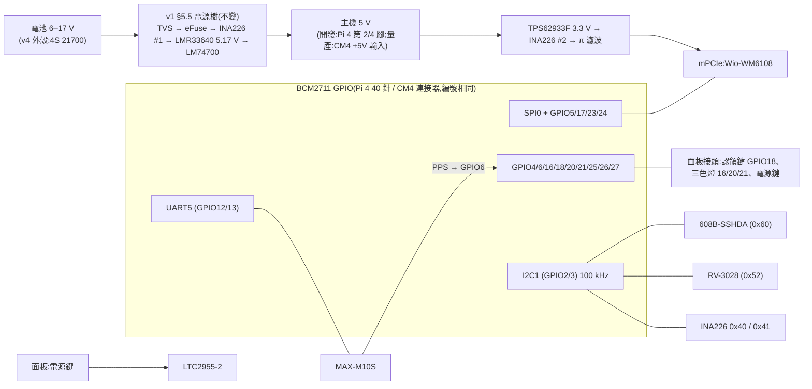

# Batman HAT v2:開發用 HAT(Pi 4),量產轉 CM4 載板

狀態:**DRAFT v0.8**(2026-10-20),**尚未經對抗式審查**。審查依 `docs/design/REVIEW.md`,交給獨立 reviewer 審整份。
- v0.8 是範圍改變,依使用者 2026-10-20 的決定:拿掉 TPM;量產用 CM4,民用也改 CM4;HAT 日後要能轉成 CM4 載板,外殼不能大改。
- 修訂紀錄見 §16。

主單:#227。決策單:#240。需求來源:#219 §8.5(H1–H11)、#256、#300、#302。外殼:#228。軟體配合:#223(#224–#226)、#239。

> 標記慣例(沿用 `hat-v1-spec.md`):**【事實】** = 本專案實測、原始碼、規格書或 repo 檔案可查證;**【推論】** = 由事實推出、尚未實測;**【決策】** = 使用者已拍板(附日期);**【提案】** = 本文提出、待審查或待使用者拍板;**【待量測】** = 要實物量過才能定;**【搜尋結果】** = 只看到搜尋摘要,原文被本環境的網路代理擋住,要人工確認。

---

## 0. 一句話

**現在**:做一片插在 **Pi 4** 上的開發用 HAT,驗證電源、608B、RTC、GNSS、按鍵與燈號的電路和軟體。

**之後**:同一套電路改成 **CM4 載板(IO 板)**,取代「Pi 4 + HAT」,裝進同一個外殼。

所以開發 HAT 的每個區塊都要能原封搬到 CM4 載板上(§7)。

## 1. 已定的方向(使用者 2026-10-20)

| # | 決定 | 影響 |
|---|---|---|
| X1 | **拿掉 TPM**,安全元件只留 ATECC608B | §5.1;TPM 的查證結果留在附錄 A |
| X2 | **量產用 CM4**(不用 CM3+) | §7 |
| X3 | **民用版也改 CM4**,不再用 Pi 3A+ | 開發 HAT 不必相容 3A+;#219 的平台假設要跟著改(§2.4) |
| X4 | 重新設計的 HAT **之後要能轉成 CM4 載板**,**外殼不能大改** | §6、§7 |
| X5 | RTC 保留 RV-3028;GNSS 走 UART,不走 I2C;USB hub 不上開發 HAT | §5 |
| X6 | QR 貼在通訊本體底面、被電池盒蓋住 | §5.8 |
| X7 | 不加 GNSS 電源閘;新 HAT 只跑新 image | §5.4、§11 |
| X8 | GPIO19 保留;三色燈由新程式控制,到貨後設計 | §4、§8 |

為什麼不用 CM3+【搜尋結果與 repo 事實,2026-10-20 評估】:
- 沒有無線,民用靠藍牙(#219 P11)會出局。
- BCM2837 不能簽章開機(`productization.md`)。
- 生產保證只到約 2028-01(第三方 endoflife.date;官方原文未找到)。

為什麼不用 CM5:CM5 透過 RP1 晶片出 SPI,HaLow 的 SPI 驅動還沒解決(`productization.md` 指向 `pi5-rp1-bringup.md`)【事實】。

## 2. 範圍

### 2.1 開發 HAT 上有的

| 區塊 | 內容 | 和 v1 比 |
|---|---|---|
| HaLow | mPCIe 插槽(Wio-WM6108),腳位照 v1 §4.1,一支都不動 | 同 |
| 安全元件 | **ATECC608B-SSHDA**(SOIC-8,I2C 0x60) | 608C → 608B;**拿掉 TPM** |
| RTC | RV-3028-C7 + 超級電容 | 同 |
| GNSS | u-blox MAX-M10S + 主動天線偏壓,走 **UART5** | 同 v1 的 UART5 |
| 電源 | v1 §5.5 全部:TVS、eFuse、兩顆降壓、兩顆 INA226、LTC2955 軟開關機、BAT_PRESENT | 同 |
| 面板接頭 | 電源鍵、認領鍵、三色燈 | 新增 |

### 2.2 開發 HAT 上沒有的
- **TPM**(X1):量產板若要認證再評估,見附錄 A。
- PTT 音訊、LoRa:理由見 v1 §8,不變。
- USB hub:開發期沿用外接 hub(#228);**量產 CM4 載板則要內建**(§7.3)。
- HAT ID EEPROM:v1 §5.7 已拿掉。
- QR 區:QR 貼在外殼(§5.8)。

### 2.3 #219 §8.5 需求對照

| # | 需求 | 開發 HAT | 量產 CM4 載板 |
|---|---|---|---|
| H1 | 所有 SKU 焊 608B-SSHDA | §5.2 | 同 |
| H2–H5 | 認領鍵(開機預設下拉的 GPIO)、凹陷按鍵、三色燈 GPIO 16/20/21 | §4、§5.6;按鍵本體在外殼 | 同 |
| H6 | QR 綁 608B 所在的板 | **改需求**:QR 貼本體底面(§5.8) | 同 |
| H7 | 3A+ 可用 | **不再需要**(X3) | — |
| H8 | USB hub | 不做(開發期外接) | **內建**(§7.3) |
| H9 | 民用不依賴 RTC | 相容 | 同 |
| H10 | 不擋藍牙天線 | Pi 4 天線禁佈區(§6.3) | CM4 可接外接天線(§7.3) |
| H11 | QR、按鍵不拆殼就碰得到 | 按鍵經面板接頭;QR 轉開電池盒可見 | 同 |

### 2.4 民用改 CM4 對其他文件的影響(本文不改,列出待辦)
- `docs/design/219-field-provisioning.md`:P11(民用 SKU = 3A+)、H7、§9 的 `[pi3]` distroconfig、B12(3A+ 512 MB 記憶體)都以 3A+ 為前提。
- `docs/productization.md`:「Pi 3A+ = civil SKU」與硬體分級表。
- `CLAUDE.md` 與 `docs/boards-and-builds.md`:目前的兩塊板是 `ekh-bcm2711`(Pi 4)與 `ekh-bcm2710`(Pi 3A+)。CM4 和 Pi 4 同為 `bcm2711` 子目標,但 CM4 會是**新的實機驗證對象**(CLAUDE.md:每塊板的 image 都要實燒驗證)。
- 以上由各自的單號處理(#219、#228),不在本 PR 改動。

## 3. 方塊圖



## 4. GPIO 分配

Pi 4 與 CM4 是同一顆 BCM2711,GPIO0–27 的編號與功能相同【推論,同一顆 SoC;CM4 規格書的腳位表待對照,A2】。開機預設 GPIO0–8 上拉、9–27 下拉【事實,#219 §8.5 H4 引述;待補一手來源,A1】。

| GPIO | 用途 | 開機預設 | 說明 |
|---|---|---|---|
| 0 / 1 | 不接 | 上拉 | HAT+ 規格 §2.3:只能接 ID EEPROM【事實,v1】 |
| 2 / 3 | I2C1:608B 0x60、RV-3028 0x52、INA226 0x40 / 0x41 | 上拉 | 100 kHz(608B 喚醒脈衝,v1 §7);Pi 板上已有 1.8 kΩ 上拉【事實,Pi 3A+ 電路圖同設計;Pi 4 待對照】 |
| 4 | BAT_PRESENT(低 = 有電池) | 上拉 | 同 v1 |
| 5 | HaLow IRQ | — | 不動 |
| 6 | GNSS PPS | — | 補上 WM1302 拿不到 PPS 的缺口(#300 B-1) |
| 7 | **不可用**(SPI0 CE1) | — | 同 v1 |
| 8–11 | HaLow SPI0 | — | 不動 |
| **12 / 13** | **GNSS:UART5 TXD / RXD** | 下拉 | 同 v1。UART5 是 PL011,鮑率時脈不跟 core clock 走,不會和 HaLow SPI 的 core_freq 互相牽制【推論,依 BCM2711 UART 架構】 |
| **14 / 15** | **開發用序列主控台**,只拉到 Tag-Connect 焊墊 | — | 【提案,O9】見 §5.7;量產 image 不開主控台(#302) |
| **16** | 燈:紅 | 下拉 | #128;下拉 = 開機時不亮 |
| 17 | HaLow reset | — | 不動 |
| **18** | 認領鍵(按下 = 3V3) | 下拉 | H4 |
| 19 | 保留(使用者 2026-10-20) | 下拉 | — |
| **20 / 21** | 燈:綠 / 藍(顏色對應以 #128 為準) | 下拉 | #128 |
| 22 | 保留 | 下拉 | TPM 拿掉後空出 |
| 23 / 24 | HaLow wake / busy | — | 不動 |
| 25 | INA226 ALERT | — | 同 v1 |
| 26 | LTC2955 INT(電源鍵要求關機) | — | 同 v1 |
| 27 | 軟關機:N-FET → LTC2955 KILL | — | 同 v1 §5.5.3 |

- 板載藍牙留在 UART0(PL011),和 Pi 4 / CM4 的預設相同【推論】。GNSS 與藍牙不再搶同一個 UART。
- 燈的驅動:GPIO 不直接推 LED,每色一顆 N-FET;電流、電壓待外殼選料(#128)【提案】。

## 5. 各區塊

### 5.1 TPM:拿掉

- **決定**(X1):開發 HAT 不放 TPM,安全元件只用 608B。
- **為什麼可以拿掉**【推論,依 repo 事實】:
  - 民用設計本來就寫明「沒有 TPM」(#219 §4)。
  - Pi 沒有開機量測(measured boot),TPM 分辨不出開的是不是我們的系統。保護資料加密金鑰要靠**簽章開機 + SoC 的 OTP 私鑰**,這在 Pi 4 / CM4 上做得到,不需要 TPM(`productization.md`)。
  - TPM 在 Pi 上剩下的價值是**認證**(SLB9673 只剩 CC EAL4+ 有效,FIPS 已轉為 Historical)和**硬體防猜 PIN**。這兩項是量產產品的需求,不是開發板的需求。
- **省下的**:
  - 時脈延展問題(SLB9673 需要主控端支援 I2C 時脈延展)、獨立的軟體 I2C、GPIO12/13/22 都不用了。
  - 不必自行打包 OpenWrt 沒有的 tpm2-tss(v1 §7.1)。
  - 少一顆 A 級零件(約 US$4)和它的周邊。
- **之後**:量產 CM4 載板若客戶要求認證,再評估加 TPM。SLB9673 的查證結果(接腳、時脈延展、證書、韌體鎖定)整理在**附錄 A**,不用重查。

### 5.2 ATECC608B-SSHDA

- 未設定版,I2C **0x60**,SOIC-8;腳位與 608C、TNGLORA 相同【事實,#240、#300】。
- 設定區鎖定不可逆:**槽位配置先在消耗品上實驗**(#219 §8.5、#240)。
- I2C 不接到 mPCIe(mPCIe 第 30、32 腳不接,v1 §4.1)【事實】。
- 出廠初始化由 #219 的燒錄站負責。
- **TPM 拿掉後,608B 是唯一的安全元件**。它擋不住的事寫在 §11:沒有硬體防猜 PIN;IO 保護金鑰只保護 ECDH / KDF / Verify,不保護 Sign / MAC(#240 留言)。

### 5.3 RTC — RV-3028-C7

不變,見 v1 §5.1 末段與 §5.3:超級電容 CPH3225A,約 2 天;overlay 要帶 `trickle-resistor-ohms`。OpenWrt 沒有 `kmod-rtc-rv3028`,要自製(#240 C8)。

CM4 本身沒有 RTC【事實,v1 §5.3】,所以量產載板也要這顆。

### 5.4 GNSS — MAX-M10S,走 UART5

- **接腳**:GPIO12(UART5 TXD)→ GNSS RXD、GPIO13(UART5 RXD)← GNSS TXD,同 v1【提案:改回 v1 的接法】。
  - v0.1–v0.7 為了 3A+ 改走 GPIO14/15 的 mini UART;3A+ 不再需要(X3),改回 UART5。
  - 好處:UART5 是 PL011,鮑率不受 core clock 影響;不必為了 mini UART 固定 core_freq,也就不牽動 HaLow SPI0 的時脈(`hardware.md`「One thing to verify」)【推論】。
- **主控台規則**(#302):主控台永遠不和任何周邊共用 UART。GNSS 專用 UART5;主控台若有,只能在 GPIO14/15(§5.7)。
- **不加 GNSS 電源閘**(X7)。#302 的防線是 image:`cmdline.txt` 不在 UART5 開主控台、`/etc/inittab` 不在 GNSS 的 UART 開登入(§8)。
- 天線:主動式、LNA 前有 SAW 預濾波,加偏壓,同 v1 §5.4。
- PPS → GPIO6(`pps-gpio`)。

### 5.5 電源

**電路沿用 v1 §5.5 全部**(設計值、模擬、方案 D 電源樹審查)。v2 的差異:

1. **電源鍵改瞬時型**:LTC2955 的 PB 要瞬時按鍵。v4 外殼現在是自鎖開關、直接控制 Mini560 的 EN(`hardware.md`)→ 外殼換成瞬時按鍵(#228)。自鎖開關改接 LTC2955 的 ON 腳不可行:TSOT 版的 SEL 內部接地,ON 下降不會關機(v1 §5.5.2)。
2. **外殼的 Mini560、INA226、DS3231 模組取消**,由 HAT 取代。保險絲、PTC 留在電池盒(`hardware.md`)。
3. **主機 5 V 介面寫成一個區塊**(§7.2):開發期接 Pi 4 第 2/4 腳;量產接 CM4 的 +5 V 輸入。LM74700 安全二極體在兩種情況都需要:開發期擋 Pi USB-C 倒灌;量產期若載板有 USB-C 供電口也一樣。
4. **3V3_SEC 的來源**:開發期取自 Pi 4 的 3.3 V(608B、RTC、GNSS,< 150 mA,v1 §5.5.5 #15)。量產期 CM4 有 3.3 V 輸出,但可供電流待查 CM4 規格書(A3);不夠就在載板上自己降壓。
5. **I2C 上拉**:Pi 在 GPIO2/3 已有 1.8 kΩ 上拉,HAT 不另加(v1 `design.py` 也沒加)。CM4 是否在模組上就有,待查(A3);沒有的話,量產載板要加。

### 5.6 面板接頭(新)

外殼上的電源鍵、認領鍵、三色燈,經一個低高度接頭接到 HAT【提案】:

| 腳 | 訊號 | 備註 |
|---|---|---|
| 1 | GND | |
| 2 | PB(LTC2955) | 電源鍵 |
| 3 | CLAIM(GPIO18) | 串聯電阻 + ESD;HAT 上預設下拉 |
| 4–6 | LED R / G / B 驅動(開汲極) | HAT 上的 FET 驅動 |
| 7 | LED 陽極電源(3V3 或 5V) | 依外殼燈的選料 |

- 接頭建議 JST SH 1.0 mm 側插(日本)【提案】,高度、位置配合外殼 #228。量產載板沿用同一個接頭與腳位,外殼線材不必改(§7.2)。
- **ESD**:按鍵線拉到外殼面板,是新的外部接觸點 → 每條線加 TVS 或 ESD 陣列。
- **安全**:CLAIM 是 #219 認領窗口的觸發鍵,實體在場才能按,這是預期的信任邊界;它不碰任何秘密線路。

### 5.7 除錯

- **GNSS 不和主控台共用 UART**(#302):GNSS 在 UART5。
- **開發用主控台**【提案,O9】:GPIO14/15(UART0 / mini UART)只拉到 **Tag-Connect TC2050 焊墊**,不裝接頭。
  - 用途:#105 擷取當機時的主控台輸出。
  - 量產 image 的 `cmdline.txt` 不開主控台,焊墊上沒有程式在聽;焊墊本身只是被動銅箔【推論】。
  - 拿掉也行:除錯改用 SSH、BLE 診斷、ramoops。
- Tag-Connect 另帶 HaLow SPI0、IRQ、BUSY、GND、3V3 感測(同 v1)。
- **I2C 不放測試點**:I2C 上有 608B。誠實的限制:40 針焊點(量產則是 CM4 連接器周邊)本來就碰得到 I2C,拿掉測試點只是不方便,不是保護。
- 電源測試點、INA226、eFuse 燈:同 v1 §5.6。

### 5.8 QR(不在 HAT 上)

- **QR 貼在通訊本體的底面,被電池盒蓋住**(X6)。HAT 和電池盒內部都封在殼裡看不到,所以 #219 H6「貼在 HAT 上」與 #256「貼在電池蓋內側」都不可行。
- **為什麼不印在外殼外面**:QR 裡有 `device_id` 與 **256 bit 認領秘密**(#219 §4、§6.1),等於這台機器的權狀。U4 的界線是「認領只防不在身邊的人與沒拿到 QR 的旁人」。印在外面,路過拍照的人就拿到了;而從未認領的機台每次開機都開放認領窗口【推論】。
- 這個位置同時滿足:組裝好時旁人看不到(U4);轉開電池盒就看到、不用工具(H11);旋轉卡扣有 O-ring 密封【推論】。
- **空間**【推論,依 Batman-P `enclosure-v4` 模型】:本體底面 63 × 43 mm,中間約 40 × 36 mm 是 pogo 與卡扣,兩側各剩約 11 mm 寬 → QR 約 10 × 10 mm,偏小,**V15 實印試掃**。
- 交給 #219 / #228:出廠要配對本體與 HAT(或 CM4 載板);換任一個要重印;盒內卡仍是備援(P8)。

### 5.9 供應鏈

分級規則照 v1 §5.8,A 級零件不交中國組裝廠(v1 §5.9)。A 級清單:

| 零件 | 廠商(所有權) | 備註 |
|---|---|---|
| ATECC608B-SSHDA | Microchip(美國) | 取代 608C |
| RV-3028-C7 | Micro Crystal(瑞士) | 同 |
| MAX-M10S | u-blox(瑞士) | 同 |
| CM4(量產) | Raspberry Pi Ltd(英國) | 有韌體、存 OTP 金鑰 → A 級;產地待查 COO |

- 新增的 C 級料:面板接頭、ESD 陣列、燈驅動 FET。
- 已知例外:Wio-WM6108(Seeed / Quectel,**中國**,v1 §5.8);mPCIe 插座 C7498130(連欣科技,**中國**,C 級,v1 §6.4)。

## 6. 外形與機構

### 6.1 v4 外殼的可用空間(Batman-P `enclosure-v4/study/chassis.py`、`layout3d.json`,2026-10-20 讀取)

外殼座標:x 寬、y 深(前 → 背)、z 高。Pi 長邊直立,SD 卡端在下(z 98),USB 端朝上。

| 項目 | 數值 | 可信度 |
|---|---|---|
| 本體內寬 | x 2.5–60.5 = **58 mm** | 【事實,模型參數】 |
| Pi 疊層可用深度 | 中隔板背面 y 17.5 → 後蓋內面 y 40.5 = **23 mm** | 【事實】 |
| 可用高度 | 中框底面 z 92.5(pogo 佔位頂 z 95)→ 後窗框上緣 z 187 | 【事實】 |
| 今天的疊層 | Pi 4 PCB y 20.5–21.9;Pi 4 USB / 網路孔到 y 37.9、z 163–185;HAT y 32.9–34.5;WM6108 到 y 39.5;導熱墊到 y 40.5(壓後蓋鋁板) | 【事實】 |

### 6.2 開發 HAT 的外形

- 寬 56.5 mm、Pi 四個固定孔、40 針排針位置不變【決策,2026-10-20】。
- 加長方向:SD 卡端。USB 端會撞 Pi 4 的 USB / 網路孔【事實,模型座標】。
- **外殼不能大改(X4)→ 加長上限約 3 mm**:再往下是 pogo 接收器與卡扣(z 95);兩側長條可到 5.5 mm【事實,模型座標】。後蓋螺絲柱 (31.5, 95.75) 與 (4.25, 100) 附近,HAT 正面零件要 ≤ 0.5 mm【推論】。
- **面積**【推論,粗估;G1 用 courtyard 實算】:

  | 項目 | 增減(mm²) |
  |---|---|
  | 拿掉 TPM 與周邊、SPI1 走線 | 約 −60 |
  | 面板接頭 + ESD + 燈驅動 FET | +55–75 |
  | 加長 3 mm(扣掉天線條對齊) | 約 +100 |
  | v1 已知不足(審查 §13 #5) | −300–600 |

  → **3 mm 內大概放不下**(O1)。選項:
  1. 開發 HAT 只在桌上與測試架用,**不要求裝進外殼**,外形放寬(建議)。量產載板才必須裝進外殼(§7)。
  2. 照 v1 §6.2 的刪減順序砍功能。
  3. 部分零件放到卡片下方(5.2H 插座,≤ 1.9 mm,PLAN §0)。

### 6.3 天線禁佈區

- **Pi 4**:天線條 (0,0)–(6.3,20),所有層不鋪銅、不放零件(PLAN §0 決定 1)。
- 量產 CM4 載板見 §7.3。

### 6.4 高度與溫度

- 卡片下方 ≤ 1.9 mm(綁 5.2H 插座)、背面限高、固定柱 H5/H6:沿用 layout-v2 PLAN。
- **工作溫度**:Pi 4 由 Pi 本身限制;量產 CM4 有一般版 −20–75 °C 與部分料號的寬溫版 −40–85 °C【搜尋結果,CM4 產品簡介 2026-02】→ 量產選寬溫版(O10)。

## 7. 量產:CM4 載板

### 7.1 外殼放得下嗎【推論,依 §6.1 的模型座標;要用 `layout3d.py` 驗證】

- CM4 本體 55 × 40 mm【事實,CM4 規格】,比 Pi 4(85 × 56)小。
- 建議配置:
  - **載板放在今天 HAT 的位置**(y ≈ 33)。
  - **HaLow 卡照舊朝後蓋**,導熱墊壓後蓋鋁板,散熱設計不變。
  - **CM4 掛在載板朝中隔板的那一面**,落在今天 Pi 4 與它 16 mm 高的 USB / 網路孔所佔的空間(y 17.5–33,約 15 mm 深)。
- 載板外形可用到約 56 × 90 mm(本體內寬 58 mm、高 z 95–187),比 HAT 大得多,**開發 HAT 的面積問題在量產板上自然消失**。
- **外殼要改的地方**(小改):
  - 拿掉 Pi 4 的固定柱;改成載板的固定柱。
  - 拿掉 Pi 4 USB 彎頭插頭的預留空間(RAK / VLM 改接載板上的 USB)。
  - CM4 SoC 的散熱改由載板或鋁片導出(今天是 Pi 4 SoC 銅片導到側壁)。
- **結論**:外殼尺寸不必變,內部固定件要改。**這要外殼(#228)用 `layout3d.py` 做干涉檢查確認**(V16)。

### 7.2 開發 HAT 現在就要遵守的「可搬移」規則【提案】

讓 HAT 的電路日後原封搬到 CM4 載板:

1. **電路圖分頁 = 功能區塊**:電源、HaLow、608B + RTC、GNSS、面板、除錯各一頁(v1 `gen/design.py` 已大致如此)。量產板只換「主機介面」那一頁。
2. **主機介面集中在一頁**:40 針排針的接線全部在這一頁。其他頁只用網路名稱(例如 `GPIO18_CLAIM`、`5V_HOST`、`3V3_SEC`),不直接寫「Pi 第幾腳」。
3. **不依賴 Pi 4 獨有的東西**:Pi 的 USB-C、Pi 板上的 I2C 上拉、Pi 的 3.3 V 輸出能力,在量產板上都要有替代(§5.5 第 3–5 點)。
4. **面板接頭、電池焊墊、天線 U.FL 的種類與腳位定案後不改**:外殼線材在兩代之間沿用。
5. **安全網路不留可選焊位**(#300):不用 DNP 或跳線切換 Pi / CM4 兩種接法。

### 7.3 CM4 載板要新增的

| 項目 | 原因 | 備註 |
|---|---|---|
| CM4 板對板連接器 ×2(Hirose DF40,100 腳) | 接 CM4 | 堆疊高度依連接器版本,待查 CM4 規格書(A3) |
| **USB hub** | RAK、VLM 兩個 USB 裝置;CM4 只有一個 USB 2.0 主機埠【推論,待 A3】 | H8 在量產板上實現 |
| eMMC 燒錄:USB 開機模式(rpiboot)與 nRPIBOOT 腳 | 量產燒 eMMC | 出廠流程從「燒 SD 卡」改成「USB 燒 eMMC」 |
| 簽章開機的燒錄步驟(OTP 公鑰、私鑰) | 「無人看管仍安全」等級(`productization.md`) | 寫入不可逆,流程要設計 |
| CM4 無線天線 | 選有外接天線座的 CM4,天線拉到外殼 | 解除 Pi 4 天線禁佈區的限制(H10) |
| 網路孔(可選) | 除錯 | CM4 模組上有 GbE PHY,載板要變壓器與接頭【推論】 |

- **CM4 選型**(O10):記憶體、eMMC 容量、有無無線、寬溫版。民用需要無線(BLE)。
- **生產保證**:CM4 到 2034-01【搜尋結果,Raspberry Pi 官方產品頁】。
- **軟體**:CM4 和 Pi 4 同為 `bcm2711` 子目標,A/B 開機(tryboot)在 Pi 4 / CM4 上可用【事實,`productization.md`、`field-resilience.md`】。要加 CM4 的 DTB 與 eMMC 開機,並在 CM4 實機上驗證(CLAUDE.md)。

### 7.4 開發期也可以先用 CM4

官方 **CM4 IO Board 有 40 針 HAT 排針**【搜尋結果,Raspberry Pi 產品頁】→ 開發 HAT 也能插在「CM4 + 官方 IO Board」上測,開發期就在量產用的 SoC 模組上驗證【提案,V17】。

## 8. 擁有權

| 資源 | 唯一擁有者(可以改) | 只讀者 |
|---|---|---|
| I2C1 匯流排 | 核心 `i2c-bcm2835` 驅動 | 608B、RTC、INA226 驅動 |
| 608B 設定區與槽位 | 出廠燒錄站(一次性,鎖定後不可改);執行期只有 `batman-provd`(#219) | — |
| RTC 時間 | **只有一個寫入者**:時間來源(chrony 或 gpsd)校準後寫 RTC【提案,待決定是哪一個】 | 開機時 `hwclock` 讀 |
| GNSS UART(UART5) | gpsd | — |
| GPIO14/15 主控台(開發用) | 只有開發 image 的 `cmdline.txt` / `inittab`;量產 image 不用 | — |
| GPIO16 / 20 / 21(三色燈) | **新程式**,到貨後設計(X8);只能有一個寫入者 | — |
| GPIO18(認領鍵) | `gpio-keys` → `batman-provd` | — |
| GPIO26(電源鍵 INT) | `gpio-keys` → `/etc/rc.button/power`(v1 §7.1) | — |
| GPIO27(KILL) | `gpio-poweroff` | — |
| INA226 ×2 | 核心 `ina2xx` hwmon | `batpower` |
| `config.txt` / `distroconfig.txt` / `cmdline.txt` | 燒卡 image(firmware fork 的 `build-board.sh`);**OTA 不帶**(`boards-and-builds.md` §5 #12) | firmware |

兩個寫入者的風險:
- RTC:chrony 的 `rtcsync` 和 `hwclock -w` 不能同時開。
- 三色燈:`meshled` 現在驅動 Pi 自己的 PWR / ACT 燈。新燈由新程式控制;其他程式(例如 #219 的認領流程)只送狀態,不直接碰 GPIO。

## 9. 介面契約

| 介面 | 寫 / 讀 | 有效條件與格式 | 缺失或錯誤時 | 誰能碰到 |
|---|---|---|---|---|
| `config.txt` 的 HAT overlay(RTC、UART5、pps、gpio-keys、gpio-poweroff) | 燒卡 image 寫;firmware 讀 | `[pi4]`(開發)/ CM4 段落(量產) | 缺 overlay → 該功能不存在;608B 讀不到 → 認領 fail-closed | root、拿到儲存媒體的人 |
| `cmdline.txt` 的 console | 燒卡 image 寫 | **不得把主控台放在 UART5**;量產 image 不開任何序列主控台 | 若放錯 → GNSS 能對登入程式打字(#302)。**fail-open,由燒卡流程擋**;V9 驗證 | 同上 |
| I2C1 位址 | 硬體 | 0x40、0x41、0x52、0x60 | 衝突 = bring-up V2 抓到 | — |
| GPIO18 認領鍵 | 硬體 → `gpio-keys` | 按下 = 高 | 斷線 = 永遠低 = 永遠不開認領窗口(fail-closed) | 實體在場的人 |
| 面板接頭 | 外殼線材 | §5.6 腳位表;開發 HAT 與量產載板相同 | 接反 → LED 不亮、按鍵無效;ESD 由 TVS 吸收 | 實體在場的人 |

## 10. 生命週期矩陣

「今天」= 現行 WM1302 HAT 節點;「之後」= v2 開發 HAT(Pi 4)。量產 CM4 載板另寫設計,屆時重做本表。

| 情境 | 今天 | 之後 | 驗證 |
|---|---|---|---|
| 首次開機 / firstload | GNSS 在 UART0 + 登入主控台(#302) | GNSS 在 UART5;主控台只在開發 image、只在 GPIO14/15 | V4、V9 |
| 開機 | — | RTC 讀時間;GNSS 開;608B 可用 | V2、V4 |
| 正常關機(`poweroff`) | — | `gpio-poweroff` → KILL → LTC2955 斷電(v1) | V8 |
| 重開機 | — | KILL 不動 → 不斷電(v1) | V8 |
| OTA(sysupgrade) | — | OTA 不帶 `config.txt` / `cmdline.txt`;**新 HAT 要燒卡 image**(#219 §9) | V11 |
| autocommit 回退 | — | A/B 兩槽都來自新卡【推論,待確認建卡腳本兩槽寫同一版】;回退的對象也支援 v2。系統要能開機、可被修復 | V11 |
| 斷電 | — | RTC 靠超級電容約 2 天;608B 執行期不寫設定區 | V6 |
| 元件自身重啟(gpsd / 燈號程式) | — | gpsd 重啟後重新開 UART5;燈號程式到貨後設計 | V4 |
| 依賴重啟(I2C 卡住) | — | 一顆 I2C 晶片卡住 SDA → 608B、RTC、INA226 同時失效;`i2c-bcm2835` 的復原行為待查(A6) | V2 |
| 當機 / 當機迴圈 | — | 長按電源鍵 5.3 s 硬體斷電(v1);ramoops 留紀錄 | V8 |
| 降版到不支援 v2 的 image | — | **不支援**(X7)。舊 image 的主控台若在 serial0(GPIO14/15),GNSS 已不在那條線上,不會注入;**但 GNSS 的 UART5 沒有人開**,只是沒有定位 | V12 |
| 兩塊板 | Pi 4 與 3A+ | **開發只有 Pi 4**(X3);CM4 + 官方 IO Board 為選配測試平台(§7.4) | V17 |

- 降版那一列比 v0.7 安全【推論】:v0.7 的 GNSS 在 GPIO14/15,舊 image 的主控台正好在那裡;v0.8 的 GNSS 在 UART5,舊 image 不會在 UART5 開登入。

## 11. 依賴的假設與證據

| # | 假設 | 證據 | 狀態 |
|---|---|---|---|
| A1 | BCM2711 開機預設 GPIO 9–27 下拉 | #219 §8.5 H4 引述 | 待補一手來源(BCM2711 周邊規格書) |
| A2 | CM4 的 GPIO0–27 與 Pi 4 40 針的編號、功能相同(含 UART5 在 GPIO12/13) | 同一顆 SoC | 待對照 CM4 規格書腳位表 |
| A3 | CM4:3.3 V 輸出可供電流、模組上有無 I2C 上拉、USB 主機埠數量、DF40 堆疊高度 | 無 | **待讀 CM4 規格書**(量產載板設計的輸入,不擋開發 HAT) |
| A4 | Pi 4 在 GPIO2/3 有 1.8 kΩ 上拉 | 3A+ 電路圖同設計(RP-008332-DS-1) | 待對照 Pi 4 簡化電路圖 |
| A5 | Pi 4 的藍牙預設在 UART0(PL011),UART5 可用 `dtoverlay=uart5` 開在 GPIO12/13 | v1 §7 已用此 overlay | 待補 Raspberry Pi「UART configuration」原文 |
| A6 | `i2c-bcm2835` 遇到卡住的匯流排會不會自己復原 | 無 | 待讀原始碼 |
| A7 | MAX-M10S 的 UART5 鮑率在 Pi 4 上穩定(不受 core clock 影響) | PL011 有獨立時脈【推論】 | V3 實測 |
| A8 | CM4 寬溫版料號、生產保證 2034-01 | Raspberry Pi 產品頁與產品簡介【搜尋結果】 | 待讀原文 |

## 12. 安全(威脅模型)

**資產**:608B 的身分金鑰與認領秘密、時間(憑證有效期)、位置、節點可用性。量產 CM4 另有簽章開機鑰匙與 OTP 私鑰(另寫設計)。

| 行為者 | 攻擊 | v2 的處理 | 剩下的風險 |
|---|---|---|---|
| 遠端(mesh / Wi-Fi) | 沒有新的網路介面 | — | — |
| 本機非 root 程式 | 讀 `/dev/i2c-1`、GNSS UART、GPIO | 裝置節點只給 root 或專屬群組【提案,權限表待寫】 | 權限表要進審查 |
| 被入侵的租戶容器 | 同上 | 容器不掛這些裝置 | 依 #274 的容器設定 |
| **實體取得節點** | ① 側錄 I2C;② 換自己的系統開機,叫 608B 運算;③ 按認領鍵;④ 接 GPIO14/15 | ① 608B 用 IO 保護金鑰;② 開發期擋不住,量產靠 CM4 簽章開機;③ 認領還要 app 端流程與 QR(#219);④ 量產 image 不開主控台 | 608B 的 IO 保護擋不住 Sign / MAC;**沒有硬體防猜 PIN**(TPM 拿掉的代價);開發 HAT 在 Pi 4 上沒有啟用簽章開機時,實體攻擊者可以使用 608B |
| **有韌體的周邊**(GNSS、HaLow 卡) | GNSS 對主控台打字(#302);監聽安全晶片 | GNSS 專用 UART5;GNSS 不在 I2C 上;mPCIe 不接 I2C | — |
| 供應鏈 | A 級零件被換料 | 非中國原產、原廠授權通路、不經中國組裝廠(v1 §5.8–5.9);安全網路不留可選焊位(#300) | WM6108(中國)仍是已知例外 |
| 我們自己的錯 | 舊 image 燒到新 HAT;608B 槽位鎖錯 | GNSS 不在舊主控台的 UART 上(§10);燒卡站只燒新 image;608B 先在消耗品實驗 | — |

**失效模式**:608B 讀不到 → 認領 fail-closed。GNSS 讀不到 → 只少定位與 PPS。RTC 失效 → 時間靠 GNSS 或網路;民用不依賴(H9)。

**負向測試**(V9):量產 image 上確認 `cmdline` 沒有序列主控台;從 GNSS 端注入 `\r\n`,確認沒有任何程式回應。

## 13. 軟體影響(草案,未驗證)

```ini
# config.txt [pi4](開發 HAT)
dtparam=i2c_arm=on
dtparam=i2c_arm_baudrate=100000
dtoverlay=uart5                      # GNSS:GPIO12/13
dtoverlay=pps-gpio,gpiopin=6
dtoverlay=i2c-rtc,rv3028,trickle-resistor-ohms=3000,backup-switchover-mode=3
dtoverlay=gpio-poweroff,gpiopin=27
dtoverlay=batman-hat-v2              # 自製:gpio-keys GPIO18(認領)、GPIO26(電源鍵 INT)
# 開發 image 才加:enable_uart=1 + cmdline console=serial0(GPIO14/15);量產 image 兩者都不加
```

- 核心模組:`kmod-rtc-rv3028`(自製),`pps-gpio` 已有;**不再需要** `kmod-tpm-tis-i2c`、`kmod-i2c-gpio`、tpm2-tss。
- `/etc/inittab`:量產 image 不在任何序列埠開登入。
- 以上是**燒卡 image** 的改動,OTA 帶不到(§10)。改到 `cmdline` 的建卡腳本在 CLAUDE.md 的「兩板共用 A/B 檔案」清單內 → 要依該規則實機驗證。

## 14. 驗證計畫

| # | 項目 | 方法 |
|---|---|---|
| V2 | I2C1 位址與共用 | `i2cdetect -y 1` 應見 0x40 / 0x41 / 0x52 / 0x60;608B、RTC、INA226 交錯存取 1 小時無錯 |
| V3 | UART5 GNSS | NMEA 長時間無亂碼;HaLow SPI 速率與 iperf 不受影響 |
| V4 | GNSS | gpsd 定位、PPS;gpsd 重啟後恢復 |
| V6 | RTC 斷電保持 | 斷電 24 / 48 小時後讀時間 |
| V7 | 認領鍵、三色燈、ESD | 按鍵事件;燈號;面板接點 ±8 kV 接觸放電【提案】 |
| V8 | 軟開關機 | 沿用 v1 V9 |
| V9 | 量產 image 沒有序列主控台 | `cat /proc/cmdline`、`/etc/inittab`、`ps`;GNSS 端注入 `\r\n` 無回應 |
| V11 | OTA 與回退 | 新 HAT 上 OTA、autocommit 回退,系統可開機、可修復 |
| V12 | 燒卡流程 | 燒卡站拒絕燒舊 image 的流程檢查(做法待定) |
| V13 | Pi 4 Wi-Fi / BT 受 HAT 遮蔽 | 有 / 無 HAT 的 RSSI |
| V15 | QR 實印試掃 | 10 × 10 mm 貼紙印在本體底面,iPhone 與 Android 各試掃;轉電池盒 50 次後再掃 |
| V16 | CM4 載板放進外殼 | 外殼(#228)用 `layout3d.py` 加入 CM4 載板方塊做干涉檢查 |
| V17 | 開發 HAT 在 CM4 + 官方 IO Board 上 | 同 V2–V9 |

v1 §9 的 V5–V11(電源、熱、雜訊、GNSS 受干擾)照做。v0.7 的 V1、V5、V10(TPM、3A+ 3.3 V)隨 X1、X3 取消。

## 15. 待決事項

| # | 問題 | 建議 | 影響 |
|---|---|---|---|
| O1 | 開發 HAT 要不要裝進外殼?(外殼不能大改 → 只能加長約 3 mm,面積大概不夠,§6.2) | **不要求**:開發 HAT 只用在桌上與測試架;裝進外殼的是量產 CM4 載板 | 開發 HAT 的外形與面積 |
| O2 | 量產板要不要 TPM?(客戶要不要認證) | 到量產板設計時決定;資料在附錄 A | 量產板 |
| O8 | 面板接頭型號、位置 | 外殼 #228 定 | 兩代共用 |
| O9 | GPIO14/15 開發用主控台焊墊(§5.7) | 保留焊墊、不裝接頭;量產 image 不開 | 除錯方式 |
| O10 | CM4 選型:記憶體、eMMC、無線、寬溫 | 民用要無線;戶外選寬溫 | 量產成本 |

O3–O7 已結案(TPM 匯流排隨 TPM 拿掉而取消;GNSS 電源閘不採用;GPIO19 保留;QR 位置;三色燈延後),見 §1。

## 16. 流程與修訂紀錄

**流程**:
1. 本文過對抗式審查(`docs/design/REVIEW.md`,審整份)。可以在雲端做。
2. 改 `hardware/hat-v1/gen/design.py`:拿掉 TPM、608C → 608B、GNSS 維持 UART5、加面板接頭;依 §7.2 整理分頁。跑 `check.py` 與模擬。要 KiCad 7,在本機做。
3. 擺件、佈線沿用 layout-v2 流程(sketch → G0 → escape → G1 → G2,連續兩次 0 未接)。在本機做。
4. 打樣,在 Pi 4(與選配的 CM4 + 官方 IO Board)上 bring-up,跑 §14。
5. 量產 CM4 載板另開設計文件,先讀 CM4 規格書(A3)。

**修訂紀錄**:

| 版本 | 內容 |
|---|---|
| v0.1 | 初稿:SLB9673(I2C)、608B、GNSS mini UART、Pi 4 與 3A+ 共用 |
| v0.2 | 使用者對 O2、O4–O7 的決定 |
| v0.3 | QR 改貼本體底面 |
| v0.4 | 用 3A+ 官方文件補背饋、3.3 V、天線、溫度 |
| v0.5 | 依 SLB9673 規格書:TPM 走獨立軟體 I2C、接腳表、證書更正 |
| v0.6 | 依 MxL7704 規格書補 3A+ 的 3.3 V 額定 |
| v0.7 | 證書頁確認:CC 有效、FIPS 為 Historical |
| **v0.8** | **範圍改變**(使用者 2026-10-20):拿掉 TPM;量產與民用都改 CM4;HAT 日後轉 CM4 載板、外殼不大改。GNSS 改回 UART5;刪除 3A+ 相容內容(v0.4、v0.6 的 3A+ 分析保留在 git 歷史與 Batman-P 的文件);新增 §7 CM4 載板 |

與舊文件的關係:`hat-v1-spec.md` 仍是電源電路的正本;`hardware/hat-v1/HANDOFF.md` 與 `layout-v2/PLAN.md` §12 的「往左延伸 3 mm」已被本文取代。

---

## 附錄 A:SLB9673 查證紀錄(TPM 已拿掉,留給量產板評估)

來源:SLB9673 TPM 2.0 FW26.xx 規格書 Rev 1.4(2024-11-13,存於 Batman-P `hardware/datasheets/`);BSI、NIST 證書頁(使用者 2026-10-20 截圖)。

- **介面**:I2C,位址 0x2E,最高 1 MHz;**使用時脈延展,主控端必須支援**【事實,規格書 §1.3、§3.2.8】。BCM2711 硬體 I2C 對時脈延展的支援報告不一致【搜尋結果】→ 量產板若加 TPM,要先驗證 CM4 的硬體 I2C,或用 `i2c-gpio` 軟體 I2C。
- **接腳和 SLB9672 不同**【事實,規格書表 13–15】:
  - 29 / 30 = SDA / SCL;
  - 20 = TEST#,必須接高電位;
  - 6、19、21、24 必須空接;
  - 17 = RST#(內建弱上拉);18 = PIRQ#(開汲極)。
  - 去耦:3 × 100 nF + 1 µF。
- **認證**【事實,證書頁截圖】:
  - CC **BSI-DSZ-CC-1245-2024**:EAL4+、ALC_FLR.1、AVA_VAN.4,**有效至 2029-10-08,只涵蓋韌體 v26.24.19041.00**。
  - FIPS 140-2 **#4467**:**Historical**(sunset),新的聯邦採購不應納入;沒有 FIPS 140-3。
- **韌體鎖定**:要維持 CC 範圍,訂購 FW26.24,不升級 TPM 韌體。
- **料號**【事實,規格書表 1】:SLB 9673XU2.0 FW26.24,訂購碼 SP006026288,−40–85 °C;AU 版(SP006026290)−40–105 °C。
- **Linux**:`tpm_tis_i2c`(`CONFIG_TCG_TIS_I2C`),compatible `"infineon,slb9673", "tcg,tpm-tis-i2c"`【搜尋結果,LKML;待確認核心版本】;OpenWrt 要自行打包 tpm2-tss(v1 §7.1)。
- 廠商:Infineon(德國)。
